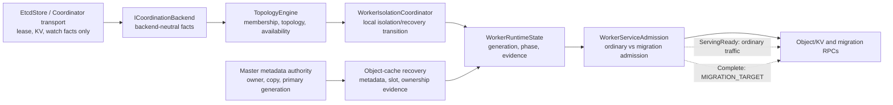

# PR1405 One-Shot ST Closure And Slimming Implementation Plan

> **For agentic workers:** REQUIRED SUB-SKILL: Use superpowers:subagent-driven-development (recommended) or superpowers:executing-plans to implement this plan task-by-task. Steps use checkbox (`- [ ]`) syntax for tracking.

**Goal:** Keep PR1405 as one mergeable PR, first prove the design-document worker-isolation cases on the exact fork head, then reduce unrelated changes and unnecessary abstractions without weakening availability, data-safety, or migration admission.

**Architecture:** Coordination backends publish lease, membership, and topology facts. `TopologyEngine` owns cluster availability interpretation; worker runtime owns local service mode and admission; object cache supplies bounded recovery evidence and keeps uncertain objects invisible; master metadata remains authoritative for owner/primary decisions. Ordinary Object/KV service may reopen at `ServingReady`, while migration and primary-changing operations remain blocked until `Complete` evidence.

**Tech Stack:** C++17, CMake/CTest and direct GoogleTest binaries, Bazel build metadata, Git worktrees, repository-local sensitive scan, tiantiyun remote validation.

## Global Constraints

- Work only on PR1405 and its existing source branch `feat/worker-self-healing-main-20260716`.
- Never push to `openeuler/yuanrong-datasystem` or remote `main`; push only after `git remote -v` proves `origin` is the `yche-huawei` fork.
- Do not issue `/retest`, remove WIP, or change PR state during this plan.
- Preserve the five local untracked CLion helpers; do not stage, delete, or include them in PR1405.
- Stream/S9 is outside the one-shot product gate and must remain zero-diff against `main/master`.
- `ServingReady = membershipReady && topologyReady && resourceReady` opens ordinary Object/KV traffic.
- `Complete` additionally requires metadata, slot, and ownership evidence and gates `MIGRATION_TARGET`.
- `ChangePrimaryCopy` remains `MIGRATION_TARGET`; do not introduce `PRIMARY_PROMOTION_RPC` without a separate SDD decision.
- Recovery/reconciliation/retry must be bounded, best effort, observable, and must not synchronously block ordinary-service reopening.
- After every C++ edit, run `clang-format -i` only on the touched C++ files, then inspect formatting churn.
- Before every DataSystem code edit, use the shared CodeGraph only for discovery, then verify current HEAD with `rg`, source, BUILD, and CMake files. Do not sync or rebuild CodeGraph.

---

## 1. Exact Handoff Snapshot

Recorded on 2026-07-30:

| Item | Exact state |
| --- | --- |
| Worktree | `/home/t14s/workspace/git-repos/yuanrong-datasystem/.worktrees/pr1405-oneshot-squash-20260730` |
| Local branch | `squash/pr1405-oneshot-20260730` |
| Local and fork HEAD | `d00ec6f1824f79226c83b0c9a54b7779be19edfc` |
| Fork branch | `origin/feat/worker-self-healing-main-20260716` |
| Current `main/master` | `7d043fc13b755e2e130302d10d889cd7b01f1c78` |
| Divergence | PR head is 44 commits ahead and 4 commits behind current `main/master` |
| Full diff | 228 files, `+23648/-3473` |
| Diff buckets | source 152, tests 74, tooling 1, docs/context 1 |
| Core review surface | runtime 25, worker/object_cache 64, cluster 23, master/object_cache 7, ST 16, UT 58; total 193 files |

The worktree deliberately contains these untracked local-only helpers:

```text
scripts/clion_remote_build.sh
scripts/ensure_clion_compdb_project.py
scripts/ensure_clion_remote_run_configs.py
scripts/rewrite_clion_compile_commands.py
tests/scripts/test_ensure_clion_remote_run_configs.py
```

Commit `d00ec6f18` removed those five paths from the PR while preserving the local files. `git ls-remote` has confirmed the fork branch points to the same SHA.

## 2. Current Evidence And Live Blocker

The previous head `3f04590956757e5481055364b63d749eb75d95be` has recorded CMake evidence:

| Bucket | Result |
| --- | --- |
| `ut_core` | 160/160 PASS |
| `ut_object` | 282/282 executed PASS, 5 disabled/not-run |
| `ut_cluster` | 137/137 PASS |
| `st_kv` | 8/8 PASS |
| `st_object` | 40/40 PASS |

This evidence is useful as a baseline but is not sufficient for `d00ec6f18`.

The current `d00ec6f18` remote build has compiled the required UT/ST binaries successfully. The first CTest run reported five buckets as `tests=0 exit=8`; this is a test-enumeration failure, not a product-case failure. Top-level CTest loads `tests/ut/ds_ut_stream_include.cmake`, but `ds_ut_stream` was intentionally not built because Stream is outside this gate. The active task is replacing that CTest selection with a direct-gtest evidence runner:

```text
/home/t14s/workspace/git-repos/pr1405-one-shot-evidence/run_pr1405_added_cases_gtest_20260730.sh
```

Do not report `d00ec6f18` as test PASS until the direct runner produces non-zero test counts, exit 0, and XML/log evidence for every required bucket.

## 2.1 PR1405 Review-Comment Inventory

The repository helper returned 472 comments: 271 CI-bot events, 4 GitCode-bot summaries, 183 comments from `yche-huawei`, and 14 from `yaohaolin`. After excluding CI, bot summaries, `/retest`, and mention-only commands, 108 human review opinions remain. `review_pr.py prepare 1405` currently stops before bundle generation because `tests/ut/worker/object_cache/worker_oc_service_impl_test.cpp` has no scannable patch payload. Do not use an unscannable-file bypass; fix the patch/API condition or keep the review explicitly partial.

The latest high-confidence comments were rechecked against exact `d00ec6f18` source:

| Status | Review opinion | Exact current conclusion |
| --- | --- | --- |
| OPEN P1 | Coordinator backend does not initialize `workerIsolationCoordinator_` | Confirmed: only `InitEtcdCoordinationBackend()` constructs it, while topology callbacks dereference it for both backends |
| OPEN P1 | DS metadata reader uses an unregistered logical table | Confirmed: DS backend construction does not register the metadata hash table consumed by `ObjectMetadataCoordinationReader` |
| OPEN P1 | `PublishMeta` returns OK before queued admission/execution can fail | Confirmed: async admission failure only returns from the lambda after caller has received OK |
| OPEN P1 | P2P master-forwarding writes bypass runtime admission | Confirmed for `PutP2PMeta`, `SendRootInfo`, `AckRecvFinish`, and `RemoveP2PLocation` |
| OPEN P1 | Failure recovery promotes executor without data evidence | Confirmed: `RecoverTopologyObjectMetadata` assigns `action.executor.address` when the failed worker was primary |
| OPEN P1 | Generation mutex covers external side effects | Confirmed: `PublishRecoveryCompletionIfCurrent` holds the mutex while health-file and topology operations run |
| OPEN P1 | Master push-meta batch swallows per-object recovery errors | Confirmed: errors are logged and the overall RPC still returns OK |
| OPEN P1 | Deferred metadata retry is volatile but incident completes | Confirmed: enqueue returns OK, `ExecuteRecoveryTask` returns OK, and caller may mark/delete the incident before the in-memory retry drains |
| OPEN P1 | Recovered ACK locations are not persisted | Confirmed: recovery updates in-memory locations/meta, but does not use the normal location-table persistence path |
| OPEN P1 | QueryAndGet inline-data admission miss fails the metadata RPC | Confirmed: worker admission `K_NOT_READY` is specially returned instead of degrading the inline-data attempt to a miss |
| OPEN P1/P2 | Startup admission UT is absent from Bazel aggregate | Confirmed: no `worker_service_impl_admission_test` target/reference exists in `tests/ut/worker/BUILD.bazel` |
| OPEN gate | Sensitive comments and an unscannable changed file | Confirmed by repo-local scanner; report category/location only and do not reproduce values |
| ADDRESSED | CONTROL_DEGRADED forged Complete evidence | Current `ControlDegradedEvidenceReport` keeps metadata/slot/ownership false and only accepts real resource evidence |
| ADDRESSED | Stream mixed into the one-shot gate | Current `main/master..HEAD` has no Stream path diff |
| ADDRESSED | Private CLion helpers in the PR | Removed from fork diff by `d00ec6f18`; files remain local-only |
| OPEN design | `EtcdStore` owns worker isolation/recovery callbacks | Still present and conflicts with the desired topology/runtime ownership boundary |
| OPEN design | Runtime is fragmented into thin classes | Confirmed: 23 runtime C++ headers/sources, 3,192 lines, including dead tracker and two facade-only wrappers |
| OPEN performance | `AdmissionGuard` allocates on the RUNNING path | Confirmed: successful acquisition constructs a heap-owned `Impl` |
| OPEN performance | ObjectTable pays recovery-generation indexing on insert | Keep as a measured P1/P2 review item; do not retain without hot-path justification and case evidence |
| OPEN scope | timer, memory rebalance, OOM parameters, metrics, client/query changes | Restore unrelated hunks; retain only case-required behavior. Keep metrics limited to state, recovery outcome, and rejected-request count unless another metric has an operator action |

Resolved historical comments still matter as regression contracts: partial peer-probe success must not be discarded; local isolation classification must not block for the full node timeout; voluntary scale-down must remain distinct from passive isolation; stale recovery generations must not reopen service; and ordinary admission must not race an isolation transition.

## 3. Target Module Relationship



The forbidden dependency is `EtcdStore -> worker isolation/recovery orchestration`. The backend may report lease/availability transitions, but worker-local state changes should be decided above it. Object-cache recovery must not create a reverse dependency from `common/kvstore` or `cluster` into object-cache business code.

## 4. Design Case Gate

The one-shot gate is `H1-H5 + D-S1-D-S8 + voluntary scale-down`. Stream/S9 is excluded. At minimum, the direct runner must map and execute these behaviors:

| Contract | Required representative evidence |
| --- | --- |
| Local keepalive/TCP flash fault does not kill worker | `WorkerPushMetaTest.LEVEL1_TestKeepAliveLocalIsolationKeepsWorkerAliveAndProtectsPeerData` |
| Global backend outage does not become local isolation | `WorkerPushMetaTest.LEVEL1_TestGlobalBackendOutageDoesNotSelfIsolateWorkers` |
| Topology jitter/passive isolation keeps process alive | `WorkerPushMetaTest.LEVEL1_TestTopologyJitterDoesNotKillLocalWorker` plus topology availability UT |
| Recovering disconnect returns to isolation | `WorkerPushMetaTest.LEVEL1_TestRecoveringWorkerFallsBackToLocalIsolatedOnDisconnect` |
| Ordinary service reopens before full reconciliation | `MetadataRecoveryTest.MetadataRecoveryBestEffortRetryDoesNotBlockAvailability` plus runtime ServingReady UT |
| Other-worker memory data remains available | `WorkerPushMetaTest.LEVEL1_TestPeerWorkerKvDataSurvivesLocalIsolationAndRecovery` |
| Local surviving memory data is recovered best effort | metadata-recovery STs for recover-before-clear and unrecoverable cleanup |
| Isolated/recovering worker rejects direct read/write | Object and KV direct-worker admission STs; do not rely on healthy-replica routing |
| Migration target remains fail-closed until Complete | migration isolation/draining/OOM/combined-fault STs and migration admission UTs |
| Old primary cannot override master authority | `WorkerStalePrimaryTest.LEVEL1_IsolatedWorkerDoesNotPromotePeerWithoutRecoveryEvidence` and master UT |
| Voluntary scale-down remains controlled | `WorkerPushMetaTest.LEVEL1_TestVoluntaryScaleDownStillExitsControlled` and three KV RocksDB write-mode cases |
| Retry and cleanup stop at budget | clear-data budget UT and recovery-request dedupe/reset UT |
| Failure steps are best effort | topology failure callback UT proving later steps run after an earlier failure |

For memory semantics, this plan protects data only while the worker process and its memory/object table survive a network or coordination flash fault. A process crash cannot restore memory-only bytes unless another copy, L2, or persistent source exists.

---

### Task 1: Finish Exact-Head Case Closure

**Files:**
- Inspect: `/home/t14s/workspace/git-repos/pr1405-one-shot-evidence/run_pr1405_added_cases_gtest_20260730.sh`
- Produce evidence under: `/home/t14s/workspace/git-repos/pr1405-one-shot-evidence/`
- Do not modify PR source in this task unless a real case fails.

**Interfaces:**
- Consumes: built `ds_ut`, `ds_ut_object`, `cluster_topology_contract_ut`, `ds_st_kv_cache`, and `ds_st_object_cache` binaries at exact `d00ec6f18`.
- Produces: per-bucket test counts, exit codes, XML, runtime, and exact failed test names.

- [ ] **Step 1: Reconfirm identity and remotes**

```bash
git status --short
git rev-parse HEAD
git rev-parse main/master
git rev-list --left-right --count main/master...HEAD
git remote -v
git ls-remote origin refs/heads/feat/worker-self-healing-main-20260716
```

Expected: local and fork SHA are `d00ec6f18...`; `origin` is the yche-huawei fork; only the five known local helper paths are untracked.

- [ ] **Step 2: Audit the direct-gtest filter before running it**

```bash
bash -n /home/t14s/workspace/git-repos/pr1405-one-shot-evidence/run_pr1405_added_cases_gtest_20260730.sh
rg -n "gtest_list_tests|gtest_filter|gtest_output|ds_ut|ds_ut_object|cluster_topology_contract_ut|ds_st_kv_cache|ds_st_object_cache" /home/t14s/workspace/git-repos/pr1405-one-shot-evidence/run_pr1405_added_cases_gtest_20260730.sh
```

Expected: every bucket lists tests before running, writes XML, preserves process exit code, and fails when zero tests match.

- [ ] **Step 3: Run the exact-head matrix on tiantiyun**

Run the evidence script against the already built dedicated remote worktree for `d00ec6f18`, with `ST_JOBS=1`. Do not rebuild Stream merely to satisfy CTest enumeration.

Expected: all five buckets have tests greater than zero; no bucket is promoted to PASS from an empty filter.

- [ ] **Step 4: Classify failures before editing**

```bash
PR1405_EVIDENCE_DIR=/home/t14s/workspace/git-repos/pr1405-one-shot-evidence/d00ec6f18-direct-gtest-20260730
rg -n "FAILED|Failure|Timeout|RECONCILIATION_INCOMPLETE|LOCAL_ISOLATED|MIGRATION_TARGET|tests=0|exit=" "$PR1405_EVIDENCE_DIR"
```

Classify each failure as build, harness/enumeration, environment, product behavior, or flaky timing. Only product behavior authorizes a source fix.

- [ ] **Step 5: Record the exact result**

Write one summary with exact HEAD, build flags, each bucket's total/pass/fail/not-run/timeout/runtime/exit, XML paths, and first product failure. Never merge old-head counts into the new-head PASS line.

### Task 2: Establish The No-Regression Baseline Before Each Slimming Commit

**Files:**
- Test oracle: the Task 1 direct-gtest runner and XML outputs.
- Build metadata: nearest `BUILD.bazel` and `CMakeLists.txt` for every removed file.

**Interfaces:**
- Consumes: Task 1 green exact-head matrix.
- Produces: a repeatable focused gate for each cleanup commit and full matrix for the final slim head.

- [ ] **Step 1: Freeze a pre-slim evidence manifest**

```bash
git diff --name-status main/master..HEAD > /tmp/pr1405-pre-slim-name-status.txt
git diff --numstat main/master..HEAD > /tmp/pr1405-pre-slim-numstat.txt
git diff --check main/master..HEAD
```

- [ ] **Step 2: Define per-commit acceptance**

Every cleanup commit must pass `git diff --check`, build-file reference search, relevant focused UT, and the ST cases mapped to the touched behavior. The final cleanup head must rerun all Task 1 buckets.

### Task 2A: Close Current P1 Review Findings Before Structural Slimming

**Files:**
- `src/datasystem/worker/worker_oc_server.cpp`
- `src/datasystem/worker/object_cache/master_worker_oc_service_impl.cpp`
- `src/datasystem/worker/object_cache/worker_oc_service_impl.cpp`
- `src/datasystem/worker/object_cache/recovery/object_cache_recovery_state.{h,cpp}`
- `src/datasystem/worker/object_cache/slot_recovery/slot_recovery_manager.{h,cpp}`
- `src/datasystem/master/object_cache/oc_metadata_manager.{h,cpp}`
- `tests/ut/worker/BUILD.bazel`
- Focused UT/ST files nearest each behavior.

**Interfaces:**
- Consumes: exact-head case baseline and the review inventory above.
- Produces: one independently testable commit per failure domain; no mixed refactor/behavior commit.

- [ ] **Step 1: Add a RED Coordinator-backend composition test**

Prove DS Coordinator mode constructs every dependency before callback registration and can process local-isolation/recovery events without null dereference. Also prove the metadata reader can read its logical table through the DS backend.

- [ ] **Step 2: Fix composition at the common owner**

Construct `WorkerIsolationCoordinator` in the backend-independent worker composition path. Register metadata tables at the owning composition root or replace the new reader with an existing metadata route/store capability. Do not add DS-only checks throughout business code.

- [ ] **Step 3: Add RED async-result and P2P admission tests**

Cover queued `PublishMeta` transitioning to isolated before execution, and the four P2P master-forwarding writes in `LOCAL_ISOLATED`, `RECOVERING`, `DRAINING`, and `STOPPING`. Classify real cleanup RPCs explicitly rather than treating every method as a normal write.

- [ ] **Step 4: Make admission outcomes caller-visible**

Do not acknowledge queued `PublishMeta` as successful when execution can still be silently rejected. Use a guard/accepted-task result or synchronous admission contract that preserves the caller-visible failure. Add admission to P2P write/cleanup entrypoints according to their semantics.

- [ ] **Step 5: Add RED master recovery integrity tests**

Cover failed primary with no valid ACK copy, one failed object in a PushMeta batch, recovered non-primary ACK location followed by master restart, and invalid executor-without-data promotion.

- [ ] **Step 6: Preserve evidence instead of inventing primary state**

Choose a primary only from authoritative, persisted healthy-copy evidence. Persist recovered ACK locations through the normal location-table path. Propagate per-object PushMeta failures to the worker so retry/cleanup retains the failed IDs.

- [ ] **Step 7: Add RED incident-lifetime and lock-scope tests**

Prove a deferred retry survives task finalization semantics and that health/topology callbacks execute with no recovery-generation mutex held. Include shutdown before the retry queue drains.

- [ ] **Step 8: Keep incidents recoverable until terminal retry**

Do not mark/delete an incident while its only retry state is process-local. Persist the pending state or keep the incident non-terminal until the bounded drainer records success/failure. Under the generation mutex, validate/copy state only; execute file IO, backend calls, and callbacks after unlock with a commit/fence check.

- [ ] **Step 9: Correct QueryAndGet fallback and Bazel reachability**

Treat local inline-data admission rejection as a per-key fast-path miss while still returning metadata/remote locations. Add `worker_service_impl_admission_test.cpp` to Bazel and `all_worker_tests` if the test remains in scope.

- [ ] **Step 10: Verify each failure domain independently**

Run the focused RED/GREEN tests after each commit, then rerun Task 1. Do not infer closure from the previous 579 UT/48 ST matrix because these comments identify contracts not necessarily exercised by that selection.

### Task 3: Delete The Proven Dead EvidenceTracker

**Files:**
- Delete: `src/datasystem/worker/runtime/worker_recovery_evidence_tracker.cpp`
- Delete: `src/datasystem/worker/runtime/worker_recovery_evidence_tracker.h`
- Delete: `tests/ut/worker/worker_recovery_evidence_tracker_test.cpp`
- Modify: `src/datasystem/worker/runtime/BUILD.bazel`
- Modify: `src/datasystem/worker/runtime/CMakeLists.txt`
- Modify: `tests/ut/worker/BUILD.bazel`
- Modify only if referenced: `tests/scripts/test_worker_runtime_module_boundary.py`

**Interfaces:**
- Consumes: production evidence already owned by `WorkerRuntimeStateManager`, `WorkerRuntimeFacade`, and object-cache recovery evidence.
- Produces: no replacement class; stale-generation behavior remains covered by runtime facade/state tests.

- [ ] **Step 1: Prove it is dead on current HEAD**

```bash
/home/t14s/.local/bin/codegraph query -p /home/t14s/workspace/git-repos/yuanrong-datasystem WorkerRecoveryEvidenceTracker
rg -n "WorkerRecoveryEvidenceTracker|worker_recovery_evidence_tracker" src tests
```

Expected: only the class's own files, its test, and build registrations; no production construction or call site.

- [ ] **Step 2: Move stale-generation assertions to existing runtime tests**

Add equivalent assertions to `tests/ut/worker/worker_runtime_facade_test.cpp` or `worker_runtime_state_test.cpp` using the existing public runtime API. The RED condition is that an old recovery generation cannot complete the current recovery.

- [ ] **Step 3: Delete the dead files and build entries**

Use `apply_patch`; do not add a replacement abstraction.

- [ ] **Step 4: Verify and commit**

```bash
rg -n "WorkerRecoveryEvidenceTracker|worker_recovery_evidence_tracker" src tests
git diff --check
```

Run the focused runtime UT and the local-isolation/recovery-evidence ST subset. Commit message:

```text
chore(worker): remove unused recovery evidence tracker
```

### Task 4: Remove Non-Gate Noise Using PR1729 As Evidence, Not As A Cherry-Pick

**Files:**
- Review commits: `7b9c0c127`, `a6978327f`, `93524b796`, `7c06c90ee`
- Candidate areas: client SDK/query, timer, memory rebalance, unrelated topology/slot/probe tests, and tooling.

**Interfaces:**
- Consumes: current PR1405 behavior and Task 1 case oracle.
- Produces: zero semantic change in H1-H5, D-S1-D-S8, voluntary scale-down, and Stream zero-diff.

- [ ] **Step 1: Build a path-by-path keep/delete table**

```bash
git show --stat --oneline 7b9c0c127 -- src/datasystem tests
git show --stat --oneline a6978327f -- src/datasystem tests
git show --stat --oneline 93524b796 -- src/datasystem tests
git show --stat --oneline 7c06c90ee -- src/datasystem tests
git diff --name-status main/master..HEAD -- src/datasystem tests
```

Mark each path `KEEP_CASE`, `KEEP_REQUIRED_DEP`, `DELETE_NOISE`, or `REVIEW_SEPARATELY`. Do not replay these commits wholesale because the current PR1405 history is not the same linear stack.

- [ ] **Step 2: Restore unrelated existing-code changes in small commits**

First candidates are changes whose only justification is a removed test or abandoned experiment: unrelated timer, hash/slot/topology-plan tests, memory rebalance edits, and client/query changes. For each path, inspect the exact hunk and restore only when no required case or production call depends on it.

- [ ] **Step 3: Preserve intentional zero-diff areas**

```bash
git diff --name-only main/master..HEAD | rg "stream_cache|ds_ut_stream|ds_st_stream" && exit 1 || true
git diff --name-only main/master..HEAD | rg "clion_remote_build|ensure_clion|rewrite_clion_compile" && exit 1 || true
```

Expected: no Stream or local CLion helper path in the PR diff.

- [ ] **Step 4: Verify each cleanup commit**

Run focused tests for the touched area and the Task 1 case subset most likely to regress. After all noise cleanup, rerun the full Task 1 matrix.

### Task 5: Mandatory Runtime Cohesion Reduction

**Files:**
- Review/possibly delete: `src/datasystem/worker/runtime/worker_admission_facade.{h,cpp}`
- Review/possibly delete: `src/datasystem/worker/runtime/worker_recovery_controller.{h,cpp}`
- Keep: `worker_runtime_types.h`, `worker_recovery_evidence.{h,cpp}`, `worker_runtime_state.{h,cpp}`, `worker_service_admission.{h,cpp}`, `worker_runtime_facade.{h,cpp}`, `worker_isolation_coordinator.{h,cpp}`
- Migrate tests from: `worker_admission_facade_test.cpp`, `worker_recovery_controller_test.cpp`

**Interfaces:**
- Consumes: existing `WorkerRuntimeFacade` public API and admission guard semantics.
- Produces: one runtime facade owning transition orchestration; `WorkerServiceAdmission` remains the policy object. Remove at least the six production files belonging to the dead tracker and the two facade-only wrappers, plus migrate/delete their three standalone UT files. Do not add replacement files.

- [ ] **Step 1: Confirm production caller count**

```bash
rg -n "WorkerAdmissionFacade|WorkerRecoveryController" src tests
rg -n "worker_admission_facade|worker_recovery_controller" src/**/BUILD.bazel src/**/CMakeLists.txt tests
```

Current evidence shows both wrappers are owned inside `WorkerRuntimeFacade`; recheck after rebase.

- [ ] **Step 2: Migrate tests to public behavior**

Move admission guard, stale generation, stopping-worker, and second-disconnect assertions to runtime facade/state/service-admission tests. Do not test private helper names.

- [ ] **Step 3: Inline one wrapper at a time**

Inline `WorkerRecoveryController` first because it is a thin prepare/commit adapter. Rerun runtime UT and recovery ST. Inline `WorkerAdmissionFacade` only after confirming all guard lifetime behavior remains explicit and tested. Use separate commits so either collapse can be reverted independently.

- [ ] **Step 4: Keep substantive boundaries out of the core bundle**

`WorkerTopologyPhaseCallbacks` has real scale/failure orchestration and `WorkerControlBackendProbe` has a production RPC path; do not delete either because PR1729 deleted noisy tests. They should not be members of `worker_runtime_core` unless core consumers require them. Keep topology orchestration and control probing as adjacent adapters with clear owners, and do not create another interface merely to relocate them.

- [ ] **Step 5: Remove RUNNING-path heap allocation**

Store the movable runtime read guard directly in `AdmissionGuard`, or provide an allocation-free accepted fast path with the same transition exclusion. Add an allocation-count or construction test and record a microbenchmark/measurement limitation.

- [ ] **Step 6: Measure the result**

Report runtime production files before/after, lines removed, Bazel/CMake targets removed, public types removed, production caller count before/after, RUNNING-path allocations before/after, and focused/full case results.

### Task 6: Correct Coordination Ownership Without Regressing Backend Neutrality

**Files:**
- `src/datasystem/common/kvstore/etcd/etcd_store.{h,cpp}`
- `src/datasystem/cluster/coordination_backend/coordination_backend.h`
- `src/datasystem/cluster/coordination_backend/{etcd,ds}_coordination_backend.{h,cpp}`
- `src/datasystem/cluster/runtime/topology_engine.{h,cpp}`
- `src/datasystem/worker/worker_oc_server.cpp`
- `src/datasystem/worker/runtime/worker_isolation_coordinator.{h,cpp}`

**Interfaces:**
- Consumes: backend-neutral lease/watch/availability events.
- Produces: topology/runtime-owned local isolation and recovery decisions; no object-cache dependency from common/cluster.

- [ ] **Step 1: Capture the current callback chain**

```bash
rg -n "SetLocalIsolationHandler|SetLocalRecoveryHandler|localIsolationHandler_|localRecoveryHandler_|ProcessKeepAliveFailure|HandleKeepAliveRenewal" src/datasystem/common/kvstore/etcd src/datasystem/cluster src/datasystem/worker
```

- [ ] **Step 2: Write boundary tests before moving behavior**

Tests must prove: local lease failure publishes a backend/topology fact; global backend outage does not close local admission; voluntary scale-down is not reopened by a later recovery event; worker process stays alive.

- [ ] **Step 3: Move decisions upward in one semantic commit**

Remove worker-specific recovery orchestration from `EtcdStore`. Keep keepalive state and failure facts in the backend, let `TopologyEngine` derive availability, and let `WorkerIsolationCoordinator` apply local runtime transitions. Do not expose object-cache classes through cluster interfaces.

- [ ] **Step 4: Re-evaluate generic coordination writes**

`CreateTable`, `CreateTableWithExactPrefix`, and `Put` are currently used by topology tables, slot recovery, and central metadata address resolution. Do not delete them blindly. Either keep them as backend-neutral storage primitives with narrow owners, or introduce owner-specific capabilities at the composition root. The acceptance rule is that `EtcdStore` stays a storage/lease/watch implementation, not a recovery policy owner.

- [ ] **Step 5: Run the full case gate**

This task touches the highest-risk availability boundary, so focused UT is insufficient. Run all Task 1 buckets plus the global-outage, local-isolation, voluntary-scale-down, and old-primary STs explicitly.

### Task 7: Rebase, Final Gates, And Fork-Only Update

**Files:**
- No planned source expansion; resolve only genuine rebase conflicts in already touched paths.

**Interfaces:**
- Consumes: slim head with full green case evidence.
- Produces: latest-master ancestry, sanitized PR diff, fork branch update, and reviewable evidence summary.

- [ ] **Step 1: Preserve state before rebase**

Create a backup ref; do not use destructive reset. Record the five untracked local helper files and keep them out of the index.

- [ ] **Step 2: Rebase onto latest `main/master`**

Fetch `main` read-only, rebase in the isolated worktree, resolve only current PR paths, and verify Stream/local helper zero-diff again.

- [ ] **Step 3: Run final static gates**

```bash
git diff --check main/master..HEAD
git diff --name-status main/master..HEAD
git diff --numstat main/master..HEAD
git clang-format --diff main/master -- $(git diff --name-only main/master..HEAD -- '*.h' '*.cpp' '*.hpp' '*.cc')
```

Run the repo-local sensitive scan against the exact PR patch. Fail closed on unscannable files; do not bypass the scanner.

- [ ] **Step 4: Run final dynamic gates**

Repeat the direct-gtest full matrix on the rebased exact head. Require non-zero test counts, exit 0, and XML/log evidence. Record build, UT, ST, and any performance limitation separately.

- [ ] **Step 5: Push only the verified fork branch**

```bash
git remote -v
git ls-remote origin refs/heads/feat/worker-self-healing-main-20260716
```

Only after confirming `origin` is the yche-huawei fork, update the existing source branch with an explicit lease and verify the remote SHA. Never push to `main`/openeuler and do not issue `/retest`.

## 5. Keep/Delete Decision Summary

| Area | Decision | Reason |
| --- | --- | --- |
| Runtime state/types/evidence/service admission/facade/isolation coordinator | Keep | Core availability and admission contract |
| `WorkerRecoveryEvidenceTracker` | Delete now | No production caller; duplicate evidence ownership |
| `WorkerRecoveryController` | Inline after case baseline | Thin wrapper around facade/state transitions |
| `WorkerAdmissionFacade` | Inline conditionally | Only runtime facade production owner, but guard lifetime is correctness-sensitive |
| topology phase callbacks | Keep for first merge | Substantive scale/failure orchestration; deleting tests does not make behavior unnecessary |
| control backend probe | Review separately | Production path exists; cannot infer dead code from PR1729 test deletion |
| object metadata reader abstraction | Do not blindly copy PR1729 | Removing it by restoring direct `EtcdStore` access would violate the desired boundary |
| object-cache recovery state/evidence/ownership/slot recovery | Keep | Required for Complete and data visibility safety |
| Stream changes | Keep zero-diff | Outside one-shot gate |
| CLion/build helper scripts | Local-only, not PR | Already removed from fork diff at `d00ec6f18` |
| unrelated client/timer/rebalance/topology/slot tests | Delete/restore only after call-site proof | High review cost with no one-shot case value |
| `PRIMARY_PROMOTION_RPC` | Do not add | SDD unresolved; current contract uses `MIGRATION_TARGET` |

## 6. Definition Of Done

- Exact final fork head is based on latest `main/master` and remotely verified.
- H1-H5, D-S1-D-S8, and voluntary scale-down have direct executable evidence with non-zero counts, exit 0, and XML/logs.
- TCP/keepalive flash fault keeps the worker process alive; other-worker data remains available; surviving local memory data is recovered best effort or remains invisible and is cleaned within budget.
- Ordinary service reopens at ServingReady; migration and primary-changing paths remain fail-closed until Complete.
- No generic primary-promotion bypass, no Stream diff, no local CLion helper diff, and no unbounded retry loop.
- Dead and duplicate abstractions are removed or justified by production callers and independent semantics.
- `git diff --check`, clang-format diff, repo-local sensitive scan, build, focused UT, and final ST matrix all pass on the same exact head.
- PR description reports source/test/build/tooling file and line counts, case mapping, runtime, residual gaps, and the distinction between static/build/UT/ST evidence.

## 7. Residuals That Do Not Block This Merge

- Extend `MIGRATION_TARGET` from an instant check to an admission guard held over the full migration critical section.
- Optimize RUNNING fast-path admission and ObjectTable access only with measurements; avoid new allocations and broad locks.
- Decide whether primary promotion needs a separate admission kind in a future SDD.
- Reduce individual ST runtime toward the six-second target without weakening real process/network coverage.
