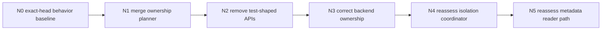

# PR1405 Next-Round Abstraction Reduction Plan

> **For agentic workers:** REQUIRED SUB-SKILL: Use superpowers:subagent-driven-development (recommended) or superpowers:executing-plans to implement this plan task-by-task. Steps use checkbox (`- [ ]`) syntax for tracking.

**Goal:** Continue slimming PR1405 after the service-admission and backend-classifier consolidations by deleting one-owner planning wrappers, test-shaped APIs, and worker-side backend composition, while preserving the worker-isolation one-shot behavior and dependency direction.

**Architecture:** `TopologyEngine` owns backend/topology facts and availability interpretation. `WorkerRuntimeFacade` owns worker-local state and admission. `WorkerOCServiceImpl` owns object-cache recovery orchestration, while `ObjectCacheRecoveryState` owns recovery evidence state. Remove abstractions that do not own a lifecycle, invariant, cross-module contract, or multiple production implementations.

**Tech Stack:** C++17, Bazel, CMake, GoogleTest, Git worktrees, repository-local sensitive scan, shared CodeGraph discovery, tiantiyun UT/ST verification.

## Global Constraints

- Target only PR1405 and its existing fork branch `feat/worker-self-healing-main-20260716`.
- Never push to `openeuler/yuanrong-datasystem` or remote `main`. Any authorized push must target the verified `yche`/`yche-huawei` fork only.
- Do not issue `/retest`, remove WIP, or change PR state as part of this plan.
- Do not create a new upstream PR or split PR1405 unless the user changes the one-shot merge direction.
- Preserve `ServingReady = membershipReady && topologyReady && resourceReady` for ordinary Object/KV requests.
- Preserve `Complete = ServingReady && metadataReady && slotReady && ownershipReady` for `MIGRATION_TARGET`.
- Keep `ChangePrimaryCopy` under `MIGRATION_TARGET`; do not add `PRIMARY_PROMOTION_RPC`.
- Recovery retries remain bounded, observable, generation-fenced, and asynchronous relative to ordinary-service reopening.
- Do not add replacement `Manager`, `Facade`, `Provider`, `Factory`, `Request`, `Plan`, or `Result` types for deleted wrappers unless a real second production implementation or independent lifecycle exists.
- Do not move concrete coordination-backend creation inline into `WorkerOCServer` merely to delete factory files.
- Before every DataSystem code edit, query the shared `/home/t14s/workspace/git-repos/yuanrong-datasystem/.codegraph` for discovery, then verify exact HEAD using `rg`, source, BUILD, and CMake. Never sync or rebuild CodeGraph.
- Run `clang-format -i` only on touched C++ files and inspect the resulting diff for unrelated formatting churn.
- Preserve unrelated dirty worktrees and workbench files.

---

## 1. Exact Starting Snapshot

Recorded on 2026-07-31:

| Item | State |
| --- | --- |
| Fork HEAD | `6af212819fb592f1b67adf28abbac09712599a6c` |
| Upstream base | `c23f3a5d2bcbdb62270ab91d5e4000fd42777c42` |
| Ancestry | Base is an ancestor of HEAD; `0 behind / 54 ahead` |
| PR files | 206 |
| Production source | 122 files, `+9054/-2356` |
| Added production source | 37 files |
| Added source at most 120 LOC | 29 files |
| Tests including test build | 69 files, `+13024/-1078` |
| Non-test build | 14 files, `+563/-21` |

Already completed on this head:

- `WorkerServiceAdmission` has been merged into `WorkerRuntimeFacade`; its two source files and target are gone.
- Backend failure-scope classification has been merged into `TopologyEngine`; its two source files and target are gone.
- The one-line `ConfirmsGlobalBackendOutage` wrapper has been removed.

Refresh before implementation:

```bash
git remote -v
git ls-remote origin refs/heads/feat/worker-self-healing-main-20260716
git ls-remote main refs/heads/master
git fetch origin feat/worker-self-healing-main-20260716:refs/tmp/pr1405-next-head
git fetch main master:refs/tmp/pr1405-next-base
git rev-parse refs/tmp/pr1405-next-head refs/tmp/pr1405-next-base
git merge-base --is-ancestor refs/tmp/pr1405-next-base refs/tmp/pr1405-next-head
git diff --name-status --find-renames refs/tmp/pr1405-next-base...refs/tmp/pr1405-next-head
git diff --numstat --find-renames refs/tmp/pr1405-next-base...refs/tmp/pr1405-next-head
```

If the head advanced, regenerate all caller counts and allowlists. Do not replay this plan by stale line number.

## 2. Quantitative Target

### Committed target for this round

| Metric | Start | Required target |
| --- | ---: | ---: |
| Production source files | 122 | At most 120 after immediate consolidation |
| Added source at most 120 LOC | 29 | At most 27 after immediate consolidation |
| Dedicated ownership-planner targets | 1 | 0 |
| Public test-shaped/dead APIs | Current exact-head set | Remove or privatize every reconfirmed no-production-caller item |

### Architecture-gated target

| Metric | After immediate work | Target after backend ownership correction |
| --- | ---: | ---: |
| Production source files | At most 120 | At most 116 after factory/resolver removal |
| Added source at most 120 LOC | At most 27 | At most 23 |
| Worker concrete-backend factory/resolver files | 4 | 0 |

### Optional target after callback ownership correction

- Remove `worker_isolation_coordinator.{h,cpp}` only after TopologyEngine owns the backend availability event path.
- This would reduce production source to at most 114 and added small files to at most 21.
- Do not treat this optional target as authorization to merge six callbacks into `WorkerOCServer` unchanged.

Raw file LOC is not net savings. Required logic and tests may move. The acceptance criterion is fewer ownership/public boundaries, fewer targets, and a non-increasing production-source line count.

## 3. Abstraction Admission Rule

A new file/class/interface is allowed only when at least one is true:

1. It has two or more real production implementations.
2. It independently owns a thread, lock, generation, cancellation domain, or lifecycle.
3. It prevents an explicit cross-module reverse dependency.
4. It is a non-trivial algorithm shared by multiple production owners.
5. It is a stable, lightweight cross-module data contract that avoids importing a substantially heavier header.

These reasons are insufficient on their own:

- a focused UT wants to call an internal helper;
- a function exceeds a line-count guideline;
- two `make_unique` calls need a name;
- one call site needs a request/plan/result bundle;
- a future second implementation is imaginable;
- a class name makes orchestration look cleaner without moving state or ownership.

Default placement for one-owner logic is an existing owner's private method or `.cpp` anonymous namespace.

## 4. Required Execution Order



N1 and N2 must remain behavior-neutral. N3-N5 are architecture changes and require RED tests before production edits.

## 5. Task N0: Freeze Exact-Head Behavior

**Files:**
- Read only: current PR1405 source, focused UT/ST tests, BUILD, and CMake files.
- Evidence: existing dedicated PR1405 tiantiyun directory and direct-gtest/UT/ST harness.

- [ ] Verify exact fork/base SHA, ancestry, worktree cleanliness, and remotes.
- [ ] Fetch current unresolved PR comments and map valid correctness/performance comments to the exact diff.
- [ ] Run the currently required worker runtime, ownership recovery, topology backend-scope, migration-admission, and one-shot ST cases.
- [ ] Record non-zero executed test counts, process exit 0, XML/log evidence, and exact disabled/not-run cases.
- [ ] Stop structural work if the current head has a product failure in ServingReady, Complete, generation fencing, or migration admission.

Static checks or a build that never enters gtest are not behavior PASS.

## 6. Task N1: Merge Ownership Reconciliation Planning

**Current abstraction:**

- `src/datasystem/worker/object_cache/recovery/object_cache_ownership_reconciliation.h`, 47 LOC.
- `src/datasystem/worker/object_cache/recovery/object_cache_ownership_reconciliation.cpp`, 64 LOC.
- Public enum, request struct, plan struct, and `BuildOwnershipReconciliationPlan`.
- Exactly three adjacent production calls in `worker_oc_service_impl.cpp`.
- Dedicated Bazel target and dedicated UT target.

**Files:**
- Modify: `src/datasystem/worker/object_cache/worker_oc_service_impl.cpp`
- Modify: `src/datasystem/worker/object_cache/worker_oc_service_impl.h` only if a private declaration is required
- Delete: `src/datasystem/worker/object_cache/recovery/object_cache_ownership_reconciliation.cpp`
- Delete: `src/datasystem/worker/object_cache/recovery/object_cache_ownership_reconciliation.h`
- Modify: `src/datasystem/worker/object_cache/BUILD.bazel`
- Modify: `src/datasystem/worker/object_cache/CMakeLists.txt`
- Move tests from: `tests/ut/worker/object_cache/object_cache_ownership_reconciliation_test.cpp`
- Extend: `tests/ut/worker/object_cache/worker_oc_service_impl_test.cpp` or the nearest existing recovery-state test
- Modify: `tests/ut/worker/BUILD.bazel`

**Interfaces:**
- Consumes: centralized/distributed metadata mode, local master address, local worker address, committed owner addresses, and existing reconciliation event type.
- Produces: a private owner list plus bounded pending/failure diagnostic detail used by existing recovery-generation code.

- [ ] Preserve tests for centralized owner selection, distributed committed owners, empty-owner failure, and restart/local-isolation/network-recovery diagnostics.
- [ ] Replace public request/plan/enum with one file-local function or direct private values. Do not create a replacement class or source file.
- [ ] Preserve all three scheduling paths and generation establishment order.
- [ ] Keep object IDs and unbounded owner lists out of evidence detail.
- [ ] Delete source files, test file, dedicated targets, and every stale source/build reference.
- [ ] Run the migrated tests plus ownership fanout, generation-fencing, recovery evidence, and WorkerOCServiceImpl focused tests.

Expected commit purpose:

```text
refactor(worker): merge ownership reconciliation planning
```

## 7. Task N2: Remove Dead And Test-Shaped Surface

This task removes APIs, not behavior. Re-run exact-head `rg` before each deletion.

### Worker runtime candidates

- `WorkerAdmissionGateUpdate::operator bool()`; production reads `.open` explicitly.
- `GenerationedWorkerRecoveryEvidenceReport`; no production use beyond declaration.
- Write-only `WorkerRuntimeFacade::Impl::outerGateOpen`.
- `WorkerRuntimeFacade::TryCompleteRecovery` when still test-only. Rewrite tests through the revisioned topology/evidence commit path or a test fixture local to the test target.
- Public transition helpers such as `MarkStarting`, `MarkJoining`, or `MarkStopping` only when exact-head search still proves no production caller.

### Object-cache recovery candidates

- `ObjectCacheRecoveryState::SetMetadataRecoveryEvidenceReport` when still test-only.
- `ObjectCacheRecoveryState::SetOwnershipRecoveryEvidenceReport` when still test-only.
- No-generation recovery-ready handler overload when still test-only.
- `WorkerOCServiceImpl::GetLastMetadataRecoveryEvidenceReport` if no production caller remains.
- Public recovery snapshot/getters that can be private because only the owning implementation and tests read them.
- `ObjectCacheOwnershipReconciliationPlan::emptyOwnersMessage` disappears with N1 rather than surviving as another public field.

**Files:**
- Modify only the existing headers/implementations containing a confirmed candidate.
- Modify existing focused test files; do not create a common test helper in production source.

- [ ] Produce a caller table with `production`, `test`, and `declaration/definition` counts for every candidate.
- [ ] Delete no-caller symbols and privatize owner-internal state.
- [ ] Rewrite tests against retained product contracts before deleting test-shaped APIs.
- [ ] Keep this commit separate from retry, locking, timeout, or admission behavior changes.
- [ ] Run runtime facade, topology availability, recovery state, WorkerOCServiceImpl, migration admission, and migration handler tests.

Expected commit purpose:

```text
refactor(worker): trim recovery test seams
```

## 8. Task N3: Correct Backend Ownership And Delete Worker Wrappers

This task is architecture-gated. Do not start it until Coordinator and ETCD composition tests are green.

**Current abstractions:**

- `worker_coordination_backend_factory.{h,cpp}`, 58 LOC: two concrete `make_unique` wrappers used only by WorkerOCServer.
- `central_metadata_address_resolver.{h,cpp}`, 94 LOC: `EnsureTable` plus `ClaimOrRead`, used only at two WorkerOCServer bootstrap sites.

**Incorrect shortcut:**

Do not inline the concrete backend constructors and resolver logic into WorkerOCServer. That deletes files while deepening the wrong dependency.

**Target ownership:**

```text
WorkerOCServer asks for topology/metadata bootstrap
    -> TopologyEngine or cluster composition owns backend construction
    -> backend exposes physical KV/watch/lease facts
    -> topology/bootstrap owner performs schema registration and address claim
```

**Expected files:**
- Modify: cluster/topology builder or composition implementation that already owns backend lifecycle
- Modify: `src/datasystem/worker/worker_oc_server.cpp`
- Modify: nearest cluster/worker BUILD and CMake files
- Delete: `src/datasystem/worker/worker_coordination_backend_factory.cpp`
- Delete: `src/datasystem/worker/worker_coordination_backend_factory.h`
- Delete: `src/datasystem/worker/object_cache/central_metadata_address_resolver.cpp`
- Delete: `src/datasystem/worker/object_cache/central_metadata_address_resolver.h`
- Move/replace: `tests/ut/worker/object_cache/central_metadata_address_resolver_test.cpp`

- [ ] Add RED tests for ETCD and Coordinator modes proving backend lifecycle, unified topology table registration, metadata table/bootstrap availability, and central metadata address claim/read.
- [ ] Define one cluster-owned bootstrap operation using existing TopologyEngine/builder ownership. Do not add another one-line factory class.
- [ ] Remove WorkerOCServer direct concrete-backend construction and direct logical-table setup.
- [ ] Delete the four files and dedicated build/test targets only after both modes pass.
- [ ] Run ETCD adapter, DS adapter, Coordinator store backend, topology builder, WorkerOCServer composition, and relevant ST startup/recovery cases.

Expected commit purposes may be split by behavior boundary:

```text
refactor(cluster): own worker coordination backends
refactor(worker): remove backend bootstrap wrappers
```

Both commits stay in the same PR1405 chain; do not create a separate upstream PR.

## 9. Task N4: Reassess WorkerIsolationCoordinator

**Current abstraction:**

- `worker_isolation_coordinator.{h,cpp}`, 137 LOC.
- Two public event methods over six `std::function` hooks.
- One production owner: WorkerOCServer.

The class is not removable while it is the only place preserving isolation/recovery ordering. First correct the event direction:

```text
backend failure/recovery fact
    -> TopologyEngine availability transition
    -> Worker runtime transition
    -> object-cache reconciliation request
```

- [ ] Add RED tests proving backend code does not directly perform Worker business orchestration.
- [ ] Route local isolation/recovery through TopologyEngine-owned availability events.
- [ ] Re-evaluate whether the remaining two transitions belong as WorkerOCServer private composition methods or WorkerRuntimeFacade operations.
- [ ] Delete the coordinator files and target only if no six-hook replacement object is introduced.
- [ ] Preserve process survival, immediate admission closure on confirmed local isolation, ServingReady reopening, and asynchronous ownership reconciliation.

If the event-direction change is not ready, keep this component. File-count pressure is not sufficient justification.

## 10. Task N5: Reassess Metadata Reader Path

**Current components:**

- `service/object_metadata_reader.h`, 38 LOC.
- `object_metadata_coordination_reader.{h,cpp}`, 110 LOC.

The interface currently provides real dependency inversion for the Get path. Do not merge it into Get implementation while object cache still needs a backend adapter.

- [ ] After N3, determine whether an existing topology/metadata route API can supply the query without exposing `ICoordinationBackend` to object cache.
- [ ] If yes, migrate Get-path calls and tests to that API, then delete the interface and concrete adapter without adding a replacement one-implementation port.
- [ ] If no, retain the interface and adapter and record the concrete dependency they prevent.

This is optional and must not block the required N1-N3 target.

## 11. Explicit Keep Set

Do not merge or delete these merely because one file is short:

| Component | Required boundary |
| --- | --- |
| `topology_availability.h` | Shared lightweight availability contract |
| `topology_phase_action.h` | Shared executor/object/Stream metadata DTO |
| `topology_cleanup_effect.h` | Bounded cleanup-effect callback contract |
| `metadata_recovery_summary.h` | Lightweight DTO shared by manager, evidence, and state |
| `worker_topology_runtime.{h,cpp}` | Prevents object cache from directly depending on TopologyEngine |
| `worker_control_backend_probe.{h,cpp}` | Owns asynchronous RPC tags, deadline polling, and cleanup |
| `worker_recovery_evidence.{h,cpp}` | Shared evidence contract and sanitizing builder |
| `worker_runtime_state.{h,cpp}` | Owns synchronization, transitions, and generation fencing |
| `object_cache_recovery_state.{h,cpp}` | Owns metadata/slot/ownership aggregation and fanout state |
| Topology metadata/object-cache action adapters | Prevent runtime callbacks from depending on master/object-cache implementations |

Removing one of these requires a separate dependency graph showing that the protected boundary no longer exists.

## 12. Verification Gates

Every commit must record:

```bash
git rev-parse HEAD
git diff --check <parent>..HEAD
git diff --name-status <parent>..HEAD
git diff --numstat <parent>..HEAD
git remote -v
```

For deleted files/symbols:

```bash
rg -n '<deleted file stem or symbol>' src tests
rg -n '<deleted Bazel/CMake target>' src tests
```

Required gates:

- CodeGraph discovery commands, returned nodes/edges, and stale-index caveat.
- Exact-head `rg`, source, BUILD, and CMake conclusions.
- `clang-format` limited to touched C++ files.
- Bazel/CMake target parity after each removed source/target.
- Focused tests with actual execution count, exit 0, and XML/log evidence.
- Affected one-shot ST cases after N3 or N4.
- Repository-local sensitive scan on the exact patch.
- No ordinary hot-path increase in locks, map lookups, allocation, key copies, or snapshot copies.

Final acceptance table:

| Gate | Required result |
| --- | --- |
| N1 file reduction | 2 production files and dedicated planner target removed |
| N2 public surface | Every reconfirmed no-production-caller API removed or privatized |
| N3 file reduction | 4 worker/backend wrapper files removed after ownership correction |
| Replacement abstractions | Zero unless Section 3 admission rule is explicitly satisfied |
| ServingReady | Ordinary Object/KV reopens before Complete evidence |
| Complete | Migration remains fail-closed until current-generation evidence |
| Backend boundary | Backend reports facts; it does not orchestrate Worker recovery |
| Build | Bazel and CMake both reference only retained files/targets |
| Validation | Focused UT and affected ST have non-zero execution, exit 0, and retained evidence |

## 13. Non-Goals

- Do not combine this round with ObjectTable recovery-index redesign.
- Do not combine behavior-neutral consolidation with Complete retry, admission-guard relocation, timeout changes, P2P admission, or master primary-authority fixes.
- Do not modify TimerQueue, issue-685 memory rebalance accounting, proto link dependencies, OOM thresholds, or unrelated formatting.
- Do not delete tests to reduce line count; migrate assertions to retained production contracts.
- Do not replace deleted small classes with lambdas scattered across many call sites.

## 14. Control-Center Report Template

```text
Task:
Exact HEAD / parent:
Exact base / merge base:
Allowlisted files:
Deleted production files:
Deleted test files after assertion migration:
Deleted BUILD/CMake targets:
Net production +/-:
Public APIs removed or privatized:
Replacement abstractions added and admission-rule justification:
CodeGraph discovery and exact-source verification:
Bazel/CMake verification:
Focused UT counts / exit / XML-log:
Affected ST counts / exit / XML-log:
Sensitive scan:
git diff --check:
Remaining correctness/performance gaps:
Push/retest/PR-state actions: none unless separately authorized
```

This round succeeds when the retained files correspond to real state, lifecycle, algorithm, or dependency boundaries. A lower file count without clearer ownership is not a successful cleanup.
