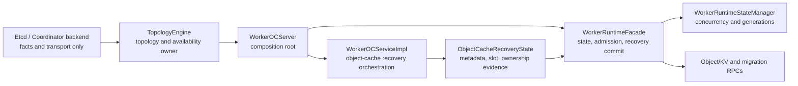

# PR1405 Small-File Consolidation Rectification Plan

> **For agentic workers:** REQUIRED SUB-SKILL: Use superpowers:subagent-driven-development (recommended) or superpowers:executing-plans to implement this plan task-by-task. Steps use checkbox (`- [ ]`) syntax for tracking.

**Goal:** Reduce PR1405's fragmented production-source surface and unnecessary public abstractions without weakening worker fault isolation, ordinary-service availability, recovery evidence, migration admission, or memory-data safety.

**Architecture:** `TopologyEngine` owns topology and control-backend availability interpretation; `WorkerRuntimeFacade` owns worker-local state, admission, and recovery commits; object cache owns metadata/slot/ownership evidence. Consolidate one-owner policy and parameter-planning helpers into those owners, while retaining lightweight contracts that genuinely cross module boundaries.

**Tech Stack:** C++17, CMake, Bazel, GoogleTest, repository-local GitCode review helpers, shared CodeGraph discovery, tiantiyun runtime validation.

## Global Constraints

- Work only on PR1405 and its existing fork source branch `feat/worker-self-healing-main-20260716`.
- Never push to `openeuler/yuanrong-datasystem` or remote `main`. Before any authorized push, verify `git remote -v`; only the `yche`/`yche-huawei` fork is allowed.
- Do not issue `/retest`, remove WIP, or change PR state unless separately authorized after exact-head self-verification.
- First preserve or establish an exact-head green baseline for the required one-shot UT/ST cases. Structural cleanup must not become a substitute for behavior closure.
- Preserve `ServingReady = membershipReady && topologyReady && resourceReady` for ordinary Object/KV service.
- Preserve `Complete = ServingReady && metadataReady && slotReady && ownershipReady` for `MIGRATION_TARGET` operations.
- Keep `ChangePrimaryCopy` under `MIGRATION_TARGET`; do not introduce a generic `PRIMARY_PROMOTION_RPC`.
- Recovery and reconciliation retries must be bounded, observable, generation-fenced, and must not block ordinary-service reopening.
- Do not move coordination-backend construction inline into `WorkerOCServer` merely to delete a factory file. Correct ownership first.
- Do not merge lightweight cross-module contracts into large headers solely to reduce file count.
- Before every DataSystem code edit, query the shared CodeGraph for discovery, then confirm against the exact current HEAD with `rg`, source, BUILD, and CMake. Never sync or rebuild the shared index.
- After each C++ edit, run `clang-format -i` only on touched C++ files and inspect the resulting diff for unrelated formatting churn.

---

## 1. Audit Snapshot

Recorded on 2026-07-31:

| Item | Exact state |
| --- | --- |
| Review worktree | `/home/t14s/workspace/git-repos/yuanrong-datasystem/.worktrees/pr1405-comments-resolve-f36b` |
| PR/fork HEAD | `bc320f89f4ff8f51d1dde87676fe2f6b67ed4d73` |
| Current base ref | `refs/tmp/pr1405-slim-base-current` = `c23f3a5d2bcbdb62270ab91d5e4000fd42777c42` |
| Merge base | `7e15afe398f3de054c75d007a6c0094d9fa3418a` |
| PR range | `refs/tmp/pr1405-slim-base-current...HEAD` |
| PR files | 213 |
| Production source | 126 files, `+9214/-2356`, 11,570 changed lines |
| Tests including test build files | 71 files, `+13288/-1079` |
| Non-test build | 15 files, `+604/-21` |
| Added production source | 41 files |
| Added source at most 120 resulting LOC | 32 files, 78% of added source files |

Use three-dot merge-base semantics. The current upstream tip is not an ancestor of the PR head; a direct endpoint diff folds base-side evolution into the PR and incorrectly reports 268 files.

Before implementation, refresh this snapshot:

```bash
git fetch main master:refs/tmp/pr1405-slim-base-current
git fetch origin feat/worker-self-healing-main-20260716:refs/tmp/pr1405-slim-head-current
git rev-parse refs/tmp/pr1405-slim-base-current refs/tmp/pr1405-slim-head-current
git merge-base refs/tmp/pr1405-slim-base-current refs/tmp/pr1405-slim-head-current
git diff --name-status --find-renames refs/tmp/pr1405-slim-base-current...refs/tmp/pr1405-slim-head-current
git diff --numstat --find-renames refs/tmp/pr1405-slim-base-current...refs/tmp/pr1405-slim-head-current
```

Do not overwrite a dirty user worktree. Execute in the existing authorized PR1405 worktree or a repository-local isolated worktree created from the exact fork head.

## 2. Rectification Principles

A small file is not automatically an unnecessary abstraction. Merge or delete a component when at least two of these hold:

1. It has only one production owner or one production caller.
2. It has a dedicated BUILD/CMake target but only forwards a constructor, enum comparison, or parameter bundle.
3. Its public type exists mainly so focused tests can call internals directly.
4. Its interface does not break a meaningful dependency direction.
5. Its lifecycle, synchronization, error policy, and state ownership belong to an existing class.

Keep a small file when at least one of these holds:

1. Multiple modules consume it without needing a heavier implementation header.
2. It defines an algorithm-neutral cross-module contract.
3. It protects object cache or runtime from directly depending on `TopologyEngine`, master internals, transport, or backend implementations.
4. It owns substantial concurrency, generation fencing, asynchronous cleanup, or evidence invariants.

The target is fewer ownership boundaries and fewer public APIs, not a cosmetically smaller directory.

## 3. Target Module Relationship



Target removals:

- `WorkerServiceAdmission` becomes private admission policy inside `WorkerRuntimeFacade::Impl`.
- Control-backend failure classification becomes private TopologyEngine implementation logic.
- Object-cache ownership-plan construction becomes private WorkerOCServiceImpl recovery logic.
- Worker coordination backend factory and central metadata resolver disappear only after their capabilities move behind a cluster/topology-owned composition API.
- `WorkerIsolationCoordinator` remains until the direct backend-to-worker callback is replaced by a TopologyEngine-owned event path.

## 4. Immediate Consolidation Matrix

| Component | Current source | Production evidence | Action | Expected removal |
| --- | --- | --- | --- | ---: |
| Service admission policy | `worker_service_admission.{h,cpp}`, 225 LOC | Only `WorkerRuntimeFacade::Impl` constructs it | Merge policy functions into `worker_runtime_facade.cpp`; remove class and target | 2 source files, 1 target |
| Backend scope classifier | `control_backend_scope_classifier.{h,cpp}`, 113 LOC | Only two calls in `topology_engine.cpp`; one wrapper only compares an enum | Keep algorithm, move to TopologyEngine private/file-local scope; delete `ConfirmsGlobalBackendOutage` | 2 source files, 1 target |
| Ownership reconciliation planner | `object_cache_ownership_reconciliation.{h,cpp}`, 111 LOC | Three adjacent calls in `worker_oc_service_impl.cpp` | Merge one private/file-local planning helper into the service recovery implementation | 2 source files, 1 target |

Immediate target after these three changes:

- Delete 6 production-source files.
- Delete at least 3 dedicated build targets and their test-only targets where tests are migrated.
- Reduce public structs/classes/functions rather than recreating equivalent wrappers under new names.
- Target at least 100 net production-source lines removed; if lower, document which required algorithm or test seam accounts for the difference.
- Do not add a new source file for any of these consolidations.

## 5. Architecture-Gated Consolidation

| Component | Current source | Why not delete immediately | Required target state |
| --- | --- | --- | --- |
| Worker coordination backend factory | `worker_coordination_backend_factory.{h,cpp}`, 58 LOC | Inlining into WorkerOCServer preserves the wrong dependency | Move backend creation/ownership behind TopologyEngine or a cluster composition API, then delete both files and target |
| Central metadata address resolver | `central_metadata_address_resolver.{h,cpp}`, 94 LOC | Current bootstrap directly consumes `ICoordinationBackend` in WorkerOCServer | Expose a cluster/topology-owned bootstrap operation, then delete resolver class/files |
| Worker isolation coordinator | `worker_isolation_coordinator.{h,cpp}`, 137 LOC | It currently holds real ordering across six hooks | First route backend availability through TopologyEngine; then decide whether two worker event methods belong in host-private composition or runtime transition API |
| Metadata coordination reader | `object_metadata_reader.h` plus `object_metadata_coordination_reader.{h,cpp}` | It is a real Get-path dependency inversion today | Keep until worker no longer owns backend access; do not collapse it into Get implementation while backend coupling remains |

Architecture-gated target after backend ownership is corrected:

- Delete another 4 production-source files from factory and resolver.
- Remove worker-root direct knowledge of concrete coordination backend construction.
- Avoid adding replacement `Manager`, `Facade`, `Provider`, or `Factory` classes unless they have at least two real production implementations or own a lifecycle.

## 6. Dead And Test-Shaped API Removal

Remove or privatize only after exact-head `rg` reconfirms no production caller.

### Worker runtime

- `WorkerAdmissionGateUpdate::operator bool()`.
- `GenerationedWorkerRecoveryEvidenceReport`.
- `WorkerIsolationReason::CONTROL_BACKEND_GLOBAL_OUTAGE` and its string branch if no producer is added.
- `WorkerServiceAdmission::CheckServing`, `IsServing`, and `IsServingMode` as part of the admission merge.
- Write-only `WorkerRuntimeFacade::Impl::outerGateOpen`.
- Public `MarkStarting`, `MarkJoining`, `MarkStopping`, and `TryCompleteRecovery` when still test-only. Tests should use the real revisioned topology/evidence commit path or a test fixture that is not public product API.

### Object-cache recovery

- `ObjectCacheRecoveryState::SetMetadataRecoveryEvidenceReport`.
- `ObjectCacheRecoveryState::SetOwnershipRecoveryEvidenceReport`.
- No-generation `ObjectCacheRecoveryState::RegisterRecoveryEvidenceReadyHandler` overload.
- `WorkerOCServiceImpl::GetLastMetadataRecoveryEvidenceReport` if still production-unused.
- No-generation WorkerOCServiceImpl recovery-handler overload.
- `ObjectCacheOwnershipReconciliationPlan::emptyOwnersMessage`; keep diagnostic wording local to plan construction.
- Make recovery snapshot/getters private when external usage is test-only.

Do not delete a test merely because it calls a test-shaped API. Rewrite the test against the retained production contract, then remove the unnecessary API.

## 7. Explicit Keep Set

These files are small but currently have justified boundaries:

| Component | Reason to keep |
| --- | --- |
| `topology_availability.h` | Lightweight availability contract shared by TopologyEngine, WorkerOCServer, diagnostics, and worker runtime |
| `topology_cleanup_effect.h` | Bounded cleanup-effect contract consumed independently by cluster callbacks and object-cache cleanup |
| `topology_phase_action.h` | Algorithm-neutral DTO used by executor, worker object cache, object metadata, and Stream metadata |
| `metadata_recovery_summary.h` | Lightweight DTO shared by metadata recovery manager, evidence conversion, and recovery state |
| `worker_topology_runtime.{h,cpp}` | Real dependency inversion preventing object cache from depending directly on TopologyEngine |
| `worker_control_backend_probe.{h,cpp}` | Owns async RPC start/finish/forget, deadline polling, and cleanup lifecycle |
| `worker_recovery_evidence.{h,cpp}` | Shared evidence contract, sanitizing builder, and complete-evidence semantics |
| `worker_runtime_state.{h,cpp}` | Owns synchronization, transition intent, generation fencing, and fast admission state |
| `object_cache_recovery_state.{h,cpp}` | Owns generation-fenced metadata/slot/ownership aggregation and terminal fanout state |
| Topology metadata/object-cache action adapters | Preserve dependency direction between runtime callbacks and master/object-cache implementations |

Do not merge these into `WorkerOCServer`, `TopologyEngine`, or a single giant runtime file just to satisfy a file-count target.

## 8. Execution Tasks

### Task 0: Re-establish Exact-Head Behavior Baseline

**Files:**
- Read: current PR1405 source and build files only.
- Evidence: use the established PR1405 direct-gtest/UT/ST harness and dedicated tiantiyun directory.

- [ ] Reconfirm fork HEAD, base, merge base, remotes, and worktree status.
- [ ] Re-fetch unresolved PR comments and map still-valid comments to the refreshed diff.
- [ ] Run the required one-shot focused UT/ST cases with non-zero test counts, exit 0, and XML/log evidence.
- [ ] Record any existing failure separately from structural cleanup. Do not label an environment/build failure as product PASS.

### Task 1: Merge Service Admission Into Runtime Facade

**Files:**
- Modify: `src/datasystem/worker/runtime/worker_runtime_facade.cpp`
- Modify: `src/datasystem/worker/runtime/worker_runtime_facade.h` only if public API shrinks
- Delete: `src/datasystem/worker/runtime/worker_service_admission.cpp`
- Delete: `src/datasystem/worker/runtime/worker_service_admission.h`
- Modify: `src/datasystem/worker/runtime/BUILD.bazel`
- Modify: `src/datasystem/worker/runtime/CMakeLists.txt`
- Modify/move tests: `tests/ut/worker/worker_service_admission_test.cpp` into facade-focused tests

- [ ] Add or retain RED/GREEN tests for the complete service-mode/admission matrix.
- [ ] Move policy functions into `WorkerRuntimeFacade::Impl` without changing status codes, DFX fields, metrics, or `MIGRATION_TARGET` semantics.
- [ ] Remove production-unused convenience APIs and update tests to use the facade contract.
- [ ] Delete the two files and dedicated targets; verify no stale source/build references remain.
- [ ] Run facade, topology-availability, migration-admission, and worker health-gate focused tests.

### Task 2: Return Backend Scope Classification To TopologyEngine

**Files:**
- Modify: `src/datasystem/cluster/runtime/topology_engine.cpp`
- Modify: `src/datasystem/cluster/runtime/topology_engine.h` only if a private declaration is required
- Delete: `src/datasystem/cluster/runtime/control_backend_scope_classifier.cpp`
- Delete: `src/datasystem/cluster/runtime/control_backend_scope_classifier.h`
- Modify: `src/datasystem/cluster/BUILD.bazel`
- Modify: `src/datasystem/cluster/CMakeLists.txt`
- Move tests: `tests/ut/cluster/control_backend_scope_classifier_test.cpp` into `topology_engine_test.cpp` or a private test seam

- [ ] Preserve freshness, reporter identity, duplicate evidence, authority stamp, local-isolation, global-outage, and inconclusive cases.
- [ ] Delete `ConfirmsGlobalBackendOutage`; compare the retained enum directly.
- [ ] Keep the algorithm file-local or private; do not expose a new public classifier class.
- [ ] Delete the dedicated classifier target and verify Bazel/CMake parity.
- [ ] Run focused TopologyEngine asymmetric/global backend outage tests.

### Task 3: Merge Ownership Reconciliation Planning Into Object Cache Recovery

**Files:**
- Modify: `src/datasystem/worker/object_cache/worker_oc_service_impl.cpp`
- Modify: `src/datasystem/worker/object_cache/worker_oc_service_impl.h` only if private signatures shrink
- Delete: `src/datasystem/worker/object_cache/recovery/object_cache_ownership_reconciliation.cpp`
- Delete: `src/datasystem/worker/object_cache/recovery/object_cache_ownership_reconciliation.h`
- Modify: `src/datasystem/worker/object_cache/BUILD.bazel`
- Modify: `src/datasystem/worker/object_cache/CMakeLists.txt`
- Move tests: `tests/ut/worker/object_cache/object_cache_ownership_reconciliation_test.cpp` into existing service/recovery tests

- [ ] Preserve centralized owner selection, distributed committed-owner selection, empty-owner failure, pending-evidence detail, and restart/local-isolation/network-recovery event mapping.
- [ ] Replace public request/plan structs with one private result/helper or direct local values.
- [ ] Keep diagnostics bounded and do not expose object IDs in recovery detail.
- [ ] Delete the two files and targets; verify all three production call sites use the consolidated helper.
- [ ] Run ownership, recovery generation, reconciliation fanout, and recovery evidence tests.

### Task 4: Remove Dead And Test-Shaped Surface

**Files:**
- Modify only the runtime and object-cache headers/implementations containing Section 6 symbols.
- Modify affected focused tests; do not add a new helper file.

- [ ] Run exact `rg` for every candidate and record production versus test callers.
- [ ] Delete truly unused declarations/fields/branches.
- [ ] Privatize state inspection used internally; rewrite tests through retained contracts.
- [ ] Keep this commit behavior-neutral and separate from admission hot-path or retry correctness fixes.

### Task 5: Correct Backend Ownership Before Deleting Worker Factories

This task is blocked until Coordinator and ETCD modes both have passing composition/recovery tests.

**Files:**
- Expected modify: TopologyEngine/cluster composition and WorkerOCServer wiring.
- Expected delete: `worker_coordination_backend_factory.{h,cpp}` and `central_metadata_address_resolver.{h,cpp}`.

- [ ] Add RED tests proving ETCD and Coordinator modes both initialize isolation/recovery and metadata bootstrap dependencies.
- [ ] Move backend creation/bootstrap behind a cluster/topology-owned API.
- [ ] Remove WorkerOCServer direct concrete-backend construction and logical-table setup.
- [ ] Delete factory/resolver files and build targets only after both modes pass.
- [ ] Do not introduce a replacement one-line factory or manager.

## 9. Verification Gates

Every cleanup commit:

```bash
git diff --check <parent>..HEAD
git diff --name-status <parent>..HEAD
git diff --numstat <parent>..HEAD
rg -n '<deleted symbol or file stem>' src tests
bash -n build.sh
```

Also run:

- nearest focused GoogleTests with actual `[ RUN ]`, exit 0, and XML/log evidence;
- Bazel query/build and CMake target verification for deleted/moved targets;
- repository-local sensitive scan on the exact patch;
- `git clang-format --diff` or the repository equivalent on only touched C++ files;
- one-shot ST cases affected by admission, topology classification, or ownership recovery.

Final structural acceptance:

| Gate | Required result |
| --- | --- |
| Immediate source-file reduction | At least 6 production files removed with no replacement source files |
| Architecture-gated reduction | Another 4 production files removed after backend ownership correction |
| Build target reduction | At least 3 immediate dedicated targets removed; Bazel/CMake remain aligned |
| Public surface | Test-only/dead APIs removed or privatized; no replacement generic facade/manager |
| Ordinary availability | `ServingReady` still reopens ordinary Object/KV service before full reconciliation |
| Migration safety | `MIGRATION_TARGET` remains closed until current-generation Complete evidence |
| Retry | Complete reconciliation has bounded retry or explicit terminal-failed observability |
| Hot path | Cleanup does not add locks, snapshots, map lookups, allocations, or string copies to ordinary traffic |
| Scope | TimerQueue, issue-685 rebalance rewrite, unrelated proto-link pruning, and formatting-only hunks are absent or separately justified |

## 10. Non-Goals

- Do not combine this work with the ObjectTable recovery-index redesign; that is a separate performance/correctness change requiring measurement and recovery-scan tests.
- Do not combine this work with bounded Complete retry implementation, admission-guard relocation, or P2P admission fixes. Those are behavioral P1 changes and need independent RED/GREEN commits.
- Do not remove recovery evidence, generation fencing, topology availability, or dependency-inversion ports merely because their files are small.
- Do not split PR1405 into multiple upstream PRs unless the user changes the one-shot merge direction.
- Do not publish new inline comments, resolve discussions, push, or trigger CI from this plan without the corresponding authorization and exact-head evidence.

## 11. Control-Center Reporting Template

For each completed task, report:

```text
Exact HEAD:
Parent SHA:
Allowlisted files:
Deleted source files:
Deleted build targets:
Net production +/-:
Public APIs removed/privatized:
CodeGraph discovery commands and stale-index caveat:
Exact rg/source/build conclusions:
Focused UT commands, counts, exits, XML/logs:
Affected ST commands, counts, exits, XML/logs:
Sensitive scan:
git diff --check:
Remaining correctness/performance gaps:
Push/PR/retest actions: none unless separately authorized
```

The central objective is not simply to make PR1405 shorter. It is to make each retained file identify a real owner, invariant, lifecycle, or dependency boundary while preserving the one-shot availability and data-safety contract.
