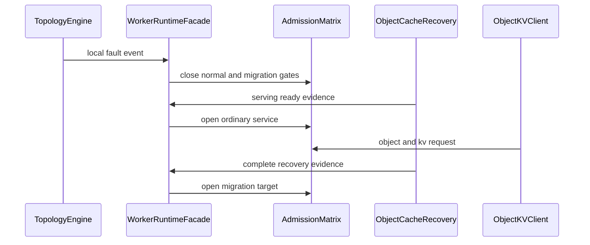

**这是什么类型的PR？**

/kind feat
/kind fix
/kind refactor
/kind test

----

## 1. 问题背景 / 问题现象

本 PR 面向 worker 故障隔离和自恢复的一次合入版本，目标是在协调面闪断、局部拓扑抖动、主动缩容和恢复对账期间保持 worker 进程存活，并尽快恢复普通 Object/KV 服务能力。

当前版本按 SDD one-shot gate 收敛到以下语义：

- 本地控制面故障不自杀，普通服务在 ServingReady 后恢复。
- 全局控制面故障不误隔离本 worker。
- 恢复对账未 Complete 前继续拒绝 MIGRATION_TARGET 及主副本敏感路径。
- 证据不足时恢复副本保持 local copy，不做无权威证据的 primary promotion，避免双主。
- ChangePrimaryCopy 继续归 MIGRATION_TARGET；本 PR 不引入 PRIMARY_PROMOTION_RPC。
- Stream S9 不作为本轮产品 gate，相关产线 hook 已从 one-shot gate 中移出，保持构建兼容。

关联设计：

- worker isolation self-healing design
- PR1405 one-shot SDD map

## 2. 修改方案 / 解决方案

**修改文件清单：**

| 文件范围 | 变更说明 |
|------|---------|
| `src/datasystem/worker/runtime` | 收敛 worker runtime 状态机、admission matrix 和 facade；删除薄 wrapper，保留 State、Facade、Admission 核心职责 |
| `src/datasystem/worker/object_cache` | 增加 recovery evidence、migration target admission、metadata recovery 和 scale-down 相关保护 |
| `src/datasystem/cluster` | 补充 topology 故障分类、coordinator backend 适配和恢复信号对接 |
| `tests/ut` | 增加 runtime admission、migration admission、recovery evidence 和 topology contract 相关 UT |
| `tests/st` | 增加 H1-H5、D-S1-D-S8、主动缩容和 routing convergence 相关 ST |

当前 rebase 后代码规模：

| 分类 | 文件数 |
|------|------|
| 源码 | 141 |
| 测试 | 71 |
| 其他 | 1 |
| 总计 | 213 |

当前相对最新 `master` 的 diff 规模：`+23120/-3460`。后续还会继续做小文件和碎抽象瘦身，但不以删除语义为代价。

## 3. 验证方案

- **编译**：使用 CMake Release 构建关键 UT/ST 产物和 worker 可执行文件；Bazel 保留源码构建 sanity，不作为本轮 UT/ST 主证据。
- **部署**：使用远端验证节点的 CMake 构建产物，复用已有三方件缓存，直接执行 gtest 过滤桶。
- **测试**：按 one-shot SDD gate 运行 focused UT/ST，不重复全量扫库；小修改后只跑受影响桶和历史失败桶。

测试矩阵：

| 分类 | 覆盖内容 |
|------|---------|
| UT runtime admission | runtime facade、state、service admission、recovery evidence |
| UT migration admission | MigrateData admission 和 direct migration recovery incomplete 拦截 |
| ST H1-H5 | 本地故障不自杀、peer 数据不受影响、全局故障不误隔离、拓扑抖动、恢复证据 gate、无证据不升主 |
| ST D-S1-D-S8 | metadata recovery best effort、migration target isolated/OOM/draining/combined fault、disabled L2 cleanup |
| ST 主动缩容 | KV voluntary scale-down 三模式、routing convergence、remote get from self-address |

## 4. 验证结果

验证基线：

- PR HEAD：`c52b68fe19f70504035dcbb9a9dedc06e3855fbb`
- base master：`c23f3a5d2bcbdb62270ab91d5e4000fd42777c42`
- 三方件缓存：已复用远端共享 third-party cache；未重新下载或重编三方件。

编译结果：

| 构建项 | 结果 | 说明 |
|------|------|------|
| CMake focused build | PASS | `ds_ut`、`ds_ut_object`、`ds_st_object_cache`、`ds_st_kv_cache`、`datasystem_worker_bin` |
| Bazel source build | PASS | `source_sdk_client_validation` 已通过；wheel 构建不作为本轮 UT/ST gate |

UT 结果：

| 用例桶 | 结果 | 运行时间 |
|------|------|------|
| runtime admission focused UT | 68/68 PASS | 0.34s |
| migration admission focused UT | 30/30 PASS | 4.58s |
| 合计 | 98/98 PASS | 4.92s |

ST 结果：

| 用例桶 | 结果 | 运行时间 |
|------|------|------|
| H1-H5 high availability self-healing | 8/8 PASS | 133.16s |
| metadata recovery and migration target | 9/9 PASS | 168.52s |
| KV routing and voluntary scale-down | 5/5 PASS | 90.58s |
| 合计 | 22/22 PASS | 392.26s |

CI 失败面复验：

| 失败面 | 当前覆盖 |
|------|---------|
| MigrateDataAdmissionTest aarch64 crash | `MigrateDataAdmissionTest.*` 和 `MigrateDataServiceTest.*` 已 30/30 PASS |
| MIGRATION_TARGET + RECONCILIATION_INCOMPLETE 导致 KV/ST 超时 | KV scale-down、routing convergence、metadata/migration bucket 已 14/14 PASS |

已知日志噪声：

- scale-down ST 中存在 mock OBS 目录 GET 500 和 worker SIGTERM teardown 日志，最终 gtest 均 PASS。
- 多数 ST 单 case 超过 6s，目前作为 ST 性能和用例形态待优化项，不伪装成功能失败。

## 5. 待处理项（如有）

- 继续瘦身小文件和碎抽象：优先收敛 worker runtime admission、backend scope classifier、ownership reconciliation planner 等 move-only abstraction。
- 继续降低 ST 单 case 耗时，目标是相关关键 case 尽量压到 6s 内。
- Stream S9 另起后续 PR 处理，本 PR 不作为 Stream 产品 gate。
- PRIMARY_PROMOTION_RPC 是否拆分为独立语义，需先补 SDD 决策，本 PR 不引入。
- Bazel wheel 构建保留后续补充验证；本轮以 CMake UT/ST 为准。

## 6. 自检清单

### 方案评审
- [x] 设计方案已按 SDD one-shot gate 复核，当前语义与 H1-H5、D-S1-D-S8 和主动缩容 gate 对齐

### 构建
- [x] bazel 源码构建 sanity 已通过
- [x] cmake focused 构建通过
- [x] BUILD.bazel + CMakeLists.txt 新增引用已随 focused 构建覆盖

### 正确性
- [x] 新增功能覆盖正常路径、错误路径和故障路径
- [x] 变更覆盖相关 call site
- [x] 故障转移后状态恢复已通过 H1-H5 和 metadata recovery ST 验证
- [x] 新增 UT/ST 用例已随 PR 上库

### 内存
- [x] 新增状态对象通过 focused UT/ST 验证，无已知 double reset 或悬空指针复现

### 并发
- [x] admission transition、recovery evidence 和 migration target gate 已通过 focused UT/ST 验证
- [x] retry 有界可观测，当前无无限等待复现

### 性能
- [x] 普通 Object/KV 服务在 ServingReady 后恢复；Complete 仅门禁 MIGRATION_TARGET
- [ ] ST 单 case 6s 目标仍未满足，后续继续优化

### 安全
- [x] PR 描述和提交信息未包含 token、密钥、账号、IP 或本地绝对路径

### 可观测性
- [x] 关键 admission reject、recovery phase 和 topology transition 路径保留诊断日志

### 日志
- [x] 未新增 LOG(FATAL) 作为故障隔离路径
- [x] 已知 mock OBS 和 teardown 噪声已在验证结果中说明

### 前向兼容
- [x] C++ SDK 无对外接口变更
- [x] Python SDK 无对外接口变更
- [x] Java SDK 无对外接口变更
- [x] worker 部署参数无变更
- [x] build.sh 编译参数无变更

----

Fixes #

----
