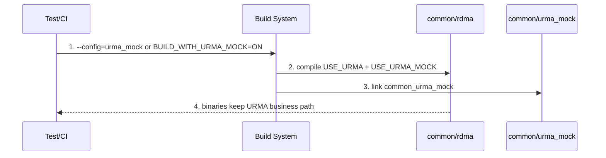
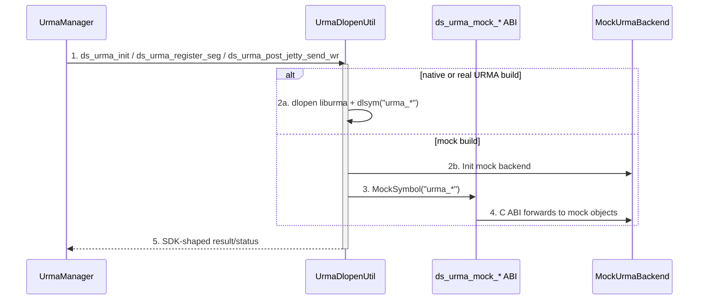
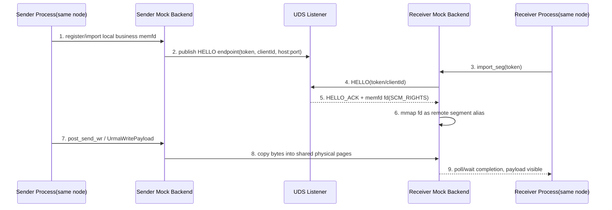
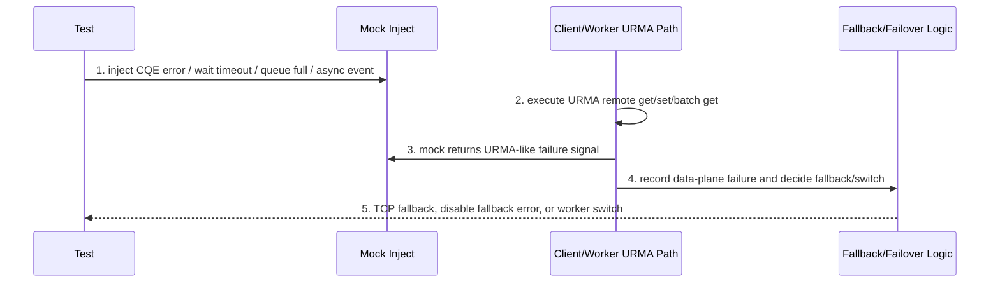
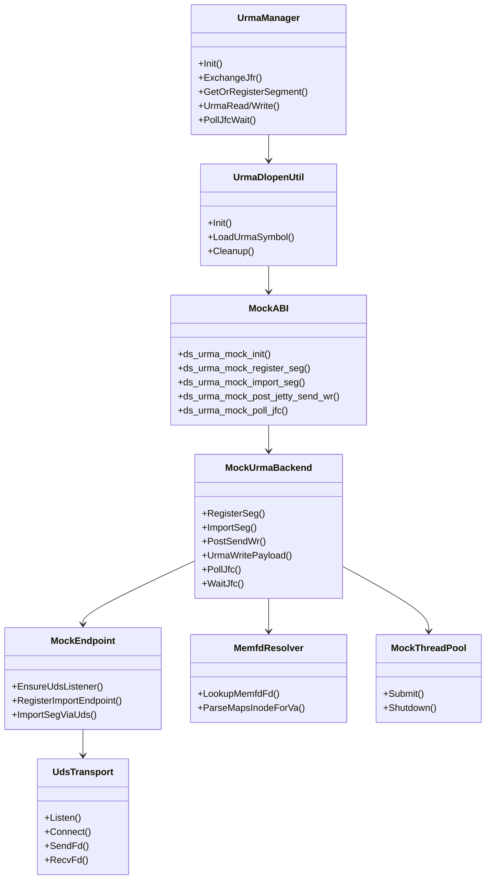

关联 PR:

+ PR1129: URMA mock backend for local and CI validation

# Story 整体设计

## 功能描述

+ Why: Object/KV cache 的 URMA 数据面长期依赖真实 URMA SDK、RNIC、驱动和跨节点部署。普通开发机没有 URMA 硬件时，只能覆盖 TCP/UDS 普通路径，无法稳定验证 `UrmaManager`、register/import segment、Jetty/JFC、completion、async event、fallback/failover 等 URMA 语义。本特性的核心目的是提供 opt-in 的同节点 URMA mock backend，用共享内存、memfd 和 UDS 让开发在本地非 URMA 环境运行 URMA 相关 UT/ST，快速验证功能和回归问题。
+ Who: 本地开发人员、测试人员、基础 CI 语义回归、Object/KV URMA remote get/set/batch get/migrate 维护者、URMA fallback/failover/async event/NUMA affinity 相关问题定位人员。
+ When: 仅在显式 mock 构建时生效，并且只支持同节点/同机多进程验证。Bazel 通过 `--config=urma_mock`，CMake 通过 `BUILD_WITH_URMA_MOCK=ON` 或对应构建入口启用。默认/native 构建不编译、不链接 mock backend，不携带 `ds_urma_mock_*` 符号。
+ Where: mock backend 位于 `src/datasystem/common/urma_mock`；mock/native 分派位于 `src/datasystem/common/rdma/urma_dlopen_util.*`、`urma_api_adapter.h`、`urma_mock_bridge.*`；业务仍主要走 `src/datasystem/common/rdma/urma_manager.*`、`fast_transport_manager_wrapper.*`、Object/KV client/worker 既有 URMA 路径；测试覆盖 `tests/ut/common/urma_mock`、`tests/st/client/object_cache/urma_object_client_test.cpp`、`tests/st/client/kv_cache/kv_client_urma_failover_test.cpp`。
+ How: mock 构建同时定义 `USE_URMA` 和 `USE_URMA_MOCK`。上层业务仍按 URMA SDK API 形态调用 `urma_*`；`urma_dlopen_util` 在 mock 模式跳过真实 `dlopen("liburma")`，用 sentinel handle 将 `dlsym("urma_*")` 分派到 `ds_urma_mock_*` C ABI。mock backend 通过同节点 UDS `SCM_RIGHTS` 传递 memfd fd，双方 mmap 同一物理页；`post_send_wr`/`UrmaWritePayload` 进行真实内存拷贝并生成 completion，模拟 URMA 数据面和错误信号。
+ What happen: 新增 mock 构建方式、mock 后端模块、mock C ABI mirror、UDS/memfd import、mock thread pool、故障注入、mock 专项 UT/ST 覆盖；不新增对外 Client API，不新增 worker RPC proto 字段，不改变默认生产 URMA/TCP/UDS 业务语义。
+ Experience: 开发可以在单机本地快速跑通 URMA 语义用例，测试可以把它作为基础语义回归入口，覆盖过去依赖人工硬件环境或 disabled 的 URMA event-mode、fallback、failover、reconnect、affinity-aware 传输等路径；跨节点打通、真实硬件性能和真实 RNIC 兼容性仍必须由真实 URMA 环境验证。

### 术语说明

| 术语/简写 | 含义 | 本文使用说明 |
| ---- | ---- | ---- |
| 同节点 URMA mock | 本 PR 新增的 mock URMA 后端 | 只在同节点/同机多进程场景打通，只在显式 mock 构建中启用，不是生产 URMA SDK 替代品 |
| native/mock-off | 默认或真实 URMA 以外的普通构建 | 不应出现 `common_urma_mock` 产物或 `ds_urma_mock_*` 符号 |
| `USE_URMA` | 表示编译 URMA 相关业务路径 | mock 构建也定义该宏，使业务继续走 URMA 代码路径 |
| `USE_URMA_MOCK` | 表示底层 URMA SDK 由 mock backend 替代 | 应尽量局限在 mock ABI、dlopen/bridge、mock backend 和测试隔离点 |
| memfd | Linux 匿名内存文件 | mock 用它承载跨进程共享物理页 |
| UDS | Unix Domain Socket | mock 用 `SOCK_SEQPACKET` + `SCM_RIGHTS` 传递 memfd fd |
| JFC/JFCE | URMA completion queue / event queue | mock 用 eventfd + queue 模拟 poll/wait/ack |
| Jetty/TJetty | URMA send endpoint / imported target endpoint | mock 保留 opaque handle 和 token/import 语义 |
| affinity-aware 传输 | 依据 NUMA/chip/device affinity 选择传输参数 | mock 归一化 chip id/device name，使测试可覆盖选择逻辑，不证明真实性能 |

## 场景分析

### 场景 1: mock 构建启用 URMA 业务路径



编号含义：

+ 1: 测试显式选择 mock 构建；默认构建不生效。
+ 2: 业务代码看到 `USE_URMA`，仍走 URMA 逻辑。
+ 3: mock backend 只在 mock 构建链接。
+ 4: ST/UT 可以在无 `liburma.so`、无 RNIC 的机器运行。

### 场景 2: `urma_*` ABI 分派到 mock backend



测试关注点：

+ mock 构建日志应出现 `URMA_MOCK mode: skipping dlopen, using mock dispatch table`，不应依赖真实 `liburma.so`。
+ native/mock-off 构建不应包含 `ds_urma_mock_*`。
+ 上层业务不应直接调用 mock C++ 对象；仍通过 SDK-shaped ABI。

### 场景 3: 同节点跨进程 memfd + UDS import



编号含义：

+ 1: mock 优先反查业务 memfd；找不到时才使用 mock fallback 映射。
+ 2: exchange JFR 时记录 token、clientId、host/port、segment 信息。
+ 4-6: receiver 通过 UDS 获取对端 memfd fd 并 mmap，不通过 socket 传 payload。
+ 7-9: 数据写入共享页并产生 completion，业务从 URMA 路径观察成功或失败。

约束说明：该场景要求 sender/receiver 位于同一节点。UDS fd 传递和 memfd mmap 无法跨机器工作，因此本特性不能用于验证真实跨节点 RDMA 建链、链路质量或跨机性能。

### 场景 4: URMA failure 触发 fallback/failover



测试关注点：

+ mock 只负责稳定制造 URMA failure 信号。
+ fallback、限流、failover、错误码和 access log 的语义仍由 Object/KV 业务层决定。
+ 断言应落在业务可观测结果上，例如 payload 正确、状态码、transport kind、fallback limiter、当前 worker 是否切换。

## 方案详细设计

### 现状分析

真实 URMA 测试存在几个痛点：

+ 环境门槛高：需要真实 URMA SDK、driver、RNIC、跨节点网络和对应部署参数；开发本地通常不具备这些条件。
+ 覆盖不稳定：很多 URMA ST 过去需要 disabled 或人工环境，CI 难以连续验证。
+ 错误路径难构造：CQE error、wait timeout、queue full、handshake delay、async event 等真实故障不可控。
+ 回归成本高：URMA fallback/failover/reconnect 变更经常影响 Object/KV 数据面，但普通 UT 只能覆盖 TCP/UDS。

PR1129 的核心策略是“在同节点 mock 底层 URMA SDK，不 mock 业务路径”。因此测试文档需要区分两类结论：

+ 可以由 mock 验证：同节点接口调用链、资源生命周期、跨进程共享页、completion、fallback/failover 业务语义、构建隔离。
+ 不能由 mock 验证：跨节点打通、真实 RNIC 性能、真实驱动兼容性、真实链路拥塞/带宽、跨机器 RDMA 可靠性。

### 方案设计

#### 1. 构建

新增或调整的构建入口：

+ Bazel:
  + `.bazelrc` 新增 `build:urma_mock --define=enable_urma_mock=true`、`--copt=-DUSE_URMA`、`--copt=-DUSE_URMA_MOCK`。
  + `src/datasystem/common/rdma/BUILD.bazel` 在 `//:enable_urma_mock` 下链接 `//src/datasystem/common/urma_mock:urma_mock_backend`。
  + `tests/ut/common/urma_mock/BUILD.bazel` 新增 mock 专项 UT target。
+ CMake:
  + `cmake/options.cmake` 新增 `BUILD_WITH_URMA_MOCK`，默认 `OFF`。
  + `cmake/dependency.cmake` 约束 `BUILD_WITH_URMA_MOCK` 与 `BUILD_WITH_URMA` 互斥，避免 mock 和真实 SDK 同时进入一个二进制。
  + `src/datasystem/common/CMakeLists.txt` 在 mock 构建下 `add_subdirectory(urma_mock)`。
  + `src/datasystem/common/rdma/CMakeLists.txt` 在 mock 构建下定义 `USE_URMA`、`USE_URMA_MOCK` 并 whole-archive 链接 `common_urma_mock`。

构建隔离要求：

+ 默认/native 构建不编译、不链接 `src/datasystem/common/urma_mock`。
+ native 产物中不应出现 `libcommon_urma_mock*` 或 `ds_urma_mock_*`。
+ mock 构建不要求机器安装真实 `liburma.so`。

#### 2. 部署

生产部署无新增服务、无新增用户配置。mock 只用于同节点本地开发验证、基础 CI 语义回归和 test binary：

+ 不新增 Client API。
+ 不新增 worker RPC proto 字段。
+ 不改变 worker/client 启动拓扑。
+ 不支持跨节点 mock 部署，不用于证明多机 URMA 建链。
+ 不替代真实 URMA 部署验证。

测试部署建议：

+ mock 构建目录与 native 构建目录分离，避免产物混用。
+ 涉及 disabled event-mode ST 时显式带 `--gtest_also_run_disabled_tests`。
+ 如使用 Bazel，显式使用 `--config=urma_mock`；如使用 CMake，显式打开 `BUILD_WITH_URMA_MOCK` 或项目封装的 mock 构建入口。

#### 3. 运行

运行期分为四层：

+ ABI 分派层：`urma_dlopen_util` 在 mock 模式使用 sentinel handle，`LoadUrmaSymbol("urma_*")` 返回对应 `ds_urma_mock_*`，不访问真实 `dlsym`。
+ mock object 层：`MockUrmaBackend` 管理 mock device、context、JFC/JFCE、seg、jetty、tjetty 和 opaque handle side table。
+ 传输层：`memfd_resolver` 反查业务 memfd，`uds_transport` 用 UDS 交换 fd，`mock_endpoint` 管理 token/clientId/import endpoint，`post_send_wr`/`UrmaWritePayload` 执行拷贝和 completion。
+ 业务层：Object/KV client/worker 仍按 `USE_URMA` 路径运行，验证 remote get/set/batch get/migrate、fallback、failover、reconnect、NUMA affinity 等语义。

关键边界：

+ `USE_URMA_MOCK` 不应扩散为业务分支。业务主流程优先用 `USE_URMA` 表达“启用 URMA 能力”。
+ mock 注入的失败应模拟 URMA failure，不应绕过业务层直接决定 fallback 结果。
+ mock payload 使用共享页语义，不通过 socket payload 传输，因此可以验证“远端可见性”和 offset/size，但不能验证真实 RDMA 性能。

#### 4. 元戎整体如何使用

+ 默认不启用：正常构建、生产部署、真实 URMA 构建不受影响。
+ 本地开发或基础 CI 需要 URMA 语义覆盖时启用 mock 构建；要求 worker/client 或测试子进程位于同一节点。
+ 测试通过已有 URMA 业务配置，例如 `enable_urma=true`、`urma_event_mode=true`、`enable_ub_numa_affinity=true` 等，让 Object/KV 走既有 URMA 路径。
+ 结果判断以业务行为为准：payload、状态码、fallback/disable fallback、worker switch、access log transport、计数器和用例通过情况。

#### 5. 代码关键类图、运行视图、数据表设计



关键模块要点：

+ `src/datasystem/common/urma_mock/urma_api_compat.h`: mock 模式下的 URMA SDK C ABI mirror。必须保持 SDK 命名和结构形态，测试不要求按项目 C++ 风格改名。
+ `mock_abi.{h,cpp}`: `ds_urma_mock_*` C ABI entry points，覆盖 device/context/JFC/JFR/Jetty/seg/import/post_send/async event/perf 等接口。
+ `urma_mock_backend.{h,cpp}` + `mock_backend_impl.cpp`: 进程级 singleton，维护 mock object 生命周期和 handle side table。
+ `mock_obj/*`: mock device/context/JFC/seg/jetty/tjetty 对象，隔离 C ABI opaque handle 和 C++ 生命周期。
+ `memfd_resolver.*`: 通过 `/proc/self/maps` 和 `/proc/self/fd` 反查业务 memfd fd。
+ `uds_transport.*`、`mock_endpoint.*`: UDS listener、HELLO/HELLO_ACK、`SCM_RIGHTS` fd 传递、import endpoint registry。
+ `post_send_wr.*`: 异步 post send、payload 拷贝、completion 生成、queue full/backpressure。
+ `urma_mock_bridge.*`: 将 exchange JFR handshake 中的 segment/import 信息注册给 mock endpoint，并处理 mock device、NUMA/chip id、transport size 归一化。

#### 6. 高性能设计 topic

mock 本身不做真实性能结论，但仍需避免测试路径引入明显不合理行为：

+ post send 使用 mock thread pool 异步执行，避免所有 submit 都同步阻塞调用线程。
+ thread pool 默认 32 线程，环境变量可设到 64；queue full 应返回 URMA failure 信号，用于验证 fallback，而不是无界堆积。
+ UDS 只用于控制面和 fd 传递，payload 不通过 socket 拷贝。
+ memfd fd 传递后需要及时关闭 dup fd，避免多轮 import 造成 fd 泄漏。
+ `Cleanup` 需要等待 in-flight post send 结束，避免测试退出或 worker restart 场景出现悬挂写。
+ affinity-aware 测试只验证选择逻辑、chip id/device name 归一化和路径可运行，不以 mock 时延作为真实 NUMA/URMA 性能依据。

### 开源软件选型

不新增开源软件。复用 Linux 标准能力和项目已有基础设施：

+ Linux `memfd`、`mmap`、`/proc/self/maps`、`/proc/self/fd`。
+ Unix Domain Socket `SOCK_SEQPACKET` 和 `SCM_RIGHTS`。
+ 项目已有 gflags、protobuf、Status、inject point、日志、测试框架、URMA manager 封装。

### 外部交互分析&&上下游依赖需求

+ Build system -> common/rdma: mock 构建定义 `USE_URMA` 和 `USE_URMA_MOCK`。
+ common/rdma -> common/urma_mock: mock 模式下 `urma_*` 调用转发到 `ds_urma_mock_*`。
+ Object/KV client/worker -> common/rdma: 继续使用已有 URMA/UB 请求语义。
+ same-node mock process A <-> same-node mock process B: 通过 UDS HELLO/HELLO_ACK 交换 memfd fd 和 endpoint 信息。
+ 测试 -> mock inject: 通过 mock 注入接口制造 CQE error、handshake delay、async event、queue full 等故障。

## 对外接口

### Proto 接口

不新增 proto 字段，不新增 worker RPC。mock 复用现有 URMA/UB 请求和 `UrmaJfrInfo`、`UrmaHandshakeReqPb`、`UrmaRemoteAddrPb` 等数据结构。

测试需要感知的点：

+ exchange JFR/handshake 中已有的 remote info 会被 mock bridge 读取，用于注册 import endpoint。
+ mock 不要求业务协议新增“mock mode”字段。

### C++ / C ABI 接口

新增或 mock 模式可见接口：

+ `src/datasystem/common/urma_mock/mock_abi.h`
  + `ds_urma_mock_init/uninit`
  + `ds_urma_mock_get_device_list/get_device_by_name/query_device`
  + `ds_urma_mock_create_context/delete_context`
  + `ds_urma_mock_create_jfce/create_jfc/rearm_jfc/wait_jfc/poll_jfc/ack_jfc`
  + `ds_urma_mock_create_jfr/create_jetty/import_jetty/post_jetty_send_wr`
  + `ds_urma_mock_register_seg/import_seg/unregister_seg/unimport_seg`
  + `ds_urma_mock_get_async_event/ack_async_event`
  + `ds_urma_mock_start_perf/stop_perf/get_perf_info`
  + `ds_urma_mock_inject_cqe_error/inject_handshake_delay` 等测试注入接口
+ `src/datasystem/common/rdma/urma_mock_bridge.h`
  + `RegisterMockImportEndpoints`
  + `TryUseMockEffectiveDevice`
  + `MaybeSetMockUdsInstance`
  + `NormalizeMockNumaChipIds`
  + `NormalizeMockClientTransportSize`

这些接口不作为用户 SDK API 暴露；测试和代码 review 需确认其只在 mock 构建或 mock 边界使用。

### 配置接口

新增构建配置：

| 配置 | 默认值 | 生效范围 | 含义 | 怎么配置 |
| ---- | ---- | ---- | ---- | ---- |
| Bazel `--config=urma_mock` | 不启用 | 构建态 | 启用 URMA mock backend，定义 `USE_URMA` + `USE_URMA_MOCK` | `bazel test --config=urma_mock //tests/ut/common/urma_mock:all` |
| Bazel `--define=enable_urma_mock=true` | `false` | 构建态 | 底层 select 条件，通常由 `--config=urma_mock` 间接设置 | 不建议单独手写，优先用 `--config=urma_mock` |
| CMake `BUILD_WITH_URMA_MOCK` | `OFF` | 构建态 | 启用 mock backend，不依赖真实 SDK/硬件 | CMake 配置或项目构建脚本打开 |
| CMake `BUILD_WITH_URMA` | `OFF` | 构建态 | 真实 URMA SDK 后端 | 与 `BUILD_WITH_URMA_MOCK` 互斥 |

运行期业务配置沿用已有 URMA flags：

| 参数 | 默认值 | 测试关注 |
| ---- | ---- | ---- |
| `enable_urma` | `false` | URMA 业务路径总开关；mock 构建中仍需让业务走 URMA path |
| `urma_event_mode` | `false` | 用于 event-mode ST，disabled case 显式运行时需覆盖 |
| `urma_register_whole_arena` | `true` | 影响 segment 注册和 affinity-aware/fast transport 能力 |
| `enable_ub_numa_affinity` | 依项目默认 | mock 下验证 NUMA affinity 选择逻辑，不验证真实性能 |
| `urma_failover_success_rate_ratio` | `0.5` | KV failover 动态阈值用例覆盖 |
| `urma_failover_min_sample_count` | `5` | KV failover 最小样本数用例覆盖 |

## 约束

+ 范围约束：mock 只支持本节点/同机多进程共享内存模拟，这是当前硬约束；不支持跨机器 mock RDMA，也不用于验证跨节点 URMA 建链。
+ 目标约束：核心目标是降低本地开发验证门槛，让开发在无 URMA 硬件的单机环境快速覆盖 URMA 语义路径；CI 使用也应定位为基础语义回归，而非跨节点验收。
+ 构建约束：`BUILD_WITH_URMA_MOCK` 与 `BUILD_WITH_URMA` 互斥；Bazel mock config 与真实 `--config=urma` 不应混用。
+ 默认隔离：native/mock-off 构建不应携带 mock artifact 或 `ds_urma_mock_*` 符号。
+ 接口约束：不新增对外 Client API，不新增 worker RPC proto。
+ 业务约束：避免为了 mock 修改 Object/KV 正常业务协议、wire format、fallback 语义。
+ 测试结论约束：mock 可证明 URMA 语义路径和业务处理，不证明真实 URMA/RNIC 性能。
+ 平台约束：依赖 Linux memfd、UDS、`/proc/self/maps`、`/proc/self/fd`；非 Linux 环境不在本特性验收范围。
+ 安全约束：UDS endpoint 和 fd 传递仅用于本机测试环境；不面向生产开放。

## Example

### 启动/构建配置示例

Bazel:

```bash
bazel test --config=urma_mock //tests/ut/common/urma_mock:all
```

CMake mock 构建示例：

```bash
DS_OPENSOURCE_DIR=<thirdparty-cache-dir> \
  bash build.sh -U on -X off -P off -J off -G off \
  -B <mock-build-dir> -o <mock-output-dir> -j 40 -t build
```

Native/mock-off 隔离检查示例：

```bash
DS_OPENSOURCE_DIR=<thirdparty-cache-dir> \
  bash build.sh -U off -M off -A off -X off -P off -J off -G off \
  -B <native-build-dir> -o <native-output-dir> -j 40 -t build

find <native-build-dir> <native-output-dir> \
  \( -name "*urma_mock*" -o -name "libcommon_urma_mock*" \)

nm -A <native-build-dir>/src/datasystem/common/rdma/libcommon_rdma.a \
  | grep ds_urma_mock
```

### 专项用例执行示例

```bash
cd <mock-build-dir>

./tests/ut/ds_ut \
  --gtest_also_run_disabled_tests \
  --gtest_filter="*Urma*:*URMA*:*urma*:*MockUrma*:*Uds*:*UDS*:*uds*"

./tests/st/ds_st_object_cache \
  --gtest_also_run_disabled_tests \
  --gtest_filter="*Urma*:*URMA*:*urma*"

./tests/st/ds_st_kv_cache \
  --gtest_also_run_disabled_tests \
  --gtest_filter="*Urma*:*URMA*:*urma*"
```

### 验证命中 mock 的证据

测试报告建议至少包含：

+ 构建参数：`--config=urma_mock` 或 `BUILD_WITH_URMA_MOCK=ON`。
+ 拓扑说明：worker/client 或测试子进程均在同一节点；如用例名包含 `remote`，仅表示业务语义上的远端 owner/worker，不表示跨机器 mock。
+ 日志证据：`URMA_MOCK mode: skipping dlopen, using mock dispatch table`。
+ 用例证据：`tests/ut/common/urma_mock` 下至少一组 mock UT 通过。
+ 隔离证据：native/mock-off 产物无 `common_urma_mock` 和 `ds_urma_mock_*`。
+ 业务证据：Object/KV URMA ST payload 正确，fallback/failover/access log/状态码符合预期。

# 可信软件

### 安全性 Security

+ mock 不新增用户 SDK API，不新增网络服务暴露面。
+ UDS/memfd fd 传递仅用于本机 mock 测试。
+ native/mock-off 构建不携带 mock 符号，避免测试后端误进入生产产物。

### 韧性 Resilience

+ mock thread pool 支持 shutdown 等待 in-flight，降低测试退出或 worker restart 时的悬挂风险。
+ fork 后 listener rebind 被 UT 覆盖，避免多进程 ST 中 owner pid 变化导致 import endpoint 不可用。
+ queue full、handshake delay、CQE error、async event 可注入，用于持续验证异常路径。

### 隐私性 Privacy

不引入个人信息收集、存储或披露变化。mock 的 endpoint/token/clientId 只用于本机测试进程间识别，不应在文档或日志中记录敏感机器路径、账号、token。

### 可靠性 Reliability

+ mock backend 维护 raw handle 到 mock object 的 side table，模拟 SDK opaque handle。
+ memfd import 使用 token、clientId、remoteVa 区分，避免同 token 不同 client 或不同 segment 混淆。
+ UDS fd 传递后关闭 dup fd，防止重复 import 泄漏。
+ completion queue、poll/wait/ack 由 mock JFC 管理，覆盖同步和异步 post send。

### 可用性 Availability

+ 默认关闭，不影响 native 构建和生产部署。
+ 无 URMA 硬件的单机开发环境可运行 URMA 相关 UT/ST，提高问题前置发现能力；CI 也仅作为同节点语义回归入口。
+ mock 不替代真实硬件回归；发布前仍需真实 URMA 环境覆盖性能和驱动兼容性。

### 安全 Safety

该特性不涉及人身安全或物理设备安全控制。失败模式限定为测试失败、mock 构建失败、URMA 业务路径返回错误或 fallback/failover 语义异常。

# 自验 用例

| 测试大类 | 测试场景 | 用例目的(名称) | 用例执行步骤 | 预期 |
| ---- | ---- | -------- | ------ | --- |
| 构建隔离 | Bazel mock 构建 | `bazel test --config=urma_mock //tests/ut/common/urma_mock:all` | 在无真实 URMA SDK/硬件环境执行 mock UT | 构建成功；mock UT 通过；日志显示 mock dispatch |
| 构建隔离 | CMake mock 构建 | `BUILD_WITH_URMA_MOCK=ON` 或 `build.sh -U on ...` | 使用独立 mock build/output 目录完整构建 | 构建成功；`common_urma_mock` 被链接到 mock rdma 目标 |
| 构建隔离 | native/mock-off 不携带 mock | native build + `find`/`nm` 检查 | 搜索 `*urma_mock*`、`libcommon_urma_mock*`、`ds_urma_mock` | 无 mock artifact；无 mock 符号残留 |
| ABI 分派 | mock dispatch | `UrmaMockDispatchTest.*` | 调用 `urma_dlopen::Init` 和 `ds_urma_*` wrapper | 不 dlopen 真实 `liburma`；`ds_urma_mock_*` 可被分派 |
| mock 后端 | device/context/JFR/Jetty 生命周期 | `UrmaMockBackendTest.InitAndDeviceList`、`CreateContextJfrJettyRoundTrip` | 创建 device/context/JFC/JFR/Jetty，再释放 | handle 有效；释放后无崩溃/泄漏症状 |
| mock 后端 | segment 注册 | `RegisterSegAllocatesRealShm`、`UnregisterBorrowedBusinessMemfdKeepsMappingAlive` | 注册 mock seg 和业务 memfd seg | segment 可读写；borrowed memfd unregister 不破坏业务映射 |
| UDS/memfd | fd 传递 | `UdsCmsgScmRightsDeliversMemfd`、`UdsHelloAckDeliversMemfdFd` | 通过 UDS HELLO/ACK 传递 memfd fd | receiver mmap 后可读同一物理页 |
| UDS/memfd | 跨进程共享页 | `PostSendWr_CrossProcessMemfdShared`、`MockUrmaWritePayloadCrossProcessMovesBytesViaMemfd` | fork/多进程注册、import、写入 payload | receiver 看到 sender 写入字节；payload 一致 |
| UDS/memfd | fd 泄漏防护 | `UdsHelloAckRepeatedImportDoesNotLeakSenderDupFd`、`CmsgFdClosedAfterImport`、`ServerClosesDupAfterTransfer` | 多次 import 并统计 fd 行为 | fd 不随重复 import 线性泄漏 |
| UDS/memfd | fork 后 listener | `ForkAfterInitRebindsListener` | mock 初始化后 fork，再执行 import | 子进程 listener 正确 rebind，import 成功 |
| endpoint 路由 | token/clientId/remoteVa 区分 | `ImportEndpointSameTokenDifferentClientsKeepsClientSpecificEntries`、`LookupByRemoteVaDisambiguatesSameToken` | 同 token 下构造不同 client/remoteVa | import endpoint 不串线 |
| post send | completion 正常 | `PostSendTransfersBytesAndCompletes`、`PollAndAckJfcRoundTrip` | 提交 send，poll/ack JFC | payload 正确；completion 可 poll/ack |
| post send | 异步行为 | `PostSendWrAsyncReturnsImmediately`、`PostSendWrAsyncConcurrentSubmitsDrain` | 并发提交异步 post send | submit 不等待数据面完全完成；最终全部 drain |
| post send | backpressure | `PostSendWrQueueFullReturnsEAGAIN`、`PostSendWrBackpressureWhenFull` | 填满 mock queue | 返回 URMA-like failure；业务 fallback 可被触发 |
| 错误注入 | CQE error | `UrmaMockInjectCqeTest.RemoteError/LocalError/TimeoutLikeGeneralError/PermanentError` | 设置不同 CQE 注入模式 | completion status 按注入返回 |
| 错误注入 | handshake delay/timeout | `UrmaMockInjectHandshakeTest.TimeoutModeReturnsAfterInjectedDelay` | 注入 handshake 延迟和 timeout mode | 调用按预期延迟/失败，后续业务可继续 |
| 错误注入 | async event | `UrmaMockInjectEventTest.FiresInjectedEventAfterDelay`、`UrmaAsyncEventTest.RemoteWorkerGetJfsAsyncEvent` | 注入 async event 并触发 worker 路径 | worker/client 感知事件并按现有逻辑处理 |
| Object ST | remote get/set/batch get | `UrmaObjectClientTest.UrmaRemoteGetSmall/Big`、`UrmaPutAndRemoteGetTest`、`TestBatchRemoteGet*` | mock 构建运行 object URMA ST | payload 正确；路径走 URMA/mock；错误码符合预期 |
| Object ST | event mode | `UrmaObjectClientTestEventMode.DISABLED_UrmaRemoteGetSmall/Big/SmallWithError` | 带 `--gtest_also_run_disabled_tests` 显式运行 | disabled event-mode case 在 mock 环境可通过 |
| Object ST | UDS 禁用场景 | `UrmaClientWorkerDisableUDS.*` | 关闭 client-worker UDS 后执行 Create/Publish/MutableData | URMA 逻辑仍可验证；失败/重试符合预期 |
| Object ST | CQE/fallback | `UrmaCqeErrorTest.*`、`UrmaFallbackTest.*`、`UrmaDisableFallbackTest.*` | 注入 client-worker/worker-worker URMA failure | fallback 开启时 TCP fallback 成功；disable fallback 时返回 URMA 相关错误 |
| Object ST | access log transport | `ClientPreRequestFallbackAccessLogRecordsTcp`、`ParallelMSetAccessLogRecordsUb`、`ParallelMSetFallbackAccessLogRecordsTcp` | 触发 UB 成功和 fallback 两类路径 | access log transport 分别记录 UB/TCP，不把 fallback 误记为 URMA 成功 |
| Object ST | reconnect | `UrmaClientHeartbeatReconnectTest.ClientHeartbeatTimeoutReconnectThenUbSetGetSuccess`、`UrmaDisableFallbackTest.UrmaRemoteGetReconnectAfterWorkerRestart` | 模拟 heartbeat timeout 或 worker restart | reconnect 后 URMA set/get 恢复 |
| Object ST | affinity-aware | `UrmaNumaAffinityTest.WorkerToWorker` | 打开 affinity 相关配置运行 worker-worker URMA | affinity 选择逻辑可运行；payload 正确；不以 mock 性能作为真实收益 |
| KV ST | URMA failover 不误切 | `KVClientUrmaFailoverTest.LocalDiscoveryUsesUdsAndDoesNotTriggerUrmaSwitch` | local discovery + UDS 场景执行 KV get | 本地 UDS 不触发远端 URMA worker switch |
| KV ST | remote failure switch | `LEVEL1_RemoteUbFallbackSwitchByDiscovery`、`LEVEL1_RemoteGetTcpFallbackSwitchByDiscovery`、`LEVEL1_RemoteGetUrmaErrorSwitchByDiscovery` | 注入远端 UB/TCP/URMA data-plane failure | 达到阈值后按 discovery 切换 worker |
| KV ST | switch 失败保护 | `LEVEL1_RemoteSwitchFailureKeepsCurrentWorkerAvailable` | 构造目标 worker 不可用 | 当前 worker 保持可用，不因切换失败导致 client 不可用 |
| KV ST | 动态阈值 | `LEVEL1_DynamicThresholdUpdateAppliesAtWindowSettlement`、`LEVEL1_DynamicMinSampleUpdateAppliesAtWindowSettlement` | 修改动态 flags 并等待窗口结算 | 新阈值/样本数生效，switch 行为符合配置 |
| KV ST | 恢复回切 | `LEVEL1_HealthyWindowResetsRemoteFailureBackoff`、`LEVEL1_LocalFailRemoteFailThenSwitchBack` | 先失败再恢复 healthy 窗口 | backoff 重置；可切回健康 worker |

说明：上表中的 `remote get`、`remote worker`、`Remote*` 用例名沿用源码命名，表示 Object/KV 业务层远端 owner/worker 或非本地数据路径。在 URMA mock 构建下，这些进程仍必须部署在同一节点，不能据此得出跨节点 mock 已打通的结论。

## 测试结论要求

+ PR 验收至少给出 mock 构建、native/mock-off 隔离、URMA mock UT、Object URMA ST、KV URMA failover ST 五类结果。
+ 验收报告必须注明 mock 是同节点验证；如果需要跨节点打通、链路质量或真实性能结论，必须补真实 URMA 环境验证。
+ disabled event-mode 用例必须显式运行一次，不能只依赖 ctest 默认 sweep。
+ fallback/failover 报告必须区分“URMA operation 失败信号”和“业务 fallback 结果”，避免把 mock 内部行为当成业务验收。
+ affinity-aware 验收只要求路径可运行和 payload 正确；真实 NUMA/RNIC 性能另走真实硬件专项。
+ 如果真实 URMA 环境仍有发布要求，mock 结果只能作为语义回归证据，不能替代真实硬件 smoke/perf。
