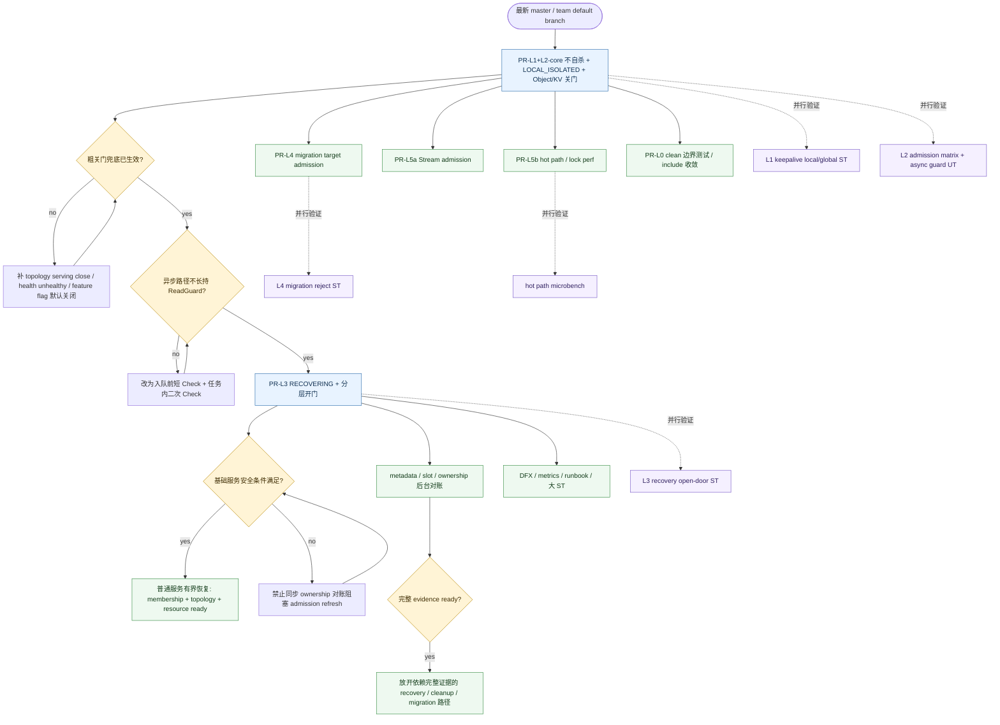

# Worker 隔离自愈：分阶段 PR 推进手册

**Status**: Active  
**Date**: 2026-07-23  
**Audience**: 人 + Codex（今晚起多 thread 并行开 PR）  
**设计**：https://yche.me/design/ds-worker-isolation-self-healing-20260716.html  
**大 PR 参考**：https://gitcode.com/openeuler/yuanrong-datasystem/pull/1405  
**代码 worktree**：`yuanrong-datasystem/.worktrees/worker-self-healing-main-20260716`  
**基线分支**：从最新 `master` / `main/master` 拉出，**不要**直接把 1405 整包当一个 PR 继续堆

---

## 1. 目标与原则

### 1.1 能力阶梯（每步合入后系统仍可用）

| 级别 | 用户可感知能力 | 尚未承诺 |
| --- | --- | --- |
| **L1** | 局部隔离时**进程不自杀**，进入 `LOCAL_ISOLATED`，并有粗粒度关门兜底 | 不保证细粒度 admission / 能自愈 |
| **L2** | 隔离后 **Object/KV 普通读写 fail-fast** | 不保证能恢复回服 |
| **L3** | 网络恢复后进入 `RECOVERING`，基础服务满足安全条件后尽快恢复，完整对账后台收敛 | 迁移/Stream/热路径打磨可后置 |
| **L4** | **迁移 target** 与读写同一套拒绝语义 | Stream / perf 可后置 |
| **L5** | Stream 准入 + 热路径/锁语义打磨 | — |

另：**L0-clean**（删死模块、收依赖）不挡功能，可夹在 L2～L3 之间随时合。

### 1.2 硬原则

1. **按能力拆 PR，不按目录硬切。**
2. **每个 PR 只有一个主故事**；描述里写清「本阶段交付 / 明确不做」。
3. **前一阶段合入前，后一阶段可开发但不要强依赖未合 API 语义漂移**；优先串行主链 `L1→L2→L3`。
4. **从 1405 抽代码可以，但每个切片 PR 必须能独立 review / 独立回滚。**
5. **最小冲击**：第一版不重写 HashRing / metadata recovery / slot recovery 算法；只加 hook + 薄封装。
6. **ds-pr-review / sensitive 扫描**用对应 worktree 里的 `.skills/ds-pr-review`（1405 已更新过滤规则），不要用主仓旧脚本。

### 1.3 今晚 Codex 并行策略

```text
主链（串行优先，可开 3 个 thread 但合并顺序固定）：
  Thread-A: PR-L1 不自杀
  Thread-B: PR-L2 关门（依赖 L1 分支或已合 master）
  Thread-C: PR-L3 恢复（依赖 L2，基础服务开门与完整对账分层）

可并行旁路（不挡主链）：
  Thread-D: PR-L0-clean 删死模块（可基于 L1 或 L2）
  Thread-E: PR-L4 迁移对齐（依赖 L2 API）
  Thread-F: PR-L5 后置（Stream / perf）— 建议明晚或 L3 合后再开
```

**2026-07-24 最新 1405 读码后调整：优先抽 `L1+L2-core`，L3 只保留“基础服务先开门 + 完整对账后台收敛”的最小闭环。**  
当前 1405 已经修掉一批原 P0/P1：删除 `worker_topology_availability_admission` 死模块、修 `AcquireGuard` transition-pending fallback、异步 Object/Stream admission 改为短 Check + 任务内二次 Check、引入 `IsServingReady`。今晚不要再围绕这些已修点反复开刀，主战场改为“抽小 PR + 去同步对账阻塞 + 裁剪旁路能力”。

建议今晚落地顺序：

1. **先抽 PR-L1+L2-core**：`LOCAL_ISOLATED` 不自杀、粗粒度 topology serving close、Object/KV 普通读写 fail-fast、异步 admission 不长持锁、`AcquireGuard` fallback OK。  
   这一步可以合并 L1/L2，是因为只做 L1 不做关门会产生“进程活着但继续接错请求”的风险。
2. **再抽 PR-L3-minimal 草稿**：保留 `IsServingReady = membership + topology + resource` 先开门；metadata / slot / ownership 只作为后台完整 evidence 收敛，不阻塞普通服务恢复。
3. **L4 migration、L5 Stream、L5 hot path 分出去**：当前 1405 里已有部分实现，但它们不是“基本隔离恢复”必需能力，继续留在首批 PR 会拖大 review 面。
4. **L0-clean 不再单独挡主链**：死模块已删除，可随 `L1+L2-core` 一起带走；后续只保留边界测试和 include 收敛。

### 1.4 作战依赖图



读图规则：

- `L1+L2-core → L3` 是当前最新作战主链；L1 不建议再单独裸提，因为不自杀后必须同时有粗关门兜底。
- `L4 / L5a / L5b / L0 / DFX` 是旁路能力，可以并行开发，但各自依赖图中上游 API/语义。
- 验证线可以和实现线并行跑；失败只回流到对应阶段，不把所有 thread 都拖回同一个大 PR。
- L3 有两扇门：`membership + topology + resource` 满足后普通服务先恢复，完整对账后台收敛后再放开 migration / ownership-sensitive 路径。
- 1405 最新代码仍要重点卡 `WorkerOCServer::RefreshTopologyServingAdmission -> HandleMembershipRecovery -> ReconcileNetworkRecoveryOwnership`：这条不能同步阻塞 topology admission refresh。

---

## 2. 公共工程约定

### 2.1 分支命名

```text
feat/worker-isolation-l1-no-self-kill
feat/worker-isolation-l2-oc-admission
feat/worker-isolation-l3-recovery-evidence
feat/worker-isolation-l4-migration-admission
feat/worker-isolation-l5a-stream-admission
feat/worker-isolation-l5b-admission-hotpath
chore/worker-isolation-l0-runtime-cohesion
```

### 2.2 基线与取材

| 动作 | 说明 |
| --- | --- |
| 新分支基线 | 最新 `master`（或团队默认主分支） |
| 代码来源 | 可从 `feat/worker-self-healing-main-20260716` / PR 1405 **拣选**相关 commit/文件 |
| 禁止 | 把 1405 全部文件一次性 cherry-pick 进 L1 |
| 验证节点 | 默认 `tiantiyun-80c128g`（见 workspace 规则） |

### 2.3 每个 PR 描述模板（复制用）

```markdown
## Summary
- 阶段：L?
- 交付能力：…
- 明确不做：…

## Design mapping
- 对应设计章节 / DryRun：…
- 链接：https://yche.me/design/ds-worker-isolation-self-healing-20260716.html

## Test plan
- [ ] UT：…
- [ ] ST（如有）：…
- [ ] 手动/注入：…

## Follow-ups
- 下一阶段：L?
```

### 2.4 Codex 通用约束（每个 thread 都贴）

```text
工作目录：yuanrong-datasystem 的独立 worktree（不要污染 master-latest 主 worktree）
规范：AGENTS.md + engineering-principles；改 .h/.cpp 后 clang-format -i
不要：重写 recovery 算法、扩大无关 refactor、提交密钥/内网路径
提交：仅在用户要求时 commit；PR 用 gh/gitcode 流程按团队习惯
自检：在本 worktree 跑 python3 .skills/ds-pr-review/scripts/review_pr.py prepare <PR>
```

---

## 3. 阶段详单

### 3.1 PR-L1 — 不自杀（先搞定）

**一句话**：局部隔离时进程保活并进入 `LOCAL_ISOLATED`，替换异常 `SIGKILL`，同时必须有粗粒度关门兜底，避免“活着但继续服务”。

| 项 | 内容 |
| --- | --- |
| 对应设计 | §2.1 / §2.2 / DryRun 1–3；图 3-2 隔离检测段 |
| 允许改 | `worker/runtime` 状态机相关（`WorkerRuntimeState*`、types）、`WorkerIsolationCoordinator`（可先瘦身）、`EtcdStore` keepalive 局部隔离 hook、HashRing/local self passive 路径去自杀、`worker_oc_server` **仅接线隔离事件**、相关 UT |
| 禁止改 | OC/SC 业务入口大面积 admission、完整 recovery evidence 编排、migration 全量、Stream、master 大改、无关 topology 重写 |
| 必须兜底 | 若本阶段要合入生产，必须在 local isolation 确认后关闭 topology serving admission / health unhealthy / 或 feature flag 默认关闭；不能留下 worker 活着但继续接新业务的窗口 |
| 最小验收 | ① 注入 keepalive 局部隔离 → 进程仍在 ② mode/`LOCAL_ISOLATED` 可观测 ③ topology serving/health 至少粗粒度不可服务或 feature flag 默认关闭 ④ 主动缩容仍走原退出语义 ⑤ 非预期路径不再 `SIGKILL` |
| 依赖 | 无（主链起点） |
| Codex 焦点 | 从 1405 **只抽出**「状态 + 隔离事件 + 停杀」；能编译、UT 过即可开 PR |

**Codex thread 提示（L1）**

```text
目标：开 PR feat/worker-isolation-l1-no-self-kill
只交付「局部隔离不自杀 + LOCAL_ISOLATED + 粗粒度关门兜底」。
从 worker-self-healing 分支拣选最小文件集；不要带 OC/SC admission、不要带完整 recovery。
如果本阶段准备合入生产，local isolation 后必须关闭 topology serving admission / health unhealthy，或用 feature flag 默认关闭能力；不能留下“进程活着但继续接新业务”的状态。
对照设计 DryRun1/2/3。PR 描述写清本阶段不做恢复/准入热路径。
完成后给出：分支名、改动文件列表、如何本地/远程跑相关 UT。
```

---

### 3.2 PR-L2 — 先关门（Object/KV 准入）

**一句话**：非 `RUNNING` 时 Object/KV 普通读写快速拒绝。

| 项 | 内容 |
| --- | --- |
| 对应设计 | 表 3-6；DryRun 1 的 admission 关闭；§3.2.1 `WorkerServiceAdmission` |
| 允许改 | `WorkerServiceAdmission` / `WorkerAdmissionFacade` / Facade 准入 API、`worker_oc_service_impl` **同步**入口 guard、必要 KV 路径、admission 矩阵 UT/ST |
| 禁止改 | Stream 全量、migration 全量对齐（留给 L4）、复杂 ownership 恢复（留给 L3）、perf fast-path 大优化（留给 L5b） |
| 异步注意 | **不要**把 `ReadGuard` 以 shared_ptr 带进 `threadPool_->Execute` 长期持有；L2 采用「入队前瞬时 Check / 短校验，任务内再 Check」的简单正确版；任务内二次 Check 失败必须 `SendStatus`/填充 rsp 并立即 return |
| 必修修复 | `AcquireGuard` transition-pending fallback 必须透传 `Check` 的 OK，避免误拒 `DIAGNOSTIC`/`CLEANUP`/`RECOVERY` |
| 最小验收 | `LOCAL_ISOLATED`/`RECOVERING` 下 Get/Put/Create 等快速失败，错误含 mode/reason；不进入 data/metadata 写 |
| 依赖 | L1 已合入或本分支基于 L1 分支 |

**Codex thread 提示（L2）**

```text
目标：开 PR feat/worker-isolation-l2-oc-admission
依赖 L1。只做 Object/KV 普通读写准入关闭。
禁止：Stream、migration 全面改造、完整 recovery evidence。
异步路径禁止长持 admission ReadGuard。
异步任务内二次 Check 失败时必须返回错误给 serverApi/rsp 并停止后续 data/metadata 处理，不允许只打日志后继续执行。
同时修复 AcquireGuard transition-pending fallback：Check 返回 OK 时必须透传 OK。
对照设计表 3-6。开 PR 并写清「恢复回服」属于下一阶段。
```

---

### 3.3 PR-L3 — 再开门（恢复 + evidence）

**一句话**：coordination 恢复后进入 `RECOVERING`；基础服务满足安全条件后尽快恢复，完整 ownership/metadata/slot 对账继续后台收敛并约束依赖完整证据的路径。

| 项 | 内容 |
| --- | --- |
| 对应设计 | DryRun 4/5；§3.2.2–3.2.5；ownership 以 Master 为准 |
| 允许改 | `WorkerRecoveryController`、EvidenceTracker、OC recovery 适配/generation、`OnLocalRecovery` 发 **RECOVERING**（禁止先 READY）、必要 metadata/slot 接线、恢复相关 UT/ST、基础服务准入与完整对账准入分层 |
| 禁止改 | 重写 recovery 算法；为「好看」再加平行抽象；Stream/perf 大改 |
| 最小验收 | 断网→恢复→RECOVERING；基础服务安全条件满足后普通服务在有界时间内恢复；完整对账未完成时 migration/recovery/cleanup 等依赖完整证据的路径仍按 kind 分层拒绝；旧 generation evidence 不可串代；主动缩容不被自愈拉回 |
| 依赖 | L2（关门语义已存在，否则恢复完成前仍可能被访问） |

**Codex thread 提示（L3）**

```text
目标：开 PR feat/worker-isolation-l3-recovery-evidence
依赖 L2。交付 RECOVERING + admission 分层：基础服务达到安全条件后尽快恢复，完整 evidence 后再放开依赖完整对账的路径。
OnLocalRecovery 不得先发 READY membership。
ownership/evidence 不得仅用乐观默认值蒙混；对照设计 DryRun4/5。
不要让 metadata/slot/ownership/resource 对账在 admission refresh 链路里同步阻塞普通服务恢复；对账应后台收敛并通过 kind 分层控制影响面。
不要重写 MetaDataRecoveryManager/SlotRecoveryManager 核心算法。
```

---

### 3.4 PR-L4 — 迁移面对齐

**一句话**：隔离 worker 不能再作为 migration/rebalance target 落数据。

| 项 | 内容 |
| --- | --- |
| 对应设计 | 表 3-6 迁移 target；验收 `MigrationTargetFiltersIsolatedWorker` |
| 允许改 | `worker_worker_oc_service_impl`、`master_worker_oc_service_impl`、migrate 相关入口；与 L2 **同一套**准入语义 |
| 禁止改 | 重做 migrator 策略；顺手大改 master 其它子系统 |
| 最小验收 | 隔离后 MigrateData/PublishMeta 等稳定拒绝；与客户端拒绝语义一致 |
| 依赖 | L2 |

---

### 3.5 PR-L5a / L5b — 补齐与打磨（后置）

**L5a Stream 准入**  
- 设计要求 Object/Stream/KV 都挂 admission；若产品确认本阶段不做 Stream，在总 RFC/PR 描述写明缺口即可。  
- 依赖 L2。

**L5b 热路径与锁语义**  
- `AcquireGuard` 接 `IsFastRunningForAdmission`  
- 异步路径绝不长持 `admissionMutex_` 挡 `MarkLocalIsolated`  
- 对 RUNNING 稳态做微基准/锁开销优化；transition-pending 回退透传 OK 已在 L2/L3 前置修复  
- 对照设计 §3.2.4  
- 依赖 L2（建议 L3 后再做，避免与恢复逻辑缠车）

---

### 3.6 PR-L0-clean — 内聚清理（随时可插）

**一句话**：删生产零调用的重复模块，不改行为。

| 项 | 内容 |
| --- | --- |
| 必做 | 删除 `worker_topology_availability_admission.{h,cpp}` 及 Bazel/CMake；UT 迁到 Facade；去掉错误依赖 |
| 可选 | 合并 OC/SC 重复 admission helper（行为不变） |
| 验收 | 生产无引用；边界脚本/UT 仍过 |
| 依赖 | 最好基于已含 Facade 的 L1/L2 分支 |

---

## 4. 今晚执行清单（给人用）

### 4.1 开 thread 前

- [ ] 确认 1405 worktree 可作取材源：`.worktrees/worker-self-healing-main-20260716`
- [ ] 为每个阶段建独立 worktree（避免多 Codex 抢同一目录）
- [ ] 主链顺序贴在每个 thread 顶部：`L1 → L2 → L3`；旁路标明「可并行、合入不挡主链」

### 4.2 建议今晚产出

| 优先级 | 产出 | Done 标准 |
| --- | --- | --- |
| P0 | L1 分支 + GitCode/GitHub PR | 描述完整；UT 列表；可 review |
| P0 | L2 分支 + PR（基于 L1） | 同步准入；无 async 长持锁 |
| P1 | L3 草稿分支 | 至少编译 + 核心 UT 骨架；可不急着挂正式 PR |
| P2 | L0-clean PR | 纯删除/迁移测试 |
| P3 | L4/L5 仅建分支或 issue | 写清依赖，避免今晚抢主链注意力 |

### 4.3 合入门禁（每个阶段）

- [ ] PR 描述含「交付 / 不做 / 下一阶段」
- [ ] 无敏感信息（用 **本 worktree** `ds-pr-review prepare`）
- [ ] 相关 UT 绿；需要时远程 tiantiyun 跑指定目标
- [ ] 不把下一阶段文件「顺便」塞进本 PR

### 4.4 与大 PR 1405 的关系

- 1405 可作为 **取材与对照**，不再作为唯一合入车辆。  
- 每抽出一个阶段 PR 并合入主线后，在 1405 或 tracking issue 打勾：`L1 done / L2 done …`  
- 若 1405 暂不关：把它改成「超级草稿 / 对照分支」，避免审稿人按完整设计一次验收。

---

## 5. 风险与常见翻车点

| 翻车点 | 后果 | 规避 |
| --- | --- | --- |
| L1 就带上全量 OC/SC admission | PR 再次过大、审不过 | 严格执行允许/禁止文件表 |
| L1 只停自杀但不关门 | worker 活着继续接写，风险比 fail-stop 更隐蔽 | L1 必须粗粒度关门或 feature flag 默认关闭 |
| L2 异步持 ReadGuard | 隔离切换被拖死 | L2 用瞬时 Check + 任务内二次 Check，失败必须返回状态并停止处理 |
| L3 先 READY 再对账 | 恢复前数据可见 | membership 用 RECOVERING |
| L3 等完整对账才恢复普通服务 | 恢复窗口被长对账放大 | 基础服务准入与完整对账准入分层，对账后台收敛 |
| ownership 默认 true | 过早 MarkRunning | generation + Master 证据 |
| Stream 与「最小切片」争论 | 阻塞主链 | Stream 进 L5a；主链不堵 |
| 多 Codex 同目录 | 互相覆盖 | 一人/一阶段一 worktree |

---

## 6. 一页纸顺序（贴在显示器上）

```text
今晚：
  1) L1 不自杀     → 开 PR
  2) L2 Object关门 → 开 PR（基于 L1）
  3) L3 恢复       → 起分支/草稿
  4) L0 删死模块   → 有空就开
稍后：
  5) L4 迁移对齐
  6) L5a Stream / L5b 热路径
```

**口诀**：先别死 → 先关门 → 再开门 → 补迁移 → 再打磨。

---

## 7. 相关文档

- 设计：https://yche.me/design/ds-worker-isolation-self-healing-20260716.html  
- 边界评审：`cluster-boundary-review-20260720.md`  
- Plan A 重构：`refactor-plan-20260720.md`  
- 缩容×故障 follow-up：`scale-fault-overlap-followups.md`  
