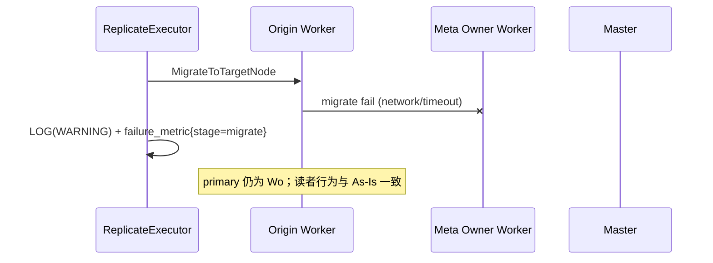
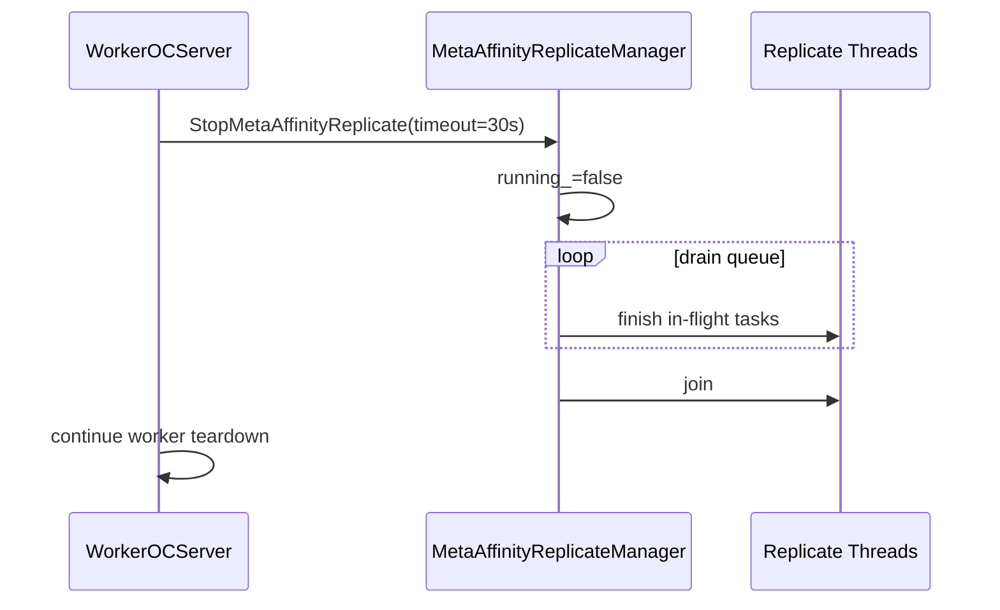
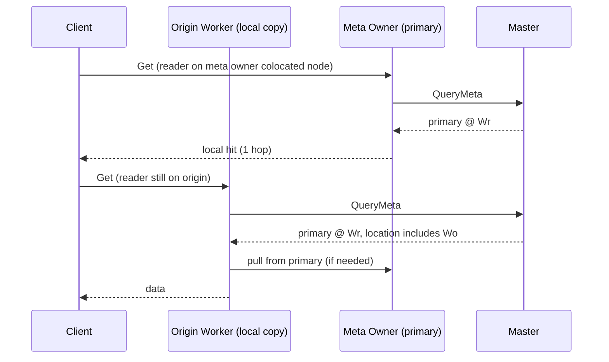

# As-Is / To-Be 时序 — Worker Async Replicate

## 1. As-Is（main/master）：同节点写入无 replicate

```mermaid
sequenceDiagram
    participant C as Client (local worker)
    participant Wo as Origin Worker
    participant M as Metadata Master
    participant Wr as Meta Owner Worker

    C->>Wo: Publish (binary)
    Wo->>M: CreateMeta / UpdateMeta
    M-->>Wo: ACK (meta owner = Wr)
    Wo->>Wo: Save data, primary=true @ Wo
    Wo-->>C: Publish ACK

    Note over Wo,Wr: primary 留在 origin，meta owner 在 Wr

    C->>Wo: Get (later, cold)
    Wo->>M: QueryMeta
    M-->>Wo: primary @ Wo, locations [Wo, ...]
    Wo-->>C: data from Wo
```



**问题**：若读者连到其它 worker，需 cross-worker pull；meta/data 不 colocate。

---

## 2. To-Be Phase 1（feature）：async replicate

```mermaid
sequenceDiagram
    participant C as Client
    participant Wo as Origin Worker
    participant M as Metadata Master
    participant Wr as Meta Owner Worker
    participant Q as MetaAffinityReplicateManager

    C->>Wo: Publish (binary)
    Wo->>M: CreateMeta
    M-->>Wo: ACK
    Wo->>Wo: Save data, primary=true @ Wo
    Wo->>Q: ScheduleMetaAffinityReplicateIfNeeded (async)
    Wo-->>C: Publish ACK (不等待 replicate)

    Q->>Q: ExecuteMetaAffinityReplicate
    Q->>Wo: DataMigrator.MigrateToTargetNode → Wr
    Wo->>Wr: worker-worker migrate RPC
    Wr-->>Wo: migrate OK
    Q->>M: ReplacePrimary(origin=Wo, new=Wr, remove_location=false)
    M-->>Q: success
    Q->>Wo: MarkLocalCopyOnOriginWorker (primary=false locally)

    Note over Wo,Wr: primary @ Wr; Wo 仍保留 local copy location
```

---

## 3. To-Be Phase 1.5：失败与关停

### 3.1 Migrate 失败



### 3.2 Worker Shutdown Drain



---

## 4. 读路径（replicate 完成后）



`SelectObjectLocation` primary 优先（Master 侧，父 RFC）保证 QueryMeta 先指向 Wr。
