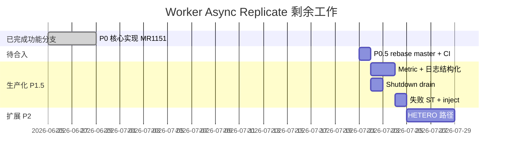

# Work Breakdown — Worker Async Replicate

**估算口径**：1 人日 = 8h 有效开发（含 UT/ST，不含 MR 评审等待）

---

## 总览

---

## WBS

### W0 — 已完成功能（feature/meta-affinity-write）

| ID | 任务 | LOC | 状态 |
|----|------|-----|------|
| W0.1 | `MetaAffinityReplicateManager` 队列/线程池 | ~162 | Done |
| W0.2 | `MetaAffinityReplicateExecutor` migrate+ReplacePrimary | ~208 | Done |
| W0.3 | `PublishObject` 挂接 + gflag | ~60 | Done |
| W0.4 | UT ×4 + ST colocate ×2 | ~214 | Done |
| W0.5 | Get RPC perf ST（读侧收益验证） | ~893 | Done |

**Worker 生产代码**：+552 / -37 行（相对 master）

---

### W1 — 合入主干（P0.5）— **0.5–1 人日**

| ID | 任务 | 产出 | 估时 |
|----|------|------|------|
| W1.1 | Rebase `feature/meta-affinity-write` → `main/master` @ `8e09318ef` | 无冲突预期（master 零重叠符号） | 0.25d |
| W1.2 | tiantiyun UT+ST 回归 | `MetaAffinityReplicateTest` + colocate ST | 0.25d |
| W1.3 | MR !1151 CI 全绿 | check_build + check_code | 0.25d |

**阻塞**：MR 评审 / check_code OpenLibing

---

### W2 — 生产化（P1.5）— **3–4 人日**

| ID | 任务 | 文件（估） | 估时 |
|----|------|-----------|------|
| W2.1 | 新增 5 个 metric | `kv_metrics.h/cpp`, `meta_affinity_replicate_executor.cpp` | 1d |
| W2.2 | 结构化失败日志（objectKey/stage/status） | executor | 0.25d |
| W2.3 | `WorkerOCServer::Stop` 显式 drain replicate 队列 | `worker_oc_server.cpp`, `publish_impl.*`, `manager.*` | 1d |
| W2.4 | 新增 `MigrateType::META_AFFINITY` | `data_migrator.h`, executor | 0.5d |
| W2.5 | ST：`ReplicateFailureInject` + metric 断言 | `meta_affinity_replicate_st_test.cpp` | 0.5d |
| W2.6 | ST：`ShmPublishColocate` | st_test + fixtures | 0.5d |
| W2.7 | 可选：queue max depth + 丢弃策略 | manager | 0.5d（可选） |

**验收**：

- [ ] flag on 时 metric 可在 `/metrics` 或 test dump 看到 scheduled/success/failure
- [ ] worker SIGTERM 后 in-flight replicate 在 timeout 内完成或明确 log
- [ ] inject migrate fail 后 primary 仍在 origin，failure counter +1

---

### W3 — 非 BINARY 扩展（P2 / Issue #9）— **3–5 人日**

| ID | 任务 | 估时 |
|----|------|------|
| W3.1 | CodeGraph + 源码走读 HETERO migrate 现有能力 | 0.5d |
| W3.2 | 扩展 `ScheduleMetaAffinityReplicateIfNeeded` + executor | 1–2d |
| W3.3 | Device migrate handler 适配（若需要） | 1–2d |
| W3.4 | HETERO ST | 1d |

---

## 人日汇总

| 里程碑 | 范围 | 剩余人日 |
|--------|------|----------|
| **M1** | binary 路径合入 master（MR !1151） | **0.5–1** |
| **M2** | M1 + 生产化（metric/shutdown/ST） | **+3–4** → **4–5 总计** |
| **M3** | M2 + HETERO 全格式 | **+3–5** → **7–10 总计** |

> **「Worker async replicate 搞定」** 若指 **binary 主路径可上生产**：距完成 **~4–5 人日**（含 MR 合入）。  
> 核心编码 **~95% 已在 feature 分支**；master 仍为 0。

---

## 风险

| 风险 | 影响 | 缓解 |
|------|------|------|
| MR !1151 CI check_code | 合入延迟 | perf test 长行 pragma / 拆分 helper |
| replicate 与 rebalance 并发 | 同一 object 双写 | 依赖 master version / ReplacePrimary 幂等；ST 加 rebalance 交叉（后续） |
| SCALE_DOWN migrator 语义混淆 | 运维误判 | W2.4 独立 MigrateType |
| HETERO migrate 不支持单对象 | P2 阻塞 | W3.1 先调研，可能降级为「HETERO 不 replicate」 |

---

## 建议执行顺序

1. **W1** — 尽快合入 MR !1151（binary 功能 unblock 读侧收益）
2. **W2.1 + W2.3** — metric + shutdown（上线门禁）
3. **W2.5 + W2.6** — ST 补齐
4. **W2.4** — MigrateType 清理（可与 W2 并行）
5. **W3** — 按客户需求排 HETERO
