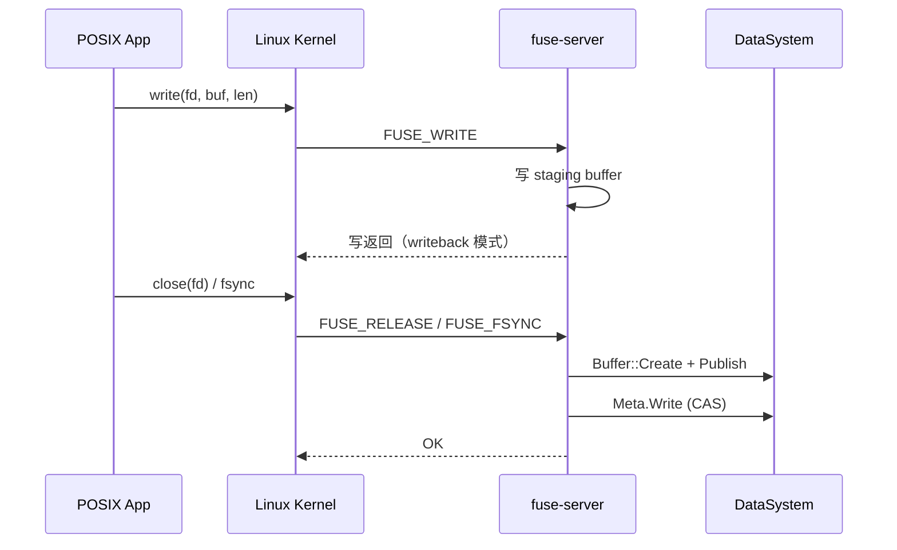
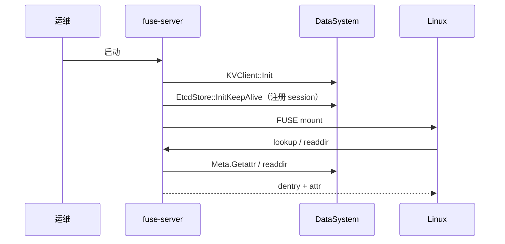
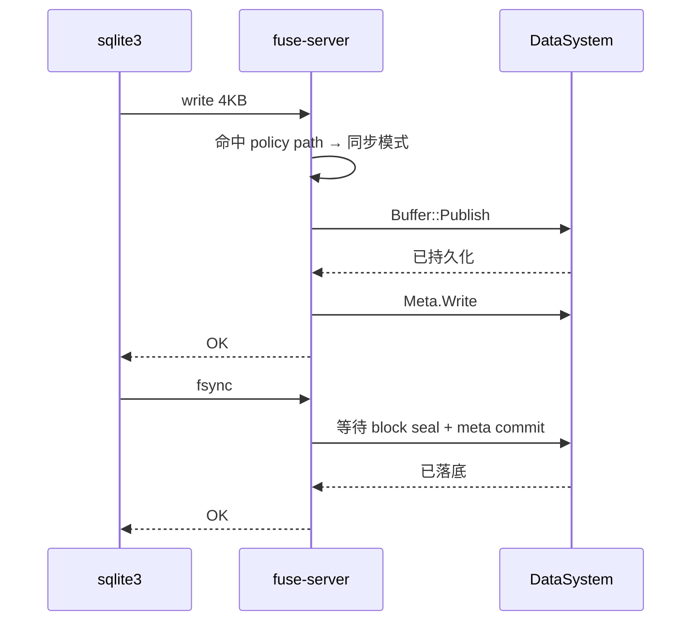
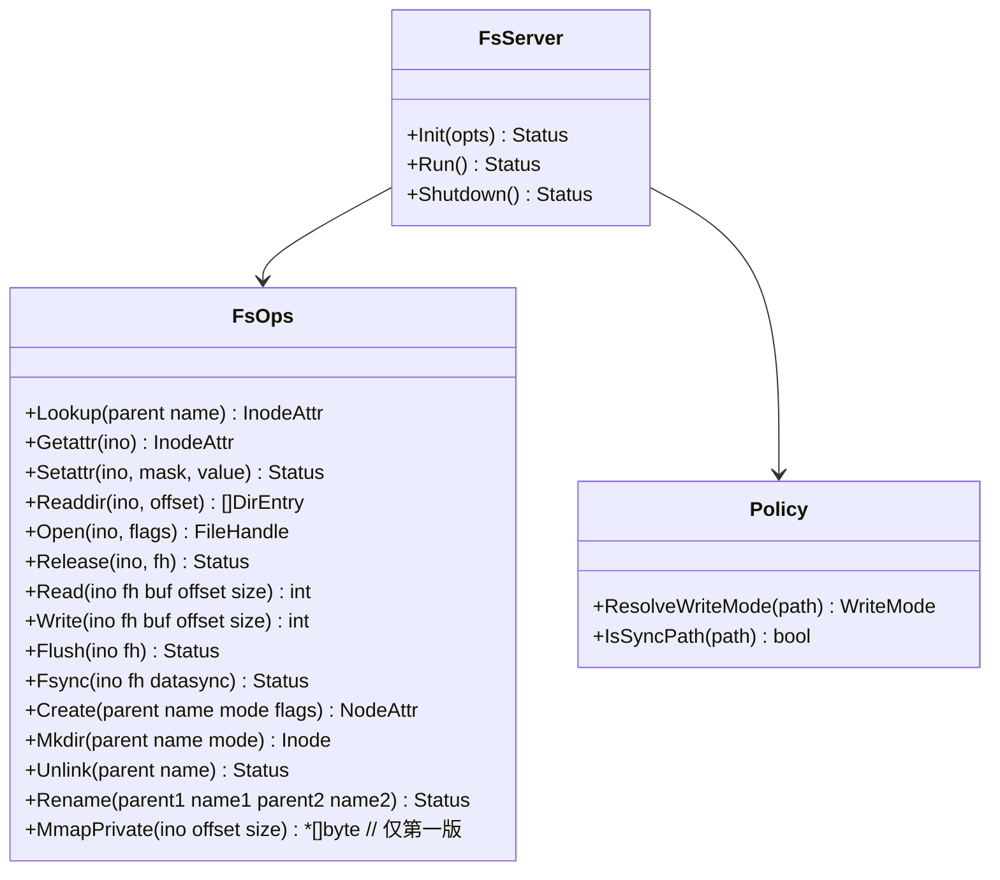
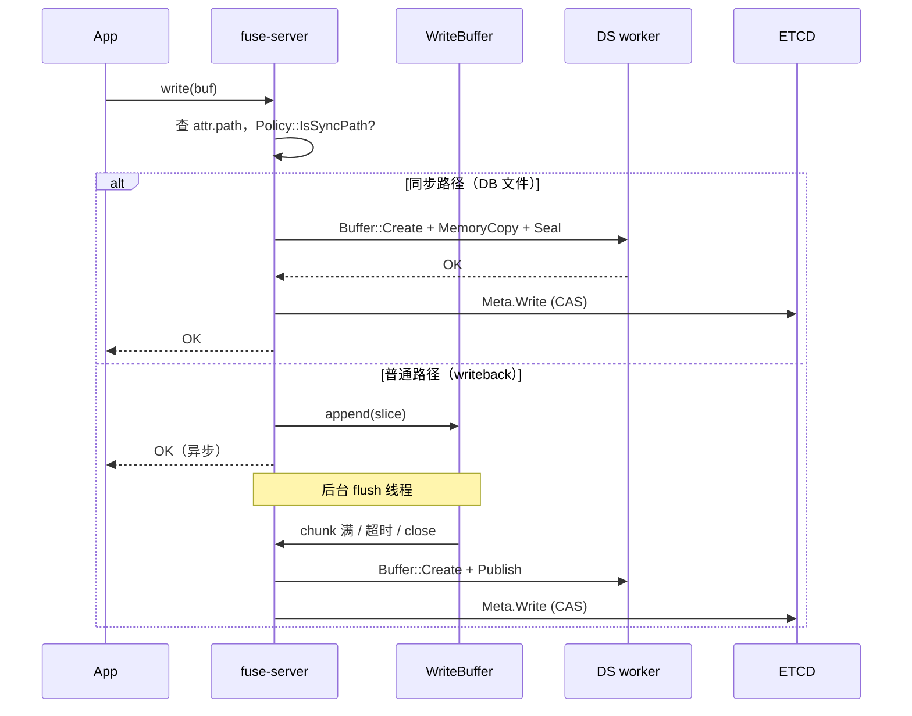
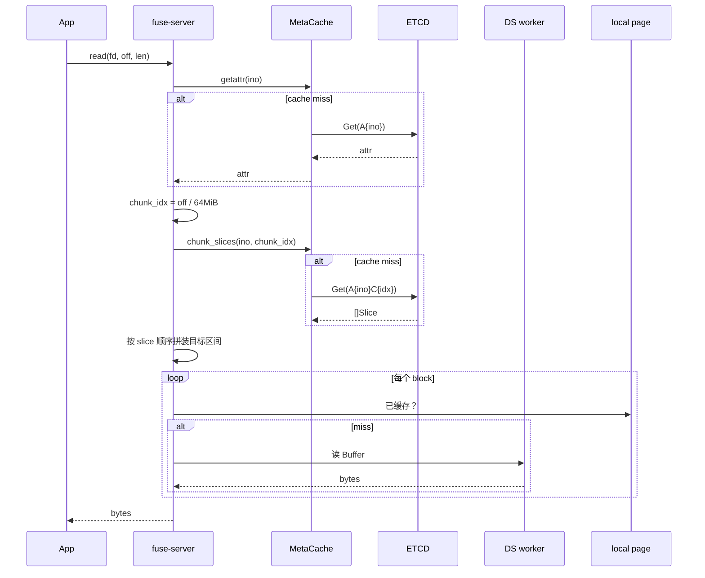
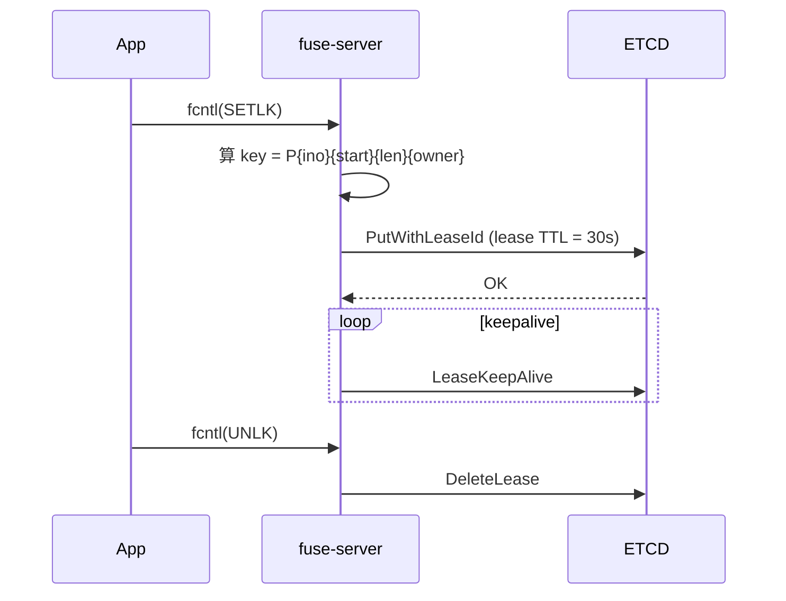
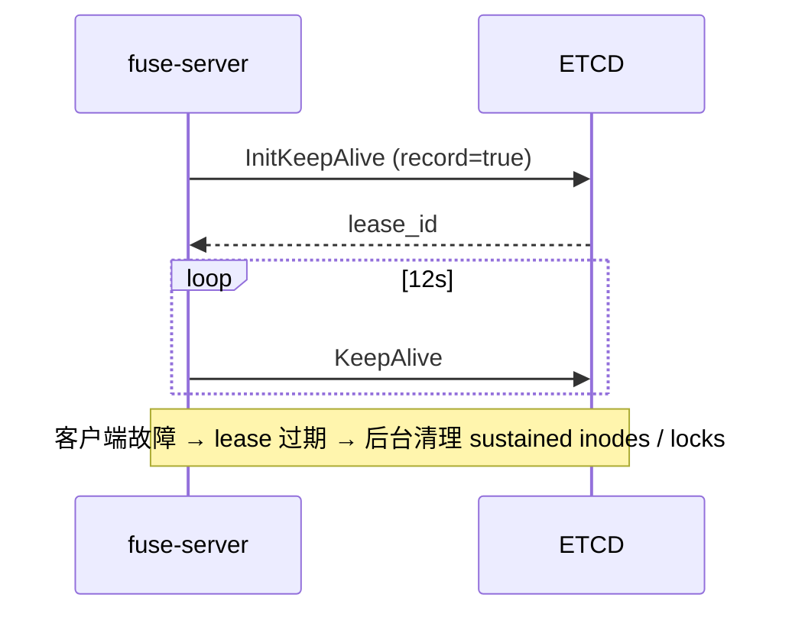
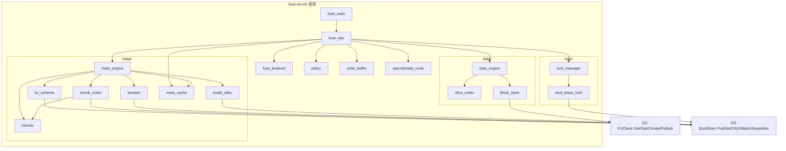

# 子模块：Fuse-on-DataSystem-KV（基于 DS KV 接口的类 JuiceFS FUSE 文件系统）

| 属性 | 值 |
|---|---|
| 创建 | 2026-08-04 |
| 阶段 | P0 脚手架 / P1 代码场景 / P2 DB 场景 / P3 Agent 场景 |
| 前置 | `yuanrong-datasystem` 源码 + `EtcdStore` + `KVClient` + `Buffer` |

---

## §1 需求背景与目标

**背景**：yuanrong-datasystem 已经提供 KV / Buffer / Object 三套接口，背后用 ETCD 做共享元数据。本 RFC 目标是基于这些接口构建一个 FUSE 文件系统服务器，让 Linux 应用以 POSIX 语义访问由 DataSystem 管理的"目录 + 文件"。

**目标**：

| # | 目标 | 验收 | 阶段 |
|---|------|------|------|
| U1 | 在 mount 目录下能完整跑通 POSIX 语义（ls / cat / echo / cp） | 5 个 Linux 基础命令全部正常，错误码与本地 ext4 一致 | P0 |
| U2 | FUSE 内核缓冲合并应用层 writeback，**单 mount 落 1000 个 1KB 小文件**耗时可比 writethrough 模式降 10× | 通过 `juicefs bench` 类似脚本对比 | P1 |
| U3 | SQLite WAL 模式随机 4KB 写 + fsync 持续写入 1 万次，无数据损坏、无 database locked 错误 | 用 `sqlite3` CLI 写随机 page 后 `PRAGMA integrity_check` 返回 `ok` | P2 |
| U4 | 多 agent 并发写 1000 个文件吞吐量 ≥ 1000 files/s，metadata RTT ≤ 10ms | 并发 16 进程 `cp -r small_files_dir mount` | P3 |
| U5 | 重复 stat/open 不穿透到 backend；metadata RTT ≤ 5ms | attr-cache 命中率达到 90%；stat 调用 1ms 内返回 | P1 |

---

## §2 需求边界

**模块定位**：Fuse-server 是独立进程或嵌入式进程，对外暴露 Linux FUSE 接口，对内使用 DS KVClient / Buffer / EtcdStore。FUSE 内核把 syscall 转为 fuse-server 的回调。

### 2.1 关键概念定义

| 术语 | 含义 |
|------|------|
| **mount** | 一个 fuse-server 进程对一个挂载点形成一段 Linux 文件系统视图 |
| **inode** | 文件系统内部 id（u64），按顺序分配，永久不变 |
| **attr** | inode 的元数据（mode/uid/gid/size/mtime 等） |
| **dentry** | 目录项（name → inode） |
| **chunk** | 文件按 64 MiB 划分的逻辑单位（`chunk_idx = offset / 64MiB`） |
| **slice** | 一次连续写产生的逻辑段（变长，24 字节描述） |
| **block** | slice 切 4 MiB 后落 KV 的物理单元 |
| **inline file** | size ≤ 256 KiB 文件，整文件 inline 到元数据 KV 的 value，不创建独立 block |
| **session** | fuse-server 进程到 ETCD 的心跳租约 |
| **staging** | writeback 模式下，未上传 KV 的 slice 缓冲（mem + 可选 disk spill） |
| **policy path** | 按文件名后缀匹配，决定写模式 / fsync 语义的路径集（DB 文件命中即强制同步） |

### 2.2 做什么

| 组件 | 职责 |
|------|------|
| fuse-server 进程 | 启动 / 接收 FUSE 回调 / 维持 session / 关闭 |
| 元数据引擎（MetaEngine） | 实现 JuiceFS `kvMeta` 等价：attr / dentry / chunk slice 列表 / counter / lock |
| 写缓冲（WriteBuffer / Staging） | writeback 模式下缓存未上传的 slice 缓冲；满 chunk / 超时 / close 时刷新 |
| 数据引擎（DataEngine） | 把 block 落到 DS `Buffer::Create` + `Publish`；读 + 组装 |
| 锁服务（LockManager） | POSIX flock / POSIX lock，通过 ETCD lease + CAS 实现 |
| 元数据缓存（MetaCache） | 进程内 attr / dentry 缓存，TTL + ETCD watch invalidate |
| 策略（Policy） | 按文件名匹配的写模式 & fsync 语义分流 |
| 特殊节点（SpecialNodes） | `.stats` 等挂载根目录的伪文件 |

### 2.3 不做什么

| 事项 | 归属 |
|------|------|
| FUSE 内核模块开发 | Linux 内核社区 |
| 完整 POSIX ACL | 第二版（v1 不实现 `setfacl`/`getfacl`） |
| MAP_SHARED mmap / msync | 第二版（v1 仅 MAP_PRIVATE 读） |
| 完整集群级 L1 cache | 第二版（v1 仅 L0 进程内缓存） |
| QEMU / RDMA 直通 | 不在范围 |
| 真正的"对象存储" | v1 用 DS Buffer 即可 |

---

## §3 UseCase

### 3.1 UseCase 概览

外部参与方：
- **POSIX App**（ls/cat/echo/编译器/SQLite/agent）
- **Linux Kernel**（FUSE 协议侧）
- **运维**（启动/停止/查 .stats）

#### UseCase1：写文件



**用户感知**：echo / dd / 编译器写文件能拿到正常返回；fsync 对 DB 文件保证数据落底，对普通文件只保证元数据已 commit。

#### UseCase2：mount 启动与目录浏览



**用户感知**：mount 后 ls 能看到根目录下的内容；多个 mount 之间 session 心跳可见，stale session 会被清理。

#### UseCase3：DB 文件耐久性（SQLite）



**用户感知**：SQLite 的 PRAGMA synchronous=FULL 模式下，每个 commit 都能可靠持久化，不丢 page。

### 3.2 UseCase 总表

| UseCase | 使用者 | 场景 | 需要什么 | 设计响应 | 验收 |
|---------|--------|------|----------|----------|------|
| UC1 | POSIX App | echo hello > a.txt | mount + 写缓冲 + KV 上传 | WriteBuffer + Buffer::Publish | 文件存在且内容正确 |
| UC2 | 运维 | mount 整个卷 | InitEmbedded 或独立进程 | 两种部署模式 | `mount` 命令成功 |
| UC3 | SQLite | 随机 4KB 写 + fsync | 按路径策略同步落底 | Policy sync-paths | integrity_check ok |
| UC4 | Agent | 1000 个小文件并发写 | writeback + inline 小文件 | Policy + Inlining | ≥ 1000 files/s |
| UC5 | 运维 | 看 `.stats` | 伪文件读 | SpecialNodes | 返回 JSON 指标 |

---

## §4 方案设计

### 4.1 类图

> 仅列 fuse-server 进程对外 API。



注：`FsOps` 是 FUSE 回调的目标 trait / interface。具体实现由 `MetaEngine` / `DataEngine` / `LockManager` / `WriteBuffer` 等内部组件组合（详见 §4.4 依赖图）。

### 4.2 开发视图（文件树）

```
src/datasystem/fuse/                           # 新模块
├── CMakeLists.txt
├── fuse_main.{h,cpp}           # 启动入口（Init + Run + Shutdown）
├── fuse_ops.{h,cpp}            # FUSE 回调实现（lookup/read/write/...）
├── fuse_lowlevel.{h,cpp}       # libfuse low-level 胶水层（这里以后也可换 go-fuse）
├── policy.{h,cpp}              # 路径策略（写模式、fsync 语义）
├── write_buffer.{h,cpp}        # writeback staging buffer
├── compact.{h,cpp}             # slice 合并（后台，可选 P3 做）
│
├── meta/                       # 元数据引擎
│   ├── meta_engine.{h,cpp}     # 总入口：封装 EtcdStore 的高层 API
│   ├── kv_schema.{h,cpp}       # K-V key 常量与编解码（A/D/C/S/X/F/P/K/SE/SI/SS/...）
│   ├── inode_alloc.{h,cpp}     # nextInode 计数器
│   ├── chunk_coder.{h,cpp}     # chunk → []Slice 编码与 CAS 追加
│   ├── session.{h,cpp}         # session 心跳（封装 EtcdStore::InitKeepAlive）
│   ├── meta_cache.{h,cpp}      # L0 进程内 attr/dentry 缓存
│   └── txlocks.{h,cpp}         # 1024 分片本地锁
│
├── data/                       # 数据引擎
│   ├── data_engine.{h,cpp}     # 数据上传 / 下载
│   ├── slice_coder.{h,cpp}     # Slice 24B 编码
│   └── block_store.{h,cpp}     # 包装 KVClient::Create / Publish / Seal
│
├── lock/                       # 锁服务
│   ├── lock_manager.{h,cpp}    # flock / POSIX lock 入口
│   └── etcd_lease_lock.{h,cpp} # ETCD lease + CAS 实现
│
└── special/                    # 特殊节点
    └── stats_node.{h,cpp}      # .stats 实现
```

### 4.3 关键交互

#### K1：写流程（writeback 路径，默认）



**错误码映射**：

| 情况 | 返回 |
|------|------|
| Buffer::Publish 失败 | EIO，重试 1 次，超时返回 ESTALE |
| Meta.Write CAS 冲突 | 重试 50 次（指数退避），仍冲突返回 EAGAIN |
| ETCD 不可达 | 返回 EIO，调用方后续 flush 会再试 |

**关键不变量**：
- 调用 `Write()` 返回成功只代表 staging 已收，**不代表数据已落底**
- 调用 `Flush()` 阻塞直到 staging 已刷
- 调用 `Fsync()`（DB 路径）阻塞直到 block seal + meta commit

#### K2：读流程



#### K3：POSIX 锁（ETCD lease 模式）



lease 失效 = 锁自动释放（拥有者故障安全）。

#### K4：session 心跳



### 4.4 模块依赖图



### 4.5 关键数据结构

#### InodeAttr（全部进 Attr 的 K-V 记录）

```cpp
// 复用 JuiceFS Attr 字段，但简化：v1 不实现 ACL/capability
struct InodeAttr {
    uint8_t  typ;          // 1=file, 2=dir, 4=symlink
    uint16_t mode;         // 0-4095
    uint32_t uid, gid;
    int64_t  atime, mtime, ctime;   // 秒
    uint32_t nlink;
    uint64_t length;       // 逻辑文件大小
    bool     full;         // 字段是否填满
};
// 编码：bincode-like 二进制，约 56 字节
// key: A{ino}
// 并发安全：单 ino attr 在 txlocks 中独占
```

#### SliceList（chunk 内全部 slice）

```cpp
struct Slice {
    uint64_t id;       // 全局唯一（fuse-server 生成 UUID）
    uint32_t size;     // 对象中占位大小（含空洞）
    uint32_t off;      // 在 slice 内的偏移
    uint32_t len;      // 有效长度
};
// 一条 chunk 的所有 slice 顺序追加
// key: A{ino}C{indx}
// value: u32 count + Slice[]  二进制编码
// 并发安全：单 (ino, indx) 写入在 txlocks 中独占；CAS 重试 50 次
```

#### MetaCacheEntry（进程内缓存）

```cpp
struct AttrEntry {
    InodeAttr attr;
    uint64_t   version;   // ETCD revision（detect stale）
    Time       expire_at;
};
struct DentryEntry {
    std::vector<Dentry> entries;  // name+ino
    uint64_t parent_version;
    Time    expire_at;
};

// 缓存 TTL（参照 JuiceFS 生产实测参数，stat/open 密集场景关键路径）
//   - 默认：attr-cache = 60s, entry-cache = 30s, dir-entry-cache = 30s, open-cache = 60s
//   - 与 JuiceFS production 对齐；writeback 模式下自身写会触发精确 invalidate
//   - 跨 mount：通过 ETCD watch 触发精确 invalidate；错的 TTL 仅是安全网
// Watch invalidate：ETCD watch 命中 → invalidate specific key
// 并发安全：read 时锁或 copy-on-write；v1 用 std::shared_mutex
```

#### WriteBufferEntry（writeback staging）

```cpp
struct StagedSlice {
    uint64_t slice_id;
    uint32_t chunk_idx;
    uint32_t off_in_chunk;
    uint32_t len;
    std::vector<uint8_t> data;
};
// 内存结构：hash map< (ino, chunk_idx), vector<StagedSlice> >
// 触发 flush：chunk 满 64MiB / 超时 5s / close / fsync
```

并发安全说明：
- `txlocks`：1024 std::mutex，按 `FNV32(ino) % 1024` 取模
- `meta_cache`：std::shared_mutex；TTL + watch 双触发 invalidate
- `write_buffer`：单 mutex；flush 线程不持锁读，复制出来

### 4.6 组件接口设计

#### 元数据接口（meta_engine 对 fuse_ops）

**v1 同时出 MetaBackend trait + DsEtcdBackend 实现**，把后端实现方式作为可替换组件：
- v1 现在实现 `DsEtcdBackend`（走 DS `EtcdStore`，单 ETCD 集群）
- v2 可加 `DsCoordinatorBackend`（走 DS 内置 braft Raft in-memory store），实现同样 trait 即换后端
- v2 也可加 `DsTikvBackend`（走 TiKV-sharded keyspace），同 trait

这样 fuse-server 业务代码**不被任何具体 backend 锁死**。JuiceFS 这十几年的核心教训：Meta 后端必须可插拔。

```cpp
// 抽象：fuse-server 看到的统一 Meta 接口
class MetaBackend {
public:
    virtual ~MetaBackend() = default;

    // 生命周期
    virtual Status Init(const BackendOptions&) = 0;
    virtual Status Shutdown() = 0;

    // inode
    virtual Status AllocateIno(Ino*) = 0;                                    // 分配 nextInode
    virtual Status GetAttr(Ino, InodeAttr*) = 0;                             // 读取 inode 属性
    virtual Status SetAttr(Ino, uint mask, const InodeAttr&) = 0;            // CAS 写属性

    // dentry
    virtual Status Lookup(Ino parent, std::string_view name, Entry*) = 0;
    virtual Status Mkdir(Ino parent, std::string_view name, uint mode) = 0;
    virtual Status Unlink(Ino parent, std::string_view name) = 0;
    virtual Status Rename(Ino p1, std::string_view n1, Ino p2, std::string_view n2) = 0;

    // chunk → slice 列表
    virtual Status ReadChunkSlices(Ino, uint32_t chunk_idx, std::vector<Slice>*) = 0;
    virtual Status AppendSlice(Ino, uint32_t chunk_idx, const Slice&) = 0;    // CAS 追加

    // 计数器
    virtual Status NextChunkId(Ino, uint32_t*) = 0;

    // 监视（用于跨 mount 的精确 invalidate）
    virtual Status WatchMeta(std::function<void(MetaEvent)> cb) = 0;
};

// v1 唯一具体实现：走 DS EtcdStore
class DsEtcdBackend : public MetaBackend {
    std::shared_ptr<EtcdStore> store_;   // DS 已封装的 KV + Lease + Watch
    KvSchema schema_;                    // A/D/C/S/X/F/P/K/SE/SI/SS/... 协议层
public:
    // 实现：对 EtcdStore::CAS/Get/Delete/Put 的一层 schema-aware 包装
};

class MetaEngine {
    std::shared_ptr<MetaBackend> backend_;   // 注入 backend，运行时可换
    MetaCache cache_;                        // L0 进程内缓存（attr/dentry，TTL + watch invalidate）
public:
    Status Init(const FuseOptions&, std::shared_ptr<MetaBackend>);
    Status Shutdown();

    // 业务 API（与原方案一致），内部统一走 cache + backend
    Status GetAttr(Ino, InodeAttr*);
    // ... 其余同上，省略
};
```
```

#### 数据接口（data_engine 对 fuse_ops）

```cpp
class DataEngine {
public:
    // 写：把 block bytes 提交到 DS
    // - size > 256 KiB：走 Buffer::Create + MemoryCopy + Seal
    // - size <= 256 KiB：inline 到 meta KV（元数据接口）
    Status PutBlock(uint64_t slice_id, uint32_t block_idx,
                    const uint8_t* data, size_t len);

    // 读：从 DS 读一个 block
    Status GetBlock(uint64_t slice_id, uint32_t block_idx,
                    std::vector<uint8_t>* out);
};
```

#### 锁接口

```cpp
class LockManager {
public:
    Status SetLk(Ino, uint64_t owner, uint32_t ltype, off_t start, off_t len, bool block);
    Status GetLk(Ino, uint64_t owner, LockInfo*);
    Status SetLkUnlock(Ino, uint64_t owner, off_t start, off_t len);
    // 内部实现：用 ETCD lease + CAS，lease TTL = 30s
};
```

---

## §5 对外接口

### 5.1 启动参数

| 参数 | 类型 | 默认 | 说明 |
|------|------|------|------|
| `--mountpoint` | string | 必填 | Linux 挂载点 |
| `--ds-addr` | host:port | — | DS worker 地址（独立模式） |
| `--embedded` | bool | false | 嵌入式模式（InitEmbedded） |
| `--chunk-size` | bytes | 67108864 (64 MiB) | chunk 大小 |
| `--block-size` | bytes | 4194304 (4 MiB) | block 大小 |
| `--inline-threshold` | bytes | 262144 (256 KiB) | ≤ 此值走 inline |
| `--sync-paths` | glob list | `*.db,*.sqlite*,*-wal,*-shm,*.ldb,*.sst` | 同步路径 |
| `--staging` | enum | `disk` | `memory` / `disk` |
| `--staging-dir` | path | `/var/lib/ds-fuse/staging` | spill 目录 |
| `--writeback-cache` | bool | true | 是否启用 FUSE 内核 writeback |

### 5.2 环境变量

| 变量 | 说明 |
|------|------|
| `DS_FUSE_LOG_LEVEL` | log 级别（debug/info/warn） |
| `DS_FUSE_ETCD_ADDR` | 与 `--etcd-address` 同 |

### 5.3 运维接口

| 路径 | 行为 |
|------|------|
| 挂载点下 `.stats` | read 返回 JSON 指标：cache hit ratio / staging bytes / 上传队列长度 |
| 挂载点下 `.config` | read 返回当前配置 JSON |

---

## §6 约束 + 风险

### 6.1 约束

| # | 约束 | 违规后果 |
|---|------|----------|
| C1 | `Write()` 返回成功不等于数据落底，必须看 `Fsync()` | 用户误以为有持久化，crash 后丢数据 |
| C2 | `flush` 必须与 Close 一致，handle 释放前未 flush staging 会触发后台 fsync | handle 泄露文件对象 |
| C3 | POSIX 锁 owner = `owner ^ fh`，同进程多 fd 不冲突 | 多 fd 会撞锁 |
| C4 | 元数据 K-V 全部以 A/D/C/S/X/F/P/K/SE/SI/SS 为前缀，与 JuiceFS 一致 | 跨工具不兼容 |
| C5 | chunk/slice 大小必须用 little-endian 字节编码 | 反向解析失败 |
| C6 | Fuse-server crash 后，未完成的 session 由 ETCD 自动清理 sustained inode | 重启 fuse-server 不能 restore 之前的 file handle（Open() 会重新走一遍） |
| C7 | `staging disk` 模式下，spill 文件与镜像挂载点目录同位置 | spill 文件被 mount 看到需要 `O_EXCL` 命名 |
| C8 | inode 号分配必须单调递增且持久 | 文件系统重新启动不能复用旧 inode |

### 6.2 风险

| # | 风险 | 缓解 |
|---|------|------|
| R1 | ETCD 单点 / 网络抖动导致所有 Meta 操作慢 | session 失败时本地缓存"轻度陈旧"视图，支持降级只读 |
| R2 | writeback staging 文件意外丢失（kill -9） | 文档明示；不承诺 default 数据安全；DB 路径强制 sync |
| R3 | 多 mount 之间 close-to-open 不一致 | 文档明示；CC 协议下其它 mount 看到旧视图 |
| R4 | 元数据膨胀（每个文件 5 条 KV），ETCD 容量上限 8GB | 单 mount 限制文件数；用 compact 后台合并 chunk slice 列表 |
| R5 | DS worker 重启导致 Buffer 引用失效 | Buffer SDK 已有 `K_BUFFER_DEPRECATED` 处理；fuse-server 捕获后重新 Get |
| R6 | FUSE 单线程回调阻塞（fuse 默认）导致多路 CPU 闲置 | 启动时 `fuse_lowlevel::Init` 设置 `-o max_background=64` |
| R7 | 1024 分片锁 hash 不均导致热点 inode 抖动 | 可改为跳表 / per-inode mutex，但 v1 接受 |
| **R8** | **高并发 metadata 场景下，attr/open 全部穿透到 ETCD，单集群 RTT = 3-5 ms + QPS ≈ 万级上限，系统会卡死** | **三层应对**（v1 全做）：1) **L0 cache + TTL = 60s/30s**（业内 JuiceFS production 实测默认参数，命中率达 90% 时 backend 几乎不被打）→ 把 ETCD RTT 隐藏掉；2) **`MetaBackend` trait 抽象**：fuse-server 不绑死 ETCD，v2 可加 `DsCoordinatorBackend`（走 DS 内置 braft Raft in-memory，无 8 GB 上限）；3) **热点 inode 路由**：同一 inode 的 attr 通过 hash 落到固定 worker，多 mount 共读走 worker local cache |
| R9 | L0 cache 在长 TTL 下"读到陈旧" | ETCD watch 触发精确 invalidate（最关键路径）；TTL 仅是兜底（与 JuiceFS `--cache-validate` 一致）；陈旧最长持续 ≤ TTL |

---

## §7 落地步骤

按四个阶段分阶段实施，每阶段独立可发布，每阶段后跑 `build.sh -t build` + 关键 ST：

### Phase 0：脚手架（P0）

| PR | 内容 | 验收 |
|----|------|------|
| 0.1 | 新模块骨架：`src/datasystem/fuse/CMakeLists.txt`、`fuse_main/fuse_lowlevel/fuse_ops` 空壳，可启动 + 能 mount 空目录 | `./fuse_server --mountpoint /tmp/x --ds-addr ...` 成功 |
| 0.2 | `meta/kv_schema` + `meta/meta_engine`（仅 GetAttr / Lookup） + `policy`（默认 stub） | ls 根目录可见 |
| 0.3 | `data/data_engine`（仅 PutBlock / GetBlock）+ `meta/chunk_coder`（仅 ReadChunkSlices） | 写一个文件并读到 |

### Phase 1：代码场景（P1）

| PR | 内容 | 验收 |
|----|------|------|
| 1.1 | `write_buffer` + `Writeback` 模式落地 | 写 1000 个 1KB 文件可测出吞吐提升 |
| 1.2 | `meta_cache` + ETCD watch invalidate | `git status` 等 stat 密集场景不卡 ETCD |
| 1.3 | `MmapPrivate`（MAP_PRIVATE 读） | gcc 编译大源文件能跑通 |
| 1.4 | 完整 Readdir / Setattr / Rename / Unlink | POSIX 语义通过 `./tests/ut/fuse_posix_test` |

### Phase 2：DB 场景（P2）

| PR | 内容 | 验收 |
|----|------|------|
| 2.1 | `policy::IsSyncPath()` + Fsnyc 同步路径 | echo hello > data.db / fsync 后 kill -9，重启后能读到 |
| 2.2 | `lock/etcd_lease_lock` + `lock_manager` | sqlite 跨进程并发写不报 "database is locked" |
| 2.3 | 性能调优：chunk_coder 的 CAS 重试退避；txlocks 热点 inode 监控 | SQLite stress test 1 万次无损坏 |

### Phase 3：Agent 场景（P3）

| PR | 内容 | 验收 |
|----|------|------|
| 3.1 | inline 小文件（≤ 256 KiB） | 1KB 文件不创建独立 Buffer |
| 3.2 | staging disk-spill 落地 | kill -9 丢未刷 staging file，db-wal 文件不丢 |
| 3.3 | session 心跳 + .stats | 多 mount 看见对方 session，stale 5min 清理 |

---

## §8 测试方案

### 8.1 UT

| 文件 | 覆盖点 | 目标 |
|------|--------|------|
| `tests/ut/fuse/kv_schema_test.cpp` | Attr 编解码 / Slice 编解码 / key 名称符合 JuiceFS 规约 | 100% |
| `tests/ut/fuse/chunk_coder_test.cpp` | chunk slice 列表 CAS 重试 & 版本号对齐 | 95% |
| `tests/ut/fuse/txlocks_test.cpp` | 1024 分片锁 hash 分布 | 90% |
| `tests/ut/fuse/policy_test.cpp` | sync paths glob 匹配 / write mode 命中规则 | 100% |
| `tests/ut/fuse/write_buffer_test.cpp` | staging 满 / 超时 / close 三种触发 flush | 95% |

### 8.2 IT

| IT | 对应 UseCase | 场景 | 断言 |
|----|--------------|------|------|
| `tests/st/fuse/posix_basic_test.cpp` | UC1 | touch / echo / cat / rm | 文件存在、内容正确、错误码与 ext4 一致 |
| `tests/st/fuse/writeback_bench.cpp` | UC4 | 1000 × 1KB 文件 16 进程并发 | 吞吐 ≥ 1000 files/s |
| `tests/st/fuse/sqlite_durability_test.cpp` | UC3 | 1万次 4KB 随机写 + fsync | `PRAGMA integrity_check` 返回 ok |
| `tests/st/fuse/fcntl_lock_test.cpp` | UC3 | 跨 2 进程 fcntl SETLK | 加锁 / 释放 / 冲突检测正确 |
| `tests/st/fuse/mmap_read_test.cpp` | UC1 | mmap 读 64 MiB 文件 | 内容正确，第二次命中 page cache |
| `tests/st/fuse/multi_mount_consistency_test.cpp` | UC2 | 2 个 mount 同时写同一文件 | close 后都看到新数据（close-to-open 一致性） |

### 8.3 关键性能指标

- 1KB 小文件 write 吞吐：≥ 1000 files/s（writeback 模式）
- 随机 4KB write + fsync QPS：≥ 5000 ops/s
- readdir 10000 文件目录：< 200ms（含第一次 attr cache miss）
- mmap 读 64 MiB：流速 ≥ 1 GB/s（同机器 SHM）

---

## §9 开放问题 / 后续

| # | 问题 | 决断时机 |
|---|------|----------|
| Q1 | L1 cluster cache（多 mount 共享 ETCD-cache）要不要在 P4 加？ | 看 L0 cache hit ratio，< 70% 时启用 |
| Q2 | compaction 后台（合并 chunk slice 列表）要不要在 P4 加？ | 看大文件随机写后的 read 性能 |
| Q3 | `*.db-wal` 同步路径是否要包含 `*.db-journal`？ | DB 用户实测 |
| Q4 | fuse-server 崩溃恢复后，能否 restore 之前打开的 file handle | 第一版不支持，看用户需求 |
| **Q5** | **v2 元数据后端替换：要不要实现 `DsCoordinatorBackend`（DS 内置 braft Raft）作为 ETCD 高密度升级路径？** | **v1 上线后看实际 QPS/RTT 是否到 ETCD 上限。JuiceFS 官方在百万级以上文件规模也是这种做法——把 backend 换掉，不是把 JuiceFS 改写** |
| **Q6** | **热点 inode 路由（fuse-server 把 lookup 路由到固定 worker 本地缓存）要不要做？** | **看 v1 部署中 inode 集中度分布** |
