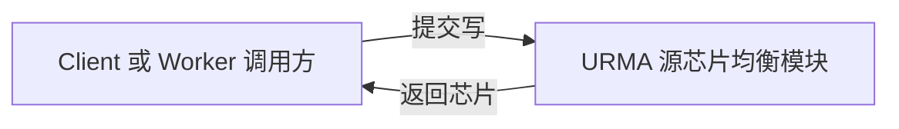
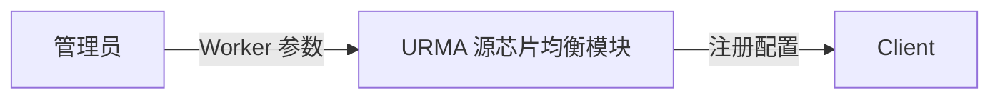
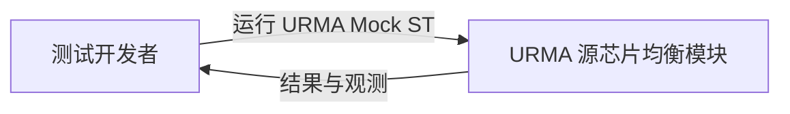
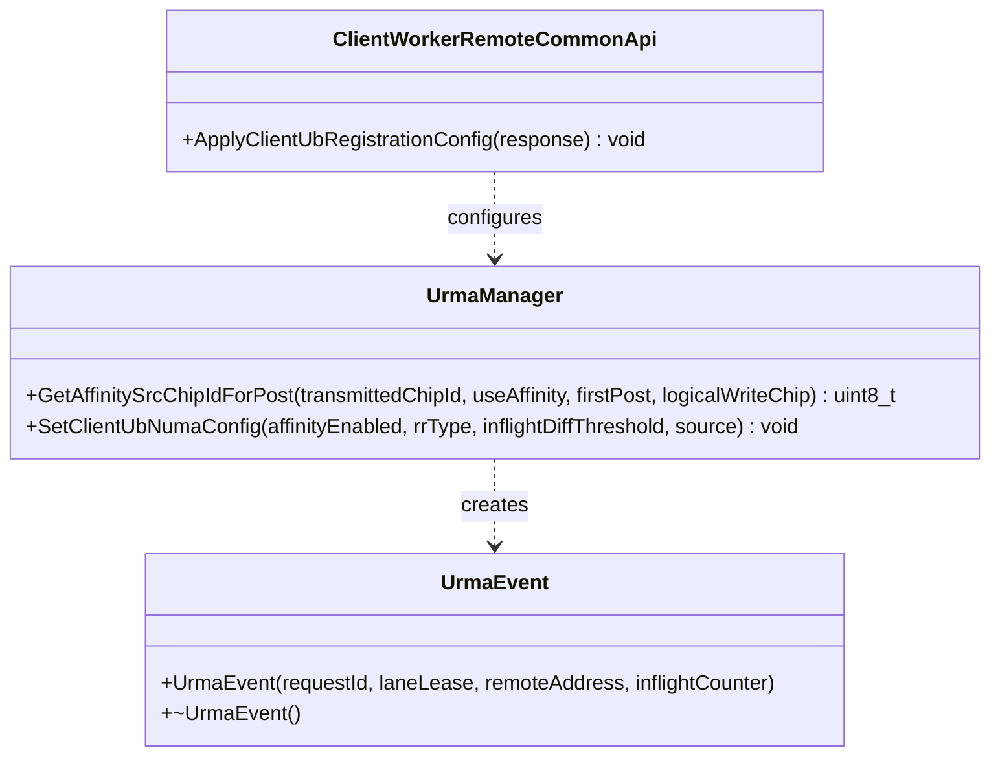
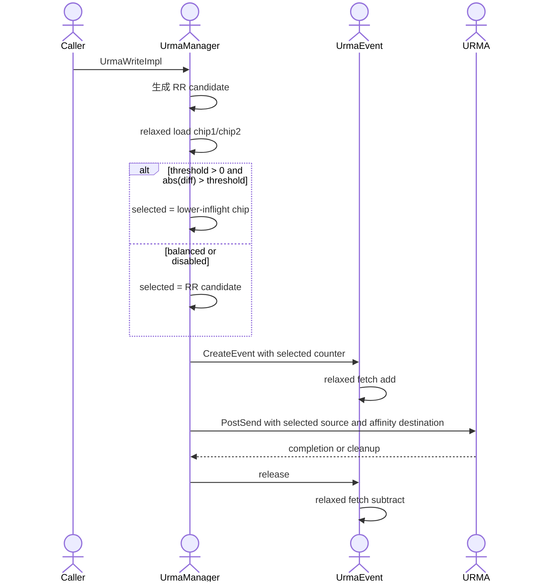
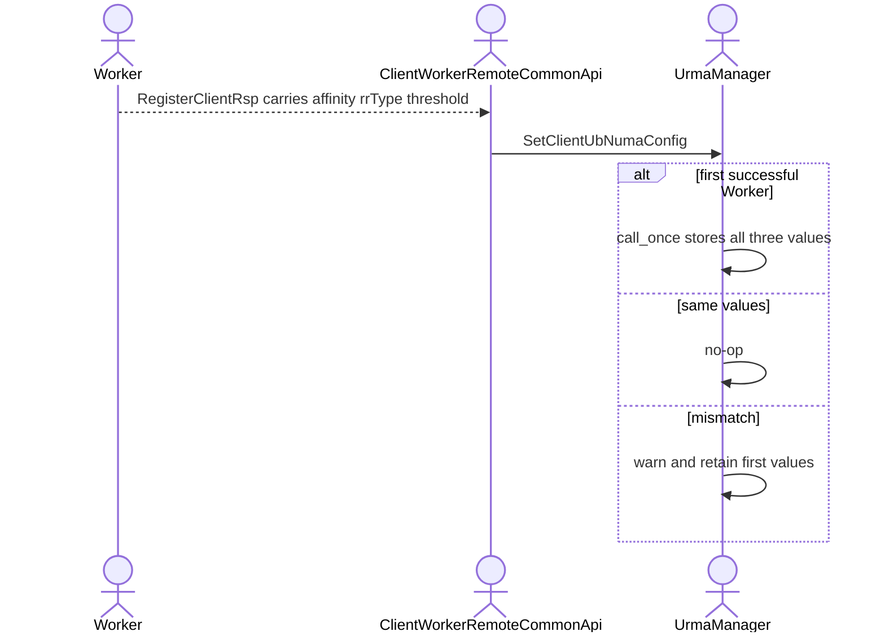
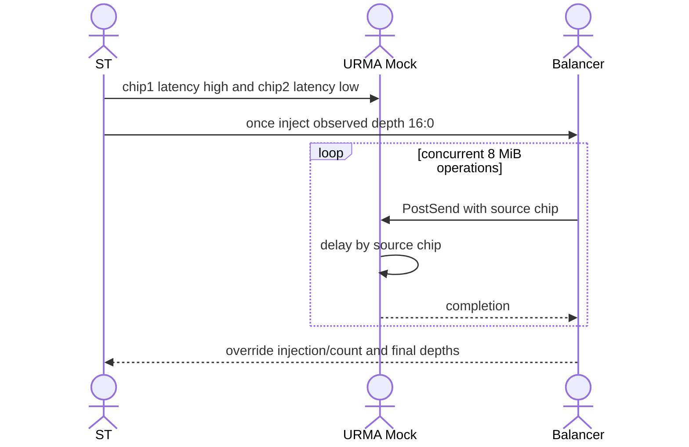
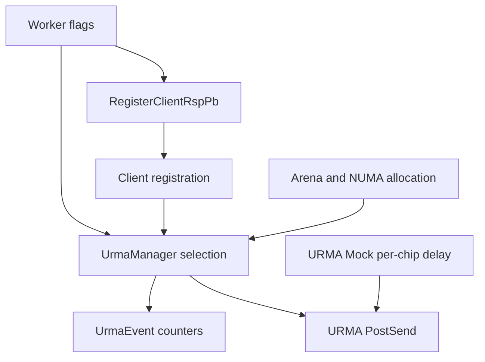

# 子模块：URMA 源芯片 inflight WR 近似均衡

| 属性 | 值 |
|---|---|
| 创建 | 2026-08-17（PR 2081 后续性能优化） |
| 修改 | 2026-08-17（首次详细设计） |
| 阶段 | P1 选择与配置 / P2 NUMA 与 Mock 验证 / P3 性能观测 |
| 前置 | PR 2081 `8e4aa6967fef67ced6228b478924b33d0e703835` / URMA Mock |

## §1 需求背景与目标

PR 2081 已支持 UB transport 多 Arena、Client transport memory 的 NUMA 绑定、目的端芯片亲和，
以及源端按逻辑写或按 Post 轮询。源芯片选择当前只推进轮询序列
（`src/datasystem/common/rdma/urma_manager.cpp:1295`），而 WR 生命周期已经通过 `UrmaEvent`
对每个源芯片做 relaxed 原子计数（`src/datasystem/common/rdma/urma_resource.h:114`、`:133`）。

典型业务在单节点使用 8 个 Client、每 Client 16 线程；每轮写入一个 8 MiB key 后，同时读取同一个
key 十次。读取 QPS 约 3150，折合 26.4 GB/s；写入 QPS 约 315，折合 2.64 GB/s。8 MiB 请求在默认
4 MiB WR 上限下形成 2 个 WR。仅使用源端轮询时，瞬时并发和 Jetty 排队可能使一个芯片深度很高、
另一个芯片空闲，最终出现超时。

| # | 目标 | 验收 | 阶段 |
|---|---|---|---|
| G1 | 避免源芯片长期失衡或饥饿 | 深度差大于阈值时，新选择落到较低深度芯片；并发测试最终重新收敛 | P1 |
| G2 | Client 与 Worker 行为一致 | 注册协议下发同一阈值；两侧 URMA 普通写路径均能观测到覆盖选择 | P1 |
| G3 | 不给热点路径引入新的协调瓶颈 | 每次选择仅 relaxed load、整数比较和分支；无锁、无 CAS 预占、无时间采样；分芯片计数器按 cache line 隔离以避免伪共享 | P1 |
| G4 | 验证 PR 2081 的 NUMA 分配和初始化闭环 | URMA Mock 下多 Arena 的大小、轮询分配和 NUMA 绑定计划可断言，Client 初始化及读写成功 | P2 |
| G5 | 覆盖真实业务形态 | 多 Worker、多 Client、每 Client 多线程，一写后同 key 十个并发读，8 MiB 数据校验通过 | P2 |
| G6 | 给出性能验收边界 | 实机记录双芯片 WR 深度、覆盖次数、吞吐和 P99/PMax；目标 P99 1.5 ms、PMax 5 ms | P3 |

## §2 需求边界

本模块是现有源芯片轮询策略上的轻量反馈控制，不替代 Jetty 调度、限流、拥塞控制或硬件遥测。

### 2.1 关键概念

| 概念 | 定义 |
|---|---|
| inflight WR | 从 `UrmaEvent` 创建到析构期间计入对应源芯片的 WR；它近似表示业务侧未完成深度 |
| 深度差 | `abs(chip1_inflight - chip2_inflight)`，使用同一选择时刻的近似 relaxed 快照 |
| 覆盖选择 | 先生成原 RR 候选，深度差严格大于阈值时改选较低深度芯片 |
| 逻辑写 | 一个业务 URMA 写请求；可被拆为多个 WR，现有 RR type 决定每个逻辑写或每个 Post 选芯片 |

### 2.2 做什么

| 端/组件 | 职责 |
|---|---|
| Worker 配置 | 提供默认值 15，校验并通过注册响应下发 |
| Client 配置 | 使用首个成功注册 Worker 的值初始化进程级 URMA 配置；后续不一致只告警 |
| `UrmaManager` | 在既有 RR 候选上应用深度差覆盖；保持 RR type 语义 |
| `UrmaEvent` | 继续作为已有 inflight WR 计数所有者，不改变计数生命周期 |
| Arena/NUMA | 验证多 Arena 拆分、轮询分配、NUMA 绑定计划与地址到 NUMA 的映射时序 |
| URMA Mock | 支持按源芯片配置完成延迟，形成可重复的深度失衡 |
| ST | 验证多 Worker、多 Client、多线程的一写十并发读和 Client/Worker 两侧覆盖 |

### 2.3 不做什么

| 事项 | 归属 |
|---|---|
| 按字节数、时间或带宽精确预测排队时延 | 性能观测/后续自适应策略 |
| 强制保证任意瞬间深度差不超过阈值 | 需要同步预占，会增加热点争用，本期明确不做 |
| 改变目的端芯片亲和 | 保持 PR 2081 行为 |
| Gather、Pipeline 等未进入 `UrmaWriteImpl` 的独立发送路径 | 后续按各自 WR 生命周期单独设计 |
| 用 Mock 证明 1.5 ms/5 ms 实机时延 | 实机性能验收；Mock 只验证功能和收敛 |
| 硬件端口、Jetty 或 HCCS 的强制配额 | 驱动/硬件拥塞控制 |

## §3 UseCase

### UC1：高负载下自动绕开拥塞源芯片



| 操作 | 输入 | 行为 | 输出 |
|---|---|---|---|
| 正常选择 | 两芯片深度差不大于阈值 | 保持既有 RR 候选 | RR 芯片 |
| 失衡选择 | 两芯片深度差大于阈值 | 选择较低 inflight 芯片 | 较空闲芯片 |
| 禁用 | 阈值为 0 或 affinity/RR 禁用 | 不应用反馈覆盖 | 既有行为 |

### UC2：管理员配置一致策略



| 操作 | 输入 | 行为 | 输出 |
|---|---|---|---|
| 默认启动 | 未显式配置 | Worker 使用 15 并下发 | 两端阈值 15 |
| 显式禁用 | 配置 0 | 保持纯 RR | 无覆盖选择 |
| 混合配置 | Client 连接到不同阈值 Worker | 首个值生效，后续差异告警 | 进程内稳定配置 |

### UC3：开发者验证 NUMA 与负载均衡



| 操作 | 输入 | 行为 | 输出 |
|---|---|---|---|
| NUMA 初始化 | 两个 transport arena | 构造绑定计划并初始化 Client | arena/NUMA 断言与成功初始化 |
| 不对称延迟 | chip1 延迟高于 chip2 | 形成 inflight 差并触发覆盖 | 覆盖计数大于 0，读写正确 |
| 业务并发 | 8 Client × 16 线程，一写十并发读 | 多轮访问同一 8 MiB key | 无错误、数据一致、无芯片饥饿 |

| UseCase | 使用者 | 场景 | 需要什么 | 设计响应 | 验收 |
|---|---|---|---|---|---|
| UC1 | Client/Worker 数据面 | 芯片排队失衡 | 新 WR 避开拥塞芯片 | 深度差覆盖 RR | 选择 UT + Mock ST |
| UC2 | 管理员 | 部署与升级 | 两端一致、可关闭 | Worker 下发、首值冻结 | 协议/config UT |
| UC3 | 测试开发者 | 回归验证 | 可制造和观测失衡 | 分芯片 Mock 延迟和注入点 | NUMA UT + 端到端 ST |

## §4 方案设计

### 4.1 类图



不新增业务侧公开 SDK。以上 public/internal-test-visible 接口均复用现有职责，只扩展配置参数。

### 4.2 开发视图

```text
src/datasystem/common/flags/common_flag_define.cpp       # 新阈值定义，默认 15
src/datasystem/common/flags/common_flags.h               # 阈值声明
src/datasystem/common/rdma/urma_manager.{h,cpp}           # 选择算法、Client 首值冻结
src/datasystem/common/rdma/fast_transport_manager_wrapper # 非 URMA 构建兼容包装
src/datasystem/client/client_worker_common_api.cpp        # 注册响应应用
src/datasystem/worker/worker_service_impl.cpp             # 注册响应下发
src/datasystem/protos/share_memory.proto                  # 向后兼容字段 32
tests/support/datasystem/common/urma_mock/                 # 分源芯片延迟
tests/ut/client/urma_chip_inflight_test.cpp                # 选择和并发近似性
tests/ut/client/client_worker_common_api_test.cpp          # 配置传播
tests/ut/common/shared_memory/                             # Arena/NUMA 分配
tests/st/client/object_cache/                              # 独立进程 URMA Mock ST
```

### 4.3 关键交互

#### 4.3.1 WR 选择与计数



伪代码：

```cpp
candidate = NextRoundRobinChip();
if (threshold == 0) return candidate;
chip1 = counters[1].load(relaxed);
chip2 = counters[2].load(relaxed);
if (AbsDiff(chip1, chip2) <= threshold) return candidate;
selected = chip1 < chip2 ? CHIP_1 : CHIP_2;
RecordRareOverride(candidate, selected, chip1, chip2, threshold);
return selected;
```

`PER_LOGICAL_WRITE` 只在首个 Post 执行选择，后续 WR 复用；`PER_POST` 每个 Post 重新选择。比较使用严格
`>`，所以阈值 15 允许差值到 15，达到 16 才覆盖。相等深度永远保留 RR，不固定偏向任一芯片。

#### 4.3.2 Client 配置传播



字段 32 使用 proto3 默认 0，因此老 Worker 对新 Client 等价于关闭反馈，保持老版本纯 RR；新 Worker 对老
Client 的未知字段会被忽略。滚动升级期间不因缺省值改变老端行为。

#### 4.3.3 Mock 制造失衡



Mock 只在测试线程池取芯片对应延迟；未配置分芯片变量时回退现有全局延迟，保持旧用例兼容。Mock 为实现
跨进程共享会把匿名注册内存原址重映射到 memfd，不能保留真实页 NUMA 驻留信息。因此 ST 使用仅测试构建
可见的 affinity 注入，并只在每个进程第一次选择时注入 `chip1=16, chip2=0` 快照，确定性验证默认阈值
`15` 的覆盖动作；后续 WR 全部使用实时计数。物理 NUMA 分配正确性由绑定计划和 Arena UT 独立负责。

### 4.4 模块依赖图



Client 的 `SendBufferViaUb`/`SubmitPayload` 与 Worker 的 `UbWriteHelper`/`WriteViaFastTransport` 最终都进入
`UrmaWriteImpl`（选择点 `src/datasystem/common/rdma/urma_manager.cpp:2023`），所以共用一个实现即可两侧生效。

### 4.5 关键数据结构

#### 芯片 inflight 计数

复用 `std::vector<std::atomic<int>> srcChipInflightWrCounts_`。索引 1、2 对应两个有效芯片，读取、增减均用
`memory_order_relaxed`。它不保护其它状态，不要求跨线程顺序，只提供近似深度；每个芯片计数器按
cache line 对齐，避免不同完成线程更新不同芯片时争用同一 cache line。计数器所有权在
`UrmaManager`，指针由 `UrmaEvent` 在自身生命周期内借用，Manager 必须晚于所有 Event 销毁。

#### 配置阈值

使用进程级 `uint32` flag。Worker 启动后只读；Client 在 transport 正式使用前由注册路径通过现有
`call_once` 写一次。禁止运行中动态修改，以免普通 flag 非原子读写发生数据竞争。

#### Arena 绑定计划

多 Arena 的地址范围按 `poolSize / arenaNum` 等分，第 `i` 段绑定到 `nodeIds[i % nodeCount]`。
生产代码和 UT 共享 `BuildRoundRobinNumaBindingPlan` 纯计划生成逻辑，UT 不依赖 CI 机器实际 NUMA 拓扑。
生产路径中的 `BindMemoryToNumaNode` 会在绑定时逐页触页，随后 Arena 初始化再通过 `move_pages` 构建 NUMA
range table；因此无需调整 `FakeAllocate` 顺序。ST 继续以 Client 初始化成功和实际读写作为端到端门禁，
不把 Mock 重映射后的页位置当成硬件 NUMA 证据。

### 4.6 组件接口设计

| 接口 | 调用方 | 输入 | 输出/副作用 |
|---|---|---|---|
| `GetAffinitySrcChipIdForPost` | `UrmaWriteImpl` | 当前 dst、affinity、Post 位置、逻辑写芯片 | 返回 RR 或较空闲源芯片 |
| `SetClientUbNumaConfig` | Client 注册路径 | affinity、RR type、阈值、来源 | 首值冻结或不一致告警 |
| `BuildRoundRobinNumaBindingPlan` | Client memory init | 基址、大小、arena 数、NUMA node IDs | 等分 range/node 计划 |
| Mock latency resolver | Mock PostSend | source chip ID、环境变量 | 对应完成延迟 |

正常选择不输出逐 WR 日志。仅覆盖发生时使用限频日志和现有测试注入点记录候选、选择、两侧深度和阈值；
这是异常/调试观测路径，不能引入全局锁或字符串格式化到每个 WR。

## §5 对外接口

### 5.1 SDK 接口

| 接口 | 调用方 | 频率 | 说明 |
|---|---|---|---|
| `void SetClientUbNumaConfig(bool affinityEnabled, uint32_t rrType, uint32_t inflightDiffThreshold, const std::string &source)` | Client 注册路径 | 每个 Worker 注册一次 | 内部接口扩参；无新增用户公开 SDK |

以上签名是内部组件接口，不改变用户 SDK。

### 5.2 新增或变更部署参数

| 参数名 | 类型 | 默认值 | 说明 |
|---|---|---|---|
| `ub_numa_inflight_wr_diff_threshold` | uint32 | 15 | 两源芯片深度差严格大于该值时覆盖 RR；0 禁用 |

### 5.3 环境变量

| 变量 | 默认值 | 说明 |
|---|---|---|
| `DATASYSTEM_UB_TRANSPORT_ARENA_NUM` | 未设置 | PR 2081 已有 Client 进程 transport arena 覆盖 |
| `URMA_MOCK_CHIP_1_LATENCY_US` | 回退 `URMA_MOCK_LATENCY_US` | 仅测试，chip1 完成延迟 |
| `URMA_MOCK_CHIP_2_LATENCY_US` | 回退 `URMA_MOCK_LATENCY_US` | 仅测试，chip2 完成延迟 |

## §6 约束 + 风险

### 6.1 约束

| # | 约束 | 违规后果 |
|---|---|---|
| C1 | 目的端芯片继续由内存 NUMA 归属决定 | 破坏本地端口亲和并增加 HCCS 流量 |
| C2 | inflight 增减必须与 Event 生命周期成对 | 计数漂移后选择长期偏向错误芯片 |
| C3 | 热点选择不得加锁或强一致预占 | 128 业务线程会在选择点形成新瓶颈 |
| C4 | 阈值在 Client 使用 transport 前冻结 | 非原子配置的并发读写会产生数据竞争 |
| C5 | 8 MiB 数据校验必须覆盖完整 payload | 只看返回码会漏掉跨 Arena/NUMA 地址错误 |
| C6 | NUMA 查询在内存触页后执行 | 未驻留页面可能没有有效 NUMA 节点，目的芯片亲和失效 |

### 6.2 风险

| # | 风险 | 缓解 |
|---|---|---|
| R1 | 并发线程同时看到旧快照，短时全部转向较空闲芯片 | 接受近似超调；RR 保留，完成反馈会反向纠偏；ST 看时间窗而非每一瞬间 |
| R2 | Event 深度包含业务等待，不等于硬件队列 | 定位为控制代理；不用于精确时延承诺，实机结合吞吐和时延验证 |
| R3 | 默认 15 对不同 WR 大小/链路不总是最优 | 可配置并允许 0 回退；P3 实机扫参 |
| R4 | Mock 线程池共享导致芯片隔离不完全 | 断言功能触发和数据正确，不用 Mock 推导硬件带宽 |
| R5 | 128 线程同步 8 MiB 可能产生 1 GiB 瞬时量，物理上无法保证 5 ms | 核心 ST 按十读 fanout 建模；另设压力用例，不把极端 barrier 当 SLA |

15 个 4 MiB WR 对应约 60 MiB 未完成量；按单端口 45 GB/s 粗略折算约 1.4 ms，按双端口
90 GB/s 约 0.7 ms。该换算只解释默认值量级，不进入运行时算法。

## §7 落地步骤

| PR/阶段 | 端 | 内容 |
|---|---|---|
| P1 | Common/Worker/Client | 增加阈值 flag、proto 字段、注册传播、首值冻结和选择 UT |
| P1 | URMA hot path | 在 RR 候选后读取两个计数并覆盖；增加稀疏观测点 |
| P2 | Arena/NUMA | 提取可测绑定计划，验证等分和轮询；确保触页后构建 NUMA range table |
| P2 | URMA Mock | 按 source chip 配置延迟并保持全局变量回退 |
| P2 | ST | 新增独立 URMA Mock 进程目标，覆盖 Client 初始化及一写十并发读 |
| P3 | 实机 | 8 Client × 16 线程、8 MiB、315/3150 QPS 下扫阈值并观测 P99/PMax、HCCS、端口带宽 |

## §8 测试方案

### 8.1 UT/组件测试

| 文件 | 覆盖点 | 覆盖率目标 |
|---|---|---|
| `tests/ut/client/urma_chip_inflight_test.cpp` | 差值小于/等于/大于阈值、两个方向、0 禁用、RR type 1/2、并发近似收敛 | 所有选择分支 |
| `tests/ut/client/client_worker_common_api_test.cpp` | 默认/显式阈值传播、首 Worker 生效、差异 Worker 不覆盖、旧端字段 0 | 所有配置分支 |
| shared-memory focused UT | Arena 等分、数量、轮询 Allocate、余数/非法配置、NUMA 绑定计划 | PR 2081 新分支 |
| URMA Mock focused UT | chip1/chip2 独立延迟与全局回退、无 ext 回退 | 所有 resolver 分支 |

### 8.2 ST

| ST | 对应 UseCase | 场景 | 断言 |
|---|---|---|---|
| Client NUMA 初始化 | UC2/UC3 | 独立进程设置 2 arenas，3 Worker | 每个 Client 初始化成功；UB Set/Get 成功；绑定计划和 Arena UT 覆盖两个 node |
| 多端读写 | UC1/UC3 | 8 Client、每 Client 16 工作线程；8 MiB key；一写后十个同时 Get，多轮跨 Worker | payload 全量一致；无超时；Client/Worker 普通写路径均有请求 |
| 不对称芯片延迟 | UC1/UC3 | chip1 延迟高、chip2 低，阈值 15；首个快照 16:0 | Client/Worker 覆盖观测次数大于 0；两个芯片均被选择；后续请求使用实时深度 |
| 回退兼容 | UC2 | 阈值 0 或不设置分芯片延迟 | 保持 RR；既有 URMA Mock 用例不变 |

默认 CI 用例控制轮数和超时时间，验证确定性功能；完整 315/3150 QPS、P99 1.5 ms、PMax 5 ms 和 HCCS
带宽均衡属于带真实双芯片硬件的 P3 性能用例。实机报告至少记录每 100 ms 两芯片深度、差值、覆盖次数、
每芯片 WR 完成数、HCCS 双向带宽、吞吐、P50/P99/PMax，并确认不存在一个芯片长期为 0 而另一个持续排队。

## §9 当前验证记录

Tiantiyun `tiantiyun-80c128g`，CMake 构建，第三方缓存根目录 `/home/cache`：

| 验证 | 结果 |
|---|---|
| `ds_ut` focused：选择边界、注册传播、NUMA 计划、双 Arena、Mock 分芯片延迟/跨 VMA 注册 | 最新 `master` rebase 后 11 tests / 6 suites，通过，31 ms |
| `ds_st_urma_numa_inflight_balance` | 最新 `master` rebase 后，3 Worker、8 Client、16 线程/Client、4 个 8 MiB key/Client、每 key 10 个并发 Get；连续 3 轮通过，13.529 s / 12.806 s / 12.702 s；每个 Worker 均观测到纠偏和两个源芯片 |
| ST 断言 | 所有 Set/Get 成功、8 MiB payload 全量一致、Client/Worker 均发生默认边界覆盖、两芯片均被选择 |

Mock 结果只证明控制逻辑和数据通路，不证明 P99 1.5 ms、PMax 5 ms 或 HCCS/端口带宽；这些仍需 P3
双芯片实机压测。
