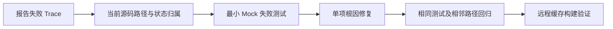

# 59 节点 UB SET/GET 报错复现与修复 RFC

状态：调查进行中；当前源码 B1 已完成 RED/GREEN，最终客户端回归 219/219、URMA Mock 故障回归 23/23；历史 UB 根因尚未闭合。

跟踪 Issue：[1217](https://gitcode.com/openeuler/yuanrong-datasystem/issues/1217)。

当前源码修复草稿 PR：[2367](https://gitcode.com/openeuler/yuanrong-datasystem/merge_requests/2367)。单一提交已推送并校验 fork 分支，`/retest` 已发布，创建时无冲突；尚未合并。

## Story 与验收目标

作为 DataSystem 使用者，需要按采集样本中的失败数量逐类定位问题；每项生产代码修改必须先有当前基线上的失败测试，再验证修复后的成功及相邻恢复路径。报告中的归因是调查线索，不能直接视为代码根因。

## 证据与基线

- 输入：`59node_set_get_trace_analysis_20260909.zip`。
- 内嵌原始归档 SHA256：`d7f84b7957dad6ba6d1708412a9fe016f0d770d3c4939ace737e5de3d81966b9`；已计算校验一致。
- 报告分析引用：`a505893981655565fed94c4c2a62a78aa239f157`；不等同于已确认部署二进制版本。
- 当前修复基线：`34bc8b8df6da360788a9953aea543becb154b1f1`。
- 31 个 run，47,276 条采集 Trace，17,090 条最终失败；不是全量运行失败率。
- 887 条最终成功但内部 URMA 等待超时的请求单列，不计入最终失败。
- 相同 run 中按 Trace 去重，跨 run 不合并；内部日志次数不当作失败请求数。

逐类分析见 [全部失败类别证据矩阵](case-matrix.md)。

## 全部失败类别与处理顺序

| 顺序 | 报告失败类别 | 失败 Trace 数 | 当前结论 |
|---|---|---:|---|
| 1 | URMA完成等待超时（同Trace证据） | 6036 | 分片错误传播已复现；硬件等待原因未闭合 |
| 2 | Publish RPC截止超时 | 4747 | 已观测服务端成功而客户端超时；提交结果不确定 |
| 3 | Client路由：等待transport snapshot刷新超时 | 2032 | 错误包装不证明真实快照成员缺失 |
| 4 | Create RPC截止超时 | 1199 | 服务端 Create 可超过 API 预算；分配细分未观测 |
| 5 | Client API预算耗尽：调用/重试检查 | 1105 | 最终预算检查点不等于首发原因 |
| 6 | URMA建链：握手RPC截止超时 | 982 | 握手服务端有效耗时未观测 |
| 7 | 业务逻辑：所有副本均未找到对象 | 505 | R05 504 条均无同对象 SET 证据 |
| 8 | QueryAndGet RPC截止超时 | 431 | 当前发现 SHM 禁重放缺陷；非历史 UB 因果证明 |
| 9 | URMA准入：获取peer jetty槽位前预算耗尽 | 40 | 示例先被 Create 耗尽预算；不证明槽位拥塞 |
| 10 | 数据读取RPC截止超时 | 12 | 元数据与数据读取共用预算 |
| 11 | URMA建链：API预算耗尽（具体阶段未观测） | 1 | 握手具体阶段未观测 |

## 全部运行覆盖

| Run | 采集 Trace | 最终失败 |
|---|---:|---:|
| R05 | 5214 | 2711 |
| R26 | 5011 | 2336 |
| R27 | 4911 | 2132 |
| R30 | 3767 | 1460 |
| R31 | 3709 | 1361 |
| R29 | 3046 | 1319 |
| R25 | 2638 | 978 |
| R28 | 2640 | 957 |
| R24 | 2524 | 837 |
| R18 | 1330 | 443 |
| R22 | 903 | 389 |
| R19 | 2190 | 344 |
| R02 | 720 | 324 |
| R23 | 735 | 305 |
| R15 | 951 | 271 |
| R16 | 422 | 170 |
| R20 | 457 | 157 |
| R17 | 341 | 147 |
| R09 | 473 | 129 |
| R21 | 340 | 116 |
| R04 | 715 | 75 |
| R13 | 60 | 37 |
| R11 | 1842 | 26 |
| R01 | 115 | 20 |
| R03 | 341 | 15 |
| R12 | 1630 | 14 |
| R07 | 18 | 7 |
| R14 | 39 | 5 |
| R10 | 128 | 4 |
| R08 | 20 | 1 |
| R06 | 46 | 0 |

## 详细设计与复现契约

优先研究 URMA 等待超时，其次 Publish 超时、transport snapshot 等待超时；各项独立建模，避免将同一请求的后续超时重复归为独立根因。



| 契约 | 复现与判定 |
|---|---|
| 已提交 URMA WR 的完成、超时、迟到 CQE | 复用 UrmaEvent、send lane 与 Mock 注入测试；检查事件和 lane 生命周期及恰好一次回收 |
| API 剩余预算 | 区分 RPC deadline、准入耗尽、建链及 CQE 等待；不以延长超时掩盖故障 |
| Publish 与 metadata | 检查 Create/传输/Publish 先后关系、超时提交不确定性、对象可见性及重试安全 |
| Snapshot | 检查版本发布、锁与条件变量、停止与超时唤醒 |
| 对象未找到 | 对照先前 SET 成败、TTL 与副本证据；缺失前因时保留未闭合 |

## TDD + SDD 执行与风险

1. 补齐每类的代表 Trace、当前源码证据、候选根因与反证。
2. 先记录具体设计契约、状态归属、修复点和回归测试，再写最小失败测试。
3. 在未修复基线上运行 RED；编译或环境失败不算复现。
4. 最小修复后运行 GREEN，并运行关联并发、清理、失败回退测试。
5. 本地使用 URMA Mock；远程使用用户指定验证节点，通过 CMake 的 `DS_OPENSOURCE_DIR` 显式复用已有三方件编译缓存，并保留 configure 的缓存命中证据；不以 ccache 作为前提。
6. 每项独立记录红绿输出与源码 SHA；更新模块上下文并运行 ds-self-verify。

风险等级暂定高：数据传输热路径、异步完成与生命周期。不得无证据增加热路径日志、锁、分配、复制或重试；持久化及恢复影响须按具体修复点逐项核实。现阶段不更改协议、公共 API 或持久化格式。修复按独立补丁回滚，不进行全局重构。

## 证据边界与非目标

- Mock 能验证协议与生命周期，不证明真实 UB 带宽、CQE 硬件延迟或 NUMA 性能。
- RPC residual 是观测残差，不直接等于物理网络耗时。
- 当前源码已有目录和行为演进，报告位置需重新定位。
- B1 的 RED/GREEN 证明当前源码 SHM 重试缺陷，不证明历史 UB 根因；真实硬件与部署版本关联尚未完成。
- Workbench 仅增加 RFC，不增加或依赖 workbench 脚本。

## 前置修正 B0：URMA Mock 的 SGE 初始化可编译性

RED：当前基线通过 CMake 配置并命中 25 项三方件缓存，但构建 `ds_ut_urma_send_jetty_fault` 在 `urma_manager.cpp` 四处失败：`missing initializer for member urma_sge::lkey/rkey`，GCC 将警告提升为错误。

根因：Mock ABI 在 `addr/len/tseg/user_tseg` 外还含 `lkey/rkey`，生产代码使用指定成员聚合初始化，触发缺字段诊断。原聚合初始化会将遗漏字段清零，修正必须保持这一语义。

方案：四处先 `urma_sge_t{}` 完整值初始化，再赋值实际使用的 `addr/len/tseg`，使 Mock 附加字段和 `user_tseg` 保持零。真实 SDK 不要求有 Mock 的 `lkey/rkey`，因此不在生产逻辑中显式引用这两个字段。

归属：common/rdma 数据传输模块；风险低，字段值不变，无新锁、分配、复制、IO 或生命周期改变；无持久化或协议变更。回滚为单独补丁逆向应用。回归证据为原始 CMake 故障目标成功编译及 URMA Mock 故障测试。此项只解除复现构建阻塞，不计作 59 节点报错根因已修复。

## 复现 R1：分片一超时、分片二已完成

报告 R05 的 8 MiB SET 示例中，第一 4 MiB WR 超时，第二 WR 已完成，最终 Client 返回 1010。首先建立确定性组件复现：两个已登记 WRITE Event，共享顺序等待入口；只完成第二项，第一项使用零剩余等待预算。断言必须保留第一项 URMA 超时、仍消费第二项成功完成，并移除两个普通事件，不能误返回成功或遗漏清理。

此复现不注入虚假的硬件原因；它只能证明该部分完成形态的错误传播和清理契约。若当前代码通过，就记录为现有行为已验证，不将其冒充 bugfix 的 RED，不修改正确行为。真实 CQE 为什么迟到仍需部署版本及硬件/调度证据。

## 当前缺陷 B1：SHM QueryAndGet 降级重试绕过禁止重放契约

当前基线的 `ObjectMetadataClient::PrepareQueryRetry` 先处理 `IsMetadataOwnerRouteFailure`，其中 deadline/unavailable/disconnect 分支可以返回 OK 触发重试，随后才检查 `rpcDispatched && SHM`。这与 client-sdk 中“SHM queries remain non-replayable”的已有契约冲突。近期增加的原 owner 内层重试进一步暴露该顺序问题。

验收：已发送的 SHM 请求遇到上述模糊结果，应保留原错误，不进入等待/重试，也不伪装为 snapshot 不包含目标；已有必要的失效连接清理仍执行。未发送请求以及 TCP/UB 的安全重试保留。已明确的 metadata owner 迁移处理保持原逻辑。

TDD：先用已经分发的 SHM 上下文和真实 `PrepareQueryRetry` 路径，注入可观测的 retry admission 拒绝回调，确定性验证是否错误进入 Backoff。以未分发 SHM 和 TCP 为对照，避免通过禁用所有重试使测试变绿。测试无需睡眠、真实硬件或并发时序。

风险中等：只调整失败路径分支，涉及 SHM 引用与失败语义；不改变健康热路径、协议、持久化格式或公开 API。修复点归属 metadata client，不让调用者承担重试政策。该问题已取得下述 RED/GREEN，不作为历史报告中真实 UB 超时的已确认原因。

### B1 RED 证据与最小修复

在未修改 metadata client 的基线上，新增两项测试：`DispatchedShmDegradationDoesNotEnterRetry` 失败，三个模糊错误码均实际进入 Backoff；`SafeDegradedQueriesStillReachRetryAdmission` 通过。合计 1 PASS / 1 FAIL，执行小于 1 ms，排除等待时序因素。

最小修复将已有的 dispatched-SHM 禁重放判断移到降级重试之前，仍在必要的 channel teardown 之后；明确 owner 迁移继续原有处理。只改变失败路径判断顺序。初次相邻回归 70 PASS / 0 FAIL，新增确认 owner 转路由和必要 channel teardown 断言后再次通过；扩大回归整体结果另列。

### B0 相邻测试核查

完整 URMA 故障套件首次为 21 PASS / 2 FAIL：旧分组延迟测试人为构造了重叠等待，却使用无符号减法期待下溢值；实现已经将该残差饱和到零。另一个测试期待旧 `requestId=` 文案，而实现输出标准 `[urma_request_id:...]`。两项需修正测试的断言契约，不能据此宣称数据面行为存在或修复了根因。


## 验证进展与回归边界

- 构建：CMake Release + URMA Mock，三方件缓存配置 `DS_OPENSOURCE_DIR`，配置日志记录 25 项缓存命中。未用 Bazel 或 ccache。
- B0：四处 SGE 完整零初始化后，原失败目标编译成功。
- B1：基线 1 PASS / 1 FAIL；修正后客户端相关 70 PASS / 0 FAIL。额外加入已确认 owner 故障与 channel teardown 的反回归断言。
- R1：分片超时与已完成分片收尾测试在当前基线行为下通过；完整 URMA Mock 故障组修正两项旧断言后 23 PASS / 0 FAIL。
- 扩大回归首轮：219 项，218 PASS / 1 FAIL。失败项 `TcpFallbackKeepsAmbiguousShmAllocationForCleanup` 单独运行通过；源码确认 `IsUrmaEnabled` 还读取已发布的进程运行状态，测试只修改 `FLAGS_enable_urma` 不能禁用已初始化的 UB。该测试实际走到 UB 成功而非 TCP，分配被成功接管，因此不应触发其期待的清理。修正测试为存在 UB 候选时显式注入 UB 不支持，再确认最终确实到 TCP；不改生产 fallback 策略。
- 独立源码审查未发现 B0/B1 的正确性、并发或生命周期阻断项。直接 retry-policy 测试未覆盖真实 SHM 会话的服务端执行次数；Mock 未证明真实 CQE、DMA 或硬件性能。
- 测试进程退出仍有合成 Jetty 未收敛警告，不能声称验证了所有真实关闭场景。


### 最终验证记录

源码提交：`2ab61bd83`。最终客户端传输组 219 PASS / 0 FAIL / 0 DISABLED，4.472 秒；URMA Mock 故障组 23 PASS / 0 FAIL / 0 DISABLED，3.227 秒。两组不同用例合计 242 项；不叠加前面重复执行次数。

```sh
cmake -S . -B build -DCMAKE_BUILD_TYPE=Release \
  -DCMAKE_INSTALL_PREFIX=./output -DWITH_TESTS=ON \
  -DBUILD_WITH_URMA_MOCK=ON -DBUILD_WITH_URMA=OFF \
  -DBUILD_HETERO=OFF -DBUILD_HETERO_NPU=OFF -DBUILD_HETERO_GPU=OFF \
  -DBUILD_PYTHON_API=OFF -DBUILD_THREAD_NUM=32 \
  -DDS_OPENSOURCE_DIR=/home/cache/ds-thirdparty-cache
cmake --build build --target ds_ut_urma_send_jetty_fault ds_ut -j32
DS_URMA_DEV_NAME=bonding_mock0 build/tests/ut/ds_ut \
  --gtest_filter='ObjectMetadataClientTest.*:WorkerRpcClientTest.*:DataPlaneManagerTest.*:DeadlineRetryTest.*:ObjectClientTransportTest.*:ReplicaReaderTest.*:TransportLayerTest.*:UbTransporterTest.*:ObjectReadFlowTest.*' \
  --gtest_output=xml:.evidence/transport-cases-green.xml
DS_URMA_DEV_NAME=bonding_mock0 build/tests/ut/ds_ut_urma_send_jetty_fault \
  --gtest_output=xml:.evidence/urma-fault-green.xml
```

ds-self-verify：检查了最终差异、定向编译与测试结果、错误路径影响、所有权/并发、持久化与恢复、模块上下文；`git diff --check` 通过，差异和 PR 文本敏感扫描 0 项。独立审查补充测试后无阻断项。未执行真实硬件、59 节点部署、TSAN 或性能基准。

## 当前缺陷 B2：分片失败回调早于完整收尾且可能重复执行

当前 `WaitFastTransportEventWithFailure` 在循环中用 `firstError.IsOk()` 决定是否调用 `errorHandler`，同时把回调返回值写回 `firstError`。若 fallback 成功，返回 OK 会让下一失败分片再次触发回调；首轮回调也只能看到部分 `UrmaWriteFailure`。实际 Worker BatchGet 回调执行 provider 失败记录与 payload 移动，不能将它当成无副作用的状态转换。

复现契约：两个已经完成的失败 WRITE Event，首项普通 CQE 错误，后项 port-unavailable；回调应在全部事件被消费后恰好一次执行，看到完整 CQE 聚合，仍接收首项原始错误。回调返回 OK 时整个批次成功 fallback；返回错误时保留该错误。两个错误的实际硬件原因不由 Mock 推断。

设计候选：先遍历等待全部 keys，保留首项原始错误并聚合 failure；循环结束后仅调用一次回调。无新增分配、锁、线程、协议和持久化变更。失败 fallback 会等到已有事件消费结束，避免在消费过程中执行有副作用的状态转换。须核查所有调用点对回调时机的依赖。先记录 RED，再决定实现；不改其他 UCP 路径，除非证明存在相同且本任务需要处理的契约问题。

### B2 RED / GREEN 与调用点核查

新增 `BatchFallbackRunsOnceAfterAllFailuresAreCollected` 在未修复 B2 的基线上 1 FAIL：第一次回调时后项 Event 仍在 map，CQE 聚合仅有 9；fallback 返回 OK 的分支总计调用两次，第二次收到后项错误而非首项。测试在 0 ms 内完成，两个 CQE 均预先完成。

最小修复后首次完整 URMA 故障组 24 PASS / 0 FAIL，UB/传输/RPC 相邻组 85 PASS / 0 FAIL。额外补充后项真实超时保留与迟到通知观察者回归，最终结果另记。

核查 URMA 提交清理、阻塞写/读、gather、恢复探针、客户端 payload 等待与 migration 调用方，其回调仅返回原错误；Worker BatchGet 回调会记录故障并移动 fallback payload。原循环本来就等待全部事件，因此总等待次数与 deadline 计算未增加；但 provider 故障记录推迟至本批事件等待结束，最坏推迟至剩余请求预算耗尽。这个时机变化换取一次完整的批级故障处理。UCP 语义未改。

独立审查未发现阻断项。事件“消费结束”包括按原策略保留超时的 in-flight 事件，不代表所有 DMA 和资源已经完成；需保持迟到完成观察者契约。报告未提供足以把这项缺陷归为历史 6036 次超时首因的证据。


### B2 最终验证与交付

提交 `57bf79459a441d9103a82037e2fb380fe6697b34`，已快速前进加入草稿 PR 2367。CMake 继续复用原构建目录及三方件缓存。完整故障组 `ds_ut_urma_send_jetty_fault` 最终 25 PASS / 0 FAIL / 0 DISABLED，3.234 秒；相邻 `UbTransporterTest.*:TransportLayerTest.*:WorkerRpcClientTest.*` 为 85 PASS / 0 FAIL，2.452 秒。新增 `BatchFallbackPreservesLaterTimeoutRetention` 证明后项真实超时继续登记保留，并在迟到 CQE 到达时调用原观察者；不把事件保留误判为泄漏或提前回收。

源码对照：报告分析引用 a505893 的同一函数也包含循环内 callback 的旧逻辑；这证明分析引用存在该缺陷，仍不等同于已确认部署版本或历史触发证据。最终差异检查与敏感扫描通过；独立审查未发现阻断项，最坏故障通知延迟的变化已记录。
