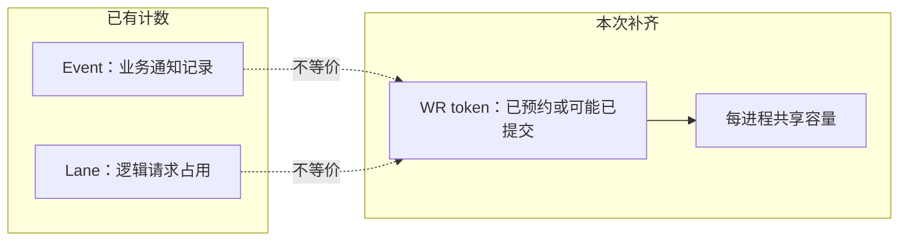
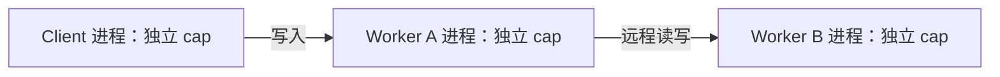
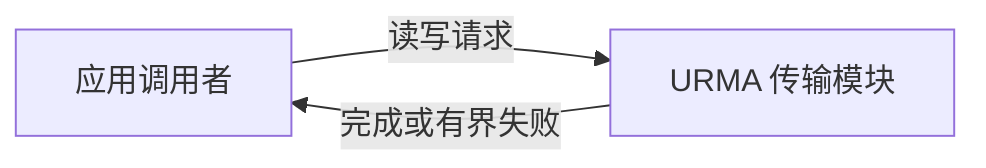
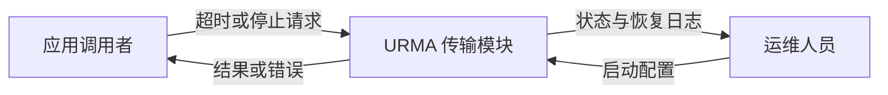
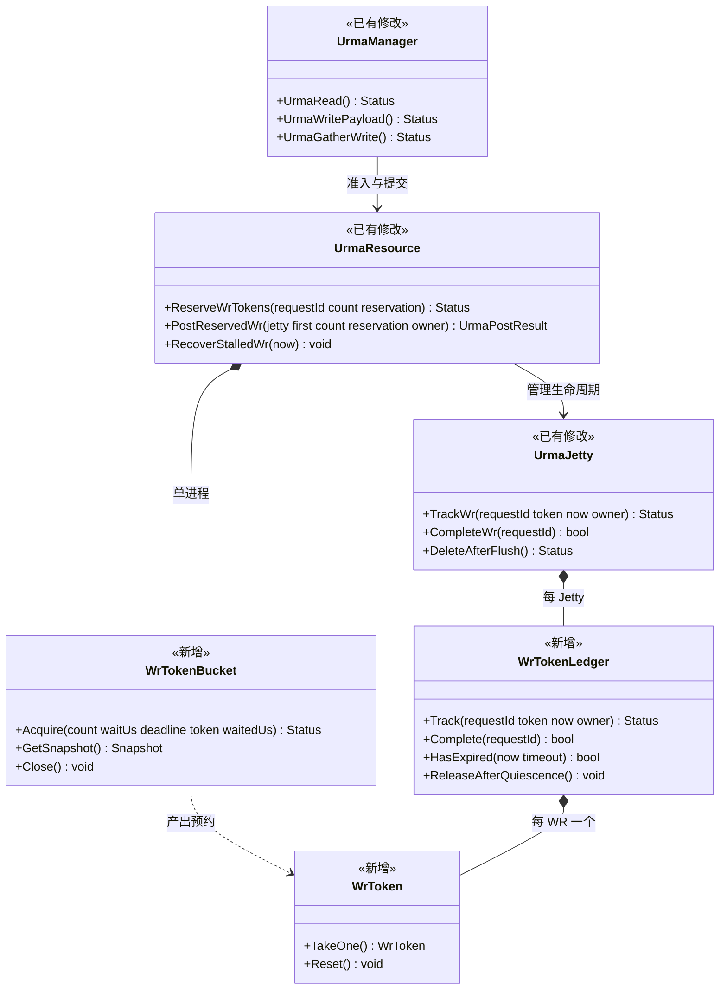
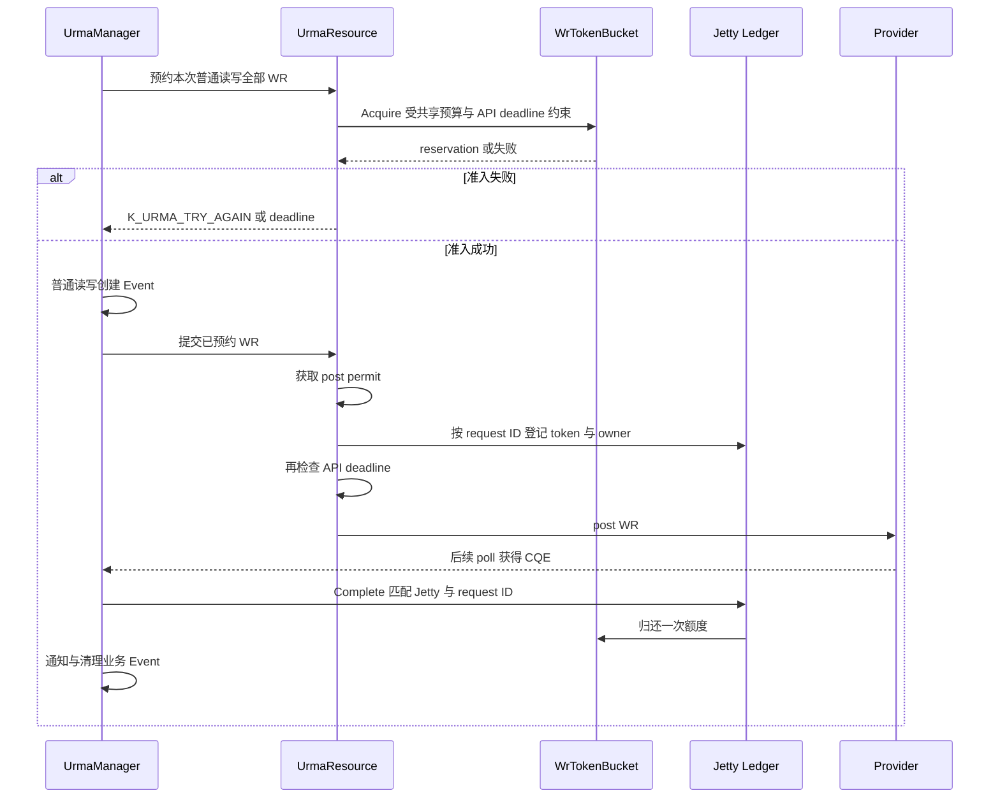
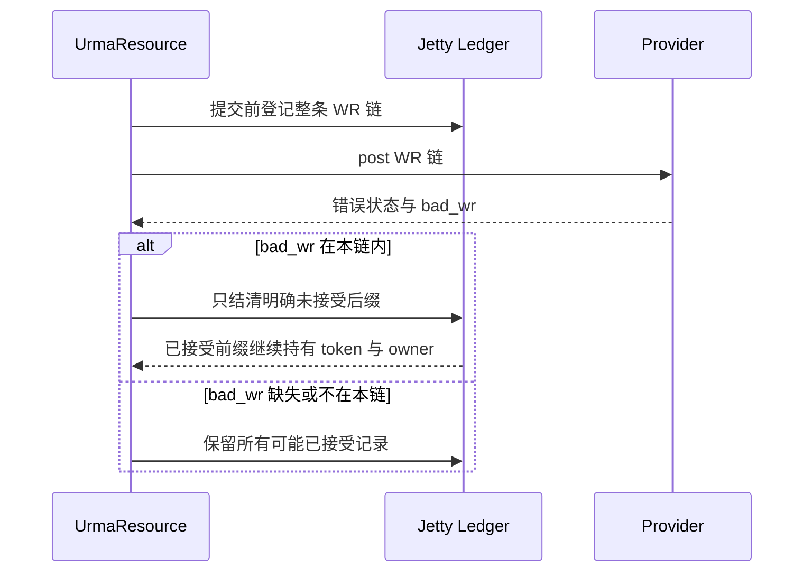
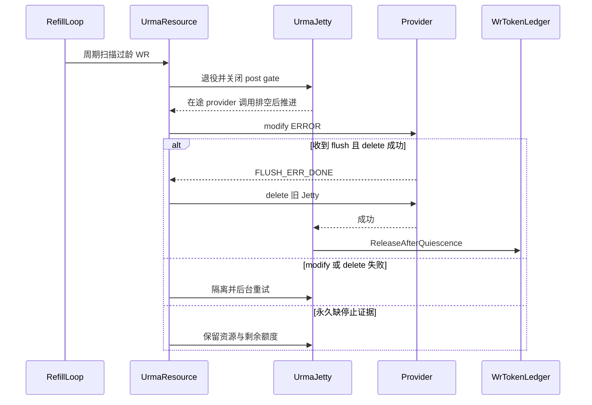
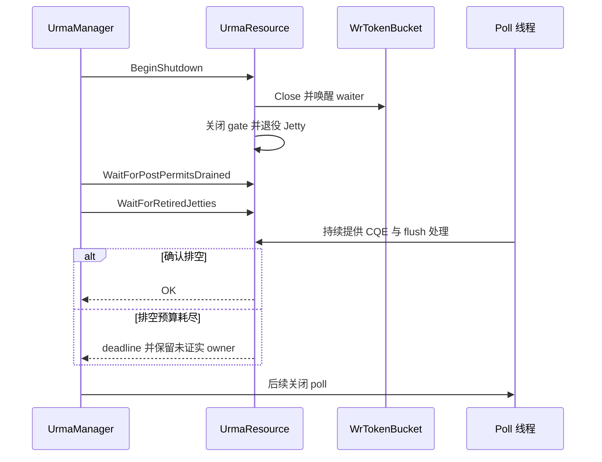
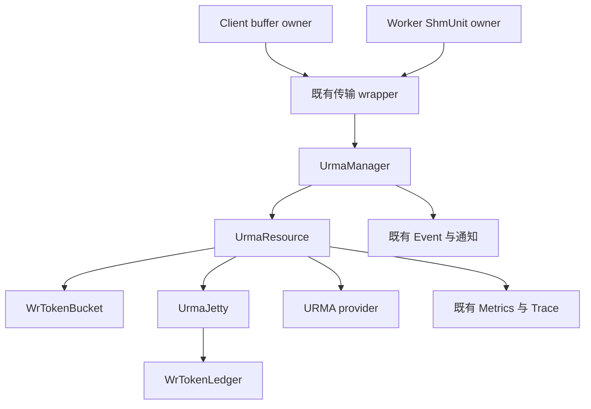

# 子模块：URMA outstanding WR 控制与安全归还

| 属性 | 值 |
|---|---|
| 创建 | 2026-09-13，原方案日期；站点登记发布时间保留原值 |
| 修改 | 2026-10-20，按 ds-design 重组详细设计，补类图、时序图及新增/已有标识 |
| 阶段 | P1 软件实现与定向 mock 验证；P2 真实设备验收待完成 |
| 源码 | PR2422 固定提交 `93c2e70c3e2e1f73096ddcaccede92ab4ab35213`；对照主线 `09d56b266b7cb1e218adcbadfe3be8881ad172b7` |
| 前置 | 独立详细设计，无概要设计前置；不代表已合入 2026-10-20 主线 |

**控制合同：**启用时，每进程所有发送 Jetty 共用 cap=100；不足时在最多 5ms 准入预算与 API 剩余期限内等待。每条 WR 只有一个额度 owner；CQE 或确认 flush 后成功 delete 才能结清可能已提交部分。5000ms 是退役触发年龄，不是保证归还期限。

[开发视图](/design/urma-wr-token-control-developer-view-20260920.html) · [部署视图](/ops/urma-wr-token-deployment-view-20261009.html) · [验证报告（历史证据）](/reliability/urma-wr-token-validation-20260917.html) · [原源码审计](/design/urma-wr-token-20261009/source-audit-20260921.html)

## 1. 需求背景与目标



图 1-1　已有 Event、Lane 与本次新增 WR 所有权的边界

请求超时后，业务 Event、lane 和设备 WR 的生命周期可能分离。既有 lane force-release 与 Event TTL 都不能证明设备停止访问 buffer，因此需要在 post 之前建立独立 WR 额度，并在正常完成以外接入安全退役流程。

| # | 目标 | 验收 | 阶段 |
|---|---|---|---|
| U1 | 过载时发送量有界，等待可配置 | 启用时 outstanding 不超过 100；未准入不调用 provider；默认等待预算 5000us | P1 |
| U2 | 超时与部分提交后不丢失额度归属 | 明确未提交的 WR 立即回滚；可能已提交的保留到安全结清；重复完成不重复归还 | P1 |
| U3 | 无普通完成、无新流量时仍发起恢复 | 后台扫描发现超过 5000ms 的 WR 后退役；flush/delete 成功后额度收敛 | P1 mock；P2 设备 |
| U4 | 测试人员能配置并解释限流效果 | Client 环境变量与 Worker 启动配置可核对；等待、额度和恢复记录可关联 | P1 |

| 现状证据（固定源码） | 结论 |
|---|---|
| `src/datasystem/common/rdma/urma_wr_token.h:23` | 新增 token、bucket、ledger，与 Event 分开记账 |
| `src/datasystem/common/rdma/urma_resource.cpp:2056` | post 前检查 reservation、post permit、deadline，并登记 owner |
| `src/datasystem/common/rdma/urma_manager.cpp:2132` | CQE 按 Jetty 与 request ID 结清，Event 缺失不阻止结清 |
| `src/datasystem/common/rdma/urma_resource.cpp:1888` | 恢复扫描复用 refill 线程，不要求成功 CQE 或新请求 |

## 2. 需求边界

### 2.1 部署范围与概念



图 2-1　每个进程独立控制自己的发送 WR，额度不跨进程共享

| 概念 | 定义 | 与原实现关系 |
|---|---|---|
| WR token | 预约额度；含未 post 预约与 ledger 中未安全结清的 WR | 新增 |
| Bucket | 单进程总额度与 FIFO 准入队列；不是每 Jetty 一个 cap | 新增 |
| Ledger | 每 Jetty 按 request ID 持有 token、登记时间、buffer owner | 新增 |
| Event / inflight event | 业务等待与通知记录；可能晚于 token 归还才删除 | 已有，修改提交/完成衔接 |
| Send lane | 请求占用与 pending/orphan 统计 | 已有复用；不代替 WR 额度 |
| Jetty / post gate | 物理发送资源与 provider 调用准入 | 已有；扩展退役重试和结清 |
| Quiescence | 本文限定为收到 flush 并成功删除旧 Jetty 的安全结清路径 | 既有生命周期上衔接 ledger |

| 端 / 组件 | 做什么 |
|---|---|
| Client | 首次 URMA 初始化前读取三项环境覆盖；向 ledger 传递本地 buffer owner |
| Worker | 启动 flags/JSON/Helm 配置；所有发送 Jetty 共用进程 bucket |
| Common RDMA | READ、WRITE、多 chunk、Gather 在 provider post 前都经过 WR 准入 |

| 不做什么 | 归属 / 原因 |
|---|---|
| 集群全局额度或每请求固定 100 WR | 配额域是本进程，不做跨进程协调 |
| 用 Event 数量估计硬件 WR 数 | 业务记录与发送所有权不同，chip 计数也必须按软件口径解释 |
| 强制回收没有停止证据的 DMA buffer | provider 停止契约；缺证据时 fail-closed |
| Pipeline H2D 与非零 cap 混用 | 存在独立 provider 提交，当前明确拒绝；旧模式需 cap=0 |
| 本轮重新证明硬件吞吐、P99/pmax | 另需同机同负载 A/B；历史采样不能证明总体分布 |

## 3. UseCase

### 3.1 正常发送与过载



图 3-1　正常与过载场景的外部交互

| 操作 | 模块行为 | 使用者观察 |
|---|---|---|
| 额度充足的读写 | 准入后发送 | 返回既有结果，观测等待为 0 或实际等待值 |
| 额度不足 | FIFO 等待，受准入预算及 API deadline 约束 | 额度可用则继续，否则返回对应状态 |
| 请求 WR 数超过 cap | 整量预约拒绝，不拆成无界并发 | provider 零提交；上层按既有策略处理错误 |

### 3.2 故障与运维



图 3-2　故障与配置场景的外部交互，不展开内部恢复组件

| 操作 | 模块行为 | 使用者观察 |
|---|---|---|
| 已发送后请求超时 | 结束业务等待，继续保有未结清 WR | 业务失败不等于设备已停止 |
| 完成长期不返回 | 主动退役并等待停止证据 | 成功回收可恢复额度；缺证据时资源隔离 |
| 配置关闭限流 | cap=0 旁路 token，保留既有 post gate | 失去本特性额度上限，启动日志明确 disabled |

| UseCase | 使用者 | 场景 | 需要什么 | 设计响应 | 验收 |
|---|---|---|---|---|---|
| UC01 | 应用 | 普通 READ/WRITE、多 chunk | 并发发送有上限 U1 | D1 整量预约 | cap 与实际预约守恒 |
| UC02 | 应用 | 额度耗尽、队首取消 | 有界等待 U1 | D1 FIFO / deadline | 5ms 预算；超时零新增 post |
| UC03 | 应用 | 部分 post 或接受范围未知 | 不误归还 U2 | D2 前缀保留 / 后缀回滚 | bad_wr 异常时保守持有 |
| UC04 | 应用 | Event 已删、晚到或重复完成 | 安全结清 U2 | D2 身份匹配 | 每 WR 只归还一次 |
| UC05 | 应用 / 运维 | 无普通 CQE 且停止流量 | 自动推进恢复 U3 | D3 后台退役 | mock 无新流量回收；设备待验 |
| UC06 | 运维 | modify/delete 失败、缺 flush | 保留资源且可重试 U2/U3 | D3 隔离重试 | 不提前释放 buffer 与额度 |
| UC07 | 运维 | Client/Worker 配置与旁路 | 参数可核对 U4 | D4 独立进程配置 | 环境非法值拒绝；Worker 忽略 Client 环境 |
| UC08 | 应用 / 运维 | 关闭、有并发 post | 关闭安全 U2 | D3 gate 关闭与排空 | poll 排空或保留未证实资源 |
| UC09 | 应用 | Gather 批量发送 | 同样受 WR 上限 U1/U2 | D1/D2 整链预约 | 不存在直接绕过额度的 post |

## 4. 方案设计

### 4.1 关键类图与变更归属



图 4-1　关键类与所有权；图中入口为摘要，完整内部接口见 4.6

D1. 新增 bucket 与 RAII token，满足 UC01、UC02、UC09。D2. 新增 ledger 并改造提交/完成衔接，满足 UC03、UC04。D3. 扩展已有 Jetty 退役机制，满足 UC05、UC06、UC08。D4. 新增配置及必要观测，满足 UC07。

| 机制 | 相对对照主线 | 必要性 / 删除后果 |
|---|---|---|
| WrToken / Bucket / Ledger | 新增 | 分开业务与 WR 所有权，避免超发和漏记 |
| CQE、Event、lane、refill 线程、post gate | 已有复用为基础 | 不是本 PR 从零新建的恢复系统 |
| buffer owner 传递、CQE 结清、部分提交回滚 | 已有调用链修改 | 未证实完成时避免释放或复用 DMA 内存 |
| Jetty 隔离重试、删除后清账、关闭排空 | 已有生命周期扩展 | 兼顾失败重试与“不提前归还” |
| BatchGet 调度与 context/deadline 传播 | 已有修改，范围待收窄审视 | token 等待可迁移 bthread；TBB 状态属于 pthread。当前影响所有并行 BatchGet，不能声称零开销 |
| Coordinator 两处重复 ReportCandidate 测试修复 | 已有修改，与 WR 无直接关系 | 审视建议独立交付；本文不为其扩展设计范围 |

### 4.2 开发视图

```text
src/datasystem/common/rdma/
  urma_wr_token.h/.cpp         [新增] 额度、FIFO、RAII、逐 WR 账本
  urma_resource.h/.cpp         [已有修改] 准入、post、后台恢复、删除结清
  urma_manager.h/.cpp          [已有修改] 拆分 WR、Event 与 CQE 衔接
  fast_transport_manager_wrapper.* [已有修改] 透传 buffer owner
src/datasystem/client/object_cache/  [已有修改] 提交时保活本地 buffer
src/datasystem/worker/object_cache/  [已有修改] Get/迁移/批量 owner 与上下文
src/datasystem/common/{flags,log,metrics}/ [已有修改] 参数与等待观测
cli/deploy/conf/ + k8s/helm_chart/   [已有修改] 三项部署参数
```

### 4.3 关键交互

#### 正常准入、CQE 与 Event 分离



图 4-2　普通 READ/WRITE 提交与完成；额度结清早于业务 Event 清理

Gather 是“先创建 Event，再整链预约”，与普通 READ/WRITE 的前置顺序不同，但 provider 首次 post 之前都必须取得对应 WR 的额度。普通读写先按拆分后的 WR 总数预约，Gather 按整链预约；单次预约超过 cap 时拒绝，不自动分成多个 cap 窗口。

#### 部分提交与回滚



图 4-3　不能把 provider 错误等同于整条 WR 链均未提交

登记中途分配失败与 post 前 deadline 失效均属于未提交路径，按已登记前缀回滚。未知接受范围不能盲目重发；只对准入失败且尚未提交的窗口进行有界重试。

#### 无普通 CQE 的退役与恢复



图 4-4　无成功 CQE、无新流量也能发起恢复；缺停止证明不提前归还

复用 refill 线程，正常等待间隔为 50ms；这不是恢复硬实时保证。5000ms 从 ledger 登记时间计龄；provider 调用阻塞、调度或 flush 缺失会延长恢复。替换 Jetty 不构成旧 Jetty 的停止证据。

#### 关闭与未证实资源保留



图 4-5　关闭时先排空再结束 poll；排空超时不能授权强制释放

`WaitForRetiredJetties` 有配置预算，`WaitForPostPermitsDrained` 等待在途 provider 调用并非有界。不能把局部排空预算描述为整体 shutdown 时间上限。

| 条件 | 状态 / 行为 |
|---|---|
| 准入预算耗尽、关闭或请求超过容量 | `K_URMA_TRY_AGAIN`；不新增 provider post |
| API deadline 已到 | `K_RPC_DEADLINE_EXCEEDED`；已登记未提交部分回滚 |
| reservation/WR 链不匹配 | `K_INVALID`；拒绝提交 |
| ledger 重复身份 / 分配失败 | `K_DUPLICATED` / `K_OUT_OF_MEMORY`；未提交回滚 |
| provider post 失败 | `K_URMA_ERROR`；按接受范围保留；不伪装成准入失败 |
| Pipeline H2D 与非零 cap 混用 | `K_NOT_SUPPORTED`；不声称自动 TCP fallback |

### 4.4 模块依赖图



图 4-6　依赖限定在传输、资源和既有观测链；不引入全局协调服务

### 4.5 关键数据结构与并发

| 数据结构 | 字段 / 所有权 | 并发与释放规则 |
|---|---|---|
| WrToken::State（新增） | capacity、outstanding、peak、waiter 指针队列、closed | bthread mutex；FIFO 队首逐个唤醒；token 共享 state 以支持延迟归还 |
| WrToken（新增） | 共享 state 与 count；仅可 move | 析构 Reset；TakeOne 转移一份所有权，禁止复制重复归还 |
| WrTokenLedger::Entry（新增） | request ID → token、posted、localBufferOwner | ledger mutex；移出记录后锁外 Reset / 销毁 owner；重复 Complete 返回 false |
| UrmaPostResult（新增） | status、submittedCount、providerStatus、admissionRejected | 区分准入失败与 provider 失败；submittedCount 在未知边界时为保守可能接受数 |
| postGate / lifecycle（已有扩展） | active provider 调用与退役状态；flush、modify/delete 重试标记 | 既有原子 gate 允许并行 post；退役关闭准入，在途调用排空后操作 provider |
| Event / lane（已有复用） | 通知状态、retained-timeout、pending/orphan | 不持有 token 结清权限；不能用 Event TTL 替代 ledger |

**守恒口径：**`outstanding = 未转入 ledger 的预约份额 + ledger 内 token 份额`。cap>0 时不超过 capacity；它覆盖“已预约或可能已提交”，不是精确硬件在飞数。每个终结路径只转移或销毁一次 owner。

### 4.6 组件接口设计

下列为实际 public 内部接口，省略命名空间，不是新增 SDK API。类图只画相关入口，未罗列全部成员。

```cpp
Status Acquire(uint32_t count, uint64_t waitUs,
               std::chrono::steady_clock::time_point deadline,
               WrToken &token, uint64_t &waitedUs);
Status ReserveWrTokens(uint64_t requestId, uint64_t count, WrToken &reservation);
UrmaPostResult PostReservedWr(const std::shared_ptr<UrmaJetty> &jetty,
                             urma_jfs_wr_t *first, uint32_t count,
                             WrToken reservation, std::shared_ptr<void> localBufferOwner = nullptr);
Status Track(uint64_t requestId, WrToken token,
             std::chrono::steady_clock::time_point now,
             std::shared_ptr<void> localBufferOwner = {});
bool Complete(uint64_t requestId);
void ReleaseAfterQuiescence();
```

| 发送方 → 接收方 | 数据载体 | 契约 |
|---|---|---|
| Manager → Resource | requestId、WR 数、reservation | 普通读写在 Event 前预约；Gather 整链在 post 前预约 |
| Resource → Jetty ledger | token move、WR 身份、owner | post 前登记；已接受部分不得随业务超时释放 |
| CQE dispatcher → Jetty ledger | local Jetty ID、user_ctx | 精确结清一次；Event 不存在也必须处理 |
| Jetty delete → ledger | 确认 flush 后成功 delete | 批量释放残留；新 Jetty 创建不具备此权限 |

## 5. 对外接口与部署参数

### 5.1 SDK 接口

| 接口 | 调用方 | 频率 | 说明 |
|---|---|---|---|
| 既有 Set/Get、Put/Get 等 SDK 入口 | 应用 | 每请求 | 本 PR 不新增或修改公开 SDK 签名；额度作用于内部实际 WR 提交 |
| 启动环境与 Worker 配置 | 测试 / 运维 | 首次初始化 / 重启 | 启动快照生效，不提供在线动态修改承诺 |

例如内部预约 `Status ReserveWrTokens(uint64_t requestId, uint64_t count, WrToken &reservation)` 不属于用户 API。

### 5.2 本特性新增参数

| 参数名 | 类型 | 默认值 | 范围与说明 |
|---|---|---|---|
| urma_wr_token_capacity | uint32 | 100 | [0,65536]；每进程，0 关闭 token；不是每 Jetty 或每 RPC |
| urma_wr_token_wait_us | uint32 | 5000 | [0,60000]us；0 不等待；受 API 剩余期限约束 |
| urma_wr_token_recovery_timeout_ms | uint32 | 5000 | [1,60000]ms；WR 过龄退役阈值；也用于局部关闭排空预算 |

Worker flags、dscli JSON 与 Helm 使用同名参数。cap=0 回到既有路径并关闭本次 ledger owner 保活；这不是另一种有额度保护的模式。

### 5.3 本特性新增 Client 环境变量

| 变量 | 默认值 | 说明 |
|---|---|---|
| DATASYSTEM_URMA_WR_TOKEN_CAPACITY | 未设则保留对应 flag 值 | 首次 Client URMA 初始化前设置 |
| DATASYSTEM_URMA_WR_TOKEN_WAIT_US | 未设则保留对应 flag 值 | 5000 表示 5ms |
| DATASYSTEM_URMA_WR_TOKEN_RECOVERY_TIMEOUT_MS | 未设则保留对应 flag 值 | 5000 表示 5s，不能误填为 5ms |

非法值导致初始化失败；Worker 忽略这三项 Client 环境变量。`[URMA_WR_TOKEN_CONFIG]` 为实际配置快照，不等于后续设备初始化或业务已成功。

## 6. 约束、性能与风险

| # | 约束 | 违规后果 |
|---|---|---|
| C1 | post 前必须拥有本 bucket、相同 WR 数的 reservation | 旁路额度或错归还 |
| C2 | Event 删除、TTL、lane force-release、创建替代 Jetty 都不能清 ledger | 设备仍访问时复用 buffer；超发或内存破坏 |
| C3 | 未知接受边界保守持有；只有明确未接受后缀可立即回滚 | 错释放已提交额度或重复发送 |
| C4 | 退役后拒绝新 post，等待已有 provider 调用退出 | modify/delete 与 post 并发访问失效 Jetty |
| C5 | owner 锁外销毁，token 与身份只结清一次 | 锁重入死锁或额度下溢 |
| C6 | 准入总预算与原始 API deadline 均不可延长 | 5ms 配置失效、请求排队累积 |

| 成本 / 风险 | 当前设计与观测 | 验证边界 |
|---|---|---|
| foreground 锁与分配 | bucket 锁；每 WR ledger 插入/删除；owner 引用计数；等待队列分配 | 未测真实设备 A/B，不能宣称零开销 |
| background 扫描 | 复用 50ms refill 等待；扫描 Jetty/ledger，约 O(J+W) | 调度和 provider 可阻塞，不是 50ms 硬实时恢复 |
| BatchGet 调度扩大 | enqueue/future/join、deadline 与 Trace context 传播 | 必须与 cap=0、TCP/UCP 路径比较；封版精简候选 |
| 永久缺 CQE / flush / delete 成功 | fail-closed 保留额度与 buffer；可用性降低 | 安全持有不是已证明“任意故障最终归还” |
| 观测重复计时 | wr_token_wait_us 为准入等待；acquire_us 含锁与执行；传输总耗时已含等待 | 不能把嵌套阶段相加；并行任务累计值也不等于请求墙钟耗时 |
| inflight Event 高于 token | CQE 先结清；Event 等通知/删除；部分超时 Event 有 5000ms TTL | Event/token 的差值不是泄漏证据；需同进程、同身份关联 |

判断是否符合预期：核对启动配置 → 对齐进程与时间 → 比较 reservation/ledger peak 与 cap → 对齐 post/CQE/flush/delete → 停流后检查未结清身份。采样 Trace 只证明样本现象，不推算全量 P99 或硬件 WR 数。

## 7. 落地步骤与修改必要性

| PR 编号 | 内容 | 阶段 |
|---|---|---|
| PR2422 | Client/Worker 配置、Bucket/Ledger、提交/完成和恢复衔接 | P1 已在固定分支实现，非已合入声明 |
| PR2422 | CMake Release + ccache + URMA mock；配置、额度与故障回归 | P1 历史验证 118 项通过，见第 8 章 |
| 后续验收 | 真 provider 无 CQE、flush/delete 故障及停流恢复 | P2 待验证 |
| 后续评估 | 同负载 cap=0/100 对照、BatchGet 范围收窄、移出无关测试 | P2 待决策，不在本文直接改生产代码 |

固定 head 相对对照主线为 47 文件，+3271/-283；其中包含生产、测试、构建及配置。不能把本轮 CodeCheck 两文件 +9/-2 当作整个 PR。封版精简应先移出无关项、收窄行为影响范围，不通过合并 Event/token/lane 的生命周期来“减代码”。独立微基准已不在该 PR，本轮也未新增。

## 8. 测试方案与证据

### 8.1 UT 与 mock 证据

| 文件 / 目标 | 覆盖点 | 覆盖率 / 结果 |
|---|---|---|
| urma_wr_token_test.cpp | FIFO、deadline、move/reset、并发守恒、owner 锁外销毁 | 17 项通过；非代码行覆盖率 |
| urma_send_jetty_fault_test.cpp | 配置、部分 post、重复 CQE、无 CQE、隔离与关闭 | 52 项通过；含参数化测试身份 |
| urma_jetty_gate_test.cpp | 并发 post / retire gate | 11 项通过 |
| urma_send_jetty_lifecycle_test.cpp | 生命周期 | 1 项通过 |
| ds_ut 定向筛选 | Metrics ID、WrToken flags、LatencyPhase | 37 项通过 |

证据为 **2026-10-09 对 93c2e70c3 的 CMake Release + ccache + URMA mock 回归：118 通过，0 失败，0 跳过**。本轮仅修订文档，没有重新执行产品测试或声称 2026-10-20 最新门禁已通过。旧验证页的 head 与门禁是历史快照，应按其日期阅读。

### 8.2 UseCase → 测试与设备验收

| IT / 验证层 | 对应 UseCase | 场景 | 断言 |
|---|---|---|---|
| UT / mock 已有 | UC01 | ConcurrentAdmissionsConserveCredits | 峰值与额度守恒 |
| UT / mock 已有 | UC02 | WaitBudgetExpiresWithoutLeaking、FifoPreventsSmallRequestBypassingHead | 有界等待且不漏未提交额度 |
| UT / mock 已有 | UC03 | PartialPostReturnsOnlyUnacceptedSuffixCredits、MissingBadWrPreservesAllPotentiallyAcceptedCredits | 不误回滚可能接受部分 |
| UT / mock 已有 | UC04 | CompletionReturnsCreditOnceAfterEventDeletion | Event 缺失、重复完成仍精确结清 |
| UT / mock 已有 | UC05 | StalledWrRetiresWithoutSuccessfulCompletion、BackgroundRecoveryReturnsCreditsWithoutNewTraffic | 无成功 CQE / 无新流量可推进 |
| UT / mock 已有 | UC06 | FailedDeleteRetriesWithoutLosingCredits、MissingFlushAndQuarantineRetainCreditsAndBuffer | 失败不提前归还 |
| UT / mock 已有 | UC07 | ClientEnvironmentOverridesAllThreeFlags、WorkerIgnoresClientEnvironment | 参数隔离与非法值拒绝 |
| UT / mock 已有 | UC08 | DrainsBeforeStoppingPollOrRetainsUnprovenOwners | 关闭排空或保留 |
| UT / mock 已有 | UC09 | PostAdmissionCountsWrRatherThanEvents | 按实际 WR 计数，不按 Event 数 |
| ST 源码已有，本轮未重跑 | UC09 | GatherLargerThanCapacityRejectsBeforeSubmission | 超 cap 在 provider 提交前拒绝；不计入 118 项 |
| 真设备 IT 待执行 | UC01/UC02/UC09 | 同负载 cap=0 与 100；读写分开 | actual post、outstanding、吞吐、P99/pmax 同步采集 |
| 真设备 IT 待执行 | UC05/UC06/UC08 | 停流、CQE 停滞、Jetty 故障与重建 | 明确停止证据、buffer 安全与恢复耗时 |

### 8.3 源码定位与修订自检

CodeGraph 未收录新 token 符号（CG-STALE），类与时序按固定提交的实际源码复核；未因索引缺失推断接口不存在。

| 证据 | 路径:行号 |
|---|---|
| Bucket 与 Ledger 接口 | `src/datasystem/common/rdma/urma_wr_token.h:46` |
| FIFO 与等待实现 | `src/datasystem/common/rdma/urma_wr_token.cpp:57` |
| ledger 精确结清 | `src/datasystem/common/rdma/urma_wr_token.cpp:251` |
| 配置快照 | `src/datasystem/common/rdma/urma_resource.cpp:993` |
| flush 后删除与清账 | `src/datasystem/common/rdma/urma_resource.cpp:575` |
| 后台恢复 | `src/datasystem/common/rdma/urma_resource.cpp:1855` |
| 部分提交与 rollback | `src/datasystem/common/rdma/urma_resource.cpp:1950` |
| 准入与 provider post | `src/datasystem/common/rdma/urma_resource.cpp:2056` |
| 关闭排空 | `src/datasystem/common/rdma/urma_resource.cpp:2418` |
| Client 环境参数 | `src/datasystem/common/rdma/urma_manager.cpp:595` |
| CQE 清账 | `src/datasystem/common/rdma/urma_manager.cpp:2129` |
| 普通读写预约 | `src/datasystem/common/rdma/urma_manager.cpp:2677` |
| Gather 构建与 post | `src/datasystem/common/rdma/urma_manager.cpp:3449` |
| 并行任务上下文 | `src/datasystem/worker/object_cache/worker_worker_oc_service_impl.cpp:79` |

本次修订对应 ds-design 详细设计八章；完整 Markdown 与 Mermaid 源码随页面提供。结构检查只覆盖可机械检查项，图形实际渲染与手机导航另做浏览器检查；它们不替代源代码审查或硬件验证。
