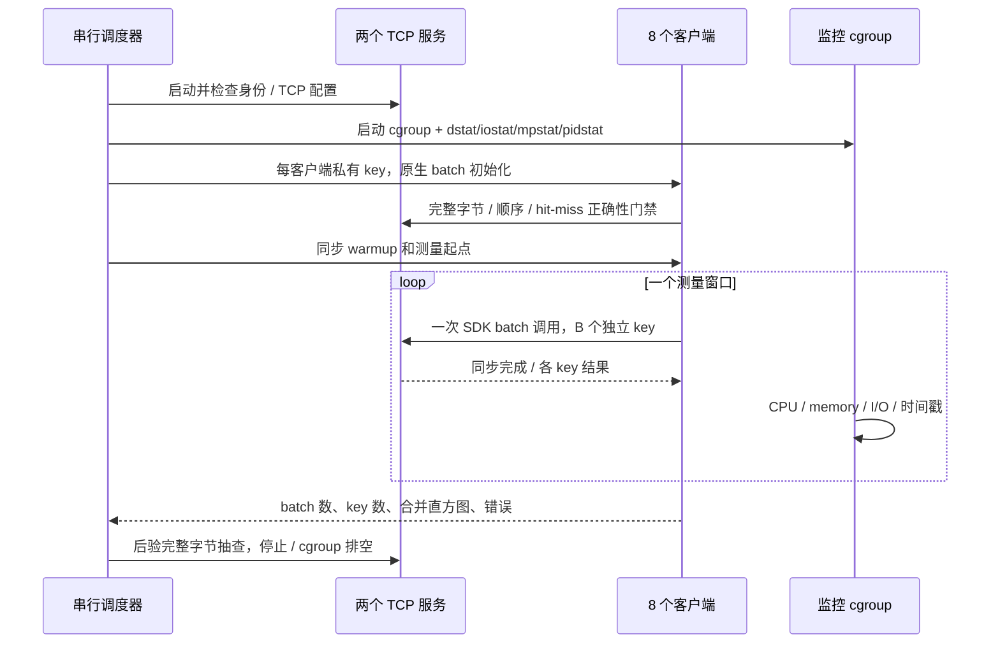

# 1. 每次调用 1 / 16 / 256 / 4096 keys：TCP 原生批量补测

用户已确认 key 数指**一次 SDK API 调用的批量大小**，不是缓存总 key 数。本补测与已发布的单 key TCP 实验分开保存、分开统计。

网页新增[附录 A：构建、版本与配置](https://yche.me/perf/kvc-batch-tcp-20261020/index.html#build-appendix)，同时补充旧单 key TCP 页面。内容模板为 [build-appendix.html](build-appendix.html)，发布与验证记录见 [build-appendix-publication.md](build-appendix-publication.md)。

当前正式证据已独立重算：**132有效 / 18原生失败 / 30 N/A**，共180槽、36个服务周期；`evidence_verified=true`但`passed=false`。18失败均为DataSystem大批量EXIST三重复。交付状态以[验收文档](validation.md)为准。

## 1.1 固定边界

- 目标：`tiantiyun-80c128g`，同节点两个服务，全部 TCP；沿用已构建的 DataSystem v0.9.2.rc44、Mooncake v0.3.13.post1、LMCache v0.5.6，重新核验构建物 SHA256，不宣称重新编译。
- 服务器合计 8 CPU / 12 GiB，客户端合计 8 CPU / 12 GiB，监控 2 CPU / 1 GiB；沿用独立 CPU、NUMA 与无 swap 的 cgroup 配置，所有新旧实验共享同一个 flock inode。
- 每 key 1024 bytes；并发客户端 8，分别接入两个端点；批量数 `[1,16,256,4096]`；3 轮。GET/EXIST/更新各 20 秒，前置 warmup 3 秒。顺序按轮换产品顺序、共同批量顺序执行，避免产品始终第一个执行。
- 主矩阵为容量适配配置：Mooncake `MC_TCP_MAX_QUEUED_TRANSFERS_PER_PEER=8192`、`MC_TCP_MAX_PENDING_ADMISSIONS_PER_PEER=8192`，所有批量大小一致；lane 数与 admission timeout 保持原值，CPU/内存不变。默认参数在独立 r2 smoke 的 C8/B4096 UPSERT 已发生 TRANSFER_FAIL，原始失败和无跟踪诊断单列，不混入适配后性能。
- 热数据工作集总计 65536 keys / 64 MiB，各客户端私有 8192 keys，跨批量数保持同一组 key。4096 keys / 请求 = 4 MiB，不把 4096 × 1 MiB / 请求塞入 12 GiB 客户端配额。
- 当前新根目录 `/home/worktrees/kvc-batch-tcp-20261020-r7`；公开目录 `perf/kvc-batch-tcp-20261020`。r3 正式首轮因 RPC deadline 中止后发现两个 DataSystem Worker 使用同一默认 RocksDB 目录，并出现大量 SST 文件错误；它不满足目录隔离条件。r4 修正目录但尚采用混排 PUT；r5 把 READ 与各档 fresh PUT 放入独立周期后仍在 B16 EXIST 出现原生 deadline 错误，不能把共享目录认定为超时唯一根因。r6 按用户要求关闭 RocksDB、stream 后完成 deadline 对照诊断，但 Mooncake 启动脚本复制时缺失执行权限，资格检查停止；r7 修正复制权限并冻结 mode，保持固定数据校验、完整记录只读原生失败；所有旧轮次独立保留，不复用成功性能行。具体开关、剩余成本和失败判定见[精简配置设计](configuration-profile.md)。
- 旧单 key native/TCP 的冻结启动脚本也缺少该目录隔离，故其中 DataSystem 性能不能作为隔离公平基线；原始成功调用、数据、脚本与失败历史继续保留，适用限制单列，仅用本次R7同配置B1计算批量变化。

## 1.2 语义优先

DataSystem `mset/get/exist`、Mooncake `put_batch/get_batch/batch_is_exist` 均为 SDK 原生批量接口；一次 Python 调用不代表一次内部 RPC。DataSystem 4096-key GET 会在 SDK 内按 1024 keys 等限制分块。

首次 PUT 只使用新 key，以固定总 262144 keys / 256 MiB 完成时间计速。Mooncake `put_batch` 对已有 key 返回成功而不更新，因此**重复调用 put_batch 不能用于更新吞吐**。另设 `upsert` 图：DataSystem `mset` 对照 Mooncake `upsert_batch`，每次更新后检查真实新字节，不把该结果混入首次 PUT。

LMCache CPU MP 的 store/retrieve 以单个 IPCCacheServerKey 为参数，多 token chunk 的 rolling prefix 不等于任意独立 key 批量。P2P 元数据模块的原生独立 ObjectKey 批量 EXIST 已通过两端点、四档批量、命中/未命中/混合集合门禁，以及 C8 冒烟验证；测量包含 lookup、轮询和命中项 unlock 协议成本。PUT / GET 仅 B=1，UPSERT 与更大的 PUT / GET 标记 N/A，不隐藏逐 key 网络循环。

## 1.3 实现和验收

每轮以所有客户端完成边界计 batch/s、keys/s 与 payload MiB/s；延迟为一次完整 batch 的完成时间，不能除以 B 后称为单 key 延迟。保留每客户端直方图及合并桶界。失败可能部分提交，禁止自动重试掩盖错误；只认全部成功的 batch，错误数和未知部分成功数分列。

所有准备、成功与失败命令记录 wall 时间与同进程 monotonic 耗时。正确性 smoke、正式输入哈希、结果重算、资源覆盖检查、公共页面/下载包验收及阶段 commit 均保留证据。对短 PUT 窗口，资源采样不足必须写 null；不以补采样冒充主测量。
