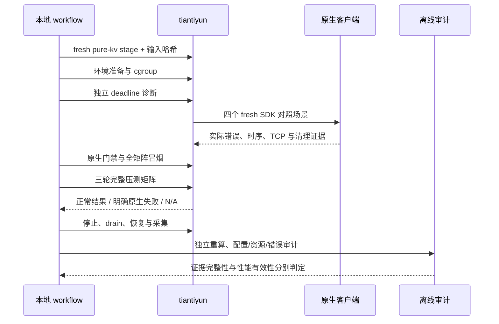

# 纯内存 KV 精简配置

## 1. 目标与证据边界

用户要求使用适合本实验的优选配置，关闭不需要的功能，并明确不需要 RocksDB 和 stream。新实验使用独立的 `pure-kv` 配置；不覆盖之前的启动文件、失败结果或原始日志。原生二进制仍是原固定版本，修改仅限实验启动参数、环境变量及结果采集脚本。

这里的“优选”指在相同硬件额度、TCP、两 worker、完整数据校验条件下移除已确认无用的功能；未穷举所有参数，不能宣称全局性能最优。静态开关审查也不能证明实际开销已消失，须检查真实启动、原生接口门禁和资源样本。

## 2. 关闭项与剩余成本

| 产品 | 新增精简项 | 仍保留的必要或无法完全关闭部分 |
|---|---|---|
| DataSystem rc44 | `rocksdb_write_mode=none`；`sc_regular_socket_num=0`、`sc_stream_socket_num=0`；关闭 worker JSON 指标、普通指标、性能 trace、request/access 采样 | 内存元数据、etcd 发现、心跳、错误诊断；独立 fresh 路径仍可能有普通 eviction policy 文件，不等同启用 RocksDB。Python SDK 未找到官方 JSON monitor 环境开关，不能编造已关闭 |
| Mooncake v0.3.13.post1 | 关闭客户端/TE 指标与 master 周期上报；显式关闭 HA、offload、snapshot/restore、disk eviction、oplog、KV events、多租户和命中 promotion；关闭主动内存驱逐比例 | 必需 master 元数据、心跳、lease；master admin listener 与清理轮询没有原生完全关闭开关 |
| LMCache v0.5.6 | 官方 `noop` 淘汰策略；关闭内部 observability、metrics、logging 订阅，KV event log 设 0，coordinator 空且不报告事件 | MP STORE/RETRIEVE 与 P2P lookup/query/unlock；当前启动入口的本地 HTTP 管理及 1 Hz 控制线程仍保留；8 GiB 预分配成本照实采集 |

精确参数、固定源码行和不可关闭项见 [DataSystem](datasystem.md)、[Mooncake](mooncake.md)、[LMCache](lmcache.md)。保持 ERROR 诊断，不以关闭错误记录、延长超时、修改原生源码或减少校验来获得成功结果。

## 3. 公平条件

两 worker、TCP、1 KiB 值、每次调用 1/16/256/4096 个独立 key、8 个客户端、固定 CPU/内存/swap 额度保持一致。只读热集与每个 fresh PUT 使用独立服务周期，背景 key 数一致。Mooncake TCP 队列的 8192/8192 容量及 4 lanes/1000 ms admission 另行显式记录；默认配置失败历史保留。

所有关闭项在 stage 前写入。stage 保存普通输入 SHA256、实际启动清单与原生构建校验；运行时不修改冻结脚本。HTTP、metadata、必要协议和后台线程的残余开销都计入原所属 cgroup，不从账面扣除。

## 4. 失败也必须完成记录

R5 在独立 RocksDB 目录条件下仍在 DataSystem B16 EXIST 命中阶段失败：121709 次成功批调用、8 个原生 deadline 错误，测量窗口 6.407281222 秒；该轮整体失败，不能纳入三轮有效性能中位数。静态源码链提示 GET/EXIST 共享异步线程池的 deadline 生命周期问题，需要独立对照诊断；不能继续把新失败归因于共享 RocksDB 路径。

新编排显式启用 `--continue-readonly-errors`：仅允许结构完整、正常退出、带原生状态码的 GET/EXIST 失败结果被记录后继续下一用例；写失败、校验错误、预热失败和进程异常仍立即停止。原始 JSON 不修改。每个失败保存命令 rc=1、原件 SHA、错误、事件及服务周期，`valid=false`；“全矩阵证据完整”与“全部测量通过”分开表达。

失败用例不记为 N/A，不填零吞吐，不进入三轮有效性能聚合。诊断用的 EXIST-only、GET→EXIST、等待过期、B1 对照均不是性能结果，限速并单独归档。

## 5. 可复现顺序

命令入口为 `batch_workflow.py stage` → `qualify` → `run` → `restore` → `collect` → 审计 → 报告。每条外部命令及远端服务周期均保存实际单调时钟耗时。R6 是否通过以实际产物为准，本文件不预告测量结果。
