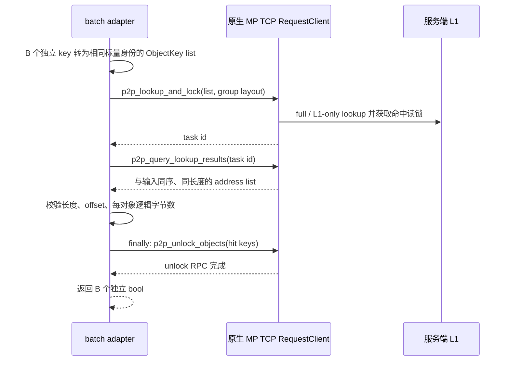

# 6. LMCache：独立 key 批量能力与语义边界

## 6.1 固定版本和证据分层

本补测复用 LMCache `v0.5.6`、提交 `3e11e10812b448142c6cdb177a3058652bd826fa` 的 CPU 原生构建。本文结论来自已核对的该提交源码和本地 mock 机制验证，不代替目标机的正确性 gate、TCP 取证、smoke 或正式性能结果。旧单 key 实验的源码构建记录继续保留，本次不宣称重新编译。

服务沿用 CPU MP、pickle/TCP、两个独立实例，每实例 4 GiB L1 私有池，总池容量 8 GiB；客户端按 `client_index % 2` 选择一个端点，C8 时每端点四客户端。这是两个独立 namespace，并非自动分片集群。单个逻辑 batch 不跨服务拆分，也不通过 Python 逐 key 网络调用实现批量。

## 6.2 能力表：任意独立 key，不等于一条 token 序列

| 对比操作 | B1 | B16 / B256 / B4096 | 本次路线与限制 |
|---|---|---|---|
| 首次 PUT | 支持 | N/A | 原 scalar CPU pickle/TCP；只写新 key，等待 COMMIT ACK |
| 覆盖更新 upsert | N/A | N/A | 已存在对象不重新分配；重复 STORE 不能作为更新吞吐 |
| GET | 支持 | N/A | 原 scalar LOOKUP → retrieve → 完整 bytes → commit |
| EXIST hit / miss | 支持 | 支持 | 原生 P2P ObjectKey list 元数据 RPC；L1-only、稀疏命中、逐 key 结果 |

普通 MP `prepare_store/commit_store/prepare_retrieve/commit_retrieve` 每次接收**一个** `IPCCacheServerKey`，不是任意独立 IPC key 的列表。[原生传输合同](https://github.com/LMCache/LMCache/blob/3e11e10812b448142c6cdb177a3058652bd826fa/lmcache/v1/multiprocess/transport/base.py#L136-L153)

把 B 个 token 塞进一条 IPC 请求，会产生 B 个 rolling-prefix chunk：后一个 hash 依赖前面所有 chunk。它不能保持任意独立 key 在单独查询、子集查询、重排查询时的身份，而且普通 LOOKUP 返回 prefix 命中数，不能替代任意稀疏 key 的存在性向量。[TokenHasher 实现](https://github.com/LMCache/LMCache/blob/3e11e10812b448142c6cdb177a3058652bd826fa/lmcache/v1/multiprocess/token_hasher.py#L192-L230)、[LOOKUP 的 prefix 结果](https://github.com/LMCache/LMCache/blob/3e11e10812b448142c6cdb177a3058652bd826fa/lmcache/v1/multiprocess/modules/lookup.py#L351-L382)

因此不将多 chunk store/retrieve 包装成独立 key 批量成绩，不新增服务端代理或自定义扩展 API。B>1 PUT/GET 直接抛 `UnsupportedBatchOperation`，在结果中保留 N/A；不补零。

## 6.3 原生批量 EXIST 与相同 key 身份

`P2PController.p2p_lookup_and_lock` 原生接收 `list[ObjectKey]`，按 `fetching_policy="full"`、`skip_l2=True` 查询所有 L1-resident key，允许中间缺项。[原生批量请求](https://github.com/LMCache/LMCache/blob/3e11e10812b448142c6cdb177a3058652bd826fa/lmcache/v1/multiprocess/modules/p2p_controller.py#L264-L315)

本适配器逐 key 进行的工作仅为本地身份转换：调用旧 TCP adapter 的 `_key(key)`，保留 `model_name=bytes-1024`、`world_size=1`、`worker_id=0`、`token_ids=(1,)`、`cache_salt=SHA256(key)`，然后使用官方 `ipc_key_to_object_keys` 转换 rank、object group 和单 token 的 blake3 chunk hash。请求顺序、B 值和客户端 session 不进入对象身份。这里的本地 list 构造不产生逐 key RPC。[官方对象身份转换](https://github.com/LMCache/LMCache/blob/3e11e10812b448142c6cdb177a3058652bd826fa/lmcache/v1/distributed/api.py#L608-L653)

结果列表保持请求顺序和长度，负 offset 表示 miss；查询结果只消费一次。适配器只检查这些地址的元数据，不读取地址指向的内存，不启动 P2P payload transfer，也不使用 RDMA/UB 路径。[结果合同与实现](https://github.com/LMCache/LMCache/blob/3e11e10812b448142c6cdb177a3058652bd826fa/lmcache/v1/multiprocess/modules/p2p_controller.py#L318-L358)、[按原请求位置生成结果](https://github.com/LMCache/LMCache/blob/3e11e10812b448142c6cdb177a3058652bd826fa/lmcache/v1/multiprocess/modules/p2p_controller.py#L379-L420)

正常命中窗口包含 lookup、result query、所有 hit 的 unlock ACK 及 O(B) 转换/校验成本；全 miss 无需发送空 unlock。因此这与旧 scalar 的 LOOKUP/prefix 路线不同，也不能解释为一次轻量 contains RPC。三个产品都以一次完整逻辑 batch API 的完成计延迟，一次 API 可以含多个内部 RPC。

## 6.4 锁、超时与失败边界

固定实现的 `skip_l2=True` 在调用线程完成 L1 lookup，返回 task id 前结果已可查询；不包含 L2 查找或加载。[同步 L1-only 分支](https://github.com/LMCache/LMCache/blob/3e11e10812b448142c6cdb177a3058652bd826fa/lmcache/v1/distributed/storage_controllers/prefetch_controller.py#L579-L593)

正常结果中每个有效 hit 都在 `finally` 进入一条原生 unlock 向量，等待 RPC 完成后才返回 bool。超时、结果缺项、类型或尺寸不符、unlock 失败均为 fatal，不改写成 miss、不重试测量。结果无效而无法确定 hit 时，保守尝试释放全部请求 key；本实验每客户端私有 key，禁止将此清理策略推广到共享 key 的并发读场景。异常后 adapter 失效，须停止并重置服务，不继续出成绩。

unlock handler 调用 `finish_read_prefetched`，但不向客户端返回逐 key 的 L1 解锁状态。收到 RPC ACK 证明 handler 已返回，不能据此宣称观测到服务内部每个 refcount 为零；网络故障下的释放、并发淘汰和恢复也未由这些离线测试证明。[原生 unlock handler](https://github.com/LMCache/LMCache/blob/3e11e10812b448142c6cdb177a3058652bd826fa/lmcache/v1/multiprocess/modules/p2p_controller.py#L361-L372)

## 6.5 PUT ACK 不能当覆盖成功

L1 `reserve_write` 对已有 resident key 返回 `KEY_NOT_WRITABLE`，不分配可写对象。[已有 key 分支](https://github.com/LMCache/LMCache/blob/3e11e10812b448142c6cdb177a3058652bd826fa/lmcache/v1/distributed/l1_manager.py#L514-L517)

pickle `commit_store` 跳过没有 reservation 的 key，最终以 `written_keys` 数等于 `reserved_dict` 数判定成功；当两个数量都为零时也可 ACK true。因此重复 PUT 可能成功返回但保留旧值，主 upsert 图中包括 B1 都必须 N/A。原生 ACK 也不提供任意批量的逐 key 成功位图，不能将 ACK 推广为全量逐 key 落库证明。[提交与成功条件](https://github.com/LMCache/LMCache/blob/3e11e10812b448142c6cdb177a3058652bd826fa/lmcache/v1/multiprocess/modules/server_transfer.py#L216-L267)

本次 B1 首次 PUT 使用固定总量的新 key；fresh namespace 与 warmup/工作集分开，不循环已有 key、不隐藏 delete。gate 必须验证换 payload 后旧值仍保留；首次 PUT 的后验完整字节抽查另保留计数。池预算充足和抽查通过，不等于逐个读回了所有首次 PUT 的对象。

## 6.6 脚本与验证证据

- `scripts/experiments/kvc-fair/batch_lmcache.py`：`new_adapter(config)`；原 scalar TCP adapter 路径必须绝对；校验 CPU pickle/TCP adapter、`chunk_size=1`，并固定 blake3 key 映射。`metadata()` 公开能力、端点选择、EXIST 路线及已有 key 语义。`put_mode=overwrite` 即使 B1 也显式拒绝。
- `test_batch_lmcache.py`：22 项离线 mock 机制验证，覆盖四档 B、独立 key 重排/子集身份、mixed/miss、异常与 finally 清理、超时不当 miss、不支持操作拒绝；不产生产品性能数字。
- `test_batch_harness.py`：12 项离线机制回归，覆盖稳定私有工作集、固定 fresh key 数、跨产品相同 key 字节、setup scalar 与测量 native batch 的分离、两版本 upsert 与恢复读回、准入和异常清理；不证明真实 SDK 或目标机吞吐。
- 目标机 `batch-gate-001` 两端点四档 B 的真实结果、原始 TCP trace、smoke、正式结果及监控样本由本补测独立保存。只有这些实际产物通过后，才进入结果汇总；本源码说明不预先宣布运行通过。

复用构建与容量配置见 [build.md](build.md)，共同公平性合同见 [test-design.md](test-design.md)，命令和阶段耗时入口见 [script-design.md](script-design.md)。旧结果、旧 scalar adapter 与原有构建制品保持独立，不以新 P2P 路线覆盖旧成绩。
