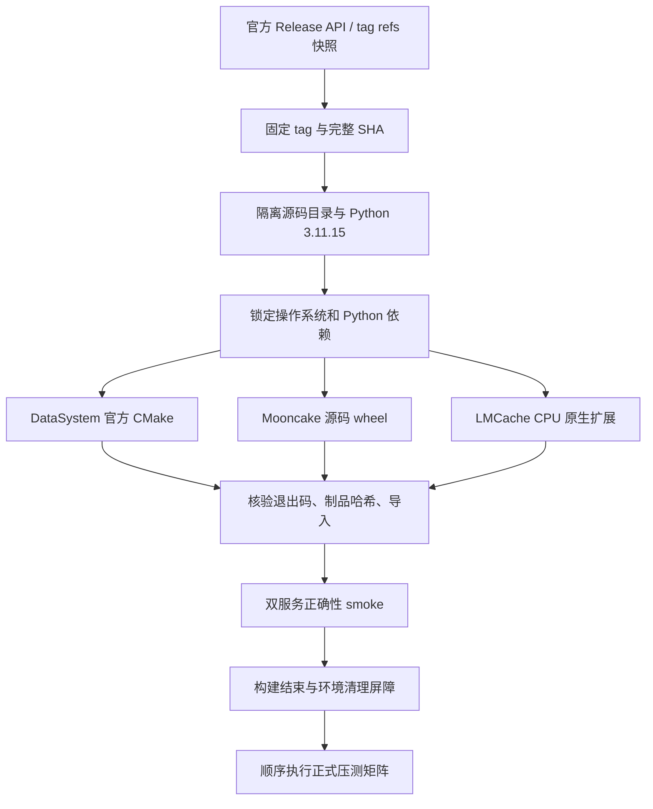

# 构建文档

Status: In-Progress

版本核对时间为北京时间 2026-10-20，来源为官方发布 API 与远端 tag，禁止以移动 main 代替发布源码。所有构建在 `tiantiyun-80c128g` 进行；产品源码、二进制与缓存保存在仓库外。DataSystem 禁止向 openeuler 推送，本任务无产品推送。

| 产品 | tag | 固定源码 SHA | CPU 构建路径 |
|---|---|---|---|
| DataSystem | v0.9.2.rc44 | 2ff37e2f7c5fb45f3feea7c3fb969b8f84b920d6 | 官方 CMake Release，禁用 RDMA/URMA，构建 Python SDK |
| Mooncake | v0.3.13.post1 | 719735896c86b56fabec6cf3e825fb2ea640597a | 官方源码 wheel，Release，TCP，CUDA/TENT/ETCD 关闭 |
| LMCache | v0.5.6 | 3e11e10812b448142c6cdb177a3058652bd826fa | NO_GPU_EXT=1，保留三个 CPU 原生 C++ 模块 |

DataSystem 目前没有最终 v0.9.2 tag，因此按用户“最新 v0.9.2 tag”选择该系列 rc44，不把它称为最终稳定版。Mooncake 官方 release 的 latest 为 post1，不能采用未发布的文档版本号替代。详见 [Mooncake Release](https://github.com/kvcache-ai/Mooncake/releases/tag/v0.3.13.post1)、[LMCache Release](https://github.com/LMCache/LMCache/releases/tag/v0.5.6)。

## 1. 解释器与编译器

三者使用私有 CPython 3.11.15，但分别使用独立 venv，避免依赖相互覆盖。系统 Python 不升级。Python 基础解释器由 uv 下载，路径与 wheel 依赖锁文件一并保留。

编译器按各源码最低要求使用目标机现有版本：Mooncake 的 C++20 使用 GCC Toolset 15，DataSystem 当前构建使用 GCC 11。此差异会进入报告，不能声称二进制编译条件完全一致。CPU PyTorch 等第三方库使用已发布二进制依赖；LMCache 自身的原生模块在 tag 源码上真实编译，二者分别标注。

## 2. 已观察到的构建问题

- Mooncake 第一次关闭 USE_HTTP 后，tag 内 `master_service.cpp` 引用不完整的 MetadataStoragePlugin 类型而失败。按源码默认启用 USE_HTTP 后重编；运行时仍使用 P2PHANDSHAKE，关闭 HTTP 元数据服务。没有修补产品源码。
- DataSystem 并行依赖 bootstrap 中 grpc 的 protoc 找不到 libabseil_dll.so，但 bootstrap 仍打印成功；主配置用完整依赖路径重新构建 grpc 后成功。保留第一次失败日志，不以 bootstrap 的文字当作成功证据。
- LMCache 旧网络服务器不适合作为同步 PUT 对照，因为没有 PUT 完成 ACK。使用新版 MP CPU engine-driven 接口，其 prepare / commit 确认实际写入。

## 3. 复现入口与制品

分产品完整命令、构建状态和依赖列表见 [datasystem.md](datasystem.md)、[mooncake.md](mooncake.md)、[lmcache.md](lmcache.md)。公共脚本设计见 [script-design.md](script-design.md)。每个产品保留源码 SHA、构建日志、退出码、Python 依赖锁、RPM 清单和制品 SHA256；报告构建进度与真实性以这些文件为准。

DataSystem构建配方在checkout内建立运行环境`.venv/`，结束时完整工作树clean标记为false，跟踪源码仍无变化。复现metadata仅允许DataSystem精确的`?? .venv/`未跟踪目录；其它未知文件、跟踪源码修改或HEAD/tag SHA不符继续拒绝，不伪造完整工作树clean。
