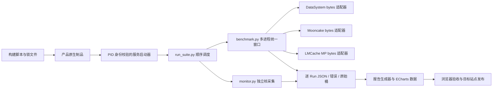
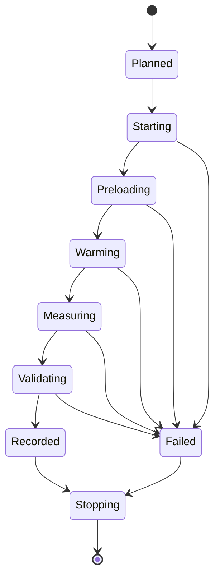

# 可复现流程与脚本设计说明

Status: In-Progress

## 1. 分层

脚本只服务本次明确要求的对比实验，不新增通用 workbench 构建体系。产品构建继续调用官方 build.sh / pip wheel，适配器只规范 key/bytes 和完成语义，不改变产品实现。

## 2. 公共组件

| 文件 | 责任 |
|---|---|
| prepare_env.py | 对精确旧 tmpfs 清单检查 fd/maps；归档校验成功后才释放源目录；记录环境前后状态 |
| cgroup.py | 创建本任务唯一 cgroup 树；在 exec 前迁移进程；固定 CPU/NUMA/内存与 swap |
| benchmark.py | spawn 独立解释器与 SDK，阶段屏障，单调时钟计时，原始直方图与精确数据抽验 |
| run_suite.py | 互斥运行、确定性随机产品/用例顺序、服务重置、失败留证、断点续跑、进程组超时清理 |
| monitor.py | 1 秒 cgroup /proc 采样，iostat/mpstat/pidstat/dstat/perf，保存命令和退出码 |
| report.py | 只消费实际结果，分离失败/短窗口、生成 CSV/JSON 与 ECharts 页面 |

三者共享驱动实现、Python 版本、数据生成种子和 key 规则。产品差异集中在 `new_adapter(config)` 对象：`put(key, bytes)`、`get(key) -> bytes`、`exists(key) -> bool`、`close()`。每个对象属于唯一客户端进程，不在 fork 前创建。

## 3. 状态与失败处理

事件日志每行保存 wall_ns、mono_ns、阶段、用例、命令或结果。原始用例结果独立 JSON，重跑同点时将旧结果改名保留。只有全部操作有效的用例允许断点跳过；有失败则重启空服务重跑，不能只补最后一个接口而复用污染状态。

外层命令使用独立进程组，超时或中断时终止本次命令及子进程；产品服务使用 PID + /proc 启动时间清理，避免 PID 复用误杀。正式用例结束后检查实验 cgroup 是否完全排空。DataSystem 测量完成后的服务退出可使用短超时的强制实验拆除，不能把该步骤视为无损下线或恢复测试。

## 4. 资源与结果

原始日志和资源序列放在目标机任务目录；仓库只保存脚本、小型锁文件与文档。结果记录每个客户端样本数、错误数、实际窗口、P99 桶边界、每秒成功数、校验次数与开始偏差。采样监控保存观察者开销；PSI 缺失或工具失败按不可用记录，不能填 0。

PUT 每点固定 `min(2 GiB, 65536 * value_size)` 的新 key 数据，三个尺寸分别为 64 MiB / 2 GiB / 2 GiB。GET 与 EXIST 共用每用例预置总 64 MiB，EXIST 由新客户端连接已有数据验证；三个尺寸 GET 各自预置。重复次数 3，并发 2/8/16，正式时间窗口 20 秒，暖机 3 秒；PUT 为固定工作量窗口，短于 10 秒会明确标注。

## 5. 执行约束

先完成依赖与三产品构建，再做真实 smoke，最后运行正式矩阵。不得把 fake backend 的驱动自测数字放进报告。构建、监控、测量与报告分别记录状态；某一产品失败不会伪造其吞吐，报告展示缺失原因和原始错误。
