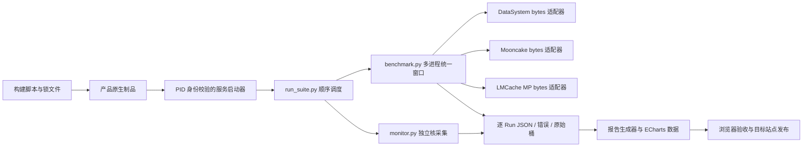
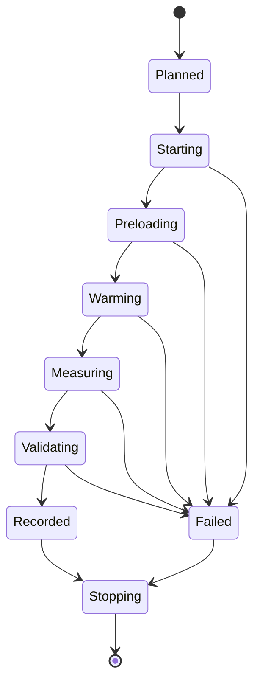

# 可复现流程与脚本设计说明

Status: 原生路径已执行并通过完整性验证；TCP 补充实验已通过整体协议门禁及共同 smoke，正式 TCP 矩阵已启动、尚未完成。

## 1. 分层



脚本只服务本次明确要求的对比实验，不新增通用 workbench 构建体系。产品构建继续调用官方 build.sh / pip wheel，适配器只规范 key/bytes 和完成语义，不改变产品实现。

## 2. 公共组件

| 文件 | 责任 |
|---|---|
| prepare_env.py | 对精确旧 tmpfs 清单检查 fd/maps；归档校验成功后才释放源目录；记录环境前后状态 |
| finish_environment.py | 主矩阵与资源补测结束、全 cgroup 排空后恢复原记录的 troubleshooting 服务；记录实际 systemctl 状态、源码身份、SHM 条目与原归档 stat，不重读大归档、不重建 DBus transient、不删数据 |
| cgroup.py | 创建本任务唯一 cgroup 树；在 exec 前迁移进程；固定 CPU/NUMA/内存与 swap |
| benchmark.py | spawn 独立解释器与 SDK，阶段屏障，单调时钟计时，原始直方图与精确数据抽验 |
| run_suite.py | 互斥运行、确定性随机产品/用例顺序、服务重置、失败留证、断点续跑、进程组超时清理 |
| monitor.py | 1 秒 cgroup /proc 采样，iostat/mpstat/pidstat/dstat/perf，保存命令和退出码 |
| timed.py / collect_timings.py | 记录命令单调时钟墙钟，读取原始阶段证据，输出统一耗时表；缺失边界为空 |
| build_metadata.py | 校验源码/制品身份与真实 smoke，复制构建证据，拒绝覆盖不同清单 |
| analyze_results.py | 按固定接口/尺寸/并发汇总三次重复，保留离散程度、采样缺失与内存事件增量 |
| verify_results.py | 发布前核对完整矩阵身份、实际参数、客户端/全局桶、PUT 后验校验、资源时间序列与已记录干扰排除 |
| profile_put.py / light_monitor.py | 主矩阵后九个独立 PUT-only 资源窗，固定原驱动与配置，轻量高频采样，单列观察者成本与实际间隔 |
| capture_evidence.py | 测量停止且 cgroup 为空后保存构建日志与脚本快照，重复收集只验证旧快照 |
| report.py | 只消费实际结果，分离失败/短窗口、生成 CSV/JSON 与 ECharts 页面 |
| refresh_delivery.py | QA 后先核验旧 SHA，仅刷新文档/复现 ZIP/带来源与截止边界的操作账本及派生 gzip/SHA；核心页面、统计、原始 tar、核心 gzip 字节及权限冻结，默认 dry-run |

三者共享驱动实现、Python 版本、数据生成种子和 key 规则。产品差异集中在 `new_adapter(config)` 对象：`put(key, bytes)`、`get(key) -> bytes`、`exists(key) -> bool`、`close()`。每个对象属于唯一客户端进程，不在 fork 前创建。

## 3. 状态与失败处理



事件日志每行保存 wall_ns、mono_ns、阶段、用例、命令或结果。原始用例结果独立 JSON，重跑同点时将旧结果改名保留。只有全部操作有效的用例允许断点跳过；有失败则重启空服务重跑，不能只补最后一个接口而复用污染状态。

外层命令使用独立进程组，超时或中断时终止本次命令及子进程；产品服务使用 PID + /proc 启动时间清理，避免 PID 复用误杀。正式用例结束后检查实验 cgroup 是否完全排空。DataSystem 测量完成后的服务退出可使用短超时的强制实验拆除，不能把该步骤视为无损下线或恢复测试。

## 4. 资源与结果

原始日志和资源序列放在目标机任务目录；仓库只保存脚本、小型锁文件与文档。结果记录每个客户端样本数、错误数、实际窗口、P99 桶边界、每秒成功数、校验次数与开始偏差。采样监控保存观察者开销；PSI 缺失或工具失败按不可用记录，不能填 0。

PUT 每点固定 `min(2 GiB, 65536 * value_size)` 的新 key 数据，三个尺寸分别为 64 MiB / 2 GiB / 2 GiB。GET 与 EXIST 共用每用例预置总 64 MiB，EXIST 由新客户端连接已有数据验证；三个尺寸 GET 各自预置。重复次数3，并发2/8/16；GET/EXIST正式20秒、暖机3秒。PUT为固定工作量窗口，暖机每客户端4次PUT+4次GET，短于10秒明确标注。

## 5. 执行约束

先完成依赖与三产品构建，再做真实 smoke，最后运行正式矩阵。不得把 fake backend 的驱动自测数字放进报告。构建、监控、测量与报告分别记录状态；某一产品失败不会伪造其吞吐，报告展示缺失原因和原始错误。

## 6. 耗时与会话证据

完整口径见 [timing.md](timing.md)。`workflow.py` 为每条外部命令追加 UTC 起止与本机单调时钟持续时间；正式接口窗口来自客户端自身记录，不能与编排墙钟混为一谈。恢复前归档已结束会话的监控、运行参数与失败启动日志，历史失败不因补跑成功而删除。最终原始证据压缩包保留全部会话及 native 工具日志。

新版复现驱动会先验证 `resume-provenance.json`：参数、产品命令、适配器、配置、解释器与运行脚本不一致则在启动监控或覆写 metadata 前拒绝续跑；实际逐接口参数也须相符。该 bookkeeping 改进只用于后续复现，不部署到本次正在运行的远端驱动。本次 legacy 续跑使用原驱动，先归档会话并独立核对初始核心脚本哈希、参数、制品及已批准的 LMCache cwd 单行修复。

## 7. 独立 TCP 流程

新增要求与协议证据边界见 [tcp-plan.md](tcp-plan.md)。TCP 复用原生阶段已实际构建并锁定 SHA 的二进制与 SDK，保留原构建时间和 smoke 记录作为来源，不声称重新构建。以下入口从脚本目录执行；原 `workflow.py` 命令继续用于原生路径：

```bash
python3 tcp_workflow.py stage
python3 tcp_workflow.py prepare
python3 tcp_workflow.py probe
python3 tcp_workflow.py smoke
python3 tcp_workflow.py run
python3 tcp_workflow.py profile
python3 tcp_workflow.py restore
python3 tcp_workflow.py collect
python3 tcp_workflow.py report
python3 tcp_workflow.py publish
```

| 层次 | 输入、状态与边界 |
| --- | --- |
| 原生基线 | `/home/worktrees/kvc-fair-20261020`，已有源码制品、原脚本、原始结果与环境归档保持不变 |
| TCP 运行根 | `/home/worktrees/kvc-fair-tcp-20261020`，独立脚本、配置、服务目录、结果和不可覆盖的 `tcp-stage.json` |
| 当前环境 | `/home/cache/kvc-fair-20261020/environment-tcp`，记录 TCP 阶段开始前实际活动的服务与环境；恢复只依据本阶段记录 |
| 共同锁与资源 | 两根目录的 `suite.lock` 是同 inode 硬链接；相同端口/cgroup 只能由一个流程独占，不能并行跑两个 profile |
| 本地证据与发布 | `~/workspace/scratch/2026-10-20-kvc-tcp`；发布目标为 `xqyun-32c32g:/var/www/html/perf/kvc-tcp-20261020`，与原生报告分开 |

`stage` 先确认原生 suite 已成功结束、重验复用制品 SHA，再复制本轮脚本和配置、链接私有安装目录。`prepare` 使用新的本阶段环境记录并建立同一资源约束，已有记录不能直接覆盖。入口提供 `--target`、`--base`、`--root`、`--local-output`、`--environment-root`、`--rfc`、`--report-path`；上表仍是本轮未改变的默认值。独立复现应同时指定新的运行根、本地输出、环境记录与同级 `perf/` 发布命名空间。`--rfc` 指定打包的本地文档目录，默认识别仓库 RFC 或解压后的 `docs/`。

下面示例在解压后的脚本目录运行，十个步骤始终携带同一组路径；每次独立复现使用新的后缀：

```bash
TCP_REPLAY=(python3 tcp_workflow.py
  --target tiantiyun-80c128g
  --base /home/worktrees/kvc-fair-20261020
  --root /home/worktrees/kvc-fair-tcp-replay-20261020
  --local-output "$HOME/workspace/scratch/2026-10-20-kvc-tcp-replay"
  --environment-root /home/cache/kvc-fair-20261020/environment-tcp-replay-20261020
  --rfc "$PWD/docs"
  --report-path perf/kvc-tcp-replay-20261020)
"${TCP_REPLAY[@]}" stage
"${TCP_REPLAY[@]}" prepare
"${TCP_REPLAY[@]}" probe
"${TCP_REPLAY[@]}" smoke
"${TCP_REPLAY[@]}" run
"${TCP_REPLAY[@]}" profile
"${TCP_REPLAY[@]}" restore
"${TCP_REPLAY[@]}" collect
"${TCP_REPLAY[@]}" report
"${TCP_REPLAY[@]}" publish
```

仓库内执行时，将 `--rfc` 改为 canonical RFC 的绝对路径。该示例发布到 `/var/www/html/perf/kvc-tcp-replay-20261020`，保留原 TCP 报告；浏览器 QA 的 `QA_URL` 也应改成相同新路径。新路径不会取消共享锁或允许同时使用同一节点资源。

`probe` 单独启动服务，以独立进程验证两接入端点的完整 bytes/EXIST 与实际 TCP syscall。DataSystem 的三尺寸、两接入端点各自留证，实际载荷可路由到配置内的任一 Worker；接入端点和实际载荷端点分开记录。只有整体协议门禁成功且共同 smoke 正常结束，`run` 才能开始。正式窗内不运行 strace，每个 cell 重新启动空服务，81 cell、216 个接口结果、72 组三次重复及九个独立 PUT 资源窗继续沿用原工作负载与配额。

第 6 次整体协议门禁成功，三产品均通过，单调时钟墙钟 **47.3834 s**；LMCache 两个 1 MiB 载荷探测均完成 TCP 收发与完整 bytes 校验。共同 smoke 的 6 cell、18 个接口结果已通过。独立正式矩阵在 UTC 2026-10-19 20:41:54.554432 至 22:42:19.371899 完成 81 cell / 216 结果，随后九格资源专项、恢复、取证和原始结果验证均完成；公开页面已发布，最终验收状态见 [TCP交付核对](tcp-acceptance.md)。协议墙钟含 tracing、启动与清理，不能用于性能排名。

## 8. TCP 预检修正与内存语义

预检失败后，先保留旧失败，再使用 `python3 tcp_workflow.py retry-probe`。事务必须持有共同锁、全部 cgroup 为空，且正式 `events.jsonl`、summary、provenance、cells 均不存在。允许变更的路径只有 `tcp_stage.py`、`tcp_protocol_gate.py`、`tcp_probe_ds_sizes.py`、`mooncake/launch_master.sh`；最后一项只负责生命周期入口，直接执行同一个已构建 master ELF 以保持本轮启动身份。产品源码/二进制、adapter、benchmark 和工作负载配置不能通过此事务更改。

部署执行位在复制完成后设置，避免 `copy2` 把 launcher 再变为 0644。只有权限变化也可构成独立修正，仍须记录对应内容 SHA。原 `tcp-stage.json` 保留，失败整轮移到 `formal-tcp-001/protocol-history/attempt-NNNN/`；修正前后文件、逐文件摘要与权限记录分别保存到 `preflight-history/`、`preflight-changes.json`。早期“先记录/设置权限、后复制内容”的错误记录明确标为历史顺序缺陷，不宣称当时权限已生效；最终门禁要求后续纠正、最终内容 SHA 和实际快照 0755 模式一致。

`verify_tcp.py` 在原 `verify_results.py` 的 216/81/72 完整性校验之上，重算协议 raw trace、完整字节、实际 Materialize、配置与执行清单，并验证受限修正链。近期增加的 16 项临时 fixtures 只验证端点白名单、权限修正与拒绝篡改逻辑；它们是离线工具测试，没有运行产品，也不是 TCP 吞吐或延迟成绩。

LMCache 的 TCP wrapper 使用 `--shm-name '' --no-l1-use-lazy` 与原生 CPU MP pickle。每个实例的私有 4 GiB 池在启动时填充触页，两实例合计 8 GiB 在工作负载前已产生物理内存计费，不能沿用原 SHM 模式仅预留地址、按需触页的资源基线。tensor/bytes 构造、pickle 序列化/反序列化、副本和提交 ACK 均计入对应 SDK 调用延迟；服务额外开销继续由 cgroup 真实采样观测。

## 9. TCP 过程耗时输出

| 记录 | 耗时口径 |
| --- | --- |
| 本地 `operation-timings.jsonl` | TCP 入口调用的实际 UTC 起止、单调时钟持续时间和退出状态 |
| 本地 `workflow-timings.jsonl` | 委托给公共 workflow 的 profile/restore/collect/report/publish 等命令；可能嵌套于上一层 |
| 当前及历史协议目录的 `summary.json`、`operations.jsonl` | 每轮整体门禁和服务、tracing、探测命令；成功与失败均保留 |
| `formal-tcp-001/preflight-changes.json` | 每次修正事务的起止、持续时间、文件/权限变更与失败轮归档位置 |
| 本地 `timings/timings.json`、`timings/timings.csv` | collect 后由 `collect_timings.py` 统一整理，复用构建区间单列 reused 来源，未知边界保持 null |

`restore` 等主矩阵和资源补测结束、cgroup 排空后，按本阶段 `environment-tcp` 记录恢复实际曾停止的服务；`collect` 之后把当前/历史协议、修正链、脚本快照和环境证据带回本地。`report` 在生成任何页面之前重新调用只读 TCP 发布门禁，而非只信旧的 passed JSON。SDK 窗口、编排命令、预检修正、复制和原始构建来源分别保留，父子区间不能相加，也不能把预检失败计入产品构建时间或正式 QPS/P99。

## 10. 报告证明绑定与交付验收

完整 `tcp-verification.json` 保留独立验证器的全部输出，包括逐尺寸实际介质证明；`data.json/data.js` 只保留确定性摘要、完整执行修订链和 `full_evidence={path,sha256,bytes}`。摘要避免把约 10 MiB 的底层证明在页面数据里重复保存。SHA 和字节数根据已写入的完整文件精确计算，包含末尾换行；证明没有删减。浏览器重新下载完整 JSON，以实际响应内容重算 SHA/字节数，再从该内容重建摘要逐字段对照，不能只检查 `passed=true`。

| 脚本 | 验收职责与边界 |
| --- | --- |
| `qa_report.mjs` | 1440/900/390 三视口、ECharts 筛选/resize、216 主结果和 9 专项的原 JSON 绑定、TCP 专属标签与证明；原生报告 HTML 的 HEAD 无长度时 GET 小页面并核对固定原生标题，原始大 tar 仍仅 HEAD 检查下载性 |
| `refresh_delivery.py` | 默认预览，`--apply` 时先验现有完整 SHA 清单，只刷新 docs、操作 ledger 和复现 ZIP；本轮 254 个核心文件的内容、gzip 头及权限逐项保持不变，不重新生成图或测量数据 |
| `commit_publication.py` | 先预览再 `--apply`，临时 Git index 只纳入本报告与自己的首页/metadata 条目，保全网站原有工作区改动；拒绝大于 20 MiB 的提交文件，原始 tar 留在网站而不提交 Git |

`reproduce.zip` 的根目录为 `kvc-fair/`，其中 `docs/` 含本轮文档，脚本通过相对 import 使用；实际清洁解压后验证 CRC、安全唯一文件路径、Python 编译、CLI 帮助、shell 语法及 74 项离线工具测试。最终仅更新文档或验收脚本时，对照已测试脚本逐项 SHA，并单列变化脚本自己的实际验收证据；不能把旧 ZIP 测试冒充新脚本测试。

页面核心通过验收后，后续公开 QA、发布和文档刷新耗时进入操作 ledger；其首行明确快照截止点，自身及之后命令没有伪造持续时间。公开 QA 的规则误判和被主动停止的尝试保存原脚本、JSON/截图及退出记录，不改写为成功，也不计入正式接口失败或五轮协议预检失败。
