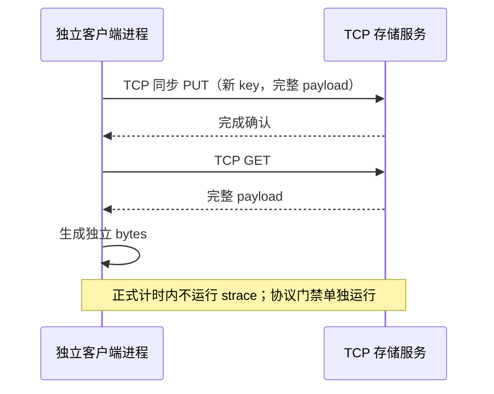

# 统一 TCP 数据通路补充实验

Status: In-Progress，原生路径实验与其公开结果保留。

## 1. 补充要求和验收边界

新增要求是所有进程间的控制和对象数据通信均走 TCP，不使用 RDMA、UB 或客户端与服务端间的共享内存传值。原生基线的 DataSystem SHM 和 LMCache MP SHM 不满足这个补充边界，不能用原结果替代 TCP 测量。Worker 自身的内存池实现不属于跨进程传输协议。

三产品复用已从锁定发布源码实际构建的二进制和 SDK，版本/编译证据沿用 build.md，不重复声称重新构建。新脚本、配置、结果、监控与计时放在独立根目录 `/home/worktrees/kvc-fair-tcp-20261020`，不替换旧实验任何输入或结果。两个根目录共享同 inode 的 flock，避免两套驱动同时占用相同资源和端口。

## 2. 原生 TCP 路径

| 产品 | 配置与完成契约 | 验证要求 |
| --- | --- | --- |
| DataSystem rc44 | `ipc_through_shared_memory=false`，`enable_urma=false`、`enable_rdma=false`；其余 routed SDK 语义保持 | 两 Worker，所有尺寸 PUT/GET 完整字节；源码传输选择链与独立 socket 跟踪 |
| Mooncake v0.3.13.post1 | classic TE `tcp`、client segment 0、hot cache 0；客户端与 peer 显式 `MC_STORE_MEMCPY=0` | 两独立 peer，验证对象数据走 TCP 而非同进程 memcpy；保留协议与 syscall 证据 |
| LMCache v0.5.6 | CPU MP engine_driven、空 `shm_name`，原生 pickle payload 经 ZMQ/TCP；PUT 等待提交 ACK，GET 完成反序列化与释放读锁 | 必须是 Pickle context，拒绝 SHM 或其他静默路径；保留 prepare/commit/lookup 完成语义 |

LMCache 非 SHM 内存池启动会全量触页，资源基线与 SHM 版本不同，不能合并旧资源点。pickle 序列化、tensor/bytes 构造与副本均包含在接口调用开销中。所有服务只监听回环地址，既有无磁盘层、单副本、4 GiB × 2 容量和 cgroup 配额沿用。

## 3. 工程风险与测试计划

不修改产品源码或二进制。风险集中在 transport 配置是否生效、pickle 完成确认、原生 memcopy 捷径、容量触页和新旧结果混入。产品 native 路径原封不动保留，新增 adapter/启动参数只用于新的实验 manifest。启动失败、超时和读回不一致都作为失败，不能当作不存在或成功写入。

先在两个服务上分别进行 fresh PUT、GET 精确内容和 EXIST hit/miss 检查，使用独立 strace 记录实际 TCP fd 的数据收发和源码选择证据。正式压测前停止协议观察，重新启动空服务；不把 strace 的耗时或结果加入吞吐统计。

正式矩阵保持三尺寸（1 KiB/64 KiB/1 MiB）、三并发（2/8/16）、三次重复、相同数据量/种子/窗口/CPU/内存/NUMA 配额，共 81 cell、216 接口结果。监控继续使用 cgroup、dstat、iostat、mpstat、pidstat、perf。短 PUT 再以相同九格资源专项补充。预置、校验和 P99/QPS 口径沿用 test-design.md 的精确定义；两个协议 profile 的结果分别统计。

## 4. 交付与恢复

继续逐阶段记录 UTC、monotonic duration 和退出状态，并提交阶段成果。新报告保留编号章节、左侧导航、ECharts、居中 caption、全部文档与复现 ZIP，明确链接原生基线和 TCP 基线。完成后核验全部结果、资源覆盖、实际 TCP 证据、浏览器与文件摘要，再恢复本阶段之前活动的服务。原有源码、归档和基线报告不清理。
