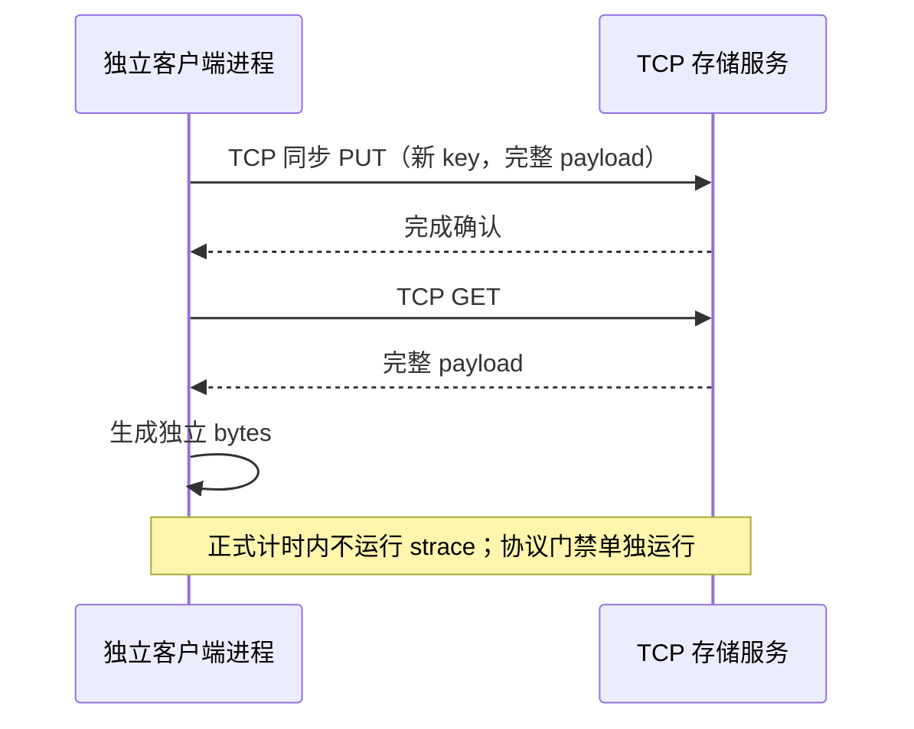

# 统一 TCP 数据通路补充实验

Status: In-Progress，TCP 主矩阵与九格 PUT 资源专项均已结束，本地结果与协议核验已通过；报告与公开验收待完成，记录外部操作排除证据仍有未知项。原生路径实验与其公开结果保留。

## 1. 补充要求和验收边界

新增要求是所有进程间的控制和对象数据通信均走 TCP，不使用 RDMA、UB 或客户端与服务端间的共享内存传值。原生基线的 DataSystem SHM 和 LMCache MP SHM 不满足这个补充边界，不能用原结果替代 TCP 测量。Worker 自身的内存池实现不属于跨进程传输协议。

三产品复用已从锁定发布源码实际构建的二进制和 SDK，版本/编译证据沿用 build.md，不重复声称重新构建。新脚本、配置、结果、监控与计时放在独立根目录 `/home/worktrees/kvc-fair-tcp-20261020`，不替换旧实验任何输入或结果。两个根目录共享同 inode 的 flock，避免两套驱动同时占用相同资源和端口。

## 2. 原生 TCP 路径

| 产品 | 配置与完成契约 | 验证要求 |
| --- | --- | --- |
| DataSystem rc44 | `ipc_through_shared_memory=false`，`enable_urma=false`、`enable_rdma=false`；其余 routed SDK 语义保持 | 两 Worker，所有尺寸 PUT/GET 完整字节；源码传输选择链与独立 socket 跟踪 |
| Mooncake v0.3.13.post1 | classic TE `tcp`、client segment 0、hot cache 0；客户端与 peer 显式 `MC_STORE_MEMCPY=0` | 两独立 peer，验证对象数据走 TCP 而非同进程 memcpy；保留协议与 syscall 证据 |
| LMCache v0.5.6 | CPU MP engine_driven、空 `shm_name`，原生 pickle payload 经 ZMQ/TCP；PUT 等待提交 ACK，GET 完成反序列化与释放读锁 | 必须是 Pickle context，拒绝 SHM 或其他静默路径；保留 prepare/commit/lookup 完成语义 |

LMCache 非 SHM 内存池启动会全量触页，资源基线与 SHM 版本不同，不能合并旧资源点。pickle 序列化、tensor/bytes 构造与副本均包含在接口调用开销中。所有服务只监听回环地址，既有无磁盘层、单副本、4 GiB × 2 容量和 cgroup 配额沿用。

## 3. 工程风险与测试计划

不修改产品源码或二进制。风险集中在 transport 配置是否生效、pickle 完成确认、原生 memcopy 捷径、容量触页和新旧结果混入。产品 native 路径原封不动保留，新增 adapter/启动参数只用于新的实验 manifest。启动失败、超时和读回不一致都作为失败，不能当作不存在或成功写入。

先在两个服务上分别进行 fresh PUT、GET 精确内容和 EXIST hit/miss 检查，使用独立 strace 记录实际 TCP fd 的数据收发和源码选择证据。正式压测前停止协议观察，重新启动空服务；不把 strace 的耗时或结果加入吞吐统计。

已执行的预检暴露了两类工具边界，后续门禁按实际公开接口处理：DataSystem Python pybind 的 access 记录没有 `transportType` 字段，且小量 access 日志在 SDK 进程退出前可能尚未刷出；因此由父进程在 SDK 正常退出后校验原始记录。PUT/GET 分别要求操作窗口内真实 TCP socket 成功返回字节数不小于载荷、出现该 fresh key 派生的独特载荷前缀，GET 另外要求同 key、同尺寸的实际 TCP Materialize 日志和完整 bytes。源配置、进程身份、共享映射与 FD 快照一并保留；单有配置或 transport hint 不能满足门禁。

DataSystem routed mode 的客户端绑定端点只表示接入端点，`REQUIRED_SAME_NODE` 不保证对象存储在该绑定 Worker。两端点分别初始化并完成探测，socket 证据只允许流向配置内的两个 Worker，另记录真实载荷端点，不能把客户端 index 当成实际存储 Worker 的证明。三尺寸、两接入端点的六组完整探测已在修订后的 v3 工具中多次通过；这不代替三产品整体协议门禁。

启动和清理同样是门禁的一部分。Mooncake launcher 的可执行位可能在部署复制后丢失；已有 venv console 入口还可能经 `execv` 变成旧目录下的 `argv[0]`，使严格停止器拒绝身份不匹配的进程。处理方式是在复制完成后核对/设置执行位，使用能保留本轮启动身份的入口，并继续保留 PID、start ticks、exe、cgroup 检查。不能为了完成测试而放宽停止器的身份校验；已发生的关联旧 master 恢复操作单独保存核对与终止凭据，见 tcp-validation.md。

正式矩阵保持三尺寸（1 KiB/64 KiB/1 MiB）、三并发（2/8/16）、三次重复、相同数据量/种子/窗口/CPU/内存/NUMA 配额，共 81 cell、216 接口结果。监控继续使用 cgroup、dstat、iostat、mpstat、pidstat、perf。短 PUT 再以相同九格资源专项补充。预置、校验和 P99/QPS 口径沿用 test-design.md 的精确定义；两个协议 profile 的结果分别统计。

## 4. 交付与恢复

继续逐阶段记录 UTC、monotonic duration 和退出状态，并提交阶段成果。新报告保留编号章节、左侧导航、ECharts、居中 caption、全部文档与复现 ZIP，明确链接原生基线和 TCP 基线。完成后核验全部结果、资源覆盖、实际 TCP 证据、浏览器与文件摘要，再恢复本阶段之前活动的服务。原有源码、归档和基线报告不清理。

失败预检、取证、修复、复制和恢复均属于过程耗时，须展示实际开始/结束、单调时钟墙钟与退出状态，保留每次尝试，不只展示成功的一次。各轮 `summary.json`、`operations.jsonl` 与外层操作 ledger 是计时来源；父命令和子步骤可以嵌套，不能相加重复计算。预检失败耗时与性能 SDK 窗口分开，也不加入产品构建耗时或吞吐/P99统计；当前轮尚未结束时结束时间和耗时保持未完成状态。

仅在正式矩阵尚未开始、suite lock 可独占且各 cgroup 已排空时允许受限预检重试。原 `tcp-stage.json` 与摘要保持不变，失败轮连同逐文件摘要归档到 `formal-tcp-001/protocol-history/attempt-NNNN`；修订前后 helper 快照和审计链另存于 `preflight-history`、`preflight-changes.json`。权限修正也须记账，允许只有权限变化的重试；不得借此修改产品、adapter、benchmark 或工作负载配置。完整三产品门禁成功、生命周期清理与共同正确性检查完成之前，不启动正式测量。

## 5. 当前阶段进展

三产品完整 TCP 协议门禁及共同编排 smoke（6 cell、18 结果）已通过。主任务读取的正式驱动汇总记录 UTC 2026-10-19 20:41:54.554432 至 22:42:19.371899 完成主矩阵：81 cell、216 标准接口结果，`failed=[]`、无 `fatal`，UTC 边界墙钟为 7224.817467 秒（约 120.414 分钟）。该区间包含服务生命周期、准备、测量及收尾，不能作为 SDK 窗口时长。

独立九格 PUT 资源专项也已结束：主任务读取的 summary 回报 UTC 2026-10-19 22:42:44.441697 至 22:46:17.881811，UTC 边界墙钟 213.440114 秒，9/9 成功、`valid=true`、`failed=[]`、`monitor_exit=0`。监控共 21192 个样本、0 次读取错误，9 个窗口均有覆盖，单窗至少 58 个样本；专项收尾的 drain 确认四个实验 cgroup 均空。

本地完整取证已完成。独立核验确认 216 个主结果、72 组三重复及 9 个专项均有效，`verify_results` 与 `verify_tcp` 通过；前五轮预检失败、25 项执行输入和 8 个原生制品保留并核对。本地未提供 `interference-audit.json`，记录外部操作排除这一项保持 unknown，不能称为已排除任何未记录负载。主窗口有 20 个短 PUT 窗口不足两个资源采样点，相关 CPU/覆盖率保持 null，不用专项结果填补主三重复。

恢复凭据确认 `setroubleshootd.service` start 退出 0，收尾观察为 active，`errors=[]` 且四个实验 cgroup 为空；该观察不保证未来服务状态。资源与比较结论见 tcp-validation.md；报告生成、归档/摘要和公开浏览器验收尚待闭合。当前阶段提交截至 `966b74a`，清单见 tcp-acceptance.md；不提前宣布 TCP 总交付完成。
