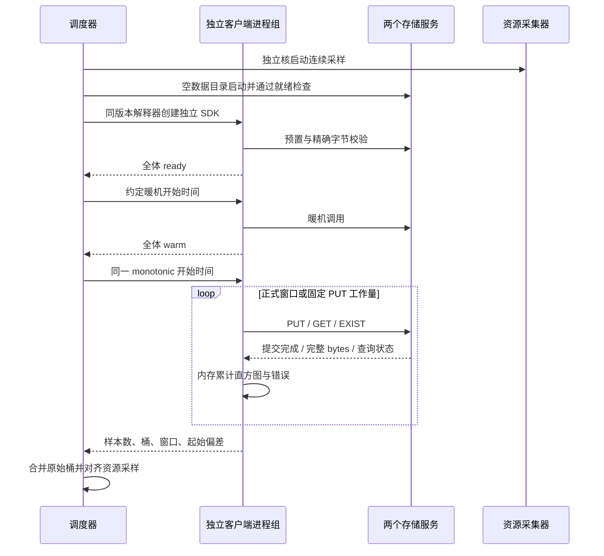
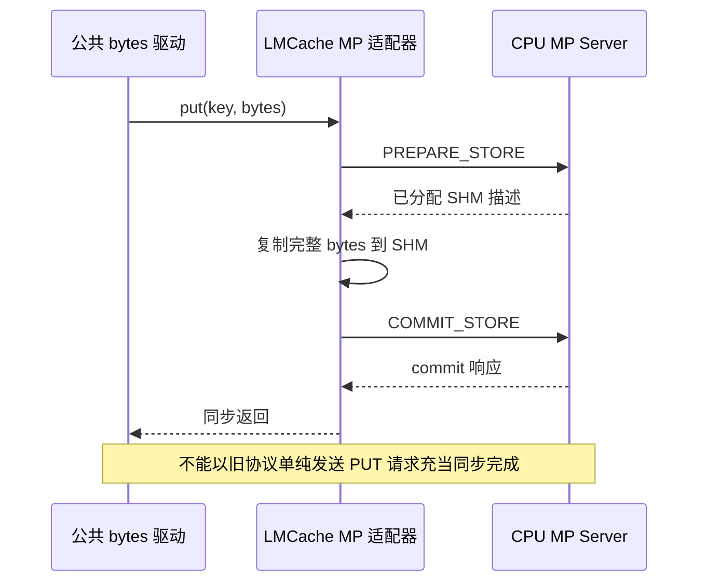

# 测试脚本用例设计

Status: In-Progress

## 1. 比较对象与拓扑

单节点 CPU 内存缓存，两个存储服务，每个服务数据容量 4 GiB。DataSystem 两个 KVC Worker 及独立 ETCD；Mooncake 一个 Master、两个具备存储容量的 peer，负载客户端不提供存储容量；LMCache 两个 CPU MP Server。工作负载客户端总数 2 / 8 / 16，至少两个客户端使双服务均有负载；DataSystem/LMCache 按客户端编号轮流连接两个服务，Mooncake 使用其原生 Master 分配。

这是各发布版支持的本机原生接口对比：DataSystem 本机 SHM、Mooncake TCP、LMCache MP 的 SHM + RPC。不能把结果解释为相同传输实现、跨节点网络、RDMA、GPU KV tensor 或推理 TTFT 的排名。LMCache 两个独立实例不等价于具备统一元数据的分布式集群，该架构差异需与结果同屏展示。

## 2. 固定资源

| 项目 | 相同约束 |
|---|---|
| Python | 私有 Python 3.11.15，各产品独立 venv |
| 服务端 | NUMA 0，8 个物理核：0,2,4,6,8,10,12,14 |
| 客户端 | NUMA 0，另外 8 个物理核：16,18,20,22,24,26,28,30 |
| 内存 | 服务端 cgroup 12 GiB，客户端 12 GiB，swap.max=0；数据容量共 8 GiB |
| 监控 | NUMA 1，CPU 1,3，独立 cgroup |
| 测量 | 产品依次运行，正式矩阵前结束编译；每点 3 次重复 |

SMT 兄弟 CPU 40–79 不用于实验客户端或服务器。记录外部负载、cpu.stat 的 throttled_usec、memory.events、I/O 和主机 CPU，不能仅凭配额宣称机器没有其他负载。SHM 首次触页可能由客户端计费，主要内存指标使用 server+client 的 cgroup memory.current 总和；不把各进程 RSS 相加当作唯一内存占用。由于 cgroup 跨用例复用，普通文件缓存可能在进程退出后仍保留计费；另展示 server+client 的 `anon+shmem` 作为数据池与 SDK 匿名堆口径，并保留 `memory.current` 总计费。后者包含缓存和内核开销，不能当作当前产品独占内存。字段和页所有权见 [Linux cgroup v2 文档](https://docs.kernel.org/admin-guide/cgroup-v2.html#memory-interface-files)。

## 3. 接口语义与负载

| 用例 | 负载与边界 | 通过条件 |
|---|---|---|
| 正确性 | 新 key 写入、完整 bytes 读回、EXIST 命中/未命中；多进程不共享 SDK | 原始字节精确一致，状态正确，无连接错误掩盖为未命中 |
| PUT | 固定总计 min(2 GiB, 65536 个对象)，全新 key，无覆盖、无删除混入；1 KiB / 64 KiB / 1 MiB | 返回表示提交完成；窗口后抽样读回；完成约定操作数 |
| GET | 预置总 64 MiB，暖机 3 秒，正式连续 20 秒，三个相同尺寸 | SDK 返回完整 bytes；样本内容验证；无错误 |
| EXIST hit | 1 KiB 对象，总 64 MiB 预置，3 秒暖机、20 秒窗口 | 每次服务端查询返回 true |
| EXIST miss | 同样预置背景数据，使用永不写入的独立 key 空间 | 每次服务端查询返回 false，不把超时计入 miss |

PUT 使用新的运行命名空间；各测试用例重启服务隔离数据，不靠不同产品不等价的 overwrite/delete 或异步入队充当持久可读完成。三个尺寸 PUT 总量分别为 64 MiB / 2 GiB / 2 GiB。固定数据量可能使 PUT 窗口短于 10 秒，结果标识为短窗口插入测试，不能称为长稳态写入吞吐。PUT 暖机为每客户端固定4次 PUT 与4次 GET，暖机 key 不进入测量空间；3秒暖机仅适用于 GET / EXIST。

同一用例内依次执行 PUT→GET→EXIST：GET 新增 64 MiB 工作集，先前 PUT 的 64 MiB / 2 GiB 数据和暖机 key 作为背景保留，三产品顺序与逻辑字节量一致。EXIST 复用 GET 的预置 key；不会再次 PUT，避免 Mooncake 不可变键与其他产品覆盖语义不同。每个用例结束重启服务，下一用例为空状态。

每个并发进程使用独立 key 空间与确定性 SHAKE256 数据，均为原始不可压缩 bytes，不启用数据压缩。GET 返回完整数据的复制包含在 API 延迟内。采样校验在单次 API 计时结束后执行，但其少量 CPU 成本仍存在于整体吞吐窗口；每 1024 次 GET 校验一次完整内容，并在预置阶段验证首尾样本。

## 4. 计时、统计与资源对齐

参考 kvtest `tests/kvtest/src/benchmark/interface_benchmark.cpp` 的独立进程和统一开始窗口；使用 monotonic_ns 约定同一未来开始时刻，保存客户端起始偏差。初始化、预置和暖机独立于正式窗口。吞吐 = 成功操作数 / 统一窗口总时长；吞吐不按各线程延迟倒数估算，也不平均客户端 P99。

每个客户端在内存累计每倍区间 64 桶的延迟直方图，汇总各客户端桶后计算 P50/P95/P99 的上下界，桶宽约 1.56%，保留上界作绘图值并注明。所有错误计数和样本一并记录；主结果只使用无错误且完成约定工作量的测试，失败结果保留。记录最大值、均值、每秒操作数及每个重复的原始结果。

监控每秒直接读 cgroup cpu.stat、memory.stat/current/events、io.stat、/proc 的 CPU、磁盘、网络、进程 CPU/RSS/I/O 与上下文切换；并行运行 iostat、mpstat、pidstat、dstat、perf。工具不可用或内核不支持时保存错误，不用零填充；该节点 PSI 文件缺失，压力指标标记不可用。观察者在独立核与 NUMA 上运行，采样日志保存在实验输出目录；保留每次采样本身的开销。

## 5. 环境处理与验证范围

历史 `/dev/shm/ds-*` 已检查无打开文件和映射，属于旧报告运行目录。仅对清单中的确切目录执行归档、gzip 完整性验证和 tar 清单验证，成功后再删除 tmpfs 原件；保留归档 SHA256。SELinux 排障服务可临时停止并在结束后恢复，代理和现存 agent 服务保留。

本轮不覆盖持久化、容量溢出、故障恢复、跨机网络与 GPU；图表旁说明可推广范围。正式测量前需要真实产品 smoke，加上驱动同步、统计、超时和失败传播自检。不能用驱动模拟后端的结果充当产品成绩。

## 6. 短 PUT 的补充资源观测

主三重复保留 1 秒主机/进程/原生工具监控。已经观察到部分固定量 PUT 窗口短于采样间隔，因此另设 3 产品 × 3 尺寸 × 并发 8 × 单次的九个独立 PUT 资源用例，仍调用冻结 benchmark 与相同逻辑字节量、原生服务配置和 cgroup；只有主矩阵成功结束、实验组为空才启动。它们标为 `supplemental_resource_only`，QPS/P99 不参与主三重复统计。

轻采样器只在独立观察者核约每 10 ms 读取 cgroup CPU/内存/I/O，不增加全主机 /proc 或 perf 采集；记录实际间隔和读取、序列化/写入成本分位数，不把标称周期当作实测保证。各 SDK 窗口至少两点才通过本阶段资源覆盖检查。网页单独选择 CPU、匿名+SHM/总计费、磁盘曲线；原始 profile、单次完整桶和采样序列都保留。
