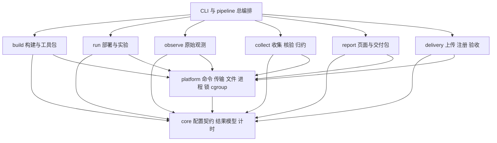
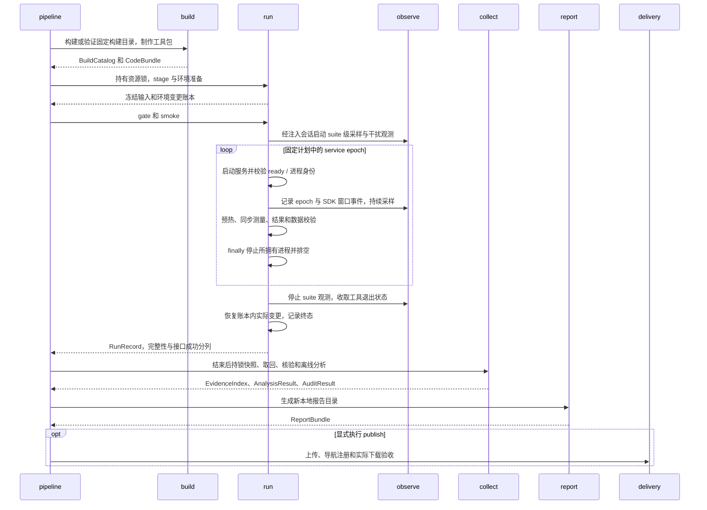
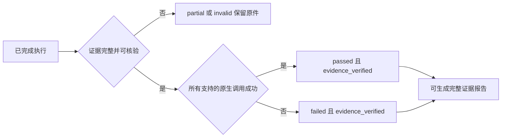

# KVC 对比工具模块化重构设计

**Status: Draft · 2026-10-20 · 仅设计，尚未实施**

现状基线为 workbench `d5907ed041f44261bff82c99ac41bc96e2f0d18d`。下文“现状”为该提交的源码事实，“目标”为待实施方案。完整文件去向见 [migration-map.csv](migration-map.csv)，验收要求见 [validation.md](validation.md)。

## 1. 重构范围与目标

重构对象是现有 `scripts/experiments/kvc-fair/` 工具及相关 RFC 中的辅助代码。保留当前工具根目录，整理目录内部职责；其他 workbench 工具、DataSystem 产品源码和历史原始证据不在本次迁移范围内。

用户要求的五个主模块直接对应五个目录：

| 模块 | 一句话职责 | 主要产物 |
| --- | --- | --- |
| `build/` 构建 | 固定版本、执行产品构建配方、核验构建物并制作工具包 | BuildCatalog、构建日志和耗时、工具包清单 |
| `run/` 运行 | 部署冻结、环境治理、资格检查、服务周期、并发客户端和清理恢复 | StageRecord、计划、调用结果、服务周期和事件 |
| `observe/` 观测 | 在约定配额内采集主机、进程、cgroup、CPU/内存/磁盘等原始信息 | 采样、系统工具日志、采样状态和覆盖信息 |
| `collect/` 收集 | 完成后取回证据、验证来源、离线归约和审计 | EvidenceIndex、AnalysisResult、AuditResult、原始证据包 |
| `report/` 报告 | 从已核验结果生成 ECharts 页面、文档阅读页和复现交付包 | 本地报告目录、图表数据、HTML、reproduce.zip |

公共模型和主机操作分别放在 `core/`、`platform/`；网站上传和验收放在 `delivery/`；独立诊断放在 `diagnostics/`。先采用普通 Python 包和显式函数调用，沿用现有构建配方与依赖，不增加插件注册、常驻调度服务或另一套产品构建体系。

本次目标是让维护者能从故障或需求直接找到模块：构建失败看 build，服务退出看 run，缺 CPU 采样看 observe，证据不匹配看 collect，图表错误看 report，线上链接错误看 delivery。

## 2. 当前为什么难维护

### 2.1 文件规模

按基线 `git ls-files` 统计，工具目录有 **132 个文件**，其中 **96 个直接位于根目录**；100 个 Python 文件合计 22,799 行，包含 31 个 `test_*.py` 文件。相关 RFC 另有 10 个可执行辅助文件、HTML 模板或依赖声明，合计 142 个迁移清单项。它们不包括 RFC 的实验说明和原始运行目录。

| 当前问题 | 源码证据（均相对工具根目录） | 后果 |
| --- | --- | --- |
| 三代工作流共存，参数和路径直接写在入口 | [batch_workflow.py](../../scripts/experiments/kvc-fair/batch_workflow.py):17–38、[workflow.py](../../scripts/experiments/kvc-fair/workflow.py):29–75、[tcp_workflow.py](../../scripts/experiments/kvc-fair/tcp_workflow.py) | 新实验需改多个入口；batch 通过旧入口的全局变量记录耗时 |
| 公共能力藏在具体诊断中 | [profile_put.py](../../scripts/experiments/kvc-fair/profile_put.py):29–93；stage、runner 都从它导入 | 正式运行依赖一个特定实验，难单独替换或验证 |
| 在线运行反向依赖离线分析 | [batch_runner.py](../../scripts/experiments/kvc-fair/batch_runner.py):178–203 | 判断失败能否继续时，导入分析层的实现 |
| 分析反向依赖报告 | [batch_analyze.py](../../scripts/experiments/kvc-fair/batch_analyze.py):15–16 | 资源和统计计算绑在 HTML 生成脚本上 |
| 报告脚本兼做核验、复制、渲染、压缩与打包 | [batch_report.py](../../scripts/experiments/kvc-fair/batch_report.py):915–1216，共 1,248 行 | 修改展示可能影响证据校验和复现包 |
| 目录结构被隐含的复制规则固化 | [batch_stage.py](../../scripts/experiments/kvc-fair/batch_stage.py):60–69；[capture_evidence.py](../../scripts/experiments/kvc-fair/capture_evidence.py):36–41；[report.py](../../scripts/experiments/kvc-fair/report.py):177–187 | 直接移动到新子目录，会漏部署、漏快照或漏打包 |
| 构建复用与旧运行结果耦合 | [batch_stage.py](../../scripts/experiments/kvc-fair/batch_stage.py):45–52；[batch_build_stage.py](../../scripts/experiments/kvc-fair/batch_build_stage.py):38–113 | 旧路径要求先有成功的旧 TCP 正式实验；已有 builds-only 能力可作为正确拆分起点 |
| 部署模块和构建辅助互相导入 | [batch_stage.py](../../scripts/experiments/kvc-fair/batch_stage.py):32、90、127；[batch_build_stage.py](../../scripts/experiments/kvc-fair/batch_build_stage.py):193 | 依靠函数内导入维持流程，职责关系不直观 |
| 正式能力和一次性修补混在一起 | [相关 RFC](../2026-10-20-kvc-batch-tcp-comparison/README.md) 中的 reader、发布、移动端修补脚本 | 复用 reader 时会带入固定实验名、个人路径或历史修补策略 |

### 2.2 保留已经正确的实现

已有实现包含必要的安全与证据校验，不应因整理目录而丢掉：共享 flock inode、进程身份保护、独立服务周期、原始输入 SHA 与文件模式、失败与 N/A 分类、资源覆盖、文档有限刷新及版本化下载链接。重构优先提取、迁移和收紧依赖，保持测量语义。

## 3. 模块依赖与职责边界



<p align="center">图 1. 代码依赖方向：箭头表示导入或调用；模块间产物传递由总编排完成。</p>

运行与观测通过 `core` 定义的会话契约协作，由总编排注入观测实现；`run` 不导入采样器实现。`report` 只消费 `core` 中定义的离线数据对象，使用 platform 的本地文件能力，不调用 SSH、启动服务或重新解释原始采样。`delivery` 消费完整报告目录，不导入渲染器。

### 3.1 五个主模块的边界

| 模块 | 包含 | 边界和错误处理 |
| --- | --- | --- |
| build | 源码 tag/SHA 验证、依赖锁、构建配方、构建元数据、产物核验、代码 bundle | 构建失败保留日志；构建物 hash 验证不等于证明它如何编译；不以旧压测是否成功判断能否复用构建 |
| run | 计划生成、配置物化、stage、环境 apply/restore、gate/smoke、服务生命周期、SDK worker、失败策略 | 环境变更有清单；失败进入清理；原生读错误按既有协议处理；部分写失败不得自动重试 |
| observe | /proc、cgroup、主机拓扑、外部干扰采样、dstat/iostat/mpstat/pidstat/perf、轻量采样 | 只记录；工具不可用、预期 SIGINT、真实采样错误分别记录；不暂停、杀死外部干扰进程 |
| collect | 完成后快照与同步、冻结校验、历史 schema reader、统计与资源归约、epoch/TCP/部署审计、耗时汇总 | 原件只读；发现损坏或缺失明确标记；不把 null 变成 0；报告不得绕过关键审计 |
| report | ReportModel、ECharts 数据映射、模板和静态资源、Markdown/Mermaid reader、复现包与交付 manifest | 只写新输出目录；正式报告要求完整证据；partial 预览显式标注；生成不自动发布 |

`collect` 内部仍分三层：`sync/freeze` 负责取回与完整性，`readers/analysis` 负责解析与计算，`audits` 负责证据约束。不用一个新的 collect 大脚本替代原来的 report 大脚本。

### 3.2 共享能力的归属

| 目录 | 唯一归属的能力 | 约束 |
| --- | --- | --- |
| core | 配置与结果数据结构、ID、路径布局规则、计时事件、共享结果校验、最小统计原语 | 标准库；无 SDK、SSH、服务操作或隐式环境探测；事件持久化由 platform 完成；统计原语保持已有桶界和缺失值语义 |
| platform | argv 命令执行、SSH/rsync、原子文件、SHA/mode、进程身份、flock、cgroup、环境操作原语 | 平台机制不决定实验策略；禁止通过 import 执行外部命令 |
| run/environment | 环境治理的策略、允许变更清单和恢复顺序 | 与 observe 的环境快照分开；复用现有 apply/restore 保护，不新增清理范围 |
| diagnostics | PUT、deadline、queue、wire、size 独立诊断入口 | 使用公共能力；主流程不从诊断脚本导入函数；额外诊断观测不混入正式性能 |
| delivery | 上传、站点导航注册、gzip 同步、有限文档刷新、验收和站点提交 | 发布锁与首页 CAS 保留；发布成功不意味着所有原生 API 通过 |

## 4. 目标目录结构

以下是目标结构，不在本次创建占位包。保留 `scripts/experiments/kvc-fair/` 为工具边界，避免同时改变仓库入口和内部模块。

```text
scripts/experiments/kvc-fair/
├── README.md                         # 唯一推荐入口、命令与模块导航
├── kvcbench/                         # python3 -m kvcbench；不要求安装工具包
│   ├── __main__.py
│   ├── cli.py                        # 解析参数、校验命令前置条件
│   ├── pipeline.py                   # 串行编排，显式传递产物和观测会话
│   ├── core/
│   │   ├── spec.py                   # 实验/版本/资源/工作负载契约
│   │   ├── records.py                # 构建、运行、证据、审计、报告数据
│   │   ├── paths.py                  # 源码/构建/运行/证据/交付路径类型
│   │   ├── timing.py                 # 阶段事件、wall 与 monotonic 域
│   │   ├── outcomes.py               # 纯结果契约与共享失败证据校验
│   │   └── statistics.py             # 已有直方图与缺失值规则
│   ├── platform/
│   │   ├── command.py                # 命令、退出码、超时、耗时
│   │   ├── transport.py              # SSH/rsync/scp 边界
│   │   ├── files.py                  # SHA/mode/安全相对路径/原子写
│   │   ├── process.py                # PID/start ticks/pidfd/命令身份
│   │   ├── locks.py                  # 资源域互斥
│   │   ├── cgroup.py                 # 创建、校验、归属、排空
│   │   └── environment.py            # 指定系统服务与环境操作机制
│   ├── build/
│   │   ├── service.py                # 原产品构建配方调度
│   │   ├── metadata.py               # 构建与产物记录
│   │   ├── bundle.py                 # 显式完整清单，不按子目录白名单扫描
│   │   └── recipes/{datasystem,mooncake,lmcache}/
│   │       └── ...                   # build.sh、依赖安装配方与 lock 文件
│   ├── run/
│   │   ├── planner.py
│   │   ├── stage.py                  # 新目录部署、配置物化、冻结
│   │   ├── environment.py            # apply/restore 策略与恢复账本
│   │   ├── qualification.py          # gate / smoke
│   │   ├── runner.py                 # service epoch 与生命周期
│   │   ├── worker.py                 # SDK 测量热循环
│   │   ├── outcomes.py               # 在线继续/停止策略，调用 core 共享规则
│   │   ├── profiles/                 # native / single_tcp / batch_tcp 调度策略
│   │   └── products/{datasystem,mooncake,lmcache}/
│   │       └── ...                   # runtime、adapter、batch_adapter、必要 launcher
│   ├── observe/
│   │   ├── supervisor.py             # 工具启动、就绪、停止与状态
│   │   ├── system.py                 # 主机快照与系统工具
│   │   ├── samples.py                # cgroup / proc 采样
│   │   ├── light.py                  # 特定诊断的轻量采样
│   │   └── interference.py           # 外部进程观测
│   ├── collect/
│   │   ├── sync.py
│   │   ├── freeze.py
│   │   ├── normalize.py
│   │   ├── archive.py                # 原始证据包，不包含渲染逻辑
│   │   ├── readers/{legacy_native,single_tcp,batch_tcp}.py
│   │   ├── analysis/{batch,legacy,resources,timings}.py
│   │   └── audits/{integrity,epochs,tcp,resources,deployment,builds}.py
│   ├── report/
│   │   ├── model.py                  # 已核验结果到展示模型
│   │   ├── render.py
│   │   ├── documents.py              # Markdown / Mermaid 阅读页
│   │   ├── bundle.py                 # reproduce.zip、交付 manifest/gzip
│   │   └── assets/{templates,css,js,vendor}/
│   ├── delivery/{publish,refresh,acceptance,git}.py
│   ├── diagnostics/{put,correctness,deadline,queue,wire,sizes}.py
│   └── compat/commands.py            # 仅有期限的旧命令参数转换
├── configs/
│   ├── experiments/{native_v1,single_tcp_v1,batch_tcp_purekv_v1}.json
│   ├── versions/kvc_20261020.json     # 固定 tag、SHA 和构建范围
│   ├── capabilities/kvc_20261020.json # 原生接口、限制与 N/A 原因
│   ├── reports/kvc_20261020.json      # RFC、历史说明和报告文档目录
│   └── hosts/example.json            # 实际主机连接/路径配置在仓库外
├── docs/{architecture,commands,build,experiments,observability,reproduction}.md
├── docs/build/{datasystem,mooncake,lmcache}.md
├── requirements-report.txt          # 报告与文档依赖，独立于产品 SDK
├── tests/
│   ├── unit/                        # 不需要产品 SDK、SSH 或 root
│   ├── contract/                    # 导入依赖、manifest、旧 CLI、新旧结果对照
│   ├── integration/                 # 本地受控进程与适配器机制
│   ├── live/                        # 显式目标节点验证，默认不发现执行
│   ├── acceptance/                  # 页面、链接、图表、干净解压包验收
│   └── fixtures/                    # 小型脱敏输入、期望输出和 fake backend
├── tools/migrations/20261020/        # 一次性历史网页修补，非主命令
└── {workflow,tcp_workflow,batch_workflow}.py  # 迁移期薄入口，最终退出

rfc/2026-10-20-kvc-*/                 # 历史实验、分析与重构决策；不再新增通用执行代码
<artifact-root>/                     # 仓库外：源码副本、venv、构建物、运行与交付结果
```

构建配方归 build，服务启动器和 SDK adapter 归 run；两处均按产品组织，不再用一个产品目录同时承载整个流程。普通测试按责任模块放入对应测试子目录。`datasystem/test_runtime_safety.py` 是要求 `--out` 的独立安全验证程序，应进入 `tests/integration/`，不能直接改成默认 unittest 发现对象。原生产品 smoke 放 `tests/live/`。

复现包包含完整 `kvcbench/`、配置、配方、资源、必要测试和文档；离线 analyze/report 只安装文档/页面所需依赖，产品 SDK 在对应子进程中延迟导入。原来从根目录、源码 sibling 或个人 Playwright 路径推导的行为，改为显式路径契约。

## 5. 模块接口与产物契约

### 5.1 接口草案

以下描述调用边界，不代表已有 API；不要求一次引入复杂类层级。

| 调用 | 输入 | 输出 / 约束 |
| --- | --- | --- |
| `build.execute(spec, build_root)` | 固定版本、构建配方、依赖锁和资源要求 | BuildCatalog；记录每个产品成功/失败、全构建 wall 区间、构建物 SHA，不用旧 formal 结果作为依赖 |
| `build.bundle(source_root, manifest)` | 工具源码、配置和显式包含项 | CodeBundle；递归完整，含 mode；拒绝遗漏模块和越界链接 |
| `run.stage(spec, catalog, bundle, run_root)` | 已核验构建引用、不可变工具包和配置 | StageRecord；新根目录、原子完成、冻结 inputs 与实际配置 |
| `run.execute(stage, observer)` | 已冻结计划、运行上下文、观测会话契约 | RunRecord；拥有服务/客户端生命周期和 finally 清理；同机实验串行 |
| `observe.session(targets, observe_spec)` | 主机身份、epoch、cgroup、PID 与配额 | MonitorHandle/Manifest；就绪状态、采样路径、工具 availability/returncode 与停止原因 |
| `collect.snapshot(run_ref, source, evidence_root)` | 已结束运行及 stage 清单 | EvidenceIndex；持锁确认停止、收集、SHA/mode 核验、只读来源角色 |
| `collect.analyze(index)` | 具有明确 schema/profile 的只读证据 | AnalysisResult；原生结果状态、统计、资源覆盖和耗时；不访问目标节点 |
| `collect.audit(index, analysis)` | 原始证据、分析产物、分析代码身份 | AuditResult；完整性、构建、epoch、TCP、资源和部署逐项结论 |
| `report.generate(index, analysis, audits, docs, out)` | 经核验的数据、来源索引、文档清单、报告配置和已准备的证据包 | ReportBundle；核对审计绑定后生成新目录、可跳转文档、ECharts、复现包和 manifest；不自行采集或重算原始统计 |
| `delivery.publish(bundle, destination)` | 已验收 ReportBundle 与明确站点配置 | DeliveryRecord；上传/注册/验收记录；独立于报告生成 |

`core` 只固定真正跨模块的字段。产品 runtime 保持 `start/ready/stop` 的最小接口；workload adapter 明确 `capabilities/put/get/exist` 和批量语义。能力清单用于前置计划，gate 的真实结果用于证明可运行；不能仅靠声明将某接口算作成功。

### 5.2 五类身份必须分开

| 身份 | 必须绑定 |
| --- | --- |
| 实验协议 | profile ID、规范化配置 hash、工作负载语义版本、计划 ID |
| 构建 | 产品 tag + 源 SHA、recipe/lock hash、构建命令、构建范围、产物 hash；tag 与包内版本同时保留 |
| 运行 | run/epoch/case ID、实际加载代码和配置、主机/boot/clock 域、进程 start ticks、cgroup 配置 |
| 后处理 | 原始输入 hash、reader/分析/审计代码版本与实际依赖 hash、生成时间 |
| 交付 | 渲染/发布工具版本、报告内容 hash、ZIP/TAR 清单、验收记录 |

原始运行输入、实际后处理源码和交付工具源码采用不同 `role`；新报告工具不能被写成当时压测运行的脚本。历史 `stage.inputs` 保留原路径、字节、SHA 和 mode，当前迁移映射只解释归属，不修改旧清单。

AuditResult 必须绑定 EvidenceIndex 内容 hash、AnalysisResult 稳定内容 hash、profile/schema 身份和分析/审计源码身份；稳定内容与生成时间等附属字段的边界由规范化 schema 明确。report 入口重新核对这些绑定及所复制原件的 hash/mode，拒绝拿另一份成功 audit 搭配不同 analysis 或 index。这里的轻量来源校验仍由报告边界执行，完整原始统计重算和证据审计归 collect。

### 5.3 运行与离线产物目录

```text
<artifact-root>/
├── builds/<build-id>/                # product sources / venv / artifacts / build records
├── runs/<run-id>/
│   ├── inputs/                      # frozen code bundle、spec、计划与构建引用
│   ├── control/                     # 阶段事件、恢复账本、运行状态
│   ├── epochs/<epoch-id>/           # 服务目录、客户端结果、epoch summary
│   └── observations/                # 原始采样和系统工具日志
├── evidence/<snapshot-id>/
│   ├── original/                    # 原始相对名和原件，含历史失败
│   ├── derived/                     # analysis / audits / timings，独立 provenance
│   └── evidence-index.json
└── reports/<delivery-id>/            # HTML / docs / data / downloads / manifest
```

上述是新运行格式，历史 native、single-TCP 和 batch-TCP 原始目录由对应 reader 读取，不原地搬迁。新格式显式标注 schema 版本；迁移早期继续读写现有结果格式，先证明行为等价，再单独引入目录/schema 升级。未知 schema 明确拒绝，不按文件名猜测。

## 6. 运行、观测和收集的生命周期



<p align="center">图 2. 总流程与所有权；原生错误或工具错误均保留证据并经过清理分支。</p>

正式 batch 流程维持现有 suite 级连续监控，覆盖服务启停、预热、测量与清理；SDK 性能归约只取相应调用窗口，全 suite 资源开销另列。单独诊断可使用其原有轻量采样 profile，不能因模块拆分改成每 epoch 启停正式采样器。外部系统工具不可用或采样失败继续保留原状态；是否停止沿用 profile 策略，关键证据不足不得宣称完整核验。

### 6.1 所有权、互斥和恢复

- **资源锁**由运行控制器持有；锁域来自主机与 cgroup/构建共享资源，旧新运行涉及同一资源时共用同一锁 inode。迁移不得因换根目录生成一把互不相关的新锁。单进程 pipeline 可连续持锁到收集结束；独立 run 命令终止后释放，collect 命令重新获取同一资源锁并复核终态、进程和来源再快照，不假定跨独立命令一直持锁。
- **锁顺序**：先资源域锁，再该运行的状态/快照锁；操作结束后按拥有者释放。发布只持站点发布锁，安排在运行锁释放后；不跨站点锁等待目标机器。迁移阶段沿用原锁语义，调整粒度需要单独验证。
- **产品 runtime**拥有服务进程，**runner**拥有客户端，**observe supervisor**拥有监控子进程；清理只操作已记录身份的进程。保留 PID/start ticks/pidfd/必要命令根路径检查，不能退化为 `pkill`。
- **观测器**只能读取外部负载。环境治理可以暂停的服务和可以清理的目录必须来自现有明确策略，并写入账本；恢复只覆盖本次实际变更。
- **运行中断**进入停止客户端、停止监控、停止服务、确认 cgroup 空、恢复环境、写终态的路径。进程硬退出后再次操作先核身份和恢复账本，不能自动重放 PUT/UPSERT；未完成调用保留 unknown/invalid。
- **产物写入**采用临时文件/目录与同文件系统 rename；完成标记最后写。中断的 `.partial` 产物保留来源和失败状态，后续收集不能当成完整证据。原子可见不等于断电持久，持久化需求和 fsync 范围在实现阶段明确。

### 6.2 状态不能收缩成一个布尔值



<p align="center">图 3. 执行完成、证据可信和产品接口成功分别判断；N/A 单独列出。</p>

保留 `execution_complete`、`passed`、`evidence_verified` 的原有区分。每个 case 保留 valid/failed/not_supported/missing/invalid；原生失败不进入成功性能统计，N/A 不表示 0。正式完整报告允许记录已核验的原生失败；缺失、损坏或 fatal 中断只能生成显式 partial 预览。

### 6.3 耗时与采样成本

所有阶段复用 `core/timing.py`，记录 command/stage ID、parent ID、host/boot/clock 域、wall 起止、同进程 monotonic 起止、退出码和失败原因。SDK 测量窗口单独保留；构建区间包括下载、依赖、配置、编译和安装，不能称为纯编译耗时。

不同主机的 monotonic 不相减，跨主机 wall 仅用于对齐和展示；存在时钟不确定性时标注。父阶段和子命令、并行或重叠采样不能重复求和；未知耗时为 null，估算值另列依据。10 ms 诊断采样与正式采样配置明确区分，监控 CPU/内存开销及缺采样覆盖进入独立观测记录。

## 7. 配置、公平性与热路径约束

### 7.1 配置只有一个物化入口

配置分为固定版本、实验 profile、接口能力、主机资源和报告文档五类。解析顺序为 profile 默认 → 显式主机配置 → CLI 允许覆盖项；未知字段或冲突参数直接报错。stage 物化最终配置和来源，计算 hash；运行只读取这个冻结配置，禁止各模块再次解析出不同默认值。

主机地址、仓库路径、构建根、运行根、站点根、CPU/NUMA/cgroup、SDK Python 解释器和 Playwright/浏览器路径均明确配置。示例配置用占位符，真实连接信息和大产物留在仓库外。DataSystem 构建解释器不再隐含取自 Mooncake venv；共享工具链如需复用，写入工具链配置并绑定版本。

固定版本清单保留本次实验选择的 tag、源码 SHA、recipe/lock hash 和包内版本差异。重放旧实验不查询“最新 release”；更新版本或能力声明产生新 profile，并重新做资格验证。

### 7.2 必须保持的公平性约束

| 约束 | 重构后的落点 |
| --- | --- |
| 每次调用 B=1/16/256/4096 个独立 key；整批延迟不能除以 B | core/spec、run/worker、collect/analysis 与 report/model 契约 |
| SDK 原生批量；不静默增加逐 key fallback、外部拆批或重试 | run/products capability 和 gate；保留产品 SDK 内部原生拆分事实 |
| 首次 PUT 与更新分开；READ 与各档 fresh PUT 独立服务周期 | run/planner 与 epoch 审计 |
| LMCache 不支持的批量 PUT/GET 或更新保持 N/A | 能力配置与真实资格结果双重绑定 |
| 相同服务器/客户端/监控预算，两个端点，NUMA/CPU/swap 配置可核验 | 单一 ResourceSpec、run/stage、observe 与 collect/audits |
| 关闭不需要的功能，DataSystem RocksDB 写模式 none、stream socket 数 0；各 Worker 状态目录独立 | pure-KV profile 和实际生效配置审计；不把“关闭写入”表述为“不存在状态目录” |
| Mooncake 容量适配参数在各 B 保持一致，历史失败和默认参数诊断保留 | 固定 profile 与历史证据索引；不声称已证明全局最优 |
| 字节、顺序、命中/未命中与后验检查保留；失败不自动重试 | core/outcomes 共享纯校验，run 决定继续/停止，collect/audits 离线复核 |
| 内存为采样观察值，资源增量需要足够样本；缺失和 counter reset 单独处理 | observe 原始采样、collect/analysis/resources |

### 7.3 热路径不引入通用框架

SDK worker 直接使用已初始化的 adapter，保留现有 key 生成、校验、时间戳和直方图边界。目录与 import 调整不应在每次 API 调用中新增 JSON、日志、文件访问、额外锁、IPC、隐式重试或复制；跨模块数据对象在阶段边界传递，不逐请求创建。

构建、收集、报告与发布进程不在正式测量窗口运行。观测进程使用原有单独配额。迁移过程中不同时调参、改数据集或改变请求分块，避免无法解释性能变化。

## 8. 迁移方案与兼容窗口

### 8.1 分阶段推进

| 阶段 | 内容与提交边界 | 进入下一步的依据 |
| --- | --- | --- |
| P0 设计与基线 | 本 RFC；锁定文件清单、旧 CLI/产物和后续验证方案 | 142 项归属覆盖，设计经源码核对；本阶段不迁移实现 |
| P1 公共契约和显式工具包 | 提取既有 path/hash/atomic-write/process/lock/timing；新增完整 bundle manifest；保留旧入口 | 旧测试行为不变；新子目录部署/快照/ZIP 均完整；身份保护、权限与锁 inode 不降级 |
| P2 构建与部署 | 移动配方/锁、BuildCatalog、stage；打通不依赖旧 formal 的 builds-only 路径 | 构建来源与产物绑定、shell mode、无旧结果依赖；冻结输入完整 |
| P3 运行与观测 | 分离 planner/runner/worker/products/environment 与 observe；下沉 outcomes 判定 | gate/epoch/失败/清理契约；受控进程验证和小规模产品 smoke；全量运行需新 run ID |
| P4 收集与离线核验 | 收敛同步快照、历史 reader、统计、timings 和 audits | 相同冻结证据的新旧统计/状态/资源结果等价，篡改样本被拒绝；无需启动目标服务 |
| P5 报告与发布 | 模板资源、ReportModel、reader、复现包、独立 delivery；提取可复用 RFC helper | 页面和离线包验收；原始证据 SHA/mode 不变；生成不会发布 |
| P6 收尾 | 文档入口切到新 CLI、镜像测试布局、移除到期薄入口和未使用旧实现 | 所有引用已更新；干净解压可独立执行；归档 reader 仍可读取旧证据 |

P1 先解决部署/证据/打包清单，再搬文件，否则会出现源码已提交而目标节点或 ZIP 缺模块的问题。每个阶段独立提交；移动与行为修改尽量分提交，避免一次性机械移动掩盖逻辑变化。

### 8.2 旧脚本如何处理

逐文件映射覆盖工具目录 132 项和 RFC 辅助文件 10 项，见 [migration-map.csv](migration-map.csv)。其中 `split` 表示先抽出公共职责再删除旧实现；同一文件的多个目标以 ` | ` 分隔，不是复制一份完整旧逻辑到每个模块。

- `workflow.py`、`tcp_workflow.py`、`batch_workflow.py` 在 P1–P5 保持原参数兼容，只转换到新 CLI/profile；默认值、退出码和 stage 行为通过契约对照。P6 在所有文档和自动化引用迁移、干净包验收后移除薄入口；旧复现包保留其原版脚本，不受移除影响。
- 其他旧顶层脚本在其阶段更新内部调用、测试、文档和 bundle 清单后移除，不长期并存两套实现；历史 reader 保留的是格式兼容能力，不是重复整套运行器。
- 通用 Markdown reader、模板和验收能力进入正式模块；已执行的一次性网页修补进入 `tools/migrations/20261020/` 并标注用途。历史执行 provenance 仍指向当时冻结的文件，不改写成新模块路径。
- 原 RFC 保留实验说明、实际命令、审计与历史结论；相关链接随辅助文件迁移一起更新。稳定操作文档进入工具 `docs/`，RFC 继续记录任务决策。

### 8.3 CLI 草案

以下命令展示目标接口，目前不可执行。所有路径显式提供；`pipeline` 只编排选定阶段，publish 必须单独指定。

```bash
python3 -m kvcbench build --spec <experiment.json> --build-root <build-root>
python3 -m kvcbench stage --spec <experiment.json> --catalog <build-catalog.json> --run-root <new-run-root>
python3 -m kvcbench qualify --run-root <run-root>
python3 -m kvcbench run --run-root <run-root>
python3 -m kvcbench restore --run-root <run-root>
python3 -m kvcbench collect --run-root <run-root> --out <new-evidence-root>
python3 -m kvcbench analyze --evidence <evidence-index.json> --out <new-derived-root>
python3 -m kvcbench audit --evidence <evidence-index.json> --analysis <analysis.json> --out <audit.json>
python3 -m kvcbench report --evidence <evidence-index.json> --analysis <analysis.json> --audit <audit.json> --out <new-report-root>
python3 -m kvcbench publish --report <report-root> --destination <site.json>
```

正常 run 内部执行 finally 恢复；`restore` 用于中断后的显式恢复，仍需身份和账本检查。collect 的 source/run 引用可指向远程源或已停止的本地运行；analyze/audit/report 都可在无目标节点和产品 SDK 的离线环境执行。

## 9. 实施验收与回退

详细矩阵见 [validation.md](validation.md)。验收分为四组：

1. **结构**：每个基线文件有归属，依赖无环；run 不导入 report/collect，collect 不导入 report，delivery 不导入 renderer；所有跨模块字段有契约。
2. **行为**：沿用现有语义测试，比较冻结输入上的计划、状态、失败原因、统计和资源字段；整批延迟、N/A、原生失败与实际来源不变。动态生成时间和交付 hash 单列，不用直接比较整份 HTML 字节判断行为。
3. **复现**：完整 manifest，干净解压、相对路径、shell mode、CLI help、离线分析/报告和浏览器验收；冻结的旧代码、归档成员与原始日志 SHA/mode 全部保持。
4. **运行**：先受控本地进程，再目标节点资格验证；涉及调度/worker 的阶段必须有小规模真实产品 smoke 和选定代表 case 的前后对照。完整性能重跑采用新 run ID、新证据，不覆盖原实验。

回退以阶段提交为边界：未运行时回退工具提交和文档；运行中先完成进程身份检查、停止、cgroup 排空和环境恢复，再切换入口。已生成的新证据保留其代码/profile 身份，不用旧工具继续写同一 run。网站发布使用独立 DeliveryRecord 和已有 CAS/回退能力，不能用代码回退推断线上内容已恢复。

## 10. 风险、决策与本次交付边界

| 风险 | 设计处理 | 后续实施责任 |
| --- | --- | --- |
| 移动 Python 文件破坏动态 import、子进程解释器与 relative path | 完整 package bundle、显式 interpreter/runtime-root、延迟导入产品 SDK | run/build 维护者；导入和干净解压契约 |
| 公共化清理降低产品身份保护 | 先提取现有机制，产品额外约束继续保留 | platform/run 维护者；受控进程与 PID 复用场景验证 |
| 老归档按新名字重写导致证据失真 | 旧路径不变，reader 适配、原始/派生/交付源码角色独立 | collect/report 维护者；SHA、mode 与来源校验 |
| 抽象过多增加热路径开销 | 简单函数和边界数据对象，不增加逐请求装饰层 | run 维护者；代表 case 对照与代码审查 |
| 配置合并后 silently 改公平性 | 一次物化、冻结来源与 hash，协议更改必须新 profile | 实验维护者；计划与生效配置对照 |
| “收集”再次变成巨型模块 | sync/readers/analysis/audits 明确子职责，report 只展示 | collect/report 维护者；依赖与模块审查 |

本次只新增 RFC 和索引，未移动现有文件、修改产品构建参数、触发压测或发布网站。产品热路径、并发状态和持久化行为均无实际改动；上述是后续实施必须满足的约束，不能据文档宣称运行安全或性能已验证。DataSystem 后续说明统一使用 **Coordinator**；历史源码符号、配置与原始日志保持原名，Mooncake 自身的 Master 名称保留。

当前方案明确采用五个主模块、普通 Python 包、显式配置与产物清单、阶段迁移和有期限的命令兼容。具体文件拆分的函数粒度在对应阶段结合测试调整；不需要先搭建新的调度平台。
