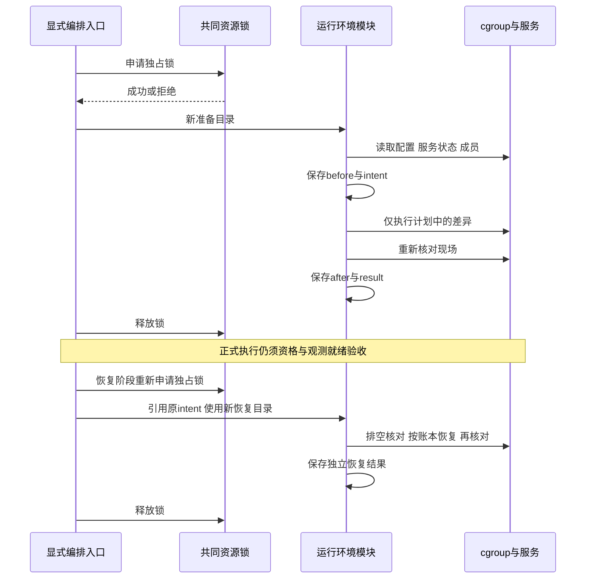

# 1. 运行隔离与恢复模块设计

状态：实施中。本文说明运行模块已经接入的能力；完整 W01–W18 验收仍见 [workflow-acceptance.md](workflow-acceptance.md)，现场执行记录见 [implementation.md](implementation.md)。

## 2. 模块与边界

| 模块 | 职责与中间结果 |
| --- | --- |
| `platform/locks.py` | 只打开普通文件锁，拒绝符号链接和非普通文件；不根据运行目录名推断资源域 |
| `run/stage.py` | 同时持构建域锁和指定运行资源锁；新目录部署并冻结输入，输出 `batch-stage.json` |
| `run/isolation.py` | 既有运行 cgroup 配置与进程放置；根 `cgroup.py` 为兼容入口 |
| `run/environment.py` | 持指定运行资源锁，记录环境基线、变更意图、实际结果及恢复记录 |
| `run/environment_restore.py` | 历史实验恢复协议的兼容实现；根 `finish_environment.py` 转入该实现，新实验使用 `run/environment.py` |
| `run/runner.py` | 开始前核对部署记录中的锁设备号/inode和实际资源锁，再运行资格或测量 |
| `observe/environment.py` | 只读硬件与干扰基线观察；不停止服务、不清理文件 |

构建域与运行资源域分别持锁，新运行根目录中的 `suite.lock` 硬链接到显式指定的共同运行锁。两次运行即使使用不同构建目录，也不能同时消费同一资源域。申请使用非阻塞 flock，冲突时留下失败，不等待后重放请求。现有硬链接 inode 保持不变，不替换旧实验锁文件。

## 3. 准备和恢复协议

准备输出新目录，先记录 `before.json`，确认 root 权限、必需工具、cgroup 排空和当前配置，再写 `intent.json`，最后执行配置差异和明确服务的停止。成功记录 `after.json`、`result.json`；失败保留实际文件和失败结果，不覆盖上次 attempt。

本次准备仅允许配置当前实验 cgroup 的明确文件，以及暂时停止 `setroubleshootd.service`。不删除历史 tmpfs 目录，不按名称搜索并结束无关进程。已符合预期的设置不重复修改。恢复时重新持同一资源锁，确认 cgroup 为空，仅恢复账本中的设置差异和原来处于 active 的服务。若设置已被外部改变为既非原值也非本次设置值，则拒绝覆盖；恢复失败另留失败结果。

恢复依据是 `intent.json`，因此在操作部分执行后失败也可显式恢复。它不会自动继续测量、重放 PUT 或续写旧 epoch。服务启动命令成功与之后的现场状态分别记录。



<p align="center">图 1. 变更意图先于操作持久化，准备与恢复分别留下结果。</p>

## 4. 可复现入口

以下在完整代码包目录中执行，参数均指向明确产物。现有比较运行配置使用 `/sys/fs/cgroup/kvcfair20261020`；不能只修改 drain 路径便认为所有旧诊断入口也支持另一资源域。

```bash
python3 -m kvcbench stage \
  --native-root /absolute/native-root \
  --catalog /absolute/native-root/revalidation/attempt-002/build-catalog.json \
  --bundle /absolute/frozen-source-payload \
  --resource-lock /absolute/shared-runtime/suite.lock \
  --cgroup /sys/fs/cgroup/kvcfair20261020 \
  --out /absolute/new-runtime-root

python3 -m kvcbench environment-prepare \
  --cgroup /sys/fs/cgroup/kvcfair20261020 \
  --resource-lock /absolute/new-runtime-root/suite.lock \
  --out /absolute/new-runtime-root/environment-preparation

python3 -m kvcbench environment-restore \
  --cgroup /sys/fs/cgroup/kvcfair20261020 \
  --resource-lock /absolute/new-runtime-root/suite.lock \
  --preparation /absolute/new-runtime-root/environment-preparation \
  --out /absolute/new-runtime-root/environment-restoration
```

## 5. 风险与验证边界

锁身份检查和账本写入在实验控制路径，不在每次 SDK 调用的热路径。没有改变 payload、原生 batch 调用或直方图采样方式。锁持有者负责自己的操作，冻结部署代码不在运行时刷新。环境变更需要现场复核；历史 PASS、目录存在或配置写命令成功不能替代复核。

本地测试检查不同构建域共享运行锁、锁被占用拒绝部署、锁类型与链接安全、原环境值恢复、服务停止失败后的恢复、必需工具缺失前置阻断及旧输出不覆盖。真实接口资格、资源覆盖、公平性能矩阵和公开报告验收必须使用各自证据，不能从这些测试推导。
