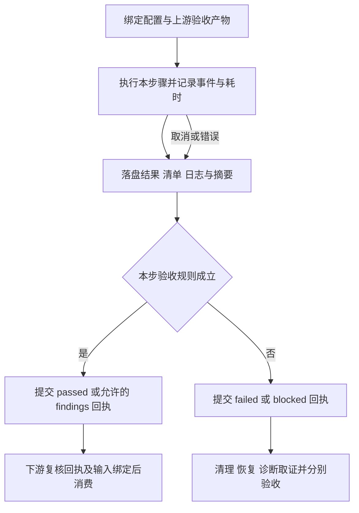

# 1. 工作流逐步验收与中间结果设计

**Status: Implemented · W01–W18 全部形成实际验收回执；W09 为 passed_with_findings，原生失败保留。**

这份设计将用户要求落实为：**每个工作流步骤都有可持久化、可独立检查的中间结果；正常下游只消费已验收且来源匹配的结果。** 验收默认由脚本自动完成，人工可以据同一份产物复核，不要求每步人工确认。

主设计见 [design.md](design.md)，实施验证见 [validation.md](validation.md)。本文 W01–W18 是一次实验的工作流步骤；主设计 P0–P6 是工具重构的实施阶段，两者含义不同。

## 2. 每一步的统一契约

| 项目 | 要求 |
| --- | --- |
| 输入 | 明确的配置、上游验收记录、实际文件清单及 hash；不靠“目录存在”或“上一条命令返回 0”判断就绪 |
| 执行 | 记录实际 argv、执行代码/依赖身份、主机与时钟域、起止与耗时、退出码、取消/中断原因 |
| 中间结果 | 本步原始输出、结构化结果、文件清单、日志索引，以及简短 `summary.md`；成功、失败和跳过都有记录 |
| 验收 | 用本步所属模块的只读验证函数检查实际产物，逐项记录 expected/observed、状态、证据位置和来源绑定 |
| 下游准入 | 验证上游 commit/验收记录、输入 hash 与当前 profile；只接受本步骤声明允许的结论 |
| 失败处理 | 明确阻断范围、允许执行的清理/恢复/诊断分支、重做规则；保留原 attempt，不覆盖失败 |

步骤粒度为可独立调度的阶段。三个产品构建子任务、service epoch 和测试 case 各有子结果，父步骤汇总它们；**不为每次 SDK 调用写回执或新增 IO**，保证测量热路径边界不变。

## 3. 实验步骤与可验收中间结果

以下路径是目标格式，均为产物根目录下的相对位置。各步骤另有第 4 节统一回执。表中“验收”是该步骤的后置条件，完整实验结论仍需 W14 审计和后续交付验收。

| 步骤 / 归属 | 主要输入 | 中间结果 | 自动验收条件 | 未通过后的处理 |
| --- | --- | --- | --- | --- |
| W01 固定计划 / core、pipeline | 版本、接口能力、实验与资源配置 | `plan/spec.json`、`versions.json`、`cases.json` | 配置无冲突；产品版本和参数明确；B=1/16/256/4096；支持/待验证/N/A 有来源；计划身份与 hash 固定 | 阻断构建及运行；不改变目标环境 |
| W02 产品构建 / build | W01、recipe、依赖锁、源码 | 每产品 `build-record.json`、日志与产物清单；总 `build-catalog.json` | tag/SHA/实际源码匹配，构建状态与产物完整，关键产物 hash 可复核；复用构建明确标记 reused | 失败产品保留子结果，其他独立构建可完成；禁止进入要求三个产品齐备的部署 |
| W03 制作代码包 / build | 工具代码、配置、配方、资源清单 | `bundle/manifest.json`、代码包 | 所有模块和必要资源完整；安全相对路径；SHA/mode 对应；可解压检查入口 | 阻断部署；不以缺文件的包继续 |
| W04 部署与冻结 / run | W01–W03 已验收结果 | `stage/stage-record.json`、冻结配置/输入、构建引用 | 新根目录；输入 hash/mode、构建引用与最终配置一致；锁和路径规则正确；完成标记最后写 | 不启动产品；保留 partial 部署用于诊断 |
| W05 主机预检 / observe、run | W04、主机与资源要求 | `environment/before.json`、`preflight.json` | 采集 CPU/NUMA/内存/磁盘/干扰基线；所需权限、工具和资源可用；变更目标已明确 | 阻断环境变更和测量；基线中未知项不补零 |
| W06 环境隔离 / run | W05、明确允许的治理策略 | `environment/change-journal.json`、`cgroup-settings.json` | 持资源锁；CPU/内存/swap/归属生效；仅治理指定对象；先记变更意图再操作并核对结果 | 阻断资格/测量；转清理与恢复，不凭操作退出码推断环境干净 |
| W07 资格验证 / run | W04、W06、原生能力声明 | `qualification/gate.json`、`smoke.json`、每产品/接口正确性证据 | 两端点、配置、字节/顺序/hit-miss、原生 batch 语义满足 profile；N/A 有明确原因；受支持能力失败不能改写为 N/A | 阻断正式测量，仍执行 W10–W12；诊断尝试单列 |
| W08 观测就绪 / observe | 已验收 gate、观测配置和资源域 | `observations/ready.json`、启动清单快照、独立首样本快照 | suite 级观测启动；必需采样源可读、首样本与时钟/资源域正确；可选工具缺失有记录 | 必需观测未就绪则阻断测量并清理；ready 只证明启动就绪 |
| W09 正式测量 / run | W01/W04/W07/W08、固定顺序与失败策略 | 每 epoch summary、每 case 原生结果/直方图/错误、`measurement-summary.json` | 实际 case/epoch 与计划对应；完成边界、数据校验和错误原件齐备；只按既有 profile 继续允许的原生只读错误 | 无论成功失败都进入 W10/W11；禁止自动重试写请求或续写中断 epoch |
| W10 停止与排空 / run、observe | 所拥有进程身份、W06 账本、观测会话 | `cleanup.json`、`observations/final.json`、工具退出与采样清单 | 保留每 epoch 清理；最后停止 suite 观测，核对工具退出原因；自有服务/客户端/监控已停且 cgroup 空；采样文件可读 | 清理不明标记 blocked；只允许受保护恢复/诊断，不能交接为可再次运行 |
| W11 环境恢复 / run | W06 账本、W10 实际清理状态 | `environment/restored.json`、after 快照 | 仅恢复本次实际变更；核验预期状态；错误/未知项明确；不覆盖先前恢复证据 | 恢复失败单独保留，阻断正常交接和再次运行；诊断取证仍可继续 |
| W12 收集冻结 / collect | 原始 step/epoch/case 结果、终态、已停止源、冻结输入 | `evidence-index.json`、原始快照、hash/mode 清单 | 重新持资源锁核对源；安全同步、来源分类、文件 hash/mode 一致；原始输入/后处理/交付角色不混淆 | 完整收集失败则保留 partial；不得给 W14 提供虚假完整索引 |
| W13 离线分析 / collect | W12 索引、显式 schema/profile | `derived/analysis.json`、逐 case 表、资源和耗时归约 | 源文件匹配索引；计划/状态完整映射；桶界、整批延迟、null、资源窗口/覆盖口径正确；记录分析代码身份 | 阻断正常审计；可产出标注缺项的诊断分析 |
| W14 独立审计 / collect | 原件、W12 索引、W13 分析 | `derived/audit.json`、逐检查结论与证据链接 | 输入来源、构建、epoch/TCP/资源/部署、错误原件和覆盖条件成立；绑定 index/analysis/profile/schema/源码身份 | 拒绝完整报告；保留 fail/blocked 检查和受限诊断预览 |
| W15 报告生成 / report | W12–W14 绑定产物、文档与模板 | `report/index.html`、ECharts 数据、文档网页、ZIP/TAR、manifest | 拒绝来源不匹配组合；写全新目录；图表/表格状态正确；复制原件 SHA/mode 一致；包清单完整 | 阻断本地交付验收与发布，不影响已冻结原件 |
| W16 本地交付验收 / report、delivery.acceptance | W15 完整目录 | `local-acceptance.json`、链接/浏览器/干净解压检查 | 图表、左导航、编号/图注、Mermaid、文档链接和相对资源正常；ZIP 干净解压可离线运行；保留失败/N/A 标签 | 阻断发布；修复后创建新报告/验收 attempt |
| W17 上传注册（可选） / delivery | W16 验收、明确站点配置 | `delivery-record.json`、目标文件 hash、导航 CAS 记录 | 目标路径受限；站点锁、依赖完整性、注册 CAS、gzip 等约束满足 | 阻断公开验收；有限回退按实际交付版本和 CAS 操作，不改原始实验 |
| W18 公开交付验收（可选） / delivery | W17、预期 manifest 与下载身份 | `public-acceptance.json`、实际下载/浏览器证据 | 公开入口、依赖、文档、下载包和 gzip 对应预期交付版本；交付状态与原生矩阵状态分别呈现 | 本次交付未通过；保留失败记录并修复，不能仅凭上传成功关闭任务 |

W05/W06 中的运行环境条件在 W07/W09 入场时仍需重新确认。旧的主机预检 PASS 不证明当前进程、负载和 cgroup 仍满足要求。

W10/W11 是成功、资格失败、观测失败和测量失败共同经过的恢复分支；未曾启动的资源按账本记录“无须停止/恢复”，不臆造实际执行。硬退出不能保证 finally 运行，下一次恢复命令必须先查账本与实际身份，再生成新的恢复回执。

## 4. 中间产物与验收回执格式

```text
<artifact-root>/runs/<run-id>/workflow/
├── workflow-status.json                 # 按步骤、epoch、case 展示状态与耗时的索引
└── steps/<step-id>/attempt-001/
    ├── inputs.json                      # 配置与上游 commit/hash 的实际消费清单
    ├── result.json                      # 执行状态、argv、时钟、耗时、退出、子结果引用
    ├── artifacts.json                   # 本步输出的角色、相对路径、SHA、mode、size
    ├── acceptance.json                  # 验收范围、规则版本、逐项 expected/observed
    ├── summary.md                       # 人可读：做了什么、结论、耗时和证据入口
    └── commit.json                      # 最后原子写入，绑定上述文件及完整性状态
```

真实构建物、采样和日志仍在各自目录，回执引用它们，不重复复制大文件。`artifacts.json` 仅枚举本步 payload，不包含自身、acceptance 或 commit 的 hash；`acceptance.json` 绑定 inputs/result/artifacts 的 hash；`commit.json` 最后绑定所有回执文件，从而避免循环 hash。下游依赖上游 commit 的 hash，并核对其引用的实际内容。

**已验收的 payload 与回执必须不可变。** 各步骤只封存其拥有、已经关闭写入的稳定输出；持续更新的状态和事件流不作为上游的可变 hash 输入。具体边界如下：

- W08 封存独立的 ready/启动清单/首样本快照；持续采样文件仍为开放流，由 W10 finalize 后封存，不能让测量期间的追加使 ready 回执失效。
- W06 封存环境操作账本快照，W10/W11 的清理与恢复另写事件和回执，引用该快照，不原地修改已验收账本。硬退出前的开放操作账本仍按 partial 恢复，不冒充已封存版本。
- W09 每个 epoch/case 的结果在其结束后分别封存，suite 状态索引持续更新；下游读取子结果的最终版本，不将正在追加的全 suite 事件文件假装成每个子步骤的固定产物。
- W12 用显式清单枚举选定的 W01–W11、构建/epoch/观测原件及明确的历史输入，排除 W12 自身的回执、后续 derived/report 结果和活动状态索引，避免把自己或后续写入放进冻结快照。
- W15 封存报告目录；W16/W17/W18 的验收、截图和交付记录写在各自 workflow attempt 下，位于该报告树外。后续文档刷新生成新的交付 attempt 和 manifest，不原地改写被先前验收绑定的报告树。

仅有文件路径引用还不足以保证不变；验收与下游消费时都复核 manifest 对应内容。拥有者发现产物仍可能追加时，应先创建稳定快照，不能提前提交 passed。

`acceptance.json` 最少包含：step/attempt/run 身份、验收 scope、profile/schema、验收规则与实际验证代码身份、被验收 inputs/result/artifacts 的 hash、每项 check 的 expected/observed/status/evidence、总体结论和 allowed_next。机器可读结论与 `summary.md` 必须来自同一数据对象。

验收规则由负责模块实现，例如 build 校验构建目录、run 校验阶段及清理证据、observe 校验采样就绪/结束、collect 校验来源和数据、report/delivery 校验交付。`core` 定义共享回执结构和绑定规则，`pipeline` 检查已验收产物再编排，不实现一个包含全部业务判断的通用 validator。

步骤执行写入 `.partial` attempt，完成后按顺序写 result/artifacts、acceptance/summary 和最终 commit。失败也提交带失败结论的回执；硬退出可能来不及提交，索引将“有开始事件但没有终态 commit”标为 interrupted/未验收，后续诊断记录引用现场，不伪造原命令的退出码或完成耗时。`workflow-status.json` 是可重建索引，不可单独作为可信输入。

## 5. 执行、验收与原生结果分别记录

| 维度 | 状态示例 | 含义 |
| --- | --- | --- |
| execution | not_started / running / completed / failed / interrupted / skipped | 步骤命令和工作是否实际执行及终止；completed 本身不保证产物正确 |
| acceptance | pending / passed / passed_with_findings / failed / blocked / skipped | 此步骤规定的后置条件是否成立；findings 必须是 profile 明确允许的类别 |
| native outcome | valid / failed / not_supported / missing / invalid | 被测产品的 case 结果；不受回执验收通过或网站发布成功改写 |

例如大批量原生 EXIST 返回错误：如果符合既有只读继续策略、该 case 错误/时间/调用结果证据完整，W09 可验收为 `passed_with_findings`，且原生 case 仍是 `failed`。W14 若证明整个矩阵执行完整、失败证据可信，可输出 `evidence_verified=true`、`passed=false`；该行不能进入成功性能聚合。

相反，输入被篡改、计划缺项、写请求状态未知、资源覆盖不满足该 scope 的要求、进程清理不明等不能用 `passed_with_findings` 放行。可选工具缺失只有在 profile 明确声明可选时才允许列为 finding；必需观测失败需阻断对应正常路径。

W08 仅验收首样本与工具就绪；W10 验收观测结束、采样文件及退出状态；完整的测量窗口资源覆盖、计数器有效性与可归因范围在 W13/W14 判断。不得用 W08 的 ready 代替全程观测证明。



<p align="center">图 1. 每步以中间产物和验收回执连接；失败分支保留证据并执行受保护恢复。</p>

## 6. 下游准入、复用与失败后继续

1. **正常依赖**：下游只接收本步骤声明允许的 passed / passed_with_findings，且输入/profile/上游 commit 与实际文件 hash 匹配。命令返回 0、存在 summary 或顶层 verified 布尔值均不足以放行。
2. **失败分支**：W10/W11 恢复、W12 诊断收集及明确标为 partial 的分析/报告可以消费失败或中断步骤，必须记录用途和失败来源；这是显式恢复/诊断依赖，不是绕过正常验收。
3. **未确认停止**：W10 无法证明停止时，可以生成只读现场诊断副本，但不得标成 W12 的静止冻结快照；不能继续正常测量、交接主机或声称完整收集通过。
4. **计划跳过**：没有请求发布时 W17/W18 为 skipped，记录选择依据；非法遗漏必需步骤不能解释为 skipped。产品接口 N/A 属于原生 case 状态，不能因此跳过整个产品的资格验收。
5. **允许复用**：构建物、冻结代码包、只读证据或离线派生产物仅在相关输入/配置/依赖闭包未变、文件重新核验且满足当前规则时复用，生成新的 reused 回执并引用原 attempt；不把 reused 写成重新构建或测量。
6. **需要重新验证**：预检、环境隔离、观测就绪、进程状态和恢复条件是现场状态，旧回执不能直接复用。输入、相关配置、上游来源或本步规则改变时，旧验收对新的依赖链失效；只使受影响的下游失效，历史回执仍保留其原含义。
7. **禁止自动重放测量**：PUT/UPSERT 和状态未确认调用不得根据断点自动重试。重新测量必须使用新 run/epoch、独立状态和完整资格/观测步骤；读测量也不续写旧 epoch。离线重做使用新 derived/report attempt，原始证据不变。

每产品 W02 可独立重做或复用；W09 的 epoch/case 子结果必须区分已成功、原生失败、未执行和未知，顶层验收按计划检查全部子项，不能仅汇总已有文件。

## 7. 独立验收入口与实施顺序

以下只读回执入口可检查各步骤持久化回执。它们核对回执身份及已封存文件绑定，**不重新执行原动作，也不等于重新证明当前主机条件或全部业务后置条件**：

```bash
python3 -m kvcbench status --workflow <workflow-root>
python3 -m kvcbench inspect-step --commit <step-commit.json>
python3 -m kvcbench verify-step --commit <step-commit.json> --out <new-check-attempt>
```

status 展示步骤/子步骤状态、耗时、摘要和证据链接；inspect-step 读取既有回执；verify-step 只读复核已经持久化的产物，生成新的检查结果，不自动补跑构建、启动服务、治理环境、重放请求或发布网站。现场状态是否仍可用于下一步，由显式的现场前置检查处理。

先在 P1 定义回执与绑定规则、清单和只读验收入口；P2–P5 随模块迁移逐步接入对应 W 步骤；每阶段用真实输出证明“执行 → 落盘 → 独立验收 → 下游消费”已闭环，再进入下一阶段。不要求预先实现完整工作流引擎。

实施验收增加：遗漏/篡改输入或产物、交换不同 run 的回执、返回码 0 但缺产物、观测 ready 后中途丢采样、原生失败完整证据、恢复失败、硬退出无 commit、跳过必需步骤、失效回执复用、错误路径请求重放等场景。文档设计通过不等于上述运行场景已经验证。


## 8. 面向使用者的逐步验收视图

用户以“这一步产生了什么、结果是否可信、下一步能否开始”查看流程。模块目录承担代码归属；W01–W18 承担验收边界，二者通过上表对应，不把整个运行模块作为一个不可拆分的黑盒。

每步页面和摘要使用同一份回执数据，显示以下内容：

| 展示项 | 用户可复核的内容 |
| --- | --- |
| 输入 | 本次实际消费的配置、版本、上游回执与文件身份 |
| 中间结果 | 结构化结果、原始日志、产物清单与下载入口；不能只展示一个通过标志 |
| 验收检查 | 预期值、实际值、判定、证据链接；未执行、未知和失败分别显示 |
| 耗时 | 实际开始与结束、执行耗时；复用注明原构建耗时与本次重新核验耗时 |
| 下一步 | 可准入的步骤，或具体阻断项和清理/恢复入口 |

例如 W02 的中间结果是三产品构建目录及总 catalog，而 W03 的中间结果是可独立解压核验的工具包。W09 逐 case 保留原生成功/错误，W14 再判断这些证据是否足以支撑比较。报告发布通过不会改写 W09 的产品失败。

验收以自动检查和可复核证据为准，无须每步等待人工确认。任何失败 attempt 均保留；修复后生成新 attempt，通过新的回执明确连接下游，避免覆盖历史导致无法复盘。

**最终实测范围（2026-10-21）**：Coordinator 正式矩阵及 W01–W18 已有完整实际回执，W09 为 passed_with_findings，其余最终步骤通过；历史失败 attempt 保留。原生成功、证据完整与公开交付分别记录，详见 final-results.md。
