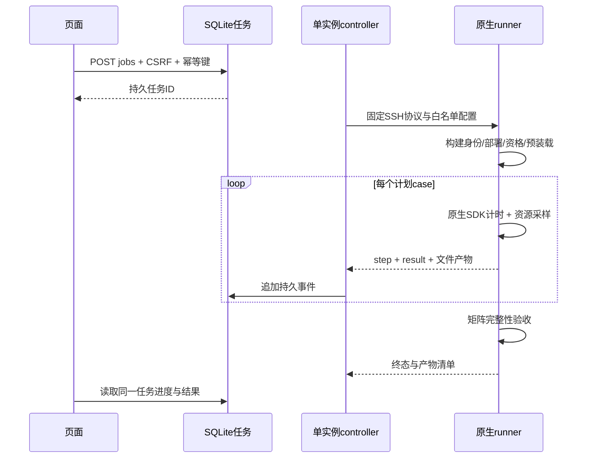

# 2. 脚本、工作流与用例设计

## 2.1 模块与可验收中间结果

| 阶段 | 模块 | 结果与门禁 |
| --- | --- | --- |
| 输入 / 计划 | spec | 显式配置、variants、预期 case 数、预算校验 |
| 任务持久化 | store / controller | SQLite WAL、幂等键、事件、独占 claim |
| 版本核对 | remote_runtime.verify_build | tag、commit、原生构建产物 SHA256 |
| 部署与回收 | remote_runtime / remote_support | fresh cgroup、PID+startticks、实际限额、端点就绪、清理回执 |
| 功能与路径资格 | remote_qualification / onehop | 字节/存在性断言、完整单 key 写 RPC 计数 |
| 工作集 | remote_preload | 两产品同一确定性 key/value 集合、全量回读验收 |
| 运行 | kvc-fair 原生 batch worker | PUT / GET / EXIST 命中与未命中、直方图及 SDK 计时边界 |
| 观测 | remote_observe | 50ms cgroup CPU/内存/IO、dstat/iostat/mpstat/pidstat 原件 |
| 完整性 | acceptance | 对照 variants×products×repeats×size×batch×op；缺失、重复、失败不能当成功 |
| 下载 / 展示 | service / site_api / web | 登录保护的 JSON、命令、资源采样、源码包、复现脚本与 ECharts |

## 2.2 当前正式实验矩阵

1. 基础：1逻辑节点、2 workers、8 clients、server8/client8核、中心2核、16GiB；两产品、1KiB、B=1/16/256/4096、四接口、20秒、3轮，96 cases。
2. Worker：固定总预算，workers=1/2/4/8，clients=8，B1，四接口。用于固定成本扩展，不能解读为每worker固定资源的容量线性增长。
3. Client：固定worker与预算，clients=1/2/4/8/16/32，B1，四接口。排查客户端限流与中心饱和。
4. 中心敏感性：workers×中心1/2/4核，EXIST hit/miss。观察 MC Master 配额、节流与吞吐/尾延迟是否共同变化；瓶颈是待检验假设。
5. 逻辑节点：同一物理机内不同loopback/host ID，比较 nodes=1/2/4 的可部署拓扑；不代表跨物理机网络。

默认5秒单轮仅用于部署/功能闭环。正式读和存在性测量选10或20秒。纯 PUT 是有界 fresh insert 集合，单列实际耗时、short_window、low_sample_p99，不将其称为持续定时写压测。

## 2.3 正确性与统计边界

B 是一次原生批量调用的独立 keys 数；API/s 与 keys/s 分开。读/EXIST 共用预装载集合；EXIST miss 使用未写入 namespace，错误不等于 miss。PUT 使用独立 warm/insert namespace；每批后精确回读。

重复轮次从0开始，逐任务、变体、完整规格与接口独立验收；任何缺轮/重复/失败均阻断该聚合点。P99使用原生直方图桶的 upper_us，原始区间保留供复核，不将桶上界描述为精确分位值。缺数据不补零。

## 2.4 取消、恢复与复现

Stop 请求绕过满队列，先标记取消，等待原进程拥有者完成清理，再回收保留部署。仅信任 PID+startticks+fresh cgroup，禁止 broad pkill。cgroup.events 的 populated 允许有界收敛等待，超时仍失败并启用清理门禁。

控制器异常重启后核对原远端 PID 与终态，按持久 cursor 和前缀 SHA 回补完整 events.jsonl、去重入库；不能仅用尾30条日志恢复，也不能自动重放状态不明的写请求。

下载 reproduce.sh 默认生成新 UUID 后执行新实验；`--original` 仅查询原任务。脚本在已安装站点上使用私有SSH配置。源码包按任务绑定 SHA，后续升级不替换历史任务的源码身份。
