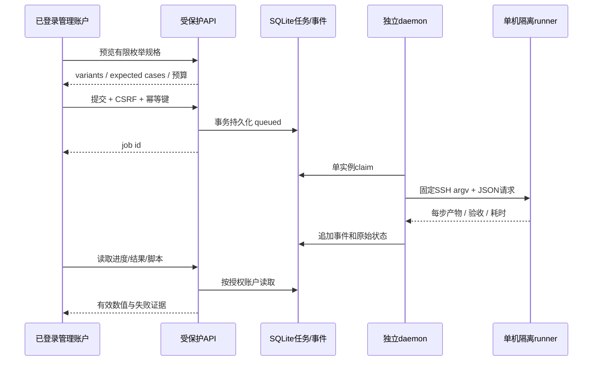

# DataSystem / Mooncake 登录实验控制台

- **Status**: In-Progress
- **范围**：现有 yche.me 管理账户授权的部署、原生用例执行、规格扩展与新运行记录页面。
- **实验边界**：用户确认单物理机；用 cgroup 隔离逻辑节点。不能作为跨物理机网络扩展性结论。
- **源码**：`scripts/experiments/kvc-lab/`；复用 `../kvc-fair/` 已验证的原生批量测量循环、数据校验及SDK接口。

## 1. 目标与成功条件

| 要求 | 验收证据 |
| --- | --- |
| 登录后可见且可操作 | 匿名/失效会话/非授权账户不能访问页面、资产、API、日志、结果或下载；授权用户浏览器实际提交成功 |
| 真实部署/回收 | 目标机实际Coordinator、DS workers、MC master/peers、每个PID启动身份、CPU/memory/cpuset及独立目录；仅回收owned资源 |
| 真实用例执行 | 页面提交→SQLite持久队列→独立daemon→固定SSH RPC→原生SDK测量；提交不在HTTP请求内阻塞 |
| 不同规格 | 逻辑节点、每节点worker数、客户端数量、角色物理核/内存，部署回执与实际生效值一致 |
| 基础性能 | 同总预算、TCP、DS PREFERRED_META_OWNER；PUT/GET/EXIST命中和未命中，原始JSON和数据事后校验 |
| 一跳写资格 | 单独资格窗口的正向运行证据（客户端写RPC、local metadata实际调用、remote metadata计数），不能只凭flag/源码认定 |
| 扩展性与中心假设 | workers/clients扩展曲线、MC master CPU/throttling、中心配额敏感性；失败/null保留，不预设瓶颈出现 |
| 新页面记录 | 控制台及独立指南/运行记录页面；步骤输入、产物、验收、耗时、版本/关键flags和脚本下载 |
| 复现及恢复 | 配置驱动、版本固定、幂等提交、任务/事件落盘；重启后核对原PID/终态，不能重放不明状态的写任务 |

## 2. 模块与信任边界

`web/`只操作受保护同源API；`site_api.py`复用站点JWT并查询有效账户、显式白名单、Origin与会话绑定CSRF；`spec.py`只接受有限枚举配置，不接受命令/路径/目标host；`store.py`使用SQLite事务、幂等键和持久事件；`service.py`提供HTTP facade及白名单下载；`controller.py`单实例消费持久队列；`remote.py`执行固定目标上的隔离部署、资格、测量、观测和回收。

两个Gunicorn worker共享SQLite，不启动进程内实验线程。独立daemon使用本地文件锁；远端独占锁、PID startticks和fresh cgroup再隔离一层。账号、SSH密钥、CSRF secret与具体安装路径只放私有配置，不进入仓库/网页公共文件。现网静态“受限页”仅前端标记，不能复用为控制面保护；新HTML/JS/CSS/指南/下载全部由鉴权Flask路由提供。

## 3. 用例设计

基础组固定workers、clients与总资源；worker扩展固定总服务端/客户端预算，比较1/2/4/8workers；client扩展比较1/2/4/8/16/32并发；中心敏感性在EXIST下联动workers与MC master 1/2/4核预算。服务端总预算始终包含Coordinator或MC master，不能将中心CPU从总成本里漏掉。

默认value=1KiB、B=1、5秒、1轮用于闭环验收；页面可选择B=1/16/256/4096、1/64/1024KiB、5/10/20秒和1/3轮。每次调用payload最多16MiB；大对象和大批量分组，最多384条case/任务。公开报告仅完整有效轮次进入性能聚合；超时/部分成功请求不冒充成功性能。

一跳指单key客户端向元数据owner worker的前台请求路径。多key分布多个owner时可能多RPC，不把整批声明为一次网络RPC。DataSystem使用已构建rc44的PREFERRED_META_OWNER且关闭本地缓存；MC副本1、TCP。持久化、RocksDB写、stream与可选扩展按此前pure-KV原则关闭；生效值写入部署产物。

## 4. 步骤与中间结果

计划验证 → 构建物身份验证 → 独占/容量检查 → fresh隔离与部署 → 功能/一跳资格 → 预装载/热身 → 同步测量及资源采样 → 字节/存在性验收 → 原始与聚合结果归档 → 按需回收。

每步单独记录开始、结束、monotonic耗时、输入身份、文件产物、验收结论与错误。产品失败、控制面失败、取消与中断是不同状态；原attempt保留。正在运行的远端句柄不能因HTTP/SSH观察超时就被当作停止。stop首先写取消请求，再等待同一执行器清理终止，之后完成部署回收。

## 5. 风险与验证

这是新增远程执行控制面，风险高于展示页。重点验证鉴权覆盖、Origin/CSRF、参数注入/路径穿越、相同幂等键并发提交、SQLite恢复、两个daemon互斥、仅owned进程清理、真实配额与源数据正确性。产品仓不修改，不增加SDK热循环日志/HTTP访问；运行观测有单独资源域。推出时仅当前站点管理账户；回滚先通过stop回收，再停独立controller并移除单独blueprint注册，不影响既有其他页面与原始实验归档。

当前已执行与未完成验证将在后续记录中逐项补充，不将单测通过当作目标机实验或真实浏览器登录通过。

## 6. 具体文档

- [构建身份与关键配置](01-build-and-config.md)
- [脚本、工作流与用例设计](02-script-and-case-design.md)
- 实测结果与恢复证据随正式任务完成追加；每个任务网页有独立日志、步骤耗时及源码包身份。
